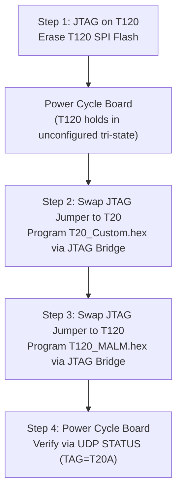

# Efinix Dual-FPGA JTAG & SPI Flash Programming Protocol

## 1. Physical Architecture & The Inter-FPGA Contention Problem

The Inverted MAML carrier board hosts two tightly coupled Efinix Trion FPGAs:
1. **Master SoC:** Trion T120F324 (`192.168.1.50:5000`)
2. **Matrix Controller:** Trion T20F256 (Controls 36 Dual-2T1C analog gate switches, Hadamard modulation, and matrix multiplexing)

They share dedicated inter-chip signaling lines:
- `T20_CLK9` (Continuous clock pumped by T120 PLL/bridge)
- `T20_CRESET_CTRL` (Master reset line driven by T120 pin G13 / LED1)
- `S_TX` / `S_RX` (Inter-FPGA bidirectional S-bus)
- `H_SYNC` / `H_DATA` (Hadamard carrier burst sync lines)

### Root Cause of `CONFIGURATION_FAIL` on T20
When programming T20's SPI flash using Efinity Programmer in **"SPI Active using JTAG Bridge"** mode:
1. Efinity Programmer first downloads a temporary helper bitstream (`u00210A79_t20.bit`) into T20's volatile SRAM via JTAG.
2. Efinity monitors T20's `CDONE` pin to confirm that T20 enters user mode to run the SPI programmer bridge.
3. **The Failure Mode:** If T120 is already configured and running its firmware (`maml_platform.c`), T120 executes an autonomous 100 Hz refresh loop (`maml_platform_tick()`). Every 10 ms, T120 drives high-speed transitions on `CLK9`, pumps S-bus frames, and manipulates `T20_CRESET_CTRL`.
4. This external clock and pin contention causes T20 to glitch during SRAM bitstream initialization, triggering the error:
   ```text
   Mon Nov 02 16:00:24 - FtdiProgram error: Device is in CONFIGURATION_FAIL state instead of user mode after programming JTAG Bridge Image!
   ```

---

## 2. Mandatory Programming Rule & Interlock

> [!CAUTION]
> **MANDATORY FLASHING INTERLOCK:**
> NEVER attempt to program T20 via JTAG while T120 is running active firmware!
> T120 MUST be placed in an unconfigured (erased flash) state, held in hard reset, or silenced before programming T20.

---

## 3. Standard Dual-FPGA Flashing Sequence (Hardware Runbook)

Follow this exact 4-step sequence whenever T20 or both FPGAs need to be updated:



### Detailed Steps:

### Step 1: Silence T120
1. Move the JTAG header jumper to **T120**.
2. In Efinity Programmer, select **SPI Active using JTAG Bridge**.
3. Perform an **Erase** on T120's SPI flash.
4. Power cycle the board.
   - *Result:* T120 has no bitstream to boot. All its I/O lines (`CLK9`, `CRESET_N`, `S_TX`, `H_SYNC`) remain in high-impedance tri-state with weak pull-ups. The inter-FPGA bus is completely silent.

### Step 2: Program T20 Controller
1. Move the JTAG header jumper to **T20**.
2. In Efinity Programmer:
   - Target: `Dual RS232-HS` (Port 2, T20)
   - Device: `T20F256` (Device ID `0x00210A79`)
   - Mode: **SPI Active using JTAG Bridge**
   - Bitstream: `FPGA_code/T20_Custom/outflow/T20F256.hex` (or `FPGA_code/releases/T20_Custom_Verified/T20F256.hex`)
   - Start Address: `0x00000000`
   - Check `Auto configure JTAG Bridge Image`
   - Check `Erase Before Programming`
3. Click **Start Program**. The JTAG bridge will now load cleanly without contention, erase the SPI flash, and program the 678,650 bytes.

### Step 3: Program T120 Master SoC
1. Move the JTAG header jumper back to **T120**.
2. In Efinity Programmer:
   - Target: `Dual RS232-HS` (Port 2, T120)
   - Device: `T120F324`
   - Mode: **SPI Active using JTAG Bridge**
   - Bitstream: `FPGA_code/T120F324/outflow/T120_MALM.hex`
   - Start Address: `0x00000000`
   - Check `Auto configure JTAG Bridge Image`
   - Check `Erase Before Programming`
3. Click **Start Program**.

### Step 4: Verification
1. Power cycle the entire board.
2. Verify hardware status via UDP query:
   ```bash
   python3 -c "
   import socket
   s = socket.socket(socket.AF_INET, socket.SOCK_DGRAM)
   s.settimeout(2.0)
   s.sendto(b'STATUS', ('192.168.1.50', 5000))
   print(s.recvfrom(1024)[0].decode())
   "
   ```
3. Confirm that the response shows:
   ```text
   Status: T20 ONLINE [TAG=T20A, S-bus ACK 0x06]
   ```
   - `TAG=T20A` confirms that the full 89-pin custom image (with all 36 2T1C analog gate controls) is booted.
   - `S-bus ACK 0x06` confirms inter-FPGA communication is 100% operational.

---

## 4. T20 Directory & Bitstream Mapping

| Directory / File | Description | Status |
| :--- | :--- | :--- |
| `FPGA_code/T20_Custom/` | Source project for the primary application bitstream (89 pins, 36 gate controls, `TAG=T20A`, LED8 heartbeat). | **ACTIVE & PRODUCTION** |
| `FPGA_code/releases/T20_Custom_Verified/` | Permanent archive of verified working `T20F256.hex` and `T20F256.bin`. | **COMMITTED IN GIT** |
| `FPGA_code/T20_Golden/` | Fallback recovery image (`IS_GOLDEN=1`, `TAG=T20G`, LED1/2 heartbeat) for multi-image booting. | **MAINTENANCE / FALLBACK** |
| `FPGA_code/T20F256/` | Obsolete 10-Oct prototype with only 47 pins (missing gate controls & tristate OE). | **DEPRECATED / REMOVED** |

