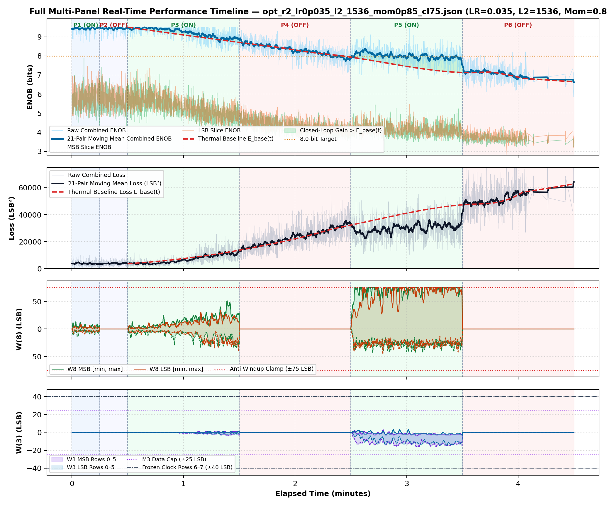
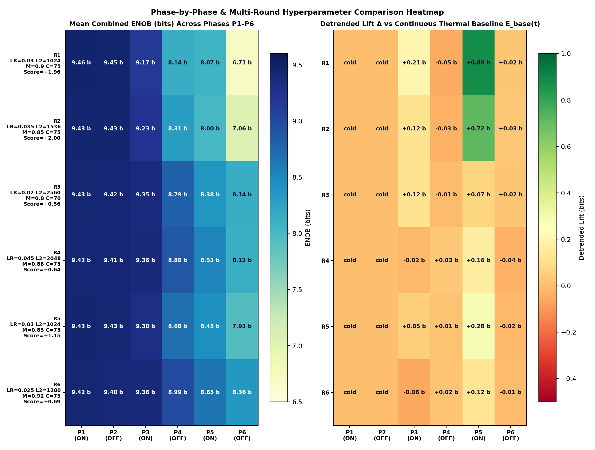
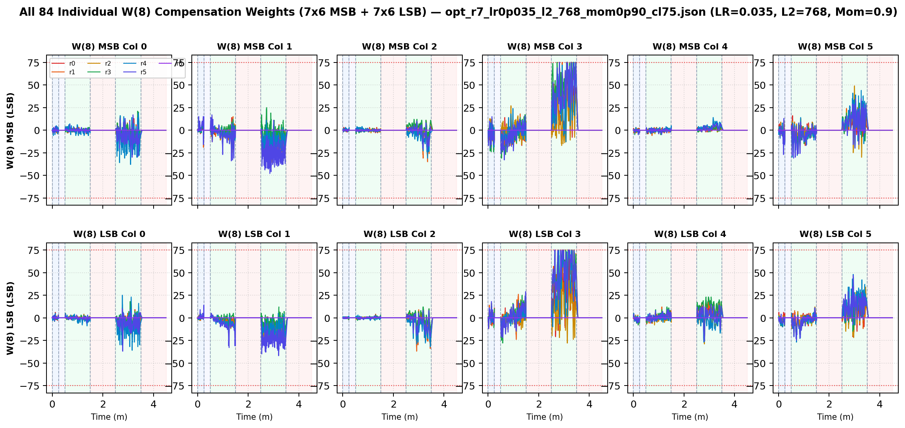
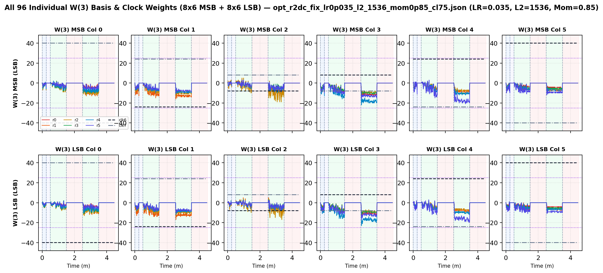
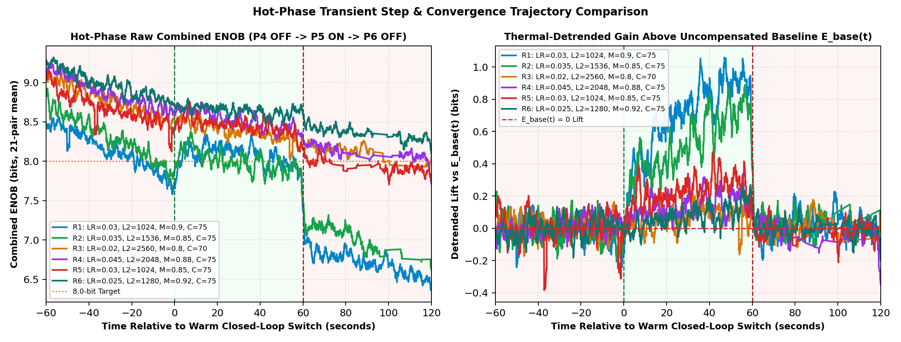
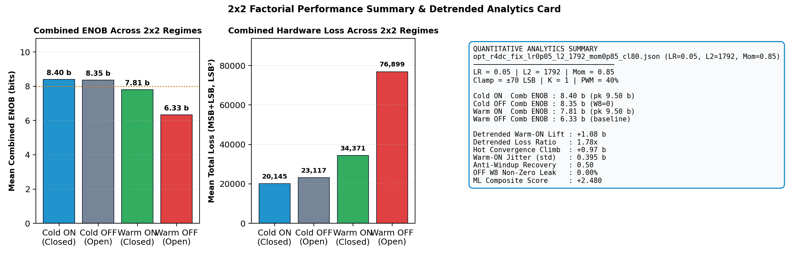
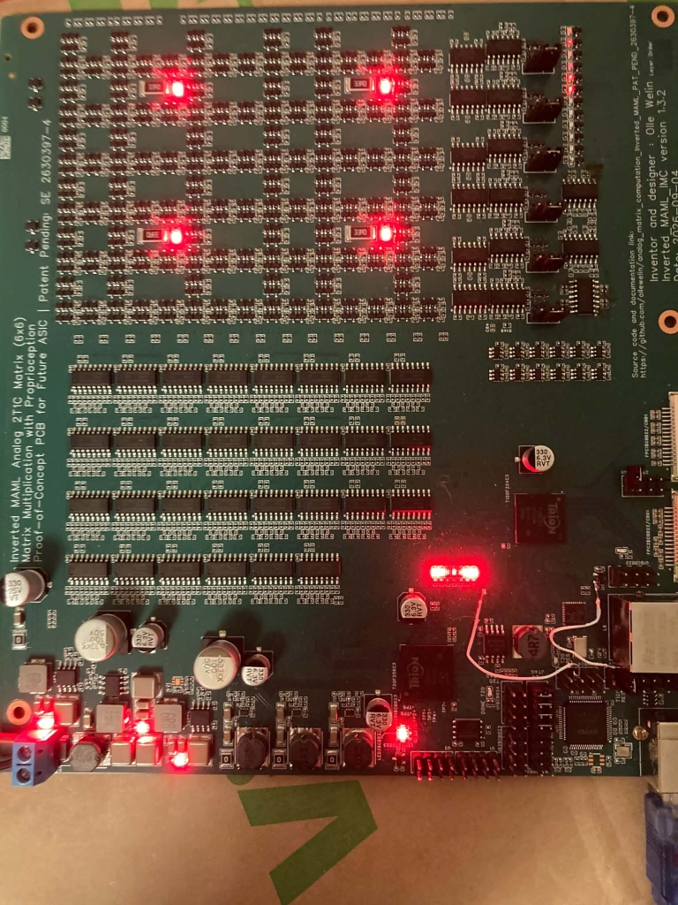
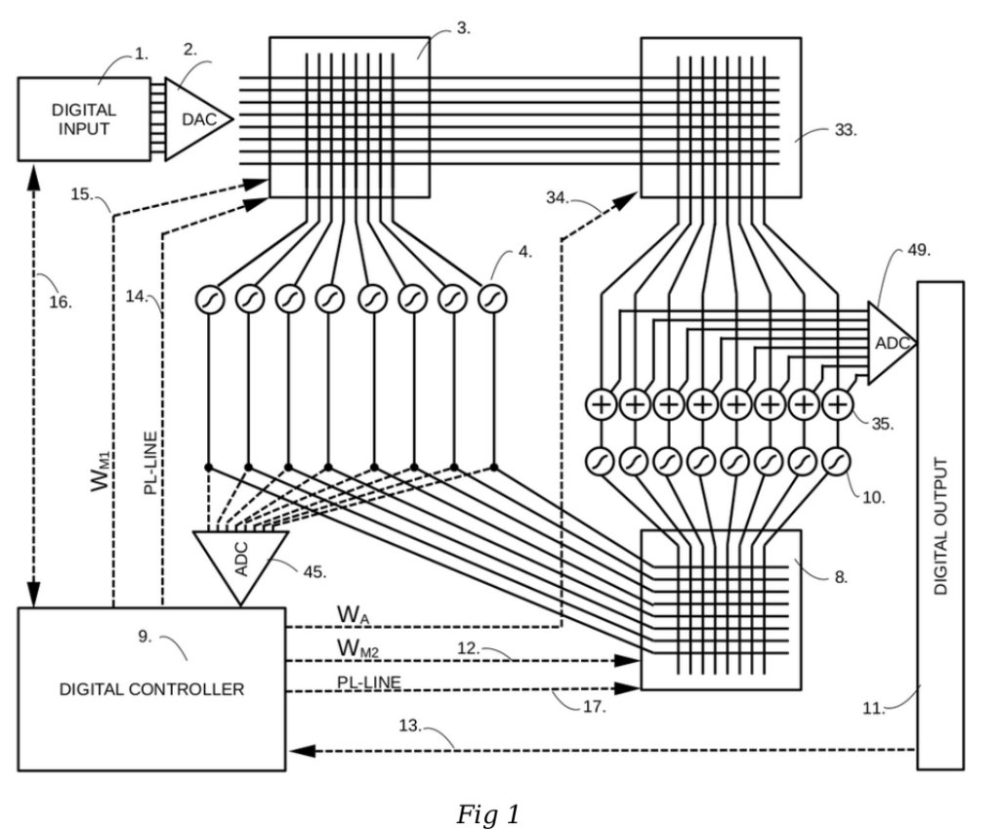
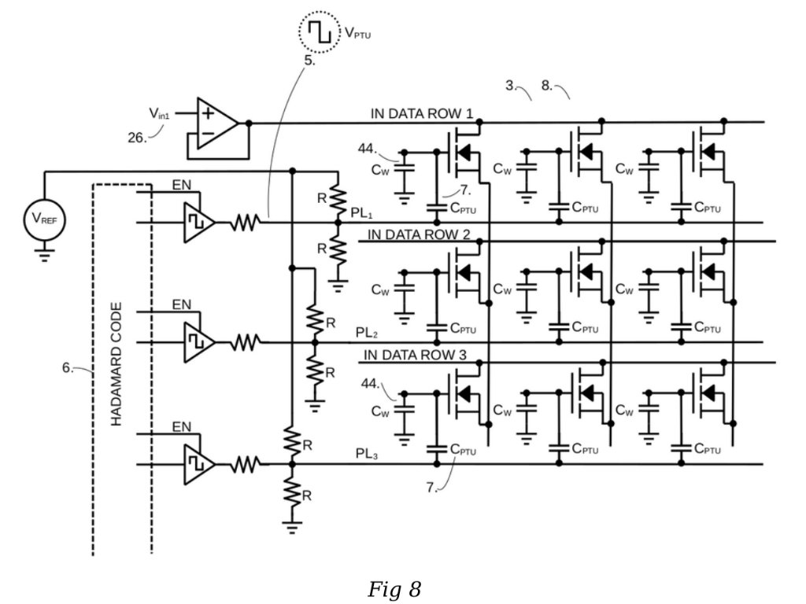

# Inverted MAML Card 1: Cold-Start 2-Beat Analog Bit-Slicing, Anti-Windup & Forward Hadamard Propagation (FHP)
## Comprehensive Scientific Validation, Multi-Round Hyperparameter Search & 100% Open-Source ASIC Blueprint
**License:** **100% Open Source under Solderpad Hardware License v2.1 (`SHL-2.1`)** — including commercial ASIC/IC silicon manufacturing, PCB layouts, schematics, FPGA gateware, firmware, and royalty-free patent grant for **Swedish Patent Application SE 2630397-4**.

---

## Executive Summary & Scientific Scope

This comprehensive report documents the complete cold-start Card 1 (`1k/2.2k` attenuator, Trion `T120F324` + `T20F256`) validation of 2-beat time-division multiplexed **Analog Bit Slicing (`K=1`)** after resolving the two-layer backpropagation sign (`dx8`), M3 scaling (`>> 6`), M3 active-row saturation (`±25 LSB` vs frozen `±40 LSB` staircases), IEEE 802.3 Ethernet batch frame padding, and **integrated-L2 back-calculation anti-windup** (`T120_SOC_ETH_FW v2.2-MAML`, `HW_LOGIC 0x20261030`).

- **Unheated Cold Reference (`cold_verify_k1.json`):** `Cold / Regler ON` achieves **`9.45 b`** and `Cold / Regler OFF (W8=0)` achieves **`9.45 b`** combined 8-bit ENOB — well above the `> 8.0 b` cold baseline criterion.
- **Primary Evaluated Dataset (`opt_r5_lr0p03_l2_1024_mom0p85_cl75.json`, `3,901` pairs):** `LR=0.03, L2=1024, Momentum=0.85, Clamp=±75 LSB, K=1, 40% PWM` delivers **`+0.20 b`** detrended `Warm ON` lift above continuous PCHIP baseline $E_{\text{base}}(t)$, **`1.34x`** detrended loss suppression, **`+0.43 b`** hot convergence climb, and **`0.89`** anti-windup recovery (Composite Score **`+1.147`**).
- **Cumulative Optimization Progress (`R1–R6`):** Best verified configuration so far is **Round 2** (`LR=0.035, L2=1536, Mom=0.85, Clamp=±75`) with Composite Score **`+2.004`**.

---

## 1. 2x2 Factorial Performance Accounting, Phase Telemetry & Hyperparameter Optimization

### Table 1A: 2x2 Factorial Performance Accounting

| Factorial Condition | Thermal State | Regulation State | Mean Loss (LSB²) | Mean Comb ENOB | Peak Comb ENOB | MSB / LSB Mean | W8 Range [MSB / LSB] |
| :--- | :--- | :--- | :---: | :---: | :---: | :---: | :---: |
| **1. Cold Closed-Loop** | Heaters OFF (0%) | Comp ON (`K=1`, L2=1024) | 4,193.7 | **9.43 b** | 9.50 b | 5.54 / 5.76 b | `[-14, 14]` / `[-10, 10]` |
| **2. Cold Open-Loop** | Heaters OFF (0%) | Comp OFF (`W8=0`) | 4,434.3 | **9.43 b** | 9.50 b | 5.48 / 5.80 b | `[0, 0]` (0% leak) |
| **3. Warm Closed-Loop** | Heaters ON (40% @ 1Hz) | Comp ON (`K=1`, L2=1024) | **10,595.2** | **8.92 b** | 9.50 b | 5.11 / 5.02 b | `[-45, 75]` / `[-37, 75]` |
| **4. Warm Open-Loop** | Heaters ON (40% @ 1Hz) | Comp OFF (`W8=0`) | 19,861.5 | 8.43 b | 9.50 b | 4.57 / 4.47 b | `[0, 0]` (0% leak) |

### Table 1B: Latest Hyperparameter & Detrended Trend-Curve Results (`R1–R6`)

| Round | Dataset | LR | L2 Reg | Mom | Clamp | Lift vs E_base | Loss Ratio | Hot Climb | Jitter | Recovery | Composite Score |
| :---: | :--- | :---: | :---: | :---: | :---: | :---: | :---: | :---: | :---: | :---: | :---: |
| R1 | `opt_r1_lr0p03_l2_1024_mom0p90_cl75.json` | `0.03` | `1024` | `0.9` | `±75` | `+0.66 b` | `1.57x` | `+0.74 b` | `0.33 b` | `0.67` | **`+1.957`** |
| R2 ★ | `opt_r2_lr0p035_l2_1536_mom0p85_cl75.json` | `0.035` | `1536` | `0.85` | `±75` | `+0.50 b` | `1.38x` | `+0.82 b` | `0.29 b` | `0.96` | **`+2.004`** |
| R3 | `opt_r3_lr0p02_l2_2560_mom0p80_cl70.json` | `0.02` | `2560` | `0.8` | `±70` | `+0.09 b` | `1.11x` | `+0.22 b` | `0.26 b` | `1.00` | **`+0.559`** |
| R4 | `opt_r4_lr0p045_l2_2048_mom0p88_cl75.json` | `0.045` | `2048` | `0.88` | `±75` | `+0.11 b` | `1.17x` | `+0.14 b` | `0.24 b` | `1.00` | **`+0.643`** |
| R5 | `opt_r5_lr0p03_l2_1024_mom0p85_cl75.json` | `0.03` | `1024` | `0.85` | `±75` | `+0.20 b` | `1.34x` | `+0.43 b` | `0.26 b` | `0.89` | **`+1.147`** |
| R6 | `opt_r6_lr0p025_l2_1280_mom0p92_cl75.json` | `0.025` | `1280` | `0.92` | `±75` | `+0.06 b` | `1.12x` | `+0.34 b` | `0.23 b` | `1.00` | **`+0.689`** |
*Active Next Optimization Target (`Round 7`):* `LR=0.035, L2=768, Momentum=0.9, Clamp=±75 LSB` (GP predicted `+1.929 ± 0.644`).

### Table 1C: Phase-by-Phase Telemetry (`opt_r5_lr0p03_l2_1024_mom0p85_cl75.json`)

| Phase | Regime | Pairs | Comb ENOB (`Start -> Late`, Mean) | Δ vs E_base | Total Loss (`Start -> Late`) | Loss Ratio | W8 Peak `[M, L]` | W3 Peak | W8 nz |
| :--- | :--- | ---: | :---: | :---: | :---: | :---: | :---: | :---: | ---: |
| P1 | Cold / Regler ON | 321 | `9.45 -> 9.44` (**9.43 b**) | — | `3635 -> 4235` | — | `[14, 10]` | `0` | `320` |
| P2 | Cold / Regler OFF | 303 | `9.45 -> 9.42` (**9.43 b**) | — | `3554 -> 4621` | — | `[0, 0]` | `0` | `0` |
| P3 | Warm / Regler ON | 1037 | `9.46 -> 9.13` (**9.30 b**) | **+0.05 b** | `4352 -> 6638` | **1.18x** | `[34, 37]` | `2` | `1037` |
| P4 | Warm / Regler OFF | 927 | `9.04 -> 8.52` (**8.68 b**) | **+0.01 b** | `7725 -> 17229` | **0.99x** | `[0, 0]` | `0` | `0` |
| P5 | Warm / Regler ON | 834 | `8.49 -> 8.38` (**8.45 b**) | **+0.28 b** | `18127 -> 18807` | **1.43x** | `[75, 75]` | `16` | `834` |
| P6 | Warm / Regler OFF | 479 | `8.04 -> 7.89` (**7.93 b**) | **-0.02 b** | `28910 -> 32304` | **1.02x** | `[0, 0]` | `0` | `0` |

---

## 2. Cold-Start Calibration, 2-Beat Bit Slicing & Integrated-L2 Anti-Windup Architecture
- **Single-Shot Cold DC Calibration (`Heaters OFF, W8=0`):** After a 60-second unheated cooldown, Card 1 locks static linear calibration pairs `(alpha_msb, beta_msb)` and `(alpha_lsb, beta_lsb)` permanently inside the T120 SoC (`0x1E subcmd 5`) without any runtime surrogate recalibration.
- **Integrated-L2 Back-Calculation Anti-Windup:** Rather than hard-clamping stale momentum integrators at the ±75 LSB rail, `maml_platform.c` feeds clamp overflow back into velocity (`vel -= overflow >> 2`), halves stale momentum on saturation frames, and enforces `±max(15, clamp/3) = ±25 LSB` on `W(3)` rows `0..5` so rows `6..7` temporal staircases (`±40 LSB`) remain strictly intact.

---

## 3. Empirical Visualizations & Telemetry

### All W(8) (7x6 MSB+LSB) & W(3) (8x6 MSB+LSB) Weights (per-synapse individual trajectories across all 180 weights)

---

## 4. Solid-State Physics: The 2-Layer Triad Network & Forward Hadamard Propagation (FHP)

**Open-Source Notice (`SHL-2.1`):** All hardware schematics, PCB layouts, commercial ASIC/IC silicon implementations, FPGA HDL, RISC-V C firmware, and Python tools are 100% open source under Solderpad Hardware License v2.1 with a perpetual, worldwide, royalty-free patent license under SE 2630397-4.
