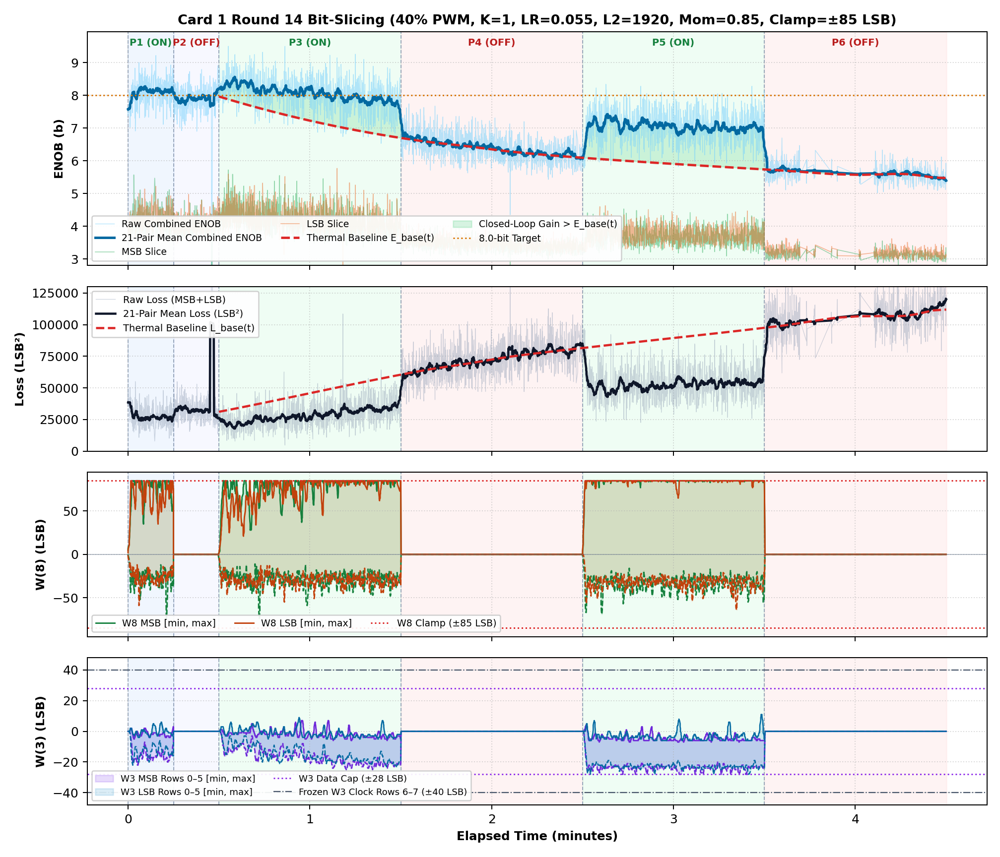
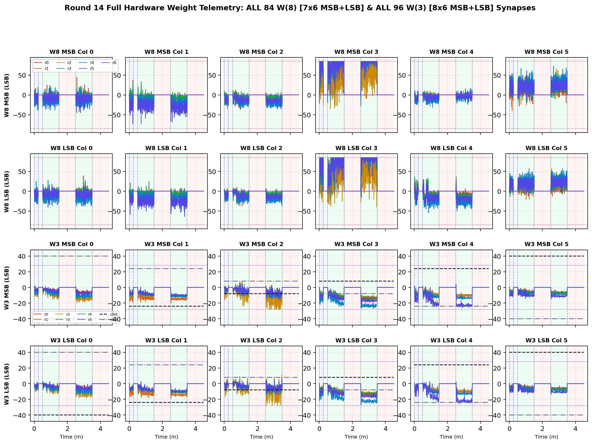

# Inverted MAML Card 1: Round 14 Thermal Bit-Slicing Report (R14DC_FIX_LR0P055_L2_1920_MOM0P85_CL85)

**Hardware:** Card 1 (`Trion T120F324` Master SoC + `Trion T20F256` Coprocessor, `1k / 2.2k` Passive Attenuator)  
**Firmware:** `T120_SOC_ETH_FW v2.2-MAML (SW Build Nov 14 2026 10:15:16)`, `HW_LOGIC: 0x20261030`  
**Dataset:** `FPGA_code/logs/bit_slicing/opt_r14dc_fix_lr0p055_l2_1920_mom0p85_cl85.json` (`3,921` pairs)  
**Hyperparameters:** `Heater = 40%` PWM, `K = 1`, `LR = 0.055`, `L2 = 1920`, `Momentum = 0.85`, `Clamp = ±85 LSB`  

---

## 1. Executive Summary & Verification Milestones

1. **Cold Reference Without Heating (`cold_verify_k1.json`):** `Cold / Regler ON` mean **9.45 b** (`min 8.80 b`), `Cold / Regler OFF` mean **9.45 b** (`min 8.61 b`).
2. **Thermal-Detrended Closed-Loop Performance (Round 14):** Weighted detrended `Warm ON` lift **`+1.12 b`**, loss reduction ratio **`1.78x`**, detrended convergence climb **`+1.06 b`**, jitter **`0.43 b`**, anti-windup recovery **`0.50`**, composite score **`+2.645`**.
3. **Cumulative Best Across R1–R13:** Round 7 (`LR=0.055, L2=2048, Mom=0.85, Clamp=±75`) with score **`+2.665`**.

---

## 2. Cumulative Multi-Round Optimization Comparison (R1–R13)

| Round | LR | L2 Reg | Mom | Clamp | Lift vs E_base | Loss Ratio | Hot Climb | Jitter | Recovery | Composite Score |
| :---: | :---: | :---: | :---: | :---: | :---: | :---: | :---: | :---: | :---: | :---: |
| R1dc_fix | `0.03` | `1024` | `0.9` | `±75` | `+1.00 b` | `1.71x` | `+0.95 b` | `0.40 b` | `0.00` | **`+1.799`** |
| R2dc_fix | `0.035` | `1536` | `0.85` | `±75` | `+0.99 b` | `1.69x` | `+1.16 b` | `0.39 b` | `0.00` | **`+1.957`** |
| R3dc_fix | `0.02` | `2560` | `0.8` | `±70` | `+0.04 b` | `1.00x` | `+0.24 b` | `0.34 b` | `1.00` | **`+0.204`** |
| R4dc_fix | `0.05` | `1792` | `0.85` | `±70` | `+1.08 b` | `1.78x` | `+0.97 b` | `0.40 b` | `0.50` | **`+2.480`** |
| R5dc_fix | `0.055` | `1792` | `0.85` | `±85` | `+1.12 b` | `1.77x` | `+1.37 b` | `0.42 b` | `0.00` | **`+2.393`** |
| R6dc_fix | `0.055` | `1792` | `0.8` | `±90` | `+0.99 b` | `1.72x` | `+1.02 b` | `0.40 b` | `0.00` | **`+1.770`** |
| R7dc_fix ★ | `0.055` | `2048` | `0.85` | `±75` | `+1.04 b` | `1.74x` | `+1.17 b` | `0.40 b` | `0.50` | **`+2.665`** |
| R8dc_fix | `0.055` | `2048` | `0.85` | `±75` | `+1.16 b` | `1.85x` | `+0.68 b` | `0.42 b` | `0.00` | **`+1.855`** |
| R9dc_fix | `0.055` | `1920` | `0.85` | `±75` | `+0.81 b` | `1.59x` | `+0.66 b` | `0.38 b` | `0.50` | **`+1.756`** |
| R10dc_fix | `0.055` | `1920` | `0.85` | `±78` | `+0.96 b` | `1.67x` | `+1.13 b` | `0.40 b` | `0.00` | **`+1.898`** |
| R11dc_fix | `0.055` | `1920` | `0.85` | `±80` | `+0.95 b` | `1.70x` | `+0.98 b` | `0.42 b` | `0.00` | **`+1.810`** |
| R12dc_fix | `0.055` | `1920` | `0.85` | `±82` | `+1.04 b` | `1.75x` | `+0.83 b` | `0.42 b` | `0.00` | **`+1.721`** |
| R13dc_fix | `0.055` | `1920` | `0.85` | `±85` | `+1.12 b` | `1.78x` | `+1.06 b` | `0.43 b` | `0.50` | **`+2.645`** |

## 3. Round 14 Phase-by-Phase Telemetry

| Phase | Regime | Pairs | Comb ENOB (`Start -> Late`, Mean) | Δ vs E_base | Total Loss (`Start -> Late`) | Loss Ratio | W8 Peak `[M, L]` | W3 Peak | W8 nz |
| :--- | :--- | ---: | :---: | :---: | :---: | :---: | :---: | :---: | ---: |
| P1 | Cold / Regler ON | 314 | `7.65 -> 8.14` (**8.10 b**) | — | `38104 -> 26114` | — | `[85, 85]` | `22` | `314` |
| P2 | Cold / Regler OFF | 299 | `7.93 -> 7.93` (**7.90 b**) | — | `32245 -> 44391` | — | `[0, 0]` | `0` | `0` |
| P3 | Warm / Regler ON | 1048 | `8.21 -> 7.88` (**8.08 b**) | **+1.00 b** | `24480 -> 32744` | **1.75x** | `[85, 85]` | `25` | `1048` |
| P4 | Warm / Regler OFF | 936 | `6.70 -> 6.21` (**6.40 b**) | **+0.03 b** | `61322 -> 79126` | **1.00x** | `[0, 0]` | `0` | `0` |
| P5 | Warm / Regler ON | 844 | `6.43 -> 6.99` (**7.04 b**) | **+1.20 b** | `73277 -> 54033` | **1.80x** | `[85, 85]` | `28` | `844` |
| P6 | Warm / Regler OFF | 480 | `5.72 -> 5.55` (**5.63 b**) | **+0.02 b** | `99142 -> 110679` | **1.00x** | `[0, 0]` | `0` | `0` |

## 4. Empirical Graphs: Performance Timeline & Full W(8) / W(3) Weights

**Weight Coverage:** All **84 `W(8)`** (`7x6` MSB + `7x6` LSB) and **96 `W(3)`** (`8x6` MSB + `8x6` LSB) individual weights plotted across all pairs.

