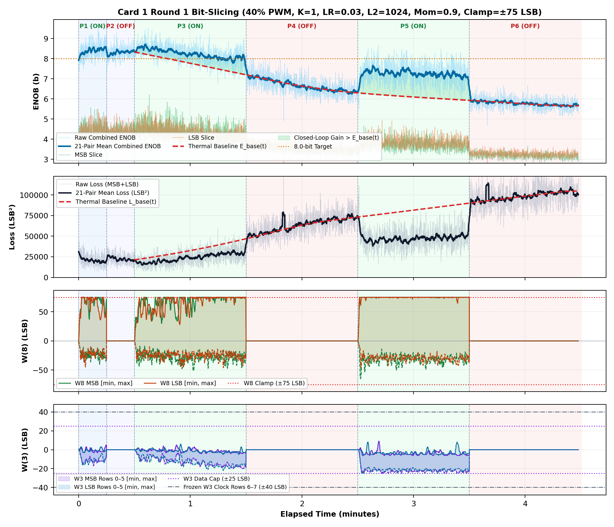
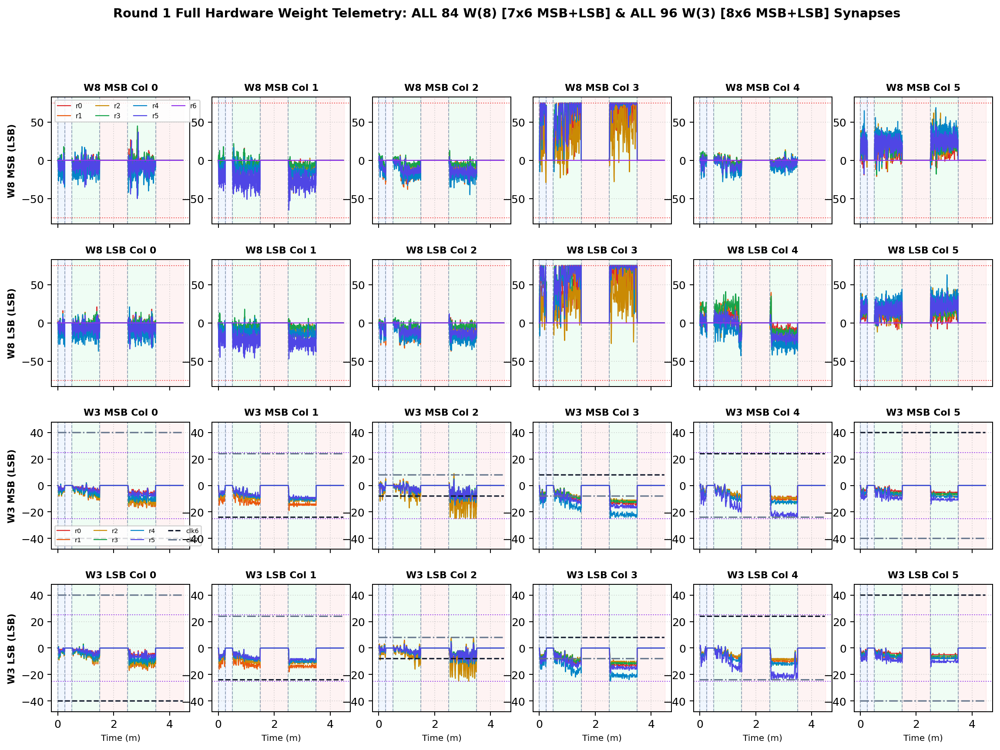

# Inverted MAML Card 1: Round 1 Thermal Bit-Slicing Report (R1DC_FIX_LR0P03_L2_1024_MOM0P90_CL75)

**Hardware:** Card 1 (`Trion T120F324` Master SoC + `Trion T20F256` Coprocessor, `1k / 2.2k` Passive Attenuator)  
**Firmware:** `T120_SOC_ETH_FW v2.2-MAML (SW Build Nov 14 2026 10:15:16)`, `HW_LOGIC: 0x20261030`  
**Dataset:** `FPGA_code/logs/bit_slicing/opt_r1dc_fix_lr0p03_l2_1024_mom0p90_cl75.json` (`4,216` pairs)  
**Hyperparameters:** `Heater = 40%` PWM, `K = 1`, `LR = 0.03`, `L2 = 1024`, `Momentum = 0.9`, `Clamp = ±75 LSB`  

---

## 1. Executive Summary & Verification Milestones

1. **Cold Reference Without Heating (`cold_verify_k1.json`):** `Cold / Regler ON` mean **9.45 b** (`min 8.80 b`), `Cold / Regler OFF` mean **9.45 b** (`min 8.61 b`).
2. **Thermal-Detrended Closed-Loop Performance (Round 1):** Weighted detrended `Warm ON` lift **`+1.00 b`**, loss reduction ratio **`1.71x`**, detrended convergence climb **`+0.95 b`**, jitter **`0.40 b`**, anti-windup recovery **`0.00`**, composite score **`+1.799`**.
3. **Cumulative Best Across R1–R1:** Round 1 (`LR=0.03, L2=1024, Mom=0.9, Clamp=±75`) with score **`+1.799`**.

---

## 2. Cumulative Multi-Round Optimization Comparison (R1–R1)

| Round | LR | L2 Reg | Mom | Clamp | Lift vs E_base | Loss Ratio | Hot Climb | Jitter | Recovery | Composite Score |
| :---: | :---: | :---: | :---: | :---: | :---: | :---: | :---: | :---: | :---: | :---: |
| R1dc_fix ★ | `0.03` | `1024` | `0.9` | `±75` | `+1.00 b` | `1.71x` | `+0.95 b` | `0.40 b` | `0.00` | **`+1.799`** |

## 3. Round 1 Phase-by-Phase Telemetry

| Phase | Regime | Pairs | Comb ENOB (`Start -> Late`, Mean) | Δ vs E_base | Total Loss (`Start -> Late`) | Loss Ratio | W8 Peak `[M, L]` | W3 Peak | W8 nz |
| :--- | :--- | ---: | :---: | :---: | :---: | :---: | :---: | :---: | ---: |
| P1 | Cold / Regler ON | 330 | `8.01 -> 8.48` (**8.38 b**) | — | `29219 -> 18810` | — | `[75, 75]` | `17` | `330` |
| P2 | Cold / Regler OFF | 309 | `8.10 -> 8.35` (**8.30 b**) | — | `27016 -> 21048` | — | `[0, 0]` | `0` | `0` |
| P3 | Warm / Regler ON | 1062 | `8.32 -> 8.02` (**8.25 b**) | **+0.61 b** | `20693 -> 28567` | **1.50x** | `[75, 75]` | `22` | `1062` |
| P4 | Warm / Regler OFF | 920 | `7.23 -> 6.42` (**6.69 b**) | **+0.02 b** | `48251 -> 70589` | **1.00x** | `[0, 0]` | `0` | `0` |
| P5 | Warm / Regler ON | 839 | `6.56 -> 7.18` (**7.25 b**) | **+1.20 b** | `69339 -> 48933` | **1.83x** | `[75, 75]` | `25` | `839` |
| P6 | Warm / Regler OFF | 756 | `5.88 -> 5.68` (**5.77 b**) | **+0.01 b** | `94044 -> 103189` | **1.01x** | `[0, 0]` | `0` | `0` |

## 4. Empirical Graphs: Performance Timeline & Full W(8) / W(3) Weights

**Weight Coverage:** All **84 `W(8)`** (`7x6` MSB + `7x6` LSB) and **96 `W(3)`** (`8x6` MSB + `8x6` LSB) individual weights plotted across all pairs.

