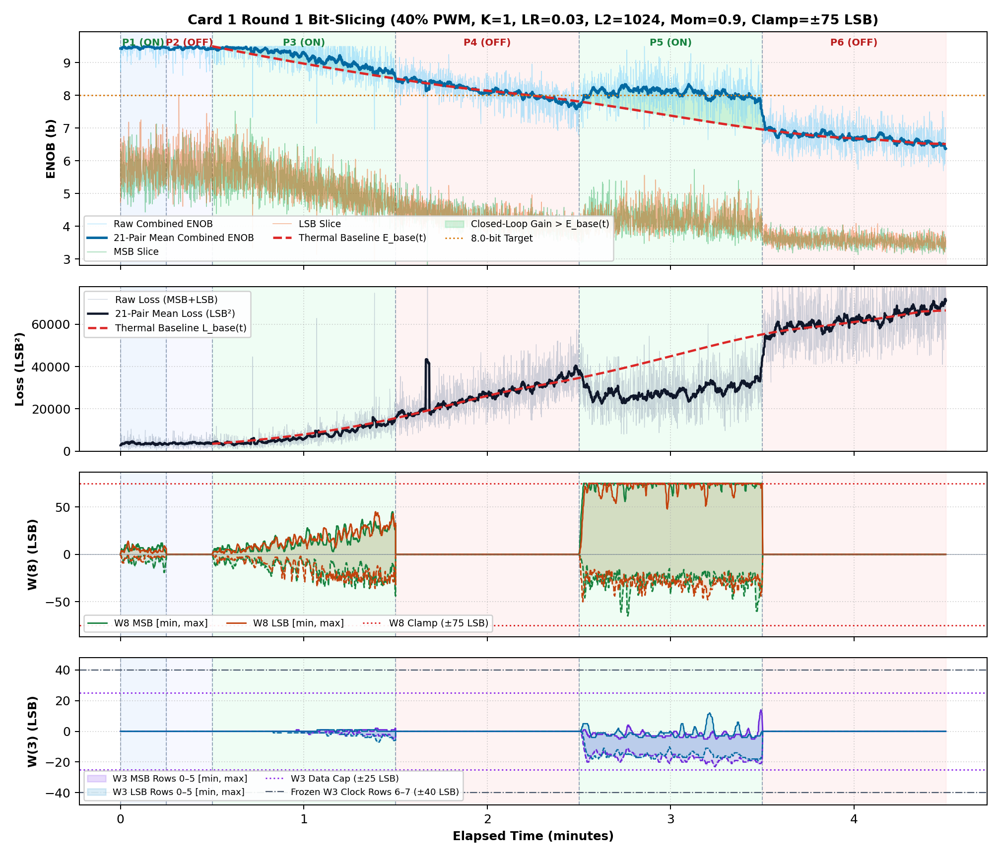
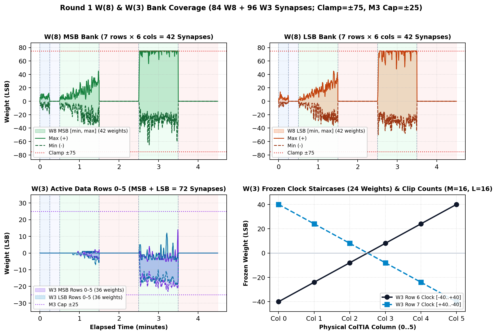

# Inverted MAML Card 1: Round 1 Thermal Bit-Slicing Report (R1_LR0P03_L2_1024_MOM0P90_CL75)

**Hardware:** Card 1 (`Trion T120F324` Master SoC + `Trion T20F256` Coprocessor, `1k / 2.2k` Passive Attenuator)  
**Firmware:** `T120_SOC_ETH_FW v2.2-MAML (SW Build Nov 14 2026 10:15:16)`, `HW_LOGIC: 0x20261030`  
**Dataset:** `FPGA_code/logs/bit_slicing/opt_r1_lr0p03_l2_1024_mom0p90_cl75.json` (`4,289` pairs)  
**Hyperparameters:** `Heater = 40%` PWM, `K = 1`, `LR = 0.03`, `L2 = 1024`, `Momentum = 0.9`, `Clamp = ±75 LSB`  

---

## 1. Executive Summary & Verification Milestones

1. **Cold Reference Without Heating (`cold_verify_k1.json`):** `Cold / Regler ON` mean **9.45 b** (`min 8.80 b`), `Cold / Regler OFF` mean **9.45 b** (`min 8.61 b`).
2. **Thermal-Detrended Closed-Loop Performance (Round 1):** Weighted detrended `Warm ON` lift **`+0.66 b`**, loss reduction ratio **`1.57x`**, detrended convergence climb **`+0.74 b`**, jitter **`0.33 b`**, anti-windup recovery **`0.67`**, composite score **`+1.957`**.
3. **Cumulative Best Across R1–R1:** Round 1 (`LR=0.03, L2=1024, Mom=0.9, Clamp=±75`) with score **`+1.957`**.

---

## 2. Cumulative Multi-Round Optimization Comparison (R1–R1)

| Round | LR | L2 Reg | Mom | Clamp | Lift vs E_base | Loss Ratio | Hot Climb | Jitter | Recovery | Composite Score |
| :---: | :---: | :---: | :---: | :---: | :---: | :---: | :---: | :---: | :---: | :---: |
| R1 ★ | `0.03` | `1024` | `0.9` | `±75` | `+0.66 b` | `1.57x` | `+0.74 b` | `0.33 b` | `0.67` | **`+1.957`** |

## 3. Round 1 Phase-by-Phase Telemetry

| Phase | Regime | Pairs | Comb ENOB (`Start -> Late`, Mean) | Δ vs E_base | Total Loss (`Start -> Late`) | Loss Ratio | W8 Peak `[M, L]` | W3 Peak | W8 nz |
| :--- | :--- | ---: | :---: | :---: | :---: | :---: | :---: | :---: | ---: |
| P1 | Cold / Regler ON | 312 | `9.43 -> 9.46` (**9.46 b**) | — | `3492 -> 3478` | — | `[19, 14]` | `0` | `311` |
| P2 | Cold / Regler OFF | 269 | `9.46 -> 9.44` (**9.45 b**) | — | `3129 -> 3695` | — | `[0, 0]` | `0` | `0` |
| P3 | Warm / Regler ON | 1082 | `9.44 -> 8.88` (**9.17 b**) | **+0.21 b** | `3970 -> 11035` | **1.21x** | `[45, 45]` | `7` | `1081` |
| P4 | Warm / Regler OFF | 973 | `8.43 -> 7.89` (**8.14 b**) | **-0.05 b** | `17507 -> 32520` | **1.00x** | `[0, 0]` | `0` | `0` |
| P5 | Warm / Regler ON | 850 | `7.74 -> 7.99` (**8.07 b**) | **+0.88 b** | `36416 -> 30612` | **1.76x** | `[75, 75]` | `23` | `850` |
| P6 | Warm / Regler OFF | 803 | `6.96 -> 6.59` (**6.71 b**) | **+0.02 b** | `54265 -> 65928` | **1.00x** | `[0, 0]` | `0` | `0` |

## 4. Empirical Graphs: Performance Timeline & Full W(8) / W(3) Weights

**Weight Coverage:** Bank `[min, max]` excursion envelopes across `W(8)` (84 synapses) and `W(3)` (72 active + 24 frozen staircase synapses).

