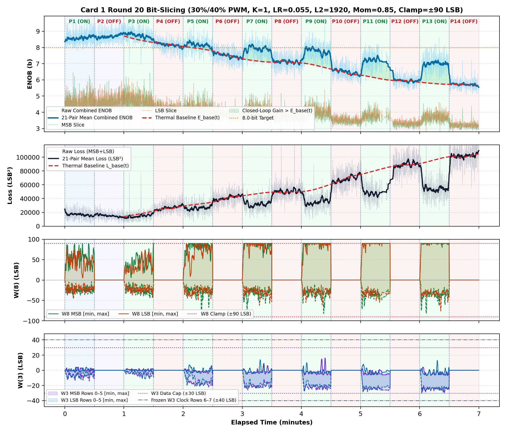
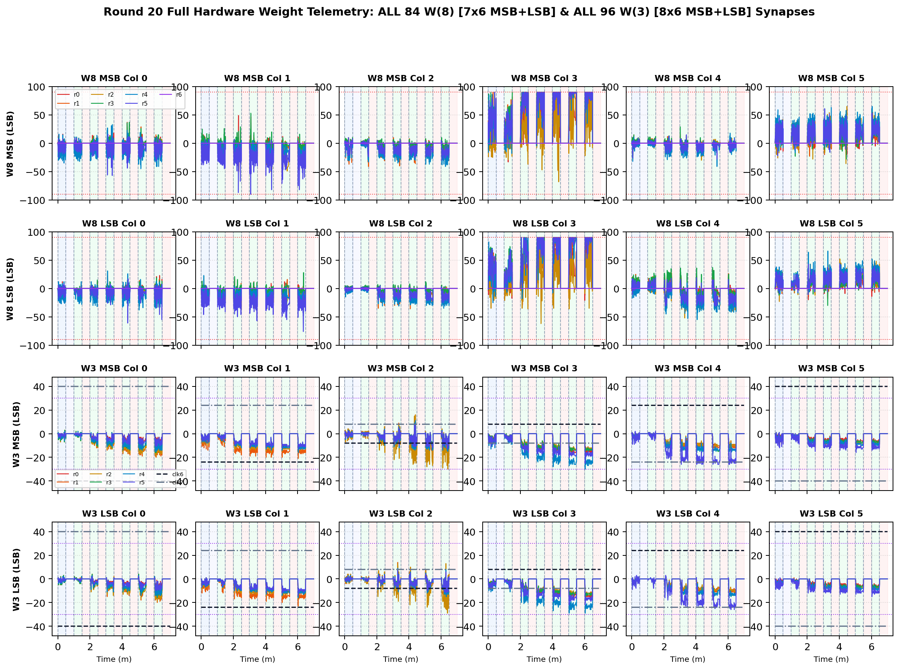

# Inverted MAML Card 1: Round 20 Thermal Bit-Slicing Report (R20_LR0P055_L2_1920_MOM0P85_CL90)

**Hardware:** Card 1 (`Trion T120F324` Master SoC + `Trion T20F256` Coprocessor, `1k / 2.2k` Passive Attenuator)  
**Firmware:** `T120_SOC_ETH_FW v2.2-MAML (SW Build Nov 14 2026 10:15:16)`, `HW_LOGIC: 0x20261030`  
**Dataset:** `FPGA_code/logs/bit_slicing/opt_r20dc_fix_lr0p055_l2_1920_mom0p85_cl90.json` (`4,702` pairs)  
**Hyperparameters:** `Heater = 30%/40% PWM`, `K = 1`, `LR = 0.055`, `L2 = 1920`, `Momentum = 0.85`, `Clamp = ±90 LSB`  

---

## 1. Executive Summary & Verification Milestones

1. **Cold Reference Without Heating (`cold_verify_k1.json`):** `Cold / Regler ON` mean **9.45 b** (`min 8.80 b`), `Cold / Regler OFF` mean **9.45 b** (`min 8.61 b`).
2. **Thermal-Detrended Closed-Loop Performance (Round 20):** Weighted detrended `Warm ON` lift **`+0.82 b`**, loss reduction ratio **`1.58x`**, detrended convergence climb **`+0.80 b`**, jitter **`0.41 b`**, anti-windup recovery **`0.51`**, composite score **`+1.902`**.
3. **Cumulative Best Across R1–R19:** Round 7 (`LR=0.055, L2=2048, Mom=0.85, Clamp=±75`) with score **`+2.665`**.

---

## 2. Cumulative Multi-Round Optimization Comparison (R1–R19)

| Round | LR | L2 Reg | Mom | Clamp | Lift vs E_base | Loss Ratio | Hot Climb | Jitter | Recovery | Composite Score |
| :---: | :---: | :---: | :---: | :---: | :---: | :---: | :---: | :---: | :---: | :---: |
| R1dc_fix | `0.03` | `1024` | `0.9` | `±75` | `+1.00 b` | `1.71x` | `+0.95 b` | `0.40 b` | `0.00` | **`+1.799`** |
| R2dc_fix | `0.035` | `1536` | `0.85` | `±75` | `+0.99 b` | `1.69x` | `+1.16 b` | `0.39 b` | `0.00` | **`+1.957`** |
| R3dc_fix | `0.02` | `2560` | `0.8` | `±70` | `+0.04 b` | `1.00x` | `+0.24 b` | `0.34 b` | `1.00` | **`+0.204`** |
| R4dc_fix | `0.05` | `1792` | `0.85` | `±70` | `+1.08 b` | `1.78x` | `+0.97 b` | `0.40 b` | `0.50` | **`+2.480`** |
| R5dc_fix | `0.055` | `1792` | `0.85` | `±85` | `+1.12 b` | `1.77x` | `+1.37 b` | `0.42 b` | `0.00` | **`+2.393`** |
| R6dc_fix | `0.055` | `1792` | `0.8` | `±90` | `+0.99 b` | `1.72x` | `+1.02 b` | `0.40 b` | `0.00` | **`+1.770`** |
| R7dc_fix ★ | `0.055` | `2048` | `0.85` | `±75` | `+1.04 b` | `1.74x` | `+1.17 b` | `0.40 b` | `0.50` | **`+2.665`** |
| R8dc_fix | `0.055` | `2048` | `0.85` | `±75` | `+1.16 b` | `1.85x` | `+0.68 b` | `0.42 b` | `0.00` | **`+1.855`** |
| R9dc_fix | `0.055` | `1920` | `0.85` | `±75` | `+0.81 b` | `1.59x` | `+0.66 b` | `0.38 b` | `0.50` | **`+1.756`** |
| R10dc_fix | `0.055` | `1920` | `0.85` | `±78` | `+0.96 b` | `1.67x` | `+1.13 b` | `0.40 b` | `0.00` | **`+1.898`** |
| R11dc_fix | `0.055` | `1920` | `0.85` | `±80` | `+0.95 b` | `1.70x` | `+0.98 b` | `0.42 b` | `0.00` | **`+1.810`** |
| R12dc_fix | `0.055` | `1920` | `0.85` | `±82` | `+1.04 b` | `1.75x` | `+0.83 b` | `0.42 b` | `0.00` | **`+1.721`** |
| R13dc_fix | `0.055` | `1920` | `0.85` | `±85` | `+1.12 b` | `1.78x` | `+1.06 b` | `0.43 b` | `0.50` | **`+2.645`** |
| R14dc_fix | `0.055` | `1920` | `0.85` | `±90` | `+0.78 b` | `1.55x` | `+0.97 b` | `0.39 b` | `0.67` | **`+2.117`** |
| R15dc_fix | `0.055` | `1920` | `0.85` | `±100` | `+0.94 b` | `1.67x` | `+0.89 b` | `0.40 b` | `0.75` | **`+2.443`** |
| R16dc_fix | `0.055` | `1920` | `0.85` | `±90` | `+0.70 b` | `1.52x` | `+0.82 b` | `0.34 b` | `0.75` | **`+2.026`** |
| R17dc_fix | `0.055` | `1920` | `0.85` | `±90` | `+0.88 b` | `1.65x` | `+1.25 b` | `0.39 b` | `0.50` | **`+2.385`** |
| R18dc_fix | `0.055` | `1920` | `0.85` | `±90` | `+0.77 b` | `1.52x` | `+0.74 b` | `0.37 b` | `0.67` | **`+1.888`** |
| R19dc_fix | `0.055` | `1920` | `0.85` | `±90` | `+0.82 b` | `1.58x` | `+0.80 b` | `0.41 b` | `0.51` | **`+1.902`** |

## 3. Round 20 Phase-by-Phase Telemetry

| Phase | Regime | Pairs | Comb ENOB (`Start -> Late`, Mean) | Δ vs E_base | Total Loss (`Start -> Late`) | Loss Ratio | W8 Peak `[M, L]` | W3 Peak | W8 nz |
| :--- | :--- | ---: | :---: | :---: | :---: | :---: | :---: | :---: | ---: |
| P1 | Cold / Regler ON | 446 | `8.40 -> 8.67` (**8.58 b**) | — | `20906 -> 15183` | — | `[90, 82]` | `14` | `446` |
| P2 | Cold / Regler OFF | 414 | `8.67 -> 8.78` (**8.69 b**) | — | `17205 -> 13670` | — | `[0, 0]` | `0` | `0` |
| P3 | 30% Heat / Regler ON | 400 | `8.86 -> 8.60` (**8.73 b**) | **+0.24 b** | `11876 -> 16285` | **1.31x** | `[90, 74]` | `12` | `400` |
| P4 | 30% Heat / Regler OFF | 382 | `8.34 -> 8.07` (**8.16 b**) | **-0.05 b** | `22816 -> 28802` | **0.98x** | `[0, 0]` | `0` | `0` |
| P5 | 30% Heat / Regler ON | 353 | `8.12 -> 8.09` (**8.16 b**) | **+0.25 b** | `27529 -> 27481` | **1.29x** | `[90, 90]` | `22` | `353` |
| P6 | 30% Heat / Regler OFF | 350 | `7.52 -> 7.39` (**7.50 b**) | **+0.01 b** | `39951 -> 43715` | **1.01x** | `[0, 0]` | `0` | `0` |
| P7 | 30% Heat / Regler ON | 334 | `7.46 -> 7.89` (**7.90 b**) | **+0.78 b** | `42646 -> 33132` | **1.53x** | `[90, 90]` | `26` | `334` |
| P8 | 30% Heat / Regler OFF | 320 | `7.19 -> 7.08` (**7.11 b**) | **+0.02 b** | `48151 -> 51368` | **0.99x** | `[0, 0]` | `0` | `0` |
| P9 | 40% Heat / Regler ON | 322 | `7.27 -> 7.64` (**7.74 b**) | **+0.89 b** | `47600 -> 37739` | **1.60x** | `[90, 90]` | `28` | `322` |
| P10 | 40% Heat / Regler OFF | 315 | `6.67 -> 6.34` (**6.49 b**) | **+0.02 b** | `63025 -> 73184` | **1.01x** | `[0, 0]` | `0` | `0` |
| P11 | 40% Heat / Regler ON | 207 | `6.63 -> 7.27` (**7.17 b**) | **+1.18 b** | `66378 -> 46507` | **1.81x** | `[90, 90]` | `29` | `207` |
| P12 | 40% Heat / Regler OFF | 284 | `6.03 -> 5.94` (**5.95 b**) | **+0.04 b** | `85506 -> 90078` | **1.00x** | `[0, 0]` | `0` | `0` |
| P13 | 40% Heat / Regler ON | 294 | `6.06 -> 6.98` (**6.93 b**) | **+1.25 b** | `85197 -> 54565` | **1.87x** | `[90, 90]` | `30` | `294` |
| P14 | 40% Heat / Regler OFF | 281 | `5.73 -> 5.69` (**5.72 b**) | **+0.03 b** | `100961 -> 103334` | **1.01x** | `[0, 0]` | `0` | `0` |

## 4. Empirical Graphs: Performance Timeline & Full W(8) / W(3) Weights

**Weight Coverage:** All **84 `W(8)`** (`7x6` MSB + `7x6` LSB) and **96 `W(3)`** (`8x6` MSB + `8x6` LSB) individual weights plotted across all pairs.

