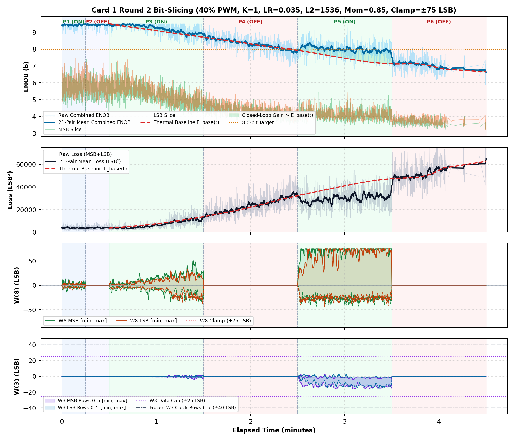
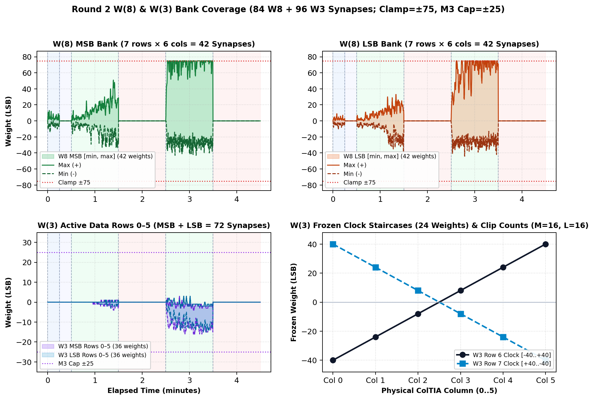

# Inverted MAML Card 1: Round 2 Thermal Bit-Slicing Report (R2_LR0P035_L2_1536_MOM0P85_CL75)

**Hardware:** Card 1 (`Trion T120F324` Master SoC + `Trion T20F256` Coprocessor, `1k / 2.2k` Passive Attenuator)  
**Firmware:** `T120_SOC_ETH_FW v2.2-MAML (SW Build Nov 14 2026 10:15:16)`, `HW_LOGIC: 0x20261030`  
**Dataset:** `FPGA_code/logs/bit_slicing/opt_r2_lr0p035_l2_1536_mom0p85_cl75.json` (`4,013` pairs)  
**Hyperparameters:** `Heater = 40%` PWM, `K = 1`, `LR = 0.035`, `L2 = 1536`, `Momentum = 0.85`, `Clamp = ±75 LSB`  

---

## 1. Executive Summary & Verification Milestones

1. **Cold Reference Without Heating (`cold_verify_k1.json`):** `Cold / Regler ON` mean **9.45 b** (`min 8.80 b`), `Cold / Regler OFF` mean **9.45 b** (`min 8.61 b`).
2. **Thermal-Detrended Closed-Loop Performance (Round 2):** Weighted detrended `Warm ON` lift **`+0.50 b`**, loss reduction ratio **`1.38x`**, detrended convergence climb **`+0.82 b`**, jitter **`0.29 b`**, anti-windup recovery **`0.96`**, composite score **`+2.004`**.
3. **Cumulative Best Across R1–R2:** Round 2 (`LR=0.035, L2=1536, Mom=0.85, Clamp=±75`) with score **`+2.004`**.

---

## 2. Cumulative Multi-Round Optimization Comparison (R1–R2)

| Round | LR | L2 Reg | Mom | Clamp | Lift vs E_base | Loss Ratio | Hot Climb | Jitter | Recovery | Composite Score |
| :---: | :---: | :---: | :---: | :---: | :---: | :---: | :---: | :---: | :---: | :---: |
| R1 | `0.03` | `1024` | `0.9` | `±75` | `+0.66 b` | `1.57x` | `+0.74 b` | `0.33 b` | `0.67` | **`+1.957`** |
| R2 ★ | `0.035` | `1536` | `0.85` | `±75` | `+0.50 b` | `1.38x` | `+0.82 b` | `0.29 b` | `0.96` | **`+2.004`** |

## 3. Round 2 Phase-by-Phase Telemetry

| Phase | Regime | Pairs | Comb ENOB (`Start -> Late`, Mean) | Δ vs E_base | Total Loss (`Start -> Late`) | Loss Ratio | W8 Peak `[M, L]` | W3 Peak | W8 nz |
| :--- | :--- | ---: | :---: | :---: | :---: | :---: | :---: | :---: | ---: |
| P1 | Cold / Regler ON | 331 | `9.41 -> 9.44` (**9.43 b**) | — | `3743 -> 3608` | — | `[14, 10]` | `0` | `330` |
| P2 | Cold / Regler OFF | 309 | `9.45 -> 9.45` (**9.43 b**) | — | `3180 -> 3834` | — | `[0, 0]` | `0` | `0` |
| P3 | Warm / Regler ON | 1084 | `9.45 -> 8.96` (**9.23 b**) | **+0.12 b** | `3702 -> 10297` | **1.16x** | `[51, 39]` | `4` | `1083` |
| P4 | Warm / Regler OFF | 952 | `8.92 -> 8.03` (**8.31 b**) | **-0.03 b** | `12876 -> 29416` | **1.01x** | `[0, 0]` | `0` | `0` |
| P5 | Warm / Regler ON | 850 | `7.93 -> 7.93` (**8.00 b**) | **+0.72 b** | `31966 -> 31202` | **1.52x** | `[75, 75]` | `16` | `850` |
| P6 | Warm / Regler OFF | 487 | `7.11 -> 6.90` (**7.06 b**) | **+0.03 b** | `49599 -> 55672` | **1.01x** | `[0, 0]` | `0` | `0` |

## 4. Empirical Graphs: Performance Timeline & Full W(8) / W(3) Weights

**Weight Coverage:** Bank `[min, max]` excursion envelopes across `W(8)` (84 synapses) and `W(3)` (72 active + 24 frozen staircase synapses).

