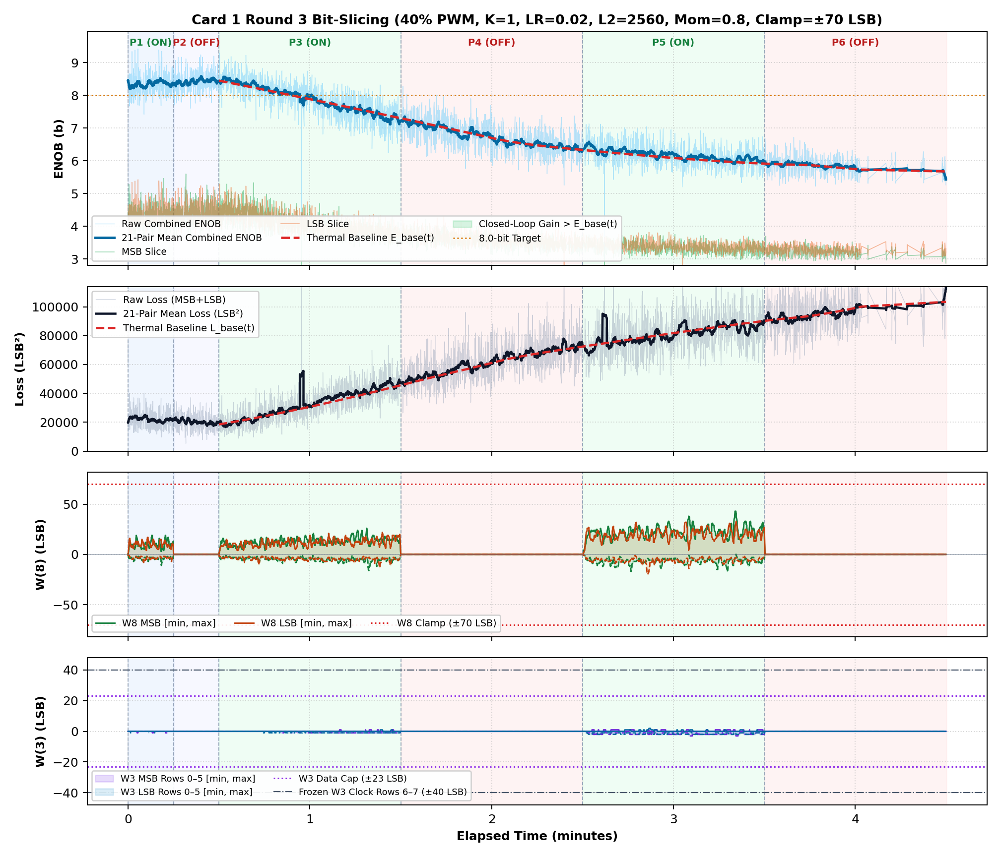
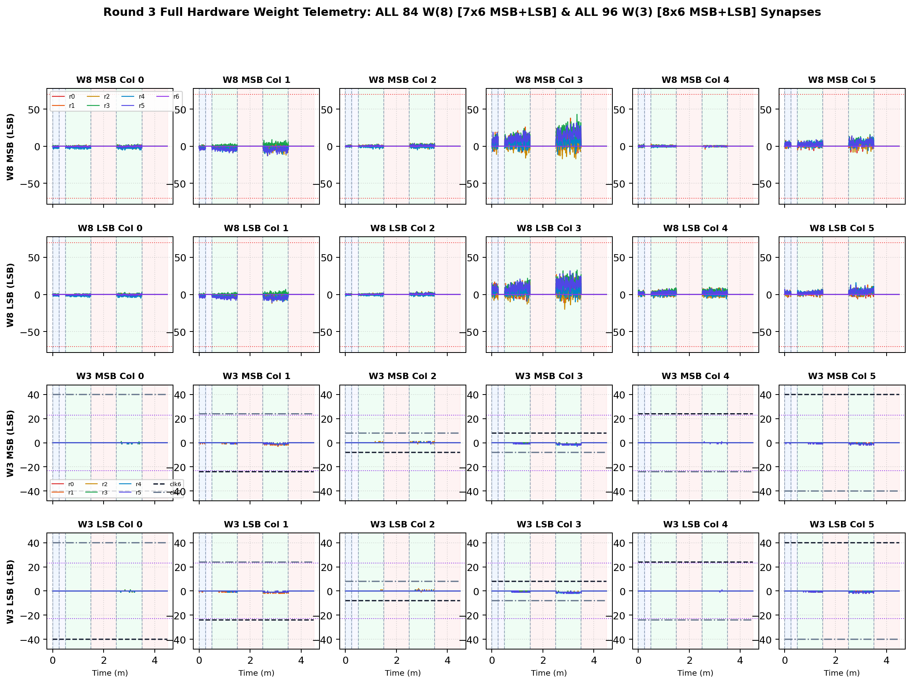

# Inverted MAML Card 1: Round 3 Thermal Bit-Slicing Report (R3DC_FIX_LR0P02_L2_2560_MOM0P80_CL70)

**Hardware:** Card 1 (`Trion T120F324` Master SoC + `Trion T20F256` Coprocessor, `1k / 2.2k` Passive Attenuator)  
**Firmware:** `T120_SOC_ETH_FW v2.2-MAML (SW Build Nov 14 2026 10:15:16)`, `HW_LOGIC: 0x20261030`  
**Dataset:** `FPGA_code/logs/bit_slicing/opt_r3dc_fix_lr0p02_l2_2560_mom0p80_cl70.json` (`3,736` pairs)  
**Hyperparameters:** `Heater = 40%` PWM, `K = 1`, `LR = 0.02`, `L2 = 2560`, `Momentum = 0.8`, `Clamp = ±70 LSB`  

---

## 1. Executive Summary & Verification Milestones

1. **Cold Reference Without Heating (`cold_verify_k1.json`):** `Cold / Regler ON` mean **9.45 b** (`min 8.80 b`), `Cold / Regler OFF` mean **9.45 b** (`min 8.61 b`).
2. **Thermal-Detrended Closed-Loop Performance (Round 3):** Weighted detrended `Warm ON` lift **`+0.04 b`**, loss reduction ratio **`1.00x`**, detrended convergence climb **`+0.24 b`**, jitter **`0.34 b`**, anti-windup recovery **`1.00`**, composite score **`+0.204`**.
3. **Cumulative Best Across R1–R3:** Round 2 (`LR=0.035, L2=1536, Mom=0.85, Clamp=±75`) with score **`+1.957`**.

---

## 2. Cumulative Multi-Round Optimization Comparison (R1–R3)

| Round | LR | L2 Reg | Mom | Clamp | Lift vs E_base | Loss Ratio | Hot Climb | Jitter | Recovery | Composite Score |
| :---: | :---: | :---: | :---: | :---: | :---: | :---: | :---: | :---: | :---: | :---: |
| R1dc_fix | `0.03` | `1024` | `0.9` | `±75` | `+1.00 b` | `1.71x` | `+0.95 b` | `0.40 b` | `0.00` | **`+1.799`** |
| R2dc_fix ★ | `0.035` | `1536` | `0.85` | `±75` | `+0.99 b` | `1.69x` | `+1.16 b` | `0.39 b` | `0.00` | **`+1.957`** |
| R3dc_fix | `0.02` | `2560` | `0.8` | `±70` | `+0.04 b` | `1.00x` | `+0.24 b` | `0.34 b` | `1.00` | **`+0.204`** |

## 3. Round 3 Phase-by-Phase Telemetry

| Phase | Regime | Pairs | Comb ENOB (`Start -> Late`, Mean) | Δ vs E_base | Total Loss (`Start -> Late`) | Loss Ratio | W8 Peak `[M, L]` | W3 Peak | W8 nz |
| :--- | :--- | ---: | :---: | :---: | :---: | :---: | :---: | :---: | ---: |
| P1 | Cold / Regler ON | 321 | `8.25 -> 8.38` (**8.35 b**) | — | `22628 -> 21169` | — | `[19, 17]` | `1` | `320` |
| P2 | Cold / Regler OFF | 292 | `8.39 -> 8.47` (**8.43 b**) | — | `21156 -> 19041` | — | `[0, 0]` | `0` | `0` |
| P3 | Warm / Regler ON | 1031 | `8.35 -> 7.47` (**7.91 b**) | **-0.05 b** | `21006 -> 42181` | **0.96x** | `[26, 22]` | `1` | `1031` |
| P4 | Warm / Regler OFF | 866 | `7.24 -> 6.46` (**6.74 b**) | **+0.02 b** | `47268 -> 69834` | **1.00x** | `[0, 0]` | `0` | `0` |
| P5 | Warm / Regler ON | 781 | `6.50 -> 6.04` (**6.17 b**) | **+0.08 b** | `68926 -> 85993` | **1.03x** | `[43, 33]` | `3` | `781` |
| P6 | Warm / Regler OFF | 445 | `5.86 -> 5.76` (**5.84 b**) | **+0.02 b** | `94707 -> 98681` | **1.02x** | `[0, 0]` | `0` | `0` |

## 4. Empirical Graphs: Performance Timeline & Full W(8) / W(3) Weights

**Weight Coverage:** All **84 `W(8)`** (`7x6` MSB + `7x6` LSB) and **96 `W(3)`** (`8x6` MSB + `8x6` LSB) individual weights plotted across all pairs.

