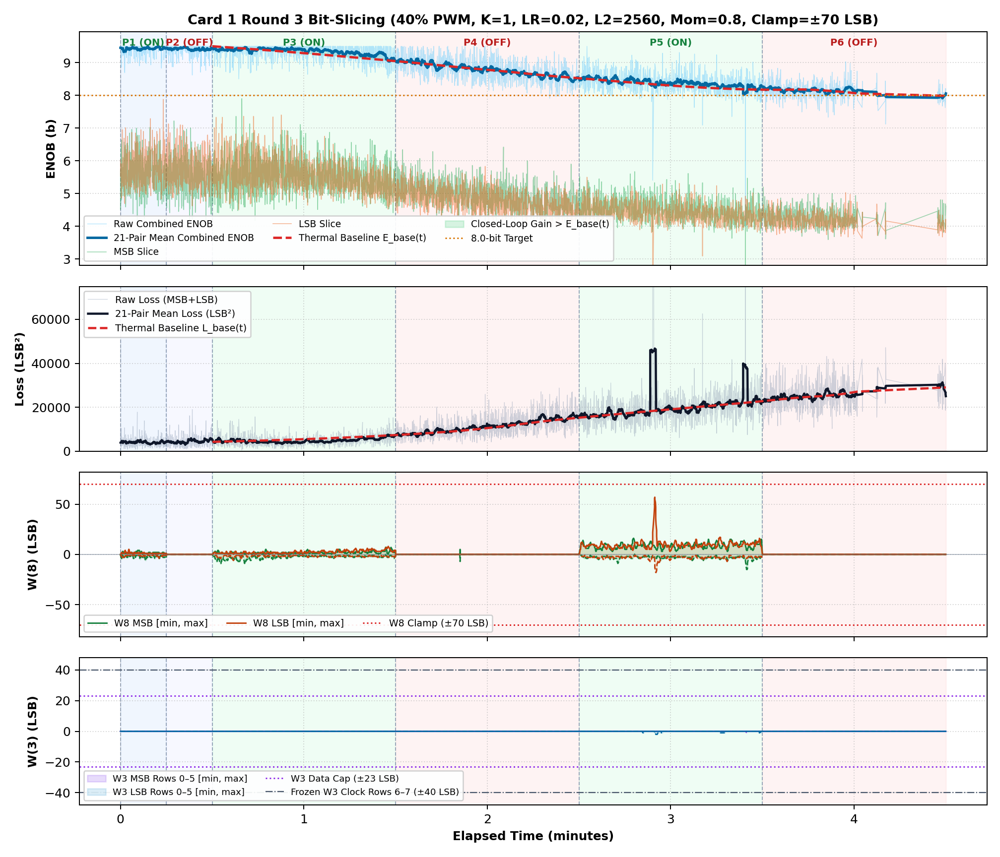
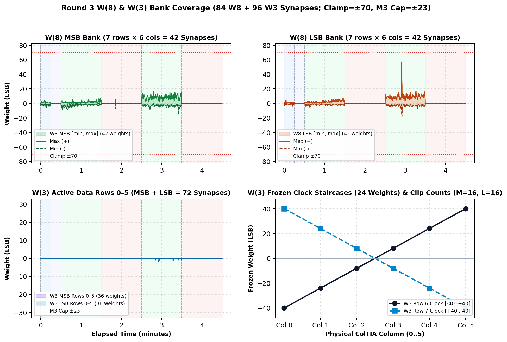

# Inverted MAML Card 1: Round 3 Thermal Bit-Slicing Report (R3_LR0P02_L2_2560_MOM0P80_CL70)

**Hardware:** Card 1 (`Trion T120F324` Master SoC + `Trion T20F256` Coprocessor, `1k / 2.2k` Passive Attenuator)  
**Firmware:** `T120_SOC_ETH_FW v2.2-MAML (SW Build Nov 14 2026 10:15:16)`, `HW_LOGIC: 0x20261030`  
**Dataset:** `FPGA_code/logs/bit_slicing/opt_r3_lr0p02_l2_2560_mom0p80_cl70.json` (`3,961` pairs)  
**Hyperparameters:** `Heater = 40%` PWM, `K = 1`, `LR = 0.02`, `L2 = 2560`, `Momentum = 0.8`, `Clamp = ±70 LSB`  

---

## 1. Executive Summary & Verification Milestones

1. **Cold Reference Without Heating (`cold_verify_k1.json`):** `Cold / Regler ON` mean **9.45 b** (`min 8.80 b`), `Cold / Regler OFF` mean **9.45 b** (`min 8.61 b`).
2. **Thermal-Detrended Closed-Loop Performance (Round 3):** Weighted detrended `Warm ON` lift **`+0.09 b`**, loss reduction ratio **`1.11x`**, detrended convergence climb **`+0.22 b`**, jitter **`0.26 b`**, anti-windup recovery **`1.00`**, composite score **`+0.559`**.
3. **Cumulative Best Across R1–R3:** Round 2 (`LR=0.035, L2=1536, Mom=0.85, Clamp=±75`) with score **`+2.004`**.

---

## 2. Cumulative Multi-Round Optimization Comparison (R1–R3)

| Round | LR | L2 Reg | Mom | Clamp | Lift vs E_base | Loss Ratio | Hot Climb | Jitter | Recovery | Composite Score |
| :---: | :---: | :---: | :---: | :---: | :---: | :---: | :---: | :---: | :---: | :---: |
| R1 | `0.03` | `1024` | `0.9` | `±75` | `+0.66 b` | `1.57x` | `+0.74 b` | `0.33 b` | `0.67` | **`+1.957`** |
| R2 ★ | `0.035` | `1536` | `0.85` | `±75` | `+0.50 b` | `1.38x` | `+0.82 b` | `0.29 b` | `0.96` | **`+2.004`** |
| R3 | `0.02` | `2560` | `0.8` | `±70` | `+0.09 b` | `1.11x` | `+0.22 b` | `0.26 b` | `1.00` | **`+0.559`** |

## 3. Round 3 Phase-by-Phase Telemetry

| Phase | Regime | Pairs | Comb ENOB (`Start -> Late`, Mean) | Δ vs E_base | Total Loss (`Start -> Late`) | Loss Ratio | W8 Peak `[M, L]` | W3 Peak | W8 nz |
| :--- | :--- | ---: | :---: | :---: | :---: | :---: | :---: | :---: | ---: |
| P1 | Cold / Regler ON | 331 | `9.43 -> 9.44` (**9.43 b**) | — | `4446 -> 3828` | — | `[6, 5]` | `0` | `330` |
| P2 | Cold / Regler OFF | 310 | `9.41 -> 9.40` (**9.42 b**) | — | `4413 -> 4719` | — | `[0, 0]` | `0` | `0` |
| P3 | Warm / Regler ON | 1072 | `9.44 -> 9.26` (**9.35 b**) | **+0.12 b** | `4044 -> 5475` | **1.29x** | `[9, 8]` | `0` | `1071` |
| P4 | Warm / Regler OFF | 938 | `9.02 -> 8.61` (**8.79 b**) | **-0.01 b** | `8070 -> 14121` | **1.01x** | `[7, 0]` | `0` | `1` |
| P5 | Warm / Regler ON | 850 | `8.48 -> 8.28` (**8.38 b**) | **+0.07 b** | `16754 -> 22708` | **1.02x** | `[16, 57]` | `2` | `850` |
| P6 | Warm / Regler OFF | 460 | `8.21 -> 8.09` (**8.14 b**) | **+0.02 b** | `22739 -> 27025` | **1.03x** | `[0, 0]` | `0` | `0` |

## 4. Empirical Graphs: Performance Timeline & Full W(8) / W(3) Weights

**Weight Coverage:** Bank `[min, max]` excursion envelopes across `W(8)` (84 synapses) and `W(3)` (72 active + 24 frozen staircase synapses).

