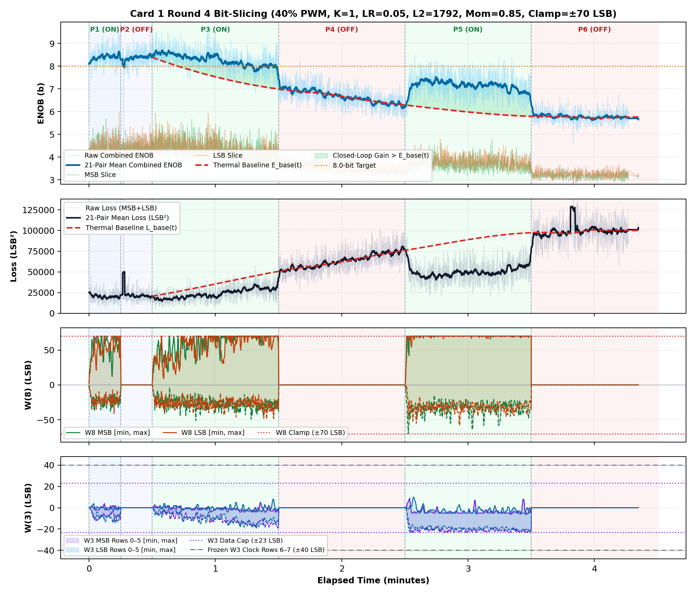
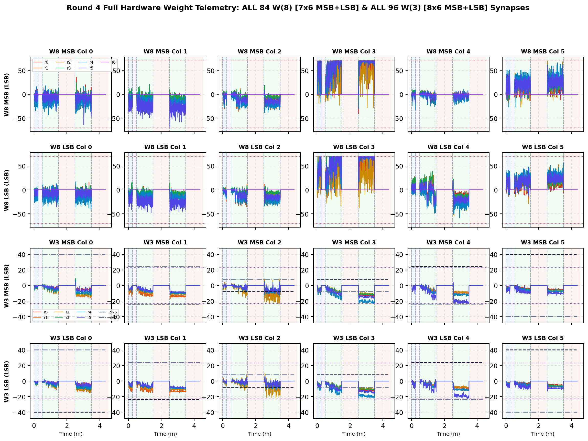

# Inverted MAML Card 1: Round 4 Thermal Bit-Slicing Report (R4DC_FIX_LR0P05_L2_1792_MOM0P85_CL70)

**Hardware:** Card 1 (`Trion T120F324` Master SoC + `Trion T20F256` Coprocessor, `1k / 2.2k` Passive Attenuator)  
**Firmware:** `T120_SOC_ETH_FW v2.2-MAML (SW Build Nov 14 2026 10:15:16)`, `HW_LOGIC: 0x20261030`  
**Dataset:** `FPGA_code/logs/bit_slicing/opt_r4dc_fix_lr0p05_l2_1792_mom0p85_cl80.json` (`3,871` pairs)  
**Hyperparameters:** `Heater = 40%` PWM, `K = 1`, `LR = 0.05`, `L2 = 1792`, `Momentum = 0.85`, `Clamp = ±70 LSB`  

---

## 1. Executive Summary & Verification Milestones

1. **Cold Reference Without Heating (`cold_verify_k1.json`):** `Cold / Regler ON` mean **9.45 b** (`min 8.80 b`), `Cold / Regler OFF` mean **9.45 b** (`min 8.61 b`).
2. **Thermal-Detrended Closed-Loop Performance (Round 4):** Weighted detrended `Warm ON` lift **`+1.08 b`**, loss reduction ratio **`1.78x`**, detrended convergence climb **`+0.97 b`**, jitter **`0.40 b`**, anti-windup recovery **`0.50`**, composite score **`+2.480`**.
3. **Cumulative Best Across R1–R4:** Round 4 (`LR=0.05, L2=1792, Mom=0.85, Clamp=±70`) with score **`+2.480`**.

---

## 2. Cumulative Multi-Round Optimization Comparison (R1–R4)

| Round | LR | L2 Reg | Mom | Clamp | Lift vs E_base | Loss Ratio | Hot Climb | Jitter | Recovery | Composite Score |
| :---: | :---: | :---: | :---: | :---: | :---: | :---: | :---: | :---: | :---: | :---: |
| R1dc_fix | `0.03` | `1024` | `0.9` | `±75` | `+1.00 b` | `1.71x` | `+0.95 b` | `0.40 b` | `0.00` | **`+1.799`** |
| R2dc_fix | `0.035` | `1536` | `0.85` | `±75` | `+0.99 b` | `1.69x` | `+1.16 b` | `0.39 b` | `0.00` | **`+1.957`** |
| R3dc_fix | `0.02` | `2560` | `0.8` | `±70` | `+0.04 b` | `1.00x` | `+0.24 b` | `0.34 b` | `1.00` | **`+0.204`** |
| R4dc_fix ★ | `0.05` | `1792` | `0.85` | `±70` | `+1.08 b` | `1.78x` | `+0.97 b` | `0.40 b` | `0.50` | **`+2.480`** |

## 3. Round 4 Phase-by-Phase Telemetry

| Phase | Regime | Pairs | Comb ENOB (`Start -> Late`, Mean) | Δ vs E_base | Total Loss (`Start -> Late`) | Loss Ratio | W8 Peak `[M, L]` | W3 Peak | W8 nz |
| :--- | :--- | ---: | :---: | :---: | :---: | :---: | :---: | :---: | ---: |
| P1 | Cold / Regler ON | 279 | `8.18 -> 8.45` (**8.40 b**) | — | `24114 -> 19771` | — | `[70, 70]` | `14` | `279` |
| P2 | Cold / Regler OFF | 300 | `8.30 -> 8.42` (**8.35 b**) | — | `22607 -> 20779` | — | `[0, 0]` | `0` | `0` |
| P3 | Warm / Regler ON | 1077 | `8.51 -> 8.01` (**8.28 b**) | **+0.86 b** | `19556 -> 29278` | **1.61x** | `[70, 70]` | `19` | `1077` |
| P4 | Warm / Regler OFF | 895 | `7.02 -> 6.40` (**6.67 b**) | **-0.01 b** | `52248 -> 71776` | **1.01x** | `[0, 0]` | `0` | `0` |
| P5 | Warm / Regler ON | 768 | `6.38 -> 7.04` (**7.15 b**) | **+1.19 b** | `71157 -> 52465` | **1.86x** | `[70, 70]` | `23` | `768` |
| P6 | Warm / Regler OFF | 552 | `5.79 -> 5.76` (**5.77 b**) | **+0.02 b** | `97639 -> 99490` | **1.02x** | `[0, 0]` | `0` | `0` |

## 4. Empirical Graphs: Performance Timeline & Full W(8) / W(3) Weights

**Weight Coverage:** All **84 `W(8)`** (`7x6` MSB + `7x6` LSB) and **96 `W(3)`** (`8x6` MSB + `8x6` LSB) individual weights plotted across all pairs.

