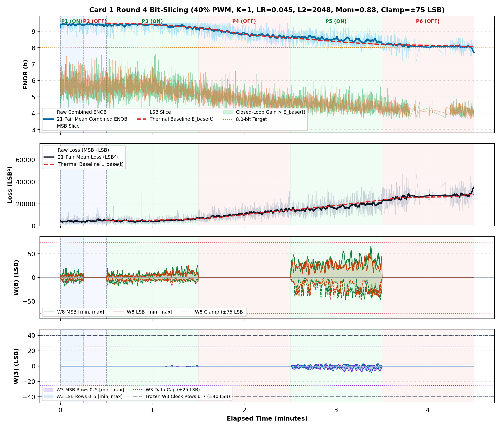
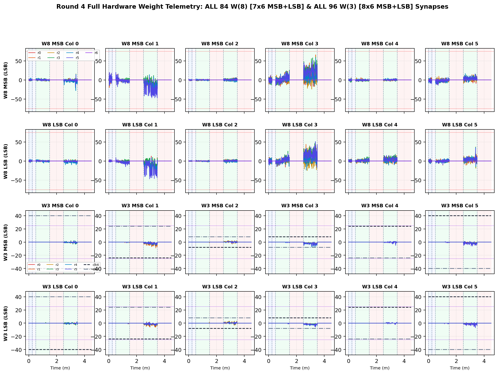

# Inverted MAML Card 1: Round 4 Thermal Bit-Slicing Report (R4_LR0P045_L2_2048_MOM0P88_CL75)

**Hardware:** Card 1 (`Trion T120F324` Master SoC + `Trion T20F256` Coprocessor, `1k / 2.2k` Passive Attenuator)  
**Firmware:** `T120_SOC_ETH_FW v2.2-MAML (SW Build Nov 14 2026 10:15:16)`, `HW_LOGIC: 0x20261030`  
**Dataset:** `FPGA_code/logs/bit_slicing/opt_r4_lr0p045_l2_2048_mom0p88_cl75.json` (`3,837` pairs)  
**Hyperparameters:** `Heater = 40%` PWM, `K = 1`, `LR = 0.045`, `L2 = 2048`, `Momentum = 0.88`, `Clamp = ±75 LSB`  

---

## 1. Executive Summary & Verification Milestones

1. **Cold Reference Without Heating (`cold_verify_k1.json`):** `Cold / Regler ON` mean **9.45 b** (`min 8.80 b`), `Cold / Regler OFF` mean **9.45 b** (`min 8.61 b`).
2. **Thermal-Detrended Closed-Loop Performance (Round 4):** Weighted detrended `Warm ON` lift **`+0.11 b`**, loss reduction ratio **`1.17x`**, detrended convergence climb **`+0.14 b`**, jitter **`0.24 b`**, anti-windup recovery **`1.00`**, composite score **`+0.643`**.
3. **Cumulative Best Across R1–R4:** Round 2 (`LR=0.035, L2=1536, Mom=0.85, Clamp=±75`) with score **`+2.004`**.

---

## 2. Cumulative Multi-Round Optimization Comparison (R1–R4)

| Round | LR | L2 Reg | Mom | Clamp | Lift vs E_base | Loss Ratio | Hot Climb | Jitter | Recovery | Composite Score |
| :---: | :---: | :---: | :---: | :---: | :---: | :---: | :---: | :---: | :---: | :---: |
| R1 | `0.03` | `1024` | `0.9` | `±75` | `+0.66 b` | `1.57x` | `+0.74 b` | `0.33 b` | `0.67` | **`+1.957`** |
| R2 ★ | `0.035` | `1536` | `0.85` | `±75` | `+0.50 b` | `1.38x` | `+0.82 b` | `0.29 b` | `0.96` | **`+2.004`** |
| R3 | `0.02` | `2560` | `0.8` | `±70` | `+0.09 b` | `1.11x` | `+0.22 b` | `0.26 b` | `1.00` | **`+0.559`** |
| R4 | `0.045` | `2048` | `0.88` | `±75` | `+0.11 b` | `1.17x` | `+0.14 b` | `0.24 b` | `1.00` | **`+0.643`** |

## 3. Round 4 Phase-by-Phase Telemetry

| Phase | Regime | Pairs | Comb ENOB (`Start -> Late`, Mean) | Δ vs E_base | Total Loss (`Start -> Late`) | Loss Ratio | W8 Peak `[M, L]` | W3 Peak | W8 nz |
| :--- | :--- | ---: | :---: | :---: | :---: | :---: | :---: | :---: | ---: |
| P1 | Cold / Regler ON | 328 | `9.44 -> 9.42` (**9.42 b**) | — | `3711 -> 3954` | — | `[20, 11]` | `0` | `328` |
| P2 | Cold / Regler OFF | 303 | `9.39 -> 9.39` (**9.41 b**) | — | `4144 -> 5037` | — | `[0, 0]` | `0` | `0` |
| P3 | Warm / Regler ON | 1055 | `9.35 -> 9.28` (**9.36 b**) | **-0.02 b** | `5087 -> 5570` | **1.15x** | `[26, 26]` | `1` | `1055` |
| P4 | Warm / Regler OFF | 902 | `9.14 -> 8.70` (**8.88 b**) | **+0.03 b** | `7340 -> 13333` | **1.02x** | `[0, 0]` | `0` | `0` |
| P5 | Warm / Regler ON | 793 | `8.65 -> 8.42` (**8.53 b**) | **+0.16 b** | `14093 -> 19402` | **1.18x** | `[66, 51]` | `9` | `793` |
| P6 | Warm / Regler OFF | 456 | `8.21 -> 8.05` (**8.12 b**) | **-0.04 b** | `23749 -> 28367` | **1.00x** | `[0, 0]` | `0` | `0` |

## 4. Empirical Graphs: Performance Timeline & Full W(8) / W(3) Weights

**Weight Coverage:** All **84 `W(8)`** (`7x6` MSB + `7x6` LSB) and **96 `W(3)`** (`8x6` MSB + `8x6` LSB) individual weights plotted across all pairs.

