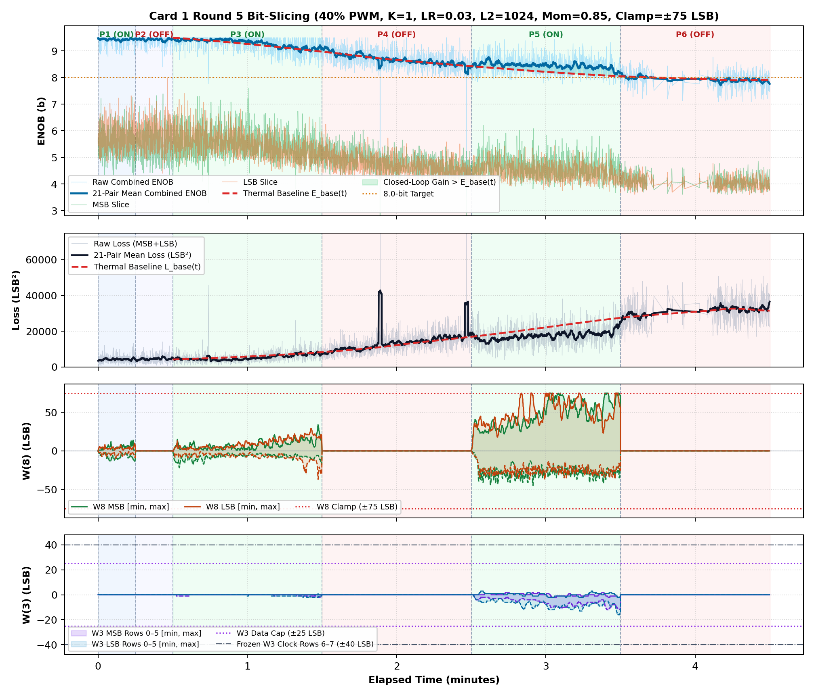
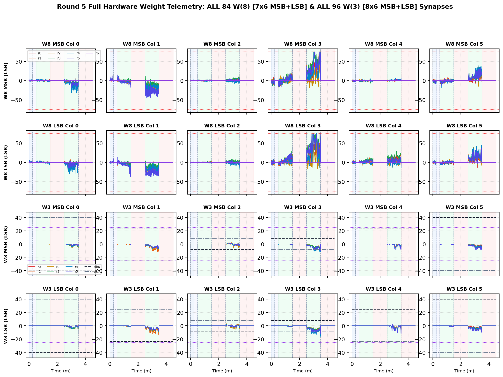

# Inverted MAML Card 1: Round 5 Thermal Bit-Slicing Report (R5_LR0P03_L2_1024_MOM0P85_CL75)

**Hardware:** Card 1 (`Trion T120F324` Master SoC + `Trion T20F256` Coprocessor, `1k / 2.2k` Passive Attenuator)  
**Firmware:** `T120_SOC_ETH_FW v2.2-MAML (SW Build Nov 14 2026 10:15:16)`, `HW_LOGIC: 0x20261030`  
**Dataset:** `FPGA_code/logs/bit_slicing/opt_r5_lr0p03_l2_1024_mom0p85_cl75.json` (`3,901` pairs)  
**Hyperparameters:** `Heater = 40%` PWM, `K = 1`, `LR = 0.03`, `L2 = 1024`, `Momentum = 0.85`, `Clamp = ±75 LSB`  

---

## 1. Executive Summary & Verification Milestones

1. **Cold Reference Without Heating (`cold_verify_k1.json`):** `Cold / Regler ON` mean **9.45 b** (`min 8.80 b`), `Cold / Regler OFF` mean **9.45 b** (`min 8.61 b`).
2. **Thermal-Detrended Closed-Loop Performance (Round 5):** Weighted detrended `Warm ON` lift **`+0.20 b`**, loss reduction ratio **`1.34x`**, detrended convergence climb **`+0.43 b`**, jitter **`0.26 b`**, anti-windup recovery **`0.89`**, composite score **`+1.147`**.
3. **Cumulative Best Across R1–R5:** Round 2 (`LR=0.035, L2=1536, Mom=0.85, Clamp=±75`) with score **`+2.004`**.

---

## 2. Cumulative Multi-Round Optimization Comparison (R1–R5)

| Round | LR | L2 Reg | Mom | Clamp | Lift vs E_base | Loss Ratio | Hot Climb | Jitter | Recovery | Composite Score |
| :---: | :---: | :---: | :---: | :---: | :---: | :---: | :---: | :---: | :---: | :---: |
| R1 | `0.03` | `1024` | `0.9` | `±75` | `+0.66 b` | `1.57x` | `+0.74 b` | `0.33 b` | `0.67` | **`+1.957`** |
| R2 ★ | `0.035` | `1536` | `0.85` | `±75` | `+0.50 b` | `1.38x` | `+0.82 b` | `0.29 b` | `0.96` | **`+2.004`** |
| R3 | `0.02` | `2560` | `0.8` | `±70` | `+0.09 b` | `1.11x` | `+0.22 b` | `0.26 b` | `1.00` | **`+0.559`** |
| R4 | `0.045` | `2048` | `0.88` | `±75` | `+0.11 b` | `1.17x` | `+0.14 b` | `0.24 b` | `1.00` | **`+0.643`** |
| R5 | `0.03` | `1024` | `0.85` | `±75` | `+0.20 b` | `1.34x` | `+0.43 b` | `0.26 b` | `0.89` | **`+1.147`** |

## 3. Round 5 Phase-by-Phase Telemetry

| Phase | Regime | Pairs | Comb ENOB (`Start -> Late`, Mean) | Δ vs E_base | Total Loss (`Start -> Late`) | Loss Ratio | W8 Peak `[M, L]` | W3 Peak | W8 nz |
| :--- | :--- | ---: | :---: | :---: | :---: | :---: | :---: | :---: | ---: |
| P1 | Cold / Regler ON | 321 | `9.45 -> 9.44` (**9.43 b**) | — | `3635 -> 4235` | — | `[14, 10]` | `0` | `320` |
| P2 | Cold / Regler OFF | 303 | `9.45 -> 9.42` (**9.43 b**) | — | `3554 -> 4621` | — | `[0, 0]` | `0` | `0` |
| P3 | Warm / Regler ON | 1037 | `9.46 -> 9.13` (**9.30 b**) | **+0.05 b** | `4352 -> 6638` | **1.18x** | `[34, 37]` | `2` | `1037` |
| P4 | Warm / Regler OFF | 927 | `9.04 -> 8.52` (**8.68 b**) | **+0.01 b** | `7725 -> 17229` | **0.99x** | `[0, 0]` | `0` | `0` |
| P5 | Warm / Regler ON | 834 | `8.49 -> 8.38` (**8.45 b**) | **+0.28 b** | `18127 -> 18807` | **1.43x** | `[75, 75]` | `16` | `834` |
| P6 | Warm / Regler OFF | 479 | `8.04 -> 7.89` (**7.93 b**) | **-0.02 b** | `28910 -> 32304` | **1.02x** | `[0, 0]` | `0` | `0` |

## 4. Empirical Graphs: Performance Timeline & Full W(8) / W(3) Weights

**Weight Coverage:** All **84 `W(8)`** (`7x6` MSB + `7x6` LSB) and **96 `W(3)`** (`8x6` MSB + `8x6` LSB) individual weights plotted across all pairs.

