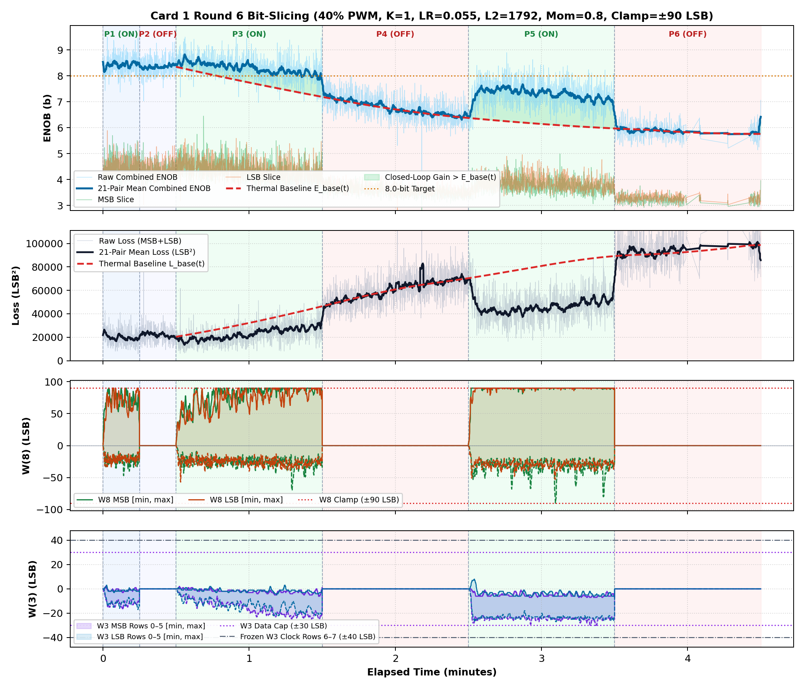
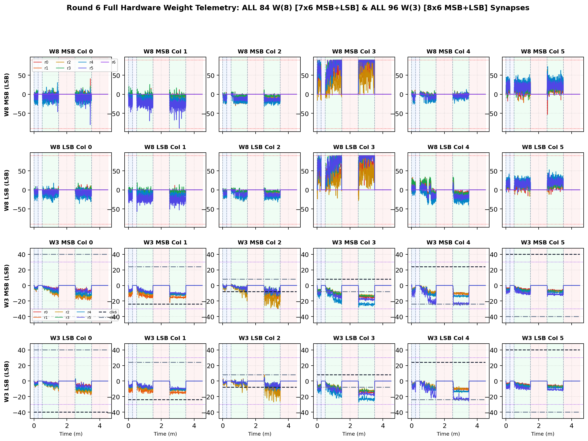

# Inverted MAML Card 1: Round 6 Thermal Bit-Slicing Report (R6DC_FIX_LR0P055_L2_1792_MOM0P80_CL90)

**Hardware:** Card 1 (`Trion T120F324` Master SoC + `Trion T20F256` Coprocessor, `1k / 2.2k` Passive Attenuator)  
**Firmware:** `T120_SOC_ETH_FW v2.2-MAML (SW Build Nov 14 2026 10:15:16)`, `HW_LOGIC: 0x20261030`  
**Dataset:** `FPGA_code/logs/bit_slicing/opt_r6dc_fix_lr0p055_l2_1792_mom0p80_cl90.json` (`3,828` pairs)  
**Hyperparameters:** `Heater = 40%` PWM, `K = 1`, `LR = 0.055`, `L2 = 1792`, `Momentum = 0.8`, `Clamp = ±90 LSB`  

---

## 1. Executive Summary & Verification Milestones

1. **Cold Reference Without Heating (`cold_verify_k1.json`):** `Cold / Regler ON` mean **9.45 b** (`min 8.80 b`), `Cold / Regler OFF` mean **9.45 b** (`min 8.61 b`).
2. **Thermal-Detrended Closed-Loop Performance (Round 6):** Weighted detrended `Warm ON` lift **`+0.99 b`**, loss reduction ratio **`1.72x`**, detrended convergence climb **`+1.02 b`**, jitter **`0.40 b`**, anti-windup recovery **`0.00`**, composite score **`+1.770`**.
3. **Cumulative Best Across R1–R6:** Round 4 (`LR=0.05, L2=1792, Mom=0.85, Clamp=±70`) with score **`+2.480`**.

---

## 2. Cumulative Multi-Round Optimization Comparison (R1–R6)

| Round | LR | L2 Reg | Mom | Clamp | Lift vs E_base | Loss Ratio | Hot Climb | Jitter | Recovery | Composite Score |
| :---: | :---: | :---: | :---: | :---: | :---: | :---: | :---: | :---: | :---: | :---: |
| R1dc_fix | `0.03` | `1024` | `0.9` | `±75` | `+1.00 b` | `1.71x` | `+0.95 b` | `0.40 b` | `0.00` | **`+1.799`** |
| R2dc_fix | `0.035` | `1536` | `0.85` | `±75` | `+0.99 b` | `1.69x` | `+1.16 b` | `0.39 b` | `0.00` | **`+1.957`** |
| R3dc_fix | `0.02` | `2560` | `0.8` | `±70` | `+0.04 b` | `1.00x` | `+0.24 b` | `0.34 b` | `1.00` | **`+0.204`** |
| R4dc_fix ★ | `0.05` | `1792` | `0.85` | `±70` | `+1.08 b` | `1.78x` | `+0.97 b` | `0.40 b` | `0.50` | **`+2.480`** |
| R5dc_fix | `0.055` | `1792` | `0.85` | `±85` | `+1.12 b` | `1.77x` | `+1.37 b` | `0.42 b` | `0.00` | **`+2.393`** |
| R6dc_fix | `0.055` | `1792` | `0.8` | `±90` | `+0.99 b` | `1.72x` | `+1.02 b` | `0.40 b` | `0.00` | **`+1.770`** |

## 3. Round 6 Phase-by-Phase Telemetry

| Phase | Regime | Pairs | Comb ENOB (`Start -> Late`, Mean) | Δ vs E_base | Total Loss (`Start -> Late`) | Loss Ratio | W8 Peak `[M, L]` | W3 Peak | W8 nz |
| :--- | :--- | ---: | :---: | :---: | :---: | :---: | :---: | :---: | ---: |
| P1 | Cold / Regler ON | 339 | `8.23 -> 8.46` (**8.42 b**) | — | `25098 -> 18668` | — | `[90, 90]` | `17` | `339` |
| P2 | Cold / Regler OFF | 287 | `8.36 -> 8.41` (**8.36 b**) | — | `22141 -> 20560` | — | `[0, 0]` | `0` | `0` |
| P3 | Warm / Regler ON | 1044 | `8.43 -> 8.12` (**8.31 b**) | **+0.72 b** | `18889 -> 27216` | **1.57x** | `[90, 90]` | `25` | `1044` |
| P4 | Warm / Regler OFF | 899 | `7.26 -> 6.51` (**6.77 b**) | **+0.03 b** | `46106 -> 68355` | **1.01x** | `[0, 0]` | `0` | `0` |
| P5 | Warm / Regler ON | 819 | `6.57 -> 7.16` (**7.30 b**) | **+1.13 b** | `66596 -> 49334` | **1.81x** | `[90, 90]` | `30` | `819` |
| P6 | Warm / Regler OFF | 440 | `5.94 -> 5.82` (**5.88 b**) | **+0.02 b** | `91932 -> 96596` | **0.99x** | `[0, 0]` | `0` | `0` |

## 4. Empirical Graphs: Performance Timeline & Full W(8) / W(3) Weights

**Weight Coverage:** All **84 `W(8)`** (`7x6` MSB + `7x6` LSB) and **96 `W(3)`** (`8x6` MSB + `8x6` LSB) individual weights plotted across all pairs.

