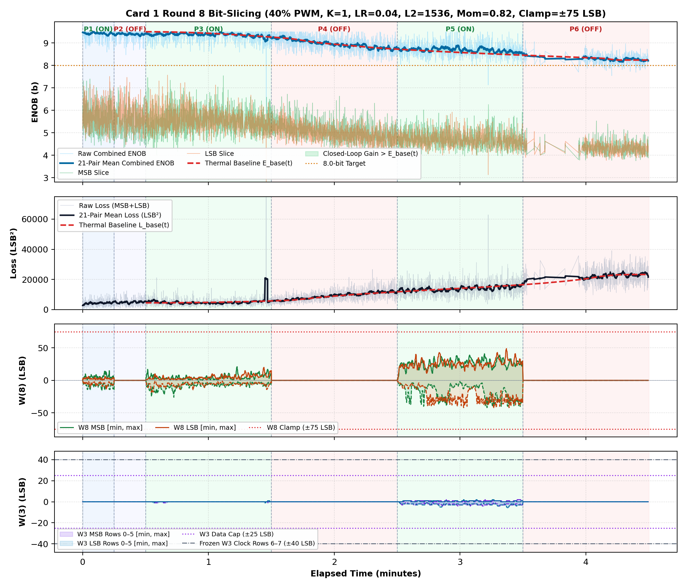
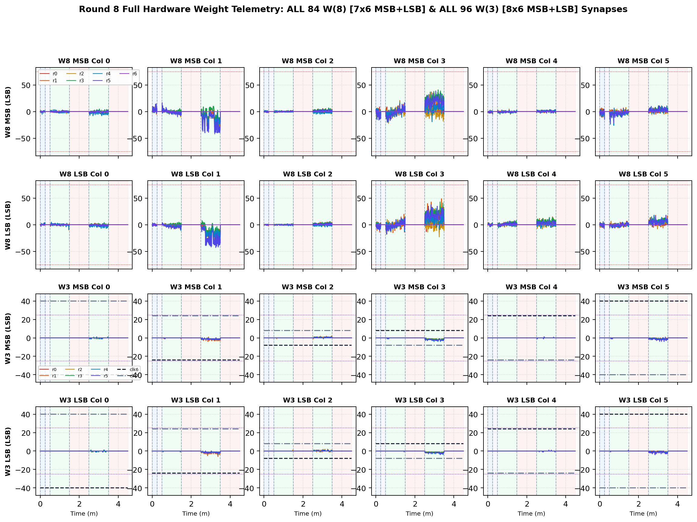

# Inverted MAML Card 1: Round 8 Thermal Bit-Slicing Report (R8_LR0P04_L2_1536_MOM0P82_CL75)

**Hardware:** Card 1 (`Trion T120F324` Master SoC + `Trion T20F256` Coprocessor, `1k / 2.2k` Passive Attenuator)  
**Firmware:** `T120_SOC_ETH_FW v2.2-MAML (SW Build Nov 14 2026 10:15:16)`, `HW_LOGIC: 0x20261030`  
**Dataset:** `FPGA_code/logs/bit_slicing/opt_r8_lr0p04_l2_1536_mom0p82_cl75.json` (`3,931` pairs)  
**Hyperparameters:** `Heater = 40%` PWM, `K = 1`, `LR = 0.04`, `L2 = 1536`, `Momentum = 0.82`, `Clamp = ±75 LSB`  

---

## 1. Executive Summary & Verification Milestones

1. **Cold Reference Without Heating (`cold_verify_k1.json`):** `Cold / Regler ON` mean **9.45 b** (`min 8.80 b`), `Cold / Regler OFF` mean **9.45 b** (`min 8.61 b`).
2. **Thermal-Detrended Closed-Loop Performance (Round 8):** Weighted detrended `Warm ON` lift **`+0.09 b`**, loss reduction ratio **`1.14x`**, detrended convergence climb **`+0.24 b`**, jitter **`0.26 b`**, anti-windup recovery **`1.00`**, composite score **`+0.626`**.
3. **Cumulative Best Across R1–R8:** Round 2 (`LR=0.035, L2=1536, Mom=0.85, Clamp=±75`) with score **`+2.004`**.

---

## 2. Cumulative Multi-Round Optimization Comparison (R1–R8)

| Round | LR | L2 Reg | Mom | Clamp | Lift vs E_base | Loss Ratio | Hot Climb | Jitter | Recovery | Composite Score |
| :---: | :---: | :---: | :---: | :---: | :---: | :---: | :---: | :---: | :---: | :---: |
| R1 | `0.03` | `1024` | `0.9` | `±75` | `+0.66 b` | `1.57x` | `+0.74 b` | `0.33 b` | `0.67` | **`+1.957`** |
| R2 ★ | `0.035` | `1536` | `0.85` | `±75` | `+0.50 b` | `1.38x` | `+0.82 b` | `0.29 b` | `0.96` | **`+2.004`** |
| R3 | `0.02` | `2560` | `0.8` | `±70` | `+0.09 b` | `1.11x` | `+0.22 b` | `0.26 b` | `1.00` | **`+0.559`** |
| R4 | `0.045` | `2048` | `0.88` | `±75` | `+0.11 b` | `1.17x` | `+0.14 b` | `0.24 b` | `1.00` | **`+0.643`** |
| R5 | `0.03` | `1024` | `0.85` | `±75` | `+0.20 b` | `1.34x` | `+0.43 b` | `0.26 b` | `0.89` | **`+1.147`** |
| R6 | `0.025` | `1280` | `0.92` | `±75` | `+0.06 b` | `1.12x` | `+0.34 b` | `0.23 b` | `1.00` | **`+0.689`** |
| R7 | `0.035` | `768` | `0.9` | `±75` | `+0.18 b` | `1.38x` | `+0.48 b` | `0.26 b` | `0.95` | **`+1.191`** |
| R8 | `0.04` | `1536` | `0.82` | `±75` | `+0.09 b` | `1.14x` | `+0.24 b` | `0.26 b` | `1.00` | **`+0.626`** |

## 3. Round 8 Phase-by-Phase Telemetry

| Phase | Regime | Pairs | Comb ENOB (`Start -> Late`, Mean) | Δ vs E_base | Total Loss (`Start -> Late`) | Loss Ratio | W8 Peak `[M, L]` | W3 Peak | W8 nz |
| :--- | :--- | ---: | :---: | :---: | :---: | :---: | :---: | :---: | ---: |
| P1 | Cold / Regler ON | 342 | `9.46 -> 9.40` (**9.42 b**) | — | `3049 -> 4432` | — | `[16, 14]` | `0` | `342` |
| P2 | Cold / Regler OFF | 279 | `9.35 -> 9.37` (**9.39 b**) | — | `5265 -> 4988` | — | `[0, 0]` | `0` | `0` |
| P3 | Warm / Regler ON | 1061 | `9.43 -> 9.32` (**9.37 b**) | **-0.01 b** | `4780 -> 5784` | **1.15x** | `[26, 20]` | `1` | `1061` |
| P4 | Warm / Regler OFF | 941 | `9.24 -> 8.81` (**8.97 b**) | **+0.01 b** | `5806 -> 11036` | **1.04x** | `[0, 0]` | `0` | `0` |
| P5 | Warm / Regler ON | 838 | `8.74 -> 8.66` (**8.69 b**) | **+0.16 b** | `12381 -> 14639` | **1.13x** | `[42, 49]` | `6` | `838` |
| P6 | Warm / Regler OFF | 470 | `8.43 -> 8.26` (**8.29 b**) | **+0.02 b** | `18684 -> 23236` | **1.03x** | `[0, 0]` | `0` | `0` |

## 4. Empirical Graphs: Performance Timeline & Full W(8) / W(3) Weights

**Weight Coverage:** All **84 `W(8)`** (`7x6` MSB + `7x6` LSB) and **96 `W(3)`** (`8x6` MSB + `8x6` LSB) individual weights plotted across all pairs.

