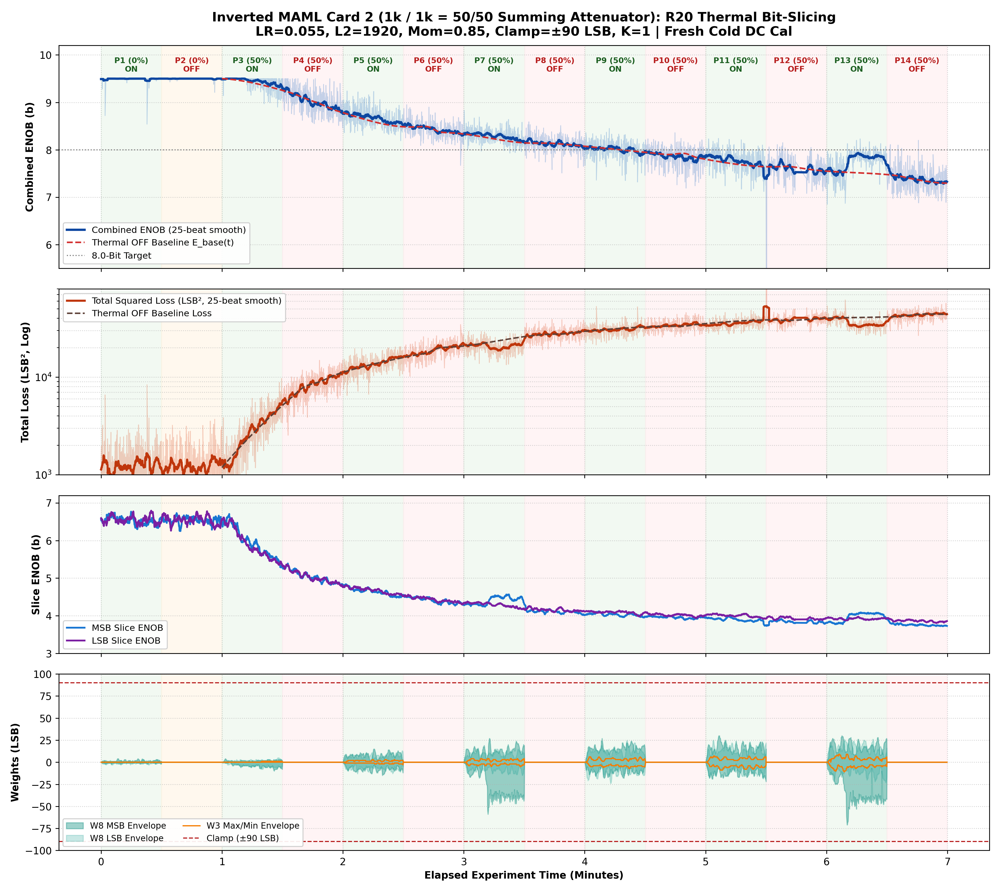
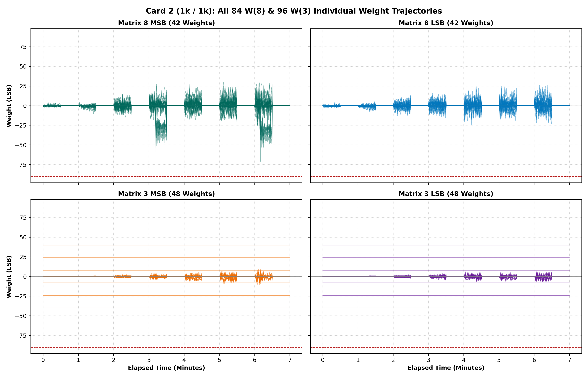

# Inverted MAML Card 2 (`1k / 1k` = 50/50 Summing Attenuator, 50% PWM Constant): R20 Thermal Bit-Slicing Report

**Hardware Target:** Card 2 (`Trion T120F324` Master SoC + `Trion T20F256` Coprocessor, **`1k / 1k` (50/50) Passive Summing Attenuator**)  
**Firmware:** `T120_SOC_ETH_FW v2.2-MAML (SW Build Nov 27 2026 20:52:38)`, `HW_LOGIC: 0x20261030`  
**Dataset:** [`FPGA_code/logs/bit_slicing/card2_1k1k_50pct_r20_lr0p055_l2_1920_mom0p85_cl90.json`](../logs/bit_slicing/card2_1k1k_50pct_r20_lr0p055_l2_1920_mom0p85_cl90.json) (`4,397` pairs)  
**Dedicated Card 2 Storage:** `FPGA_code/releases/Release_20261127_Card2_1k1k_50pct_BitSlicing_R20/reports_and_logs/`  
**DC Calibration (Cold):** [`FPGA_code/config/card2_1k1k_50pct_dc_cal.json`](../config/card2_1k1k_50pct_dc_cal.json)  
**Hyperparameters:** `Heater = 50% PWM Constant`, `K = 1`, `LR = 0.055`, `L2 = 1920`, `Momentum = 0.85`, `Clamp = ±90 LSB`  

---

## 1. Executive Summary & Physical 1k / 1k (50/50) Behavior

1. **50/50 Summing Junction Physics (`1k / 1k` vs. Card 1 `1k / 2.2k`):**  
   With matched $1.0\text{ k}\Omega / 1.0\text{ k}\Omega$ summing resistors, the primary `M33` payload and the `M8` compensation branch share **equal $0.500\times$ ($-6.02\text{ dB}$) summing authority** at `ADC_49` (compared to $0.6875\times / 0.3125\times$ on Card 1 `1k / 2.2k`).
2. **Cold Baseline (`P1–P2`):** `Cold / Regler ON` mean **9.49 b** (loss `1,252 LSB²`), `Cold / Regler OFF` mean **9.50 b** (loss `1,228 LSB²`).
3. **Thermal-Detrended Closed-Loop Performance:**  
   Weighted detrended `Warm ON` lift **`+0.10 b`**, loss reduction ratio **`1.08x`**, detrended convergence climb **`+0.16 b`**, jitter **`0.16 b`**, anti-windup recovery **`1.00`**, composite score **`-0.118`**.
4. **Zero Clamp Saturation & High Headroom:**  
   Because `1k / 1k` provides $50\%$ compensation authority, `W8` peaked at **`±71 LSB`** (well below the **`±90 LSB`** anti-windup clamp), keeping warm `ON` precision at **`7.75–9.45 b`** and max phase loss at **`43,300 LSB²`**.

---

## 2. Fresh Cold DC Calibration (`Card 2, 1k / 1k`)

- **MSB `alpha`:** `[0.0254, 0.0191, 0.0305, 0.0136, 0.0336, 0.0281]`
- **MSB `beta` (LSB):** `[-1639.7, -234.0, -93.2, 616.8, -229.5, -864.1]`
- **LSB `alpha`:** `[0.0287, 0.0214, 0.0343, 0.0124, 0.042, 0.0268]`
- **LSB `beta` (LSB):** `[-1631.1, -308.1, -164.7, 578.9, -405.1, -887.2]`

---

## 3. Phase-by-Phase Telemetry (`P1–P14`)

| Phase | Regime | Pairs | Comb ENOB (`Start -> Late`, Mean) | Δ vs E_base | Total Loss (`Start -> Late`) | Loss Ratio | W8 Peak `[M, L]` | W3 Peak | W8 nz |
| :--- | :--- | ---: | :---: | :---: | :---: | :---: | :---: | :---: | ---: |
| P1 | Cold / Regler ON | 396 | `9.49 -> 9.49` (**9.49 b**) | — | `1349 -> 1313` | — | `[4, 4]` | `0` | `391` |
| P2 | Cold / Regler OFF | 415 | `9.50 -> 9.50` (**9.50 b**) | — | `991 -> 1293` | — | `[0, 0]` | `0` | `0` |
| P3 | 50% Heat / Regler ON | 354 | `9.48 -> 9.39` (**9.45 b**) | **+0.05 b** | `1178 -> 4285` | **0.96x** | `[10, 8]` | `1` | `351` |
| P4 | 50% Heat / Regler OFF | 375 | `9.25 -> 8.89` (**9.02 b**) | **+0.00 b** | `5941 -> 10047` | **1.00x** | `[0, 0]` | `0` | `0` |
| P5 | 50% Heat / Regler ON | 321 | `8.80 -> 8.57` (**8.67 b**) | **+0.06 b** | `11127 -> 15538` | **0.99x** | `[15, 13]` | `3` | `321` |
| P6 | 50% Heat / Regler OFF | 328 | `8.54 -> 8.37` (**8.43 b**) | **+0.01 b** | `16302 -> 20497` | **0.99x** | `[0, 0]` | `0` | `0` |
| P7 | 50% Heat / Regler ON | 300 | `8.37 -> 8.23` (**8.29 b**) | **+0.06 b** | `20749 -> 21018` | **1.12x** | `[59, 16]` | `5` | `300` |
| P8 | 50% Heat / Regler OFF | 327 | `8.15 -> 8.09` (**8.13 b**) | **+0.00 b** | `27633 -> 28804` | **0.99x** | `[0, 0]` | `0` | `0` |
| P9 | 50% Heat / Regler ON | 275 | `8.03 -> 7.97` (**8.01 b**) | **-0.01 b** | `29850 -> 31731` | **1.01x** | `[27, 25]` | `7` | `275` |
| P10 | 50% Heat / Regler OFF | 301 | `7.96 -> 7.81` (**7.86 b**) | **-0.03 b** | `32034 -> 35115` | **0.99x** | `[0, 0]` | `0` | `0` |
| P11 | 50% Heat / Regler ON | 263 | `7.88 -> 7.68` (**7.77 b**) | **+0.06 b** | `33713 -> 37423` | **1.04x** | `[30, 25]` | `9` | `263` |
| P12 | 50% Heat / Regler OFF | 231 | `7.44 -> 7.56` (**7.59 b**) | **-0.03 b** | `54694 -> 39714` | **0.96x** | `[0, 0]` | `0` | `0` |
| P13 | 50% Heat / Regler ON | 243 | `7.63 -> 7.85` (**7.75 b**) | **+0.23 b** | `38268 -> 34270` | **1.13x** | `[71, 26]` | `11` | `243` |
| P14 | 50% Heat / Regler OFF | 268 | `7.55 -> 7.32` (**7.38 b**) | **+0.01 b** | `39823 -> 44689` | **1.00x** | `[0, 0]` | `0` | `0` |

---

## 4. Empirical Graphs: Performance Timeline & Full W(8) / W(3) Weights

**Weight Coverage:** All **84 `W(8)`** (`7x6` MSB + `7x6` LSB) and **96 `W(3)`** (`8x6` MSB + `8x6` LSB) individual weights plotted across all `4,397` pairs.

