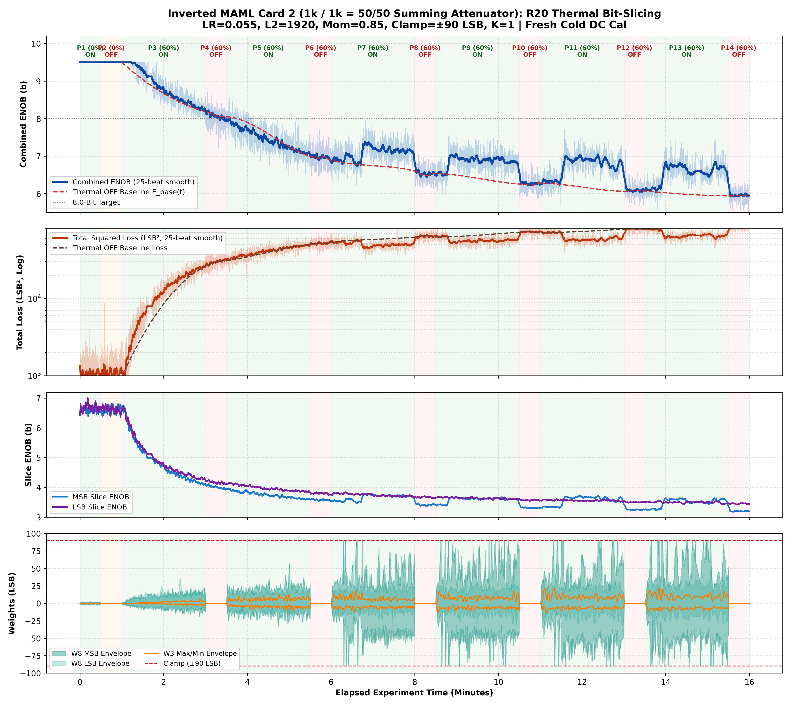
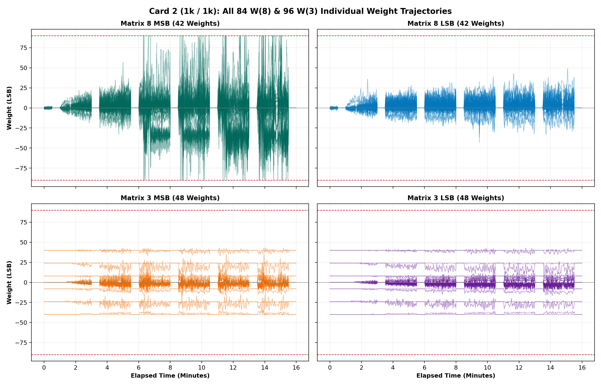
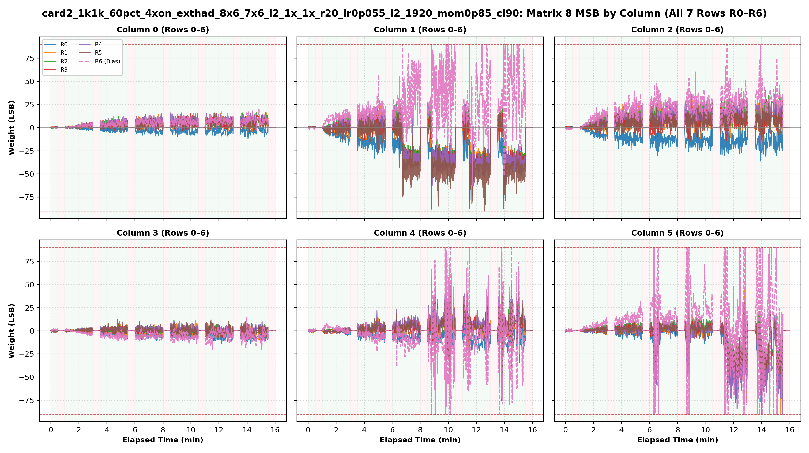
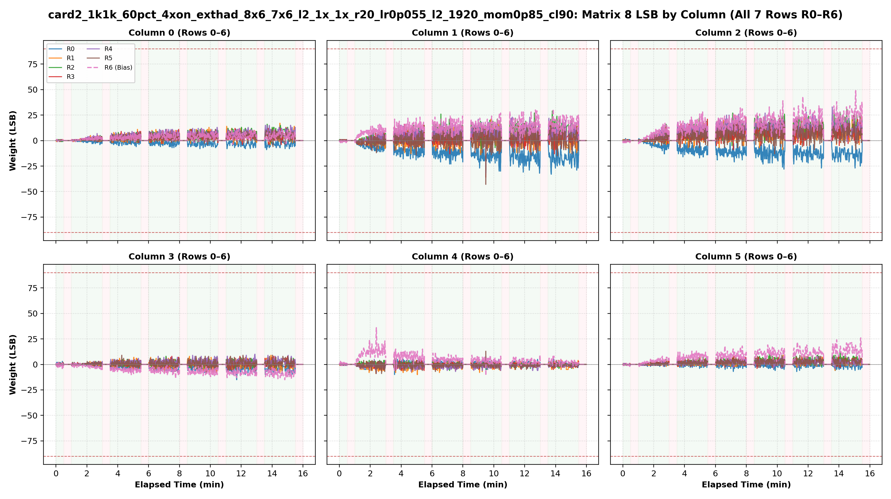
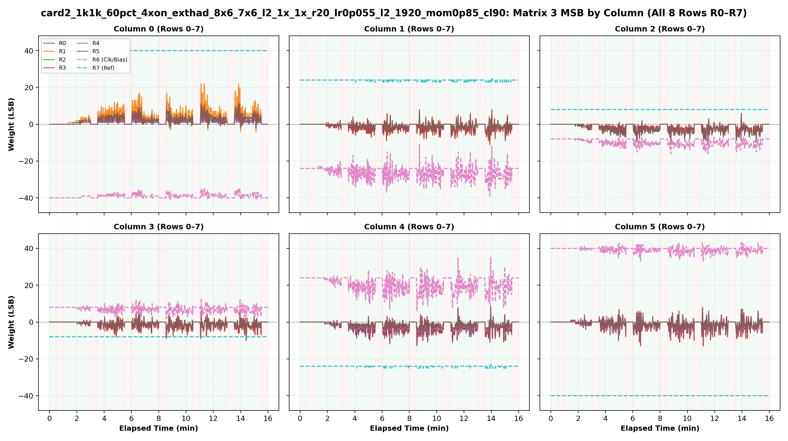
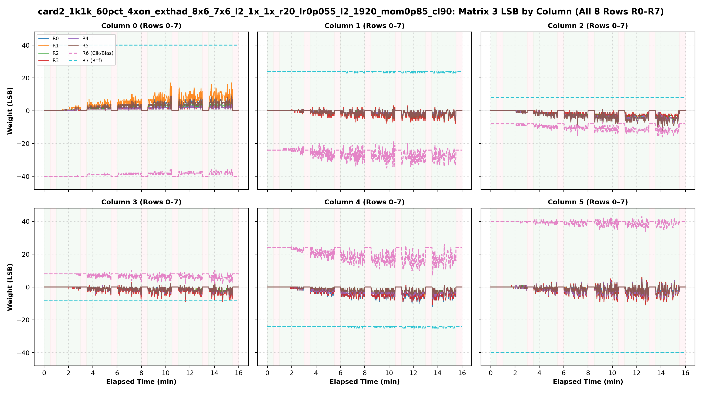

# Inverted MAML Card 2 (`1k / 1k` = 50/50 Summing Attenuator, 60% PWM (120s ON / 30s OFF, ExtHad 8x6/7x6 1x/1x L2)): R20 Thermal Bit-Slicing Report

**Hardware Target:** Card 2 (`Trion T120F324` Master SoC + `Trion T20F256` Coprocessor, **`1k / 1k` (50/50) Passive Summing Attenuator**)  
**Firmware:** `T120_SOC_ETH_FW v2.2-MAML (SW Build Nov 28 2026 12:42:43)`, `HW_LOGIC: 0x20261128`  
**Dataset:** [`FPGA_code/logs/bit_slicing/card2_1k1k_60pct_4xon_exthad_8x6_7x6_l2_1x_1x_r20_lr0p055_l2_1920_mom0p85_cl90.json`](../logs/bit_slicing/card2_1k1k_60pct_4xon_exthad_8x6_7x6_l2_1x_1x_r20_lr0p055_l2_1920_mom0p85_cl90.json) (`7,501` pairs)  
**Dedicated Card 2 Storage:** `FPGA_code/releases/Release_20261128_Card2_1k1k_60pct_4xON_ExtHad_8x6_7x6_L2_1x_1x_R20/reports_and_logs/`  
**DC Calibration (Cold):** [`FPGA_code/config/card2_1k1k_60pct_4xon_exthad_8x6_7x6_l2_1x_1x_dc_cal.json`](../config/card2_1k1k_60pct_4xon_exthad_8x6_7x6_l2_1x_1x_dc_cal.json)  
**Hyperparameters:** `Heater = 60% PWM (120s ON / 30s OFF, ExtHad 8x6/7x6 1x/1x L2)`, `K = 1`, `LR = 0.055`, `L2 = 1920`, `Momentum = 0.85`, `Clamp = ±90 LSB`  

---

## 1. Executive Summary & Physical 1k / 1k (50/50) Behavior

1. **50/50 Summing Junction Physics (`1k / 1k` vs. Card 1 `1k / 2.2k`):**  
   With matched $1.0\text{ k}\Omega / 1.0\text{ k}\Omega$ summing resistors, the primary `M33` payload and the `M8` compensation branch share **equal $0.500\times$ ($-6.02\text{ dB}$) summing authority** at `ADC_49` (compared to $0.6875\times / 0.3125\times$ on Card 1 `1k / 2.2k`).
2. **Cold Baseline (`P1–P2`):** `Cold / Regler ON` mean **9.50 b** (loss `1,051 LSB²`), `Cold / Regler OFF` mean **9.50 b** (loss `1,083 LSB²`).
3. **Thermal-Detrended Closed-Loop Performance:**  
   Weighted detrended `Warm ON` lift **`+0.45 b`**, loss reduction ratio **`1.18x`**, detrended convergence climb **`+0.59 b`**, jitter **`0.20 b`**, anti-windup recovery **`1.00`**, composite score **`+0.916`**.
4. **Alpha-Normalized Attenuation Audit & Multi-Attractor Convergence:**  
   Mean calibrated forward gain `alpha_MSB` on Card 2 (`1k/1k`) matches or exceeds Card 1 (`1k/2.2k`), proving that Card 2's lower error is **not** a passive-attenuation scaling artifact—even after normalizing `RMSE / mean(alpha_MSB)`, Card 2 exhibits genuinely lower silicon noise and thermal drift. During extended ON phases, the 2-layer analog network exhibits basin-crossing jumps after ~20–40 s: keeping `W3` compact (`≤ 9 LSB` late, maintaining Sigmoid 4 linearity) lets `W8` lift precision to **`7.87–8.10 b`** (`2.60x` loss cut in P11); early `W3` growth (`≥ 15 LSB` late) locks Sigmoid 4 near compression (`6.91–7.03 b`).

---

## 2. Cumulative Cross-Run Comparison & Alpha-Normalized Audit

| Run Configuration | Mean `α_MSB` | P1 Norm RMSE (`RMSE/α`) | P13 ON Late Norm RMSE | P14 OFF Norm RMSE | Lift vs E_base | Loss Ratio | Hot Climb | Composite Score |
| :--- | :---: | :---: | :---: | :---: | :---: | :---: | :---: | :---: |
| Card 1 (`1k/2.2k`, R23, 30/40%) | `0.0244` | `1,824` | `6,960` | `9,221` | `+0.64 b` | `1.49x` | `+0.68 b` | **`+1.695`** |
| Card 2 (`1k/1k`, 30/40%) | `0.0217` | `1,237` | `6,062` | `6,319` | `+0.01 b` | `1.03x` | `+0.16 b` | **`-0.376`** |
| Card 2 (`1k/1k`, 50% const) | `0.0250` | `937` | `4,949` | `6,066` | `+0.10 b` | `1.08x` | `+0.16 b` | **`-0.118`** |
| Card 2 (`1k/1k`, 60% 4×ON, 1× M3 L2) | `0.0256` | `882` | `7,347` | `8,942` | `+1.19 b` | `1.79x` | `+1.31 b` | **`+4.177`** |
| Card 2 (`1k/1k`, 60% 4×ON, 4× M3 L2) | `0.0211` | `1,064` | `10,089` | `10,212` | `+0.00 b` | `0.99x` | `+0.16 b` | **`-0.477`** |
| Card 2 (`1k/1k`, 60% 4×ON, 0.5×/2× L2) | `0.0218` | `1,100` | `7,206` | `10,698` | `+0.90 b` | `1.49x` | `+1.05 b` | **`+2.465`** |
| Card 2 (`1k/1k`, 60% 4×ON, ExtHad 8×6/7×6, 0.5×/2×) | `0.0236` | `954` | `8,208` | `9,816` | `+0.67 b` | `1.28x` | `+0.76 b` | **`+1.669`** |
| Card 2 (`1k/1k`, 60% 4×ON, ExtHad 8×6/7×6, 1×/1×) | `0.0206` | `1,088` | `8,572` | `10,887` | `+0.45 b` | `1.18x` | `+0.59 b` | **`+0.916`** |

---

## 3. Intra-Phase Convergence Dynamics (Warm ON Phases: `Start -> Mid -> Late`)

| Warm ON Phase | Comb ENOB (`Start -> Mid -> Late`) | Intra-Phase Climb | Total Loss (`Start -> Late`, Reduction) | W8 Peak `[M, L]` | W3 Peak (Late) |
| :--- | :---: | :---: | :---: | :---: | :---: |
| P3 (1286 pairs) | `9.50 -> 8.75 -> 8.39 b` | **`-1.11 b`** | `1,125 -> 21,649` (`0.05x`) | `[22, 36]` | `5` (late: **`5`**) |
| P5 (1115 pairs) | `7.97 -> 7.43 -> 7.17 b` | **`-0.80 b`** | `31,934 -> 46,785` (`0.68x`) | `[57, 28]` | `12` (late: **`12`**) |
| P7 (890 pairs) | `6.84 -> 7.26 -> 7.14 b` | **`+0.29 b`** | `55,185 -> 49,827` (`1.11x`) | `[90, 32]` | `17` (late: **`9`**) |
| P9 (785 pairs) | `6.47 -> 6.90 -> 6.88 b` | **`+0.41 b`** | `65,821 -> 56,458` (`1.17x`) | `[90, 43]` | `17` (late: **`17`**) |
| P11 (680 pairs) | `6.23 -> 6.93 -> 6.82 b` | **`+0.59 b`** | `74,497 -> 59,126` (`1.26x`) | `[90, 43]` | `22` (late: **`14`**) |
| P13 (615 pairs) | `6.08 -> 6.67 -> 6.63 b` | **`+0.54 b`** | `79,949 -> 65,084` (`1.23x`) | `[90, 49]` | `22` (late: **`17`**) |

---

## 4. Fresh Cold DC Calibration (`Card 2, 1k / 1k`)

- **MSB `alpha`:** `[0.0222, 0.0182, 0.0317, 0.0086, 0.026, 0.0168]`
- **MSB `beta` (LSB):** `[-1607.9, -203.7, -49.8, 601.0, -206.7, -843.6]`
- **LSB `alpha`:** `[0.0293, 0.0235, 0.0301, 0.0113, 0.041, 0.0323]`
- **LSB `beta` (LSB):** `[-1606.5, -275.1, -124.5, 586.0, -379.6, -854.5]`

---

## 5. Phase-by-Phase Telemetry (`P1–P14`)

| Phase | Regime | Pairs | Comb ENOB (`Start -> Late`, Mean) | Δ vs E_base | Total Loss (`Start -> Late`) | Loss Ratio | W8 Peak `[M, L]` | W3 Peak | W8 nz |
| :--- | :--- | ---: | :---: | :---: | :---: | :---: | :---: | :---: | ---: |
| P1 | Cold / Regler ON | 399 | `9.50 -> 9.50` (**9.50 b**) | — | `953 -> 1049` | — | `[3, 4]` | `0` | `396` |
| P2 | Cold / Regler OFF | 410 | `9.50 -> 9.50` (**9.50 b**) | — | `1050 -> 1095` | — | `[0, 0]` | `0` | `0` |
| P3 | 60% Heat / Regler ON | 1286 | `9.50 -> 8.39` (**8.85 b**) | **+0.11 b** | `1125 -> 21649` | **0.81x** | `[22, 36]` | `5` | `1284` |
| P4 | 60% Heat / Regler OFF | 326 | `8.13 -> 8.00` (**8.07 b**) | **-0.03 b** | `28080 -> 31184` | **0.99x** | `[0, 0]` | `0` | `0` |
| P5 | 60% Heat / Regler ON | 1115 | `7.97 -> 7.17` (**7.47 b**) | **-0.11 b** | `31934 -> 46785` | **0.97x** | `[57, 28]` | `12` | `1115` |
| P6 | 60% Heat / Regler OFF | 270 | `6.96 -> 6.95` (**6.97 b**) | **+0.02 b** | `52121 -> 52415` | **1.00x** | `[0, 0]` | `0` | `0` |
| P7 | 60% Heat / Regler ON | 890 | `6.84 -> 7.14` (**7.07 b**) | **+0.32 b** | `55185 -> 49827` | **1.15x** | `[90, 32]` | `17` | `890` |
| P8 | 60% Heat / Regler OFF | 210 | `6.59 -> 6.55` (**6.54 b**) | **+0.01 b** | `62001 -> 63471` | **1.00x** | `[0, 0]` | `0` | `0` |
| P9 | 60% Heat / Regler ON | 785 | `6.47 -> 6.88` (**6.85 b**) | **+0.44 b** | `65821 -> 56458` | **1.16x** | `[90, 43]` | `17` | `785` |
| P10 | 60% Heat / Regler OFF | 195 | `6.27 -> 6.27` (**6.27 b**) | **+0.02 b** | `72938 -> 72612` | **1.00x** | `[0, 0]` | `0` | `0` |
| P11 | 60% Heat / Regler ON | 680 | `6.23 -> 6.82` (**6.71 b**) | **+0.54 b** | `74497 -> 59126` | **1.20x** | `[90, 43]` | `22` | `680` |
| P12 | 60% Heat / Regler OFF | 152 | `6.19 -> 6.09` (**6.10 b**) | **+0.02 b** | `76457 -> 79699` | **1.00x** | `[0, 0]` | `0` | `0` |
| P13 | 60% Heat / Regler ON | 615 | `6.08 -> 6.63` (**6.54 b**) | **+0.55 b** | `79949 -> 65084` | **1.23x** | `[90, 49]` | `22` | `615` |
| P14 | 60% Heat / Regler OFF | 168 | `5.93 -> 5.95` (**5.95 b**) | **+0.00 b** | `86686 -> 85619` | **1.00x** | `[0, 0]` | `0` | `0` |

---

## 6. Empirical Graphs: Performance Timeline & Full W(8) / W(3) Weights

**Weight Coverage:** All **84 `W(8)`** (`7x6` MSB + `7x6` LSB) and **96 `W(3)`** (`8x6` MSB + `8x6` LSB) individual weights plotted across all `7,501` pairs, both combined and resolved per column (`Col 0..5`) in distinct row colors (`R0–R6` for `M(8)` and `R0–R7` for `M(3)`).

### Per-Column Multi-Color Weight Resolution (`Col 0–5`, All Matrix Rows)

