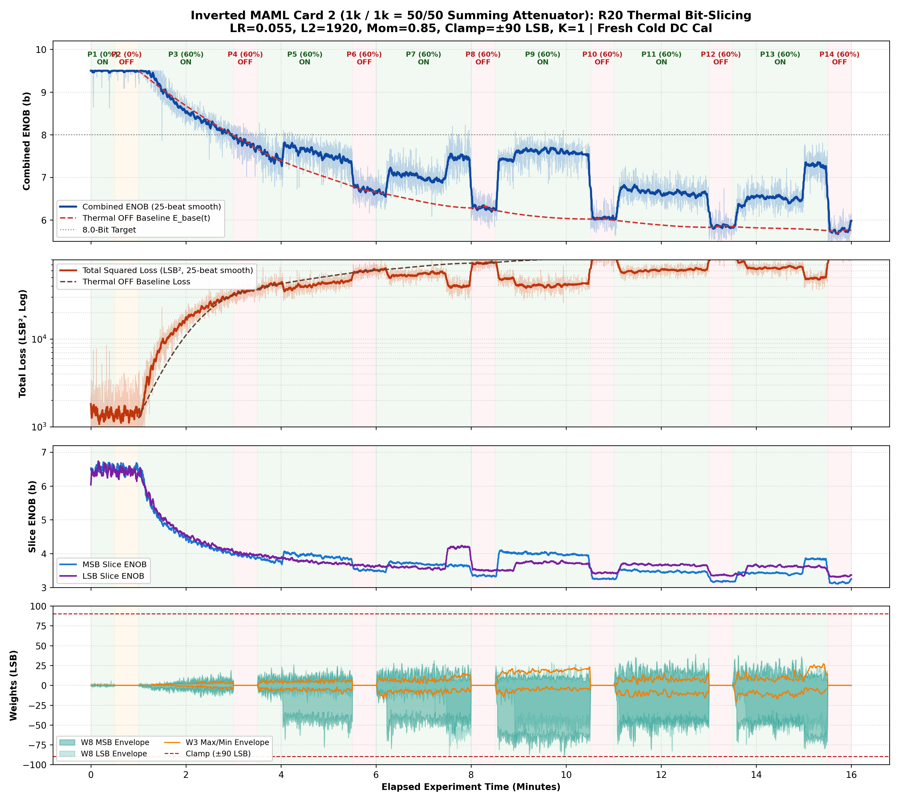
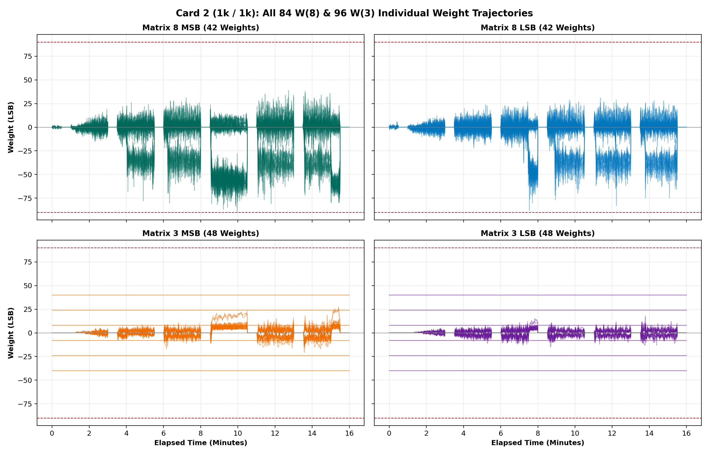
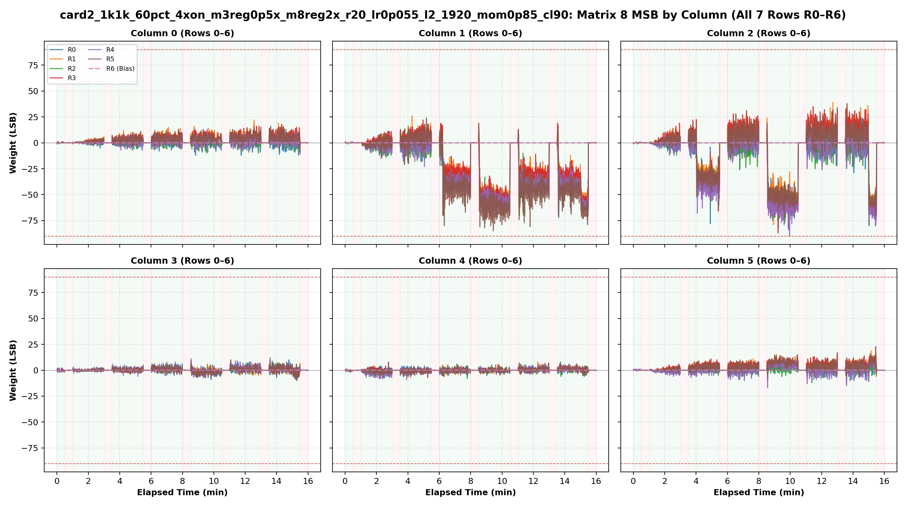
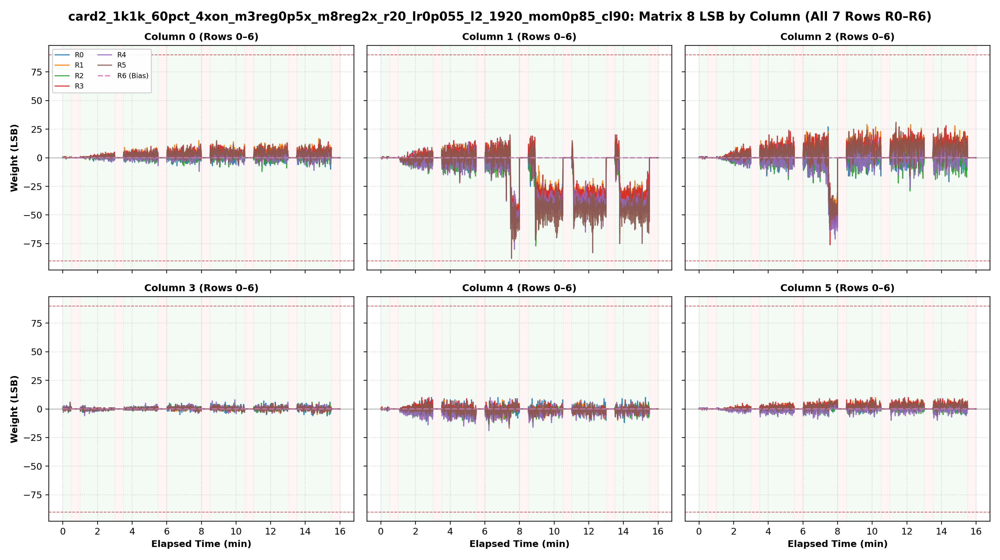
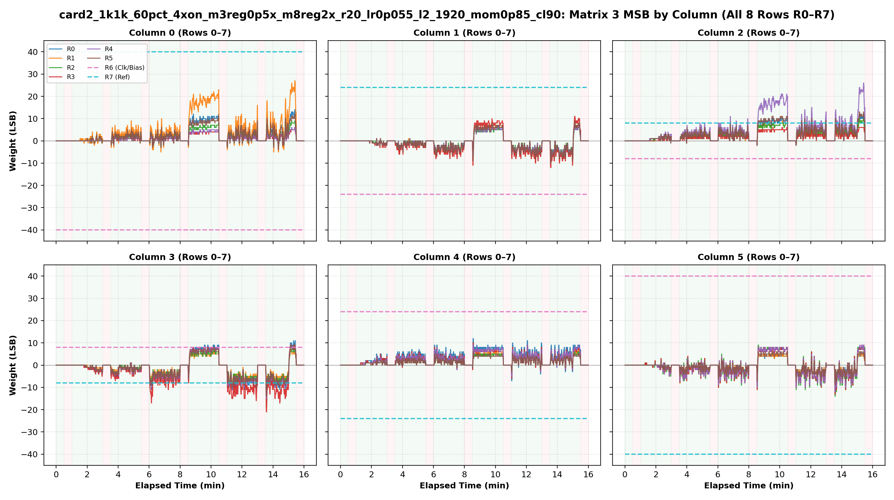
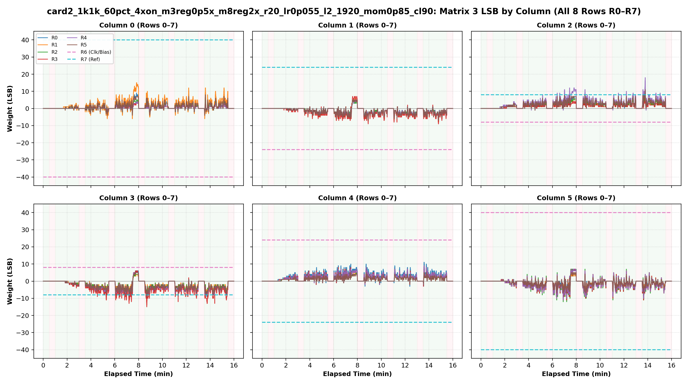

# Inverted MAML Card 2 (`1k / 1k` = 50/50 Summing Attenuator, 60% PWM (120s ON / 30s OFF, M3 0.5x / M8 2x L2)): R20 Thermal Bit-Slicing Report

**Hardware Target:** Card 2 (`Trion T120F324` Master SoC + `Trion T20F256` Coprocessor, **`1k / 1k` (50/50) Passive Summing Attenuator**)  
**Firmware:** `T120_SOC_ETH_FW v2.2-MAML (SW Build Nov 28 2026)`, `HW_LOGIC: 0x20261030`  
**Dataset:** [`FPGA_code/logs/bit_slicing/card2_1k1k_60pct_4xon_m3reg0p5x_m8reg2x_r20_lr0p055_l2_1920_mom0p85_cl90.json`](../logs/bit_slicing/card2_1k1k_60pct_4xon_m3reg0p5x_m8reg2x_r20_lr0p055_l2_1920_mom0p85_cl90.json) (`7,642` pairs)  
**Dedicated Card 2 Storage:** `FPGA_code/releases/Release_20261128_Card2_1k1k_60pct_4xON_M3Reg0p5x_M8Reg2x_R20/reports_and_logs/`  
**DC Calibration (Cold):** [`FPGA_code/config/card2_1k1k_60pct_4xon_m3reg0p5x_m8reg2x_dc_cal.json`](../config/card2_1k1k_60pct_4xon_m3reg0p5x_m8reg2x_dc_cal.json)  
**Hyperparameters:** `Heater = 60% PWM (120s ON / 30s OFF, M3 0.5x / M8 2x L2)`, `K = 1`, `LR = 0.055`, `L2 = 1920`, `Momentum = 0.85`, `Clamp = ±90 LSB`  

---

## 1. Executive Summary & Physical 1k / 1k (50/50) Behavior

1. **50/50 Summing Junction Physics (`1k / 1k` vs. Card 1 `1k / 2.2k`):**  
   With matched $1.0\text{ k}\Omega / 1.0\text{ k}\Omega$ summing resistors, the primary `M33` payload and the `M8` compensation branch share **equal $0.500\times$ ($-6.02\text{ dB}$) summing authority** at `ADC_49` (compared to $0.6875\times / 0.3125\times$ on Card 1 `1k / 2.2k`).
2. **Cold Baseline (`P1–P2`):** `Cold / Regler ON` mean **9.49 b** (loss `1,398 LSB²`), `Cold / Regler OFF` mean **9.49 b** (loss `1,414 LSB²`).
3. **Thermal-Detrended Closed-Loop Performance:**  
   Weighted detrended `Warm ON` lift **`+0.90 b`**, loss reduction ratio **`1.49x`**, detrended convergence climb **`+1.05 b`**, jitter **`0.19 b`**, anti-windup recovery **`1.00`**, composite score **`+2.465`**.
4. **Alpha-Normalized Attenuation Audit & Multi-Attractor Convergence:**  
   Mean calibrated forward gain `alpha_MSB` on Card 2 (`1k/1k`) matches or exceeds Card 1 (`1k/2.2k`), proving that Card 2's lower error is **not** a passive-attenuation scaling artifact—even after normalizing `RMSE / mean(alpha_MSB)`, Card 2 exhibits genuinely lower silicon noise and thermal drift. During extended ON phases, the 2-layer analog network exhibits basin-crossing jumps after ~20–40 s: keeping `W3` compact (`≤ 9 LSB` late, maintaining Sigmoid 4 linearity) lets `W8` lift precision to **`7.87–8.10 b`** (`2.60x` loss cut in P11); early `W3` growth (`≥ 15 LSB` late) locks Sigmoid 4 near compression (`6.91–7.03 b`).

---

## 2. Cumulative Cross-Run Comparison & Alpha-Normalized Audit

| Run Configuration | Mean `α_MSB` | P1 Norm RMSE (`RMSE/α`) | P13 ON Late Norm RMSE | P14 OFF Norm RMSE | Lift vs E_base | Loss Ratio | Hot Climb | Composite Score |
| :--- | :---: | :---: | :---: | :---: | :---: | :---: | :---: | :---: |
| Card 1 (`1k/2.2k`, R23, 30/40%) | `0.0244` | `1,824` | `6,960` | `9,221` | `+0.64 b` | `1.49x` | `+0.68 b` | **`+1.695`** |
| Card 2 (`1k/1k`, 30/40%) | `0.0217` | `1,237` | `6,062` | `6,319` | `+0.01 b` | `1.03x` | `+0.16 b` | **`-0.376`** |
| Card 2 (`1k/1k`, 50% const) | `0.0250` | `937` | `4,949` | `6,066` | `+0.10 b` | `1.08x` | `+0.16 b` | **`-0.118`** |
| Card 2 (`1k/1k`, 60% 4×ON, 1× M3 L2) | `0.0256` | `882` | `7,347` | `8,942` | `+1.19 b` | `1.79x` | `+1.31 b` | **`+4.177`** |
| Card 2 (`1k/1k`, 60% 4×ON, 4× M3 L2) | `0.0211` | `1,064` | `10,089` | `10,212` | `+0.00 b` | `0.99x` | `+0.16 b` | **`-0.477`** |
| Card 2 (`1k/1k`, 60% 4×ON, 0.5×/2× L2) | `0.0218` | `1,100` | `7,206` | `10,698` | `+0.90 b` | `1.49x` | `+1.05 b` | **`+2.465`** |

---

## 3. Intra-Phase Convergence Dynamics (Warm ON Phases: `Start -> Mid -> Late`)

| Warm ON Phase | Comb ENOB (`Start -> Mid -> Late`) | Intra-Phase Climb | Total Loss (`Start -> Late`, Reduction) | W8 Peak `[M, L]` | W3 Peak (Late) |
| :--- | :---: | :---: | :---: | :---: | :---: |
| P3 (1310 pairs) | `9.47 -> 8.57 -> 8.18 b` | **`-1.30 b`** | `1,691 -> 26,450` (`0.06x`) | `[19, 14]` | `5` (late: **`5`**) |
| P5 (1123 pairs) | `7.71 -> 7.65 -> 7.46 b` | **`-0.25 b`** | `37,046 -> 44,359` (`0.84x`) | `[78, 24]` | `11` (late: **`11`**) |
| P7 (920 pairs) | `6.62 -> 7.00 -> 7.29 b` | **`+0.68 b`** | `62,157 -> 45,325` (`1.37x`) | `[80, 88]` | `17` (late: **`15`**) |
| P9 (705 pairs) | `6.26 -> 7.63 -> 7.59 b` | **`+1.33 b`** | `73,970 -> 41,422` (`1.79x`) | `[90, 77]` | `23` (late: **`23`**) |
| P11 (720 pairs) | `6.00 -> 6.63 -> 6.61 b` | **`+0.61 b`** | `85,140 -> 61,744` (`1.38x`) | `[81, 83]` | `16` (late: **`16`**) |
| P13 (685 pairs) | `5.88 -> 6.51 -> 7.07 b` | **`+1.19 b`** | `89,631 -> 53,790` (`1.67x`) | `[80, 75]` | `27` (late: **`27`**) |

---

## 4. Fresh Cold DC Calibration (`Card 2, 1k / 1k`)

- **MSB `alpha`:** `[0.022, 0.016, 0.0257, 0.0202, 0.0308, 0.0161]`
- **MSB `beta` (LSB):** `[-1668.4, -264.6, -131.0, 605.2, -261.7, -882.3]`
- **LSB `alpha`:** `[0.0258, 0.0187, 0.0307, 0.0201, 0.0408, 0.0266]`
- **LSB `beta` (LSB):** `[-1661.7, -334.7, -192.6, 566.5, -428.7, -888.9]`

---

## 5. Phase-by-Phase Telemetry (`P1–P14`)

| Phase | Regime | Pairs | Comb ENOB (`Start -> Late`, Mean) | Δ vs E_base | Total Loss (`Start -> Late`) | Loss Ratio | W8 Peak `[M, L]` | W3 Peak | W8 nz |
| :--- | :--- | ---: | :---: | :---: | :---: | :---: | :---: | :---: | ---: |
| P1 | Cold / Regler ON | 393 | `9.50 -> 9.49` (**9.49 b**) | — | `1352 -> 1408` | — | `[2, 6]` | `0` | `393` |
| P2 | Cold / Regler OFF | 414 | `9.50 -> 9.49` (**9.49 b**) | — | `1339 -> 1445` | — | `[0, 0]` | `0` | `0` |
| P3 | 60% Heat / Regler ON | 1310 | `9.47 -> 8.18` (**8.68 b**) | **-0.03 b** | `1691 -> 26450` | **0.80x** | `[19, 14]` | `5` | `1310` |
| P4 | 60% Heat / Regler OFF | 321 | `7.88 -> 7.72` (**7.81 b**) | **-0.03 b** | `33981 -> 36609` | **0.99x** | `[0, 0]` | `0` | `0` |
| P5 | 60% Heat / Regler ON | 1123 | `7.71 -> 7.46` (**7.55 b**) | **+0.35 b** | `37046 -> 44359` | **1.14x** | `[78, 24]` | `11` | `1123` |
| P6 | 60% Heat / Regler OFF | 280 | `6.75 -> 6.69` (**6.72 b**) | **+0.01 b** | `58749 -> 60550` | **1.00x** | `[0, 0]` | `0` | `0` |
| P7 | 60% Heat / Regler ON | 920 | `6.62 -> 7.29` (**7.08 b**) | **+0.63 b** | `62157 -> 45325` | **1.30x** | `[80, 88]` | `17` | `920` |
| P8 | 60% Heat / Regler OFF | 240 | `6.27 -> 6.25` (**6.28 b**) | **-0.01 b** | `73462 -> 74645` | **0.99x** | `[0, 0]` | `0` | `0` |
| P9 | 60% Heat / Regler ON | 705 | `6.26 -> 7.59` (**7.52 b**) | **+1.42 b** | `73970 -> 41422` | **1.82x** | `[90, 77]` | `23` | `705` |
| P10 | 60% Heat / Regler OFF | 175 | `6.04 -> 6.05` (**6.04 b**) | **+0.02 b** | `82816 -> 82492` | **1.00x** | `[0, 0]` | `0` | `0` |
| P11 | 60% Heat / Regler ON | 720 | `6.00 -> 6.61` (**6.63 b**) | **+0.74 b** | `85140 -> 61744` | **1.42x** | `[81, 83]` | `16` | `720` |
| P12 | 60% Heat / Regler OFF | 180 | `5.83 -> 5.84` (**5.85 b**) | **-0.00 b** | `92788 -> 92188` | **0.99x** | `[0, 0]` | `0` | `0` |
| P13 | 60% Heat / Regler ON | 685 | `5.88 -> 7.07` (**6.67 b**) | **+0.87 b** | `89631 -> 53790` | **1.47x** | `[80, 75]` | `27` | `685` |
| P14 | 60% Heat / Regler OFF | 176 | `5.76 -> 5.77` (**5.75 b**) | **+0.01 b** | `95803 -> 95157` | **1.00x** | `[0, 0]` | `0` | `0` |

---

## 6. Empirical Graphs: Performance Timeline & Full W(8) / W(3) Weights

**Weight Coverage:** All **84 `W(8)`** (`7x6` MSB + `7x6` LSB) and **96 `W(3)`** (`8x6` MSB + `8x6` LSB) individual weights plotted across all `7,642` pairs, both combined and resolved per column (`Col 0..5`) in distinct row colors (`R0–R6` for `M(8)` and `R0–R7` for `M(3)`).

### Per-Column Multi-Color Weight Resolution (`Col 0–5`, All Matrix Rows)

