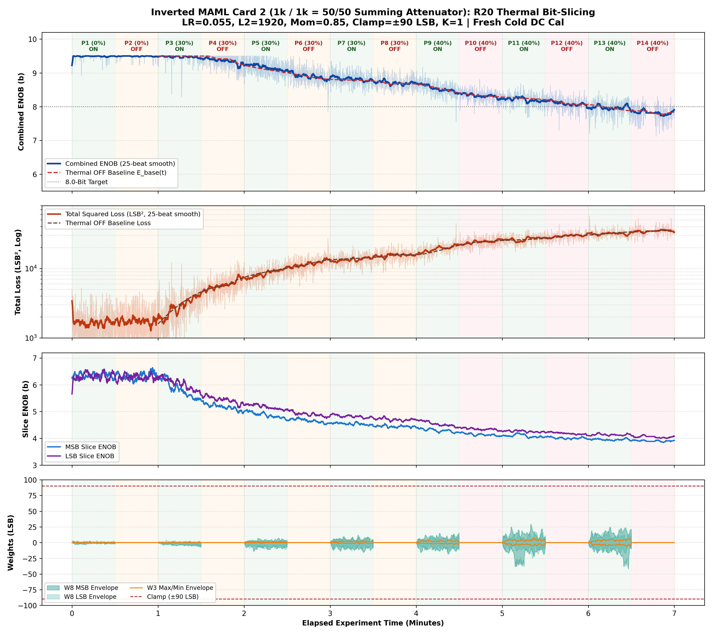
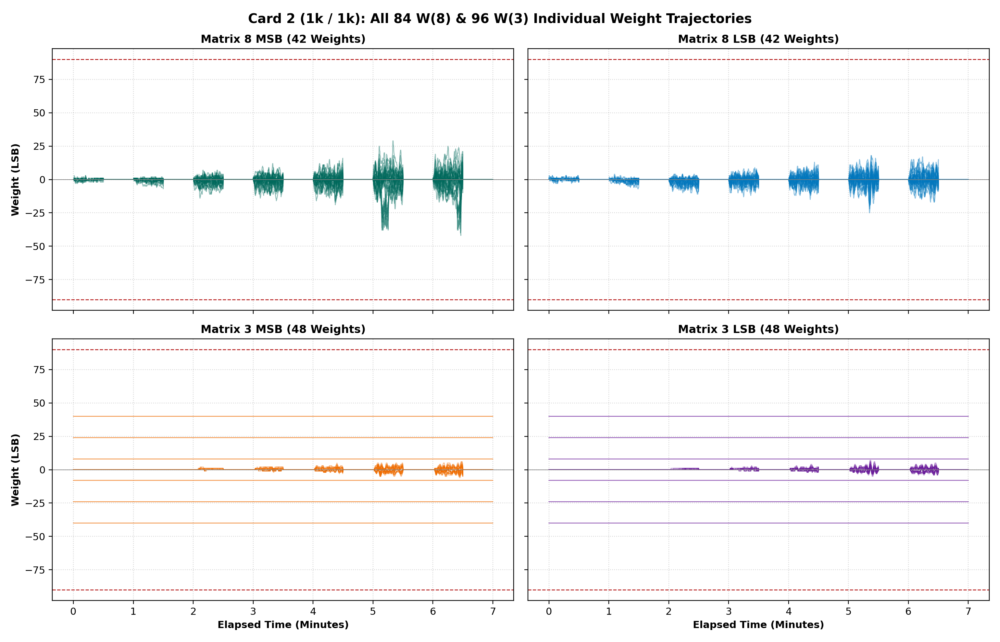

# Inverted MAML Card 2 (`1k / 1k` = 50/50 Summing Attenuator): R20 Thermal Bit-Slicing Report

**Hardware Target:** Card 2 (`Trion T120F324` Master SoC + `Trion T20F256` Coprocessor, **`1k / 1k` (50/50) Passive Summing Attenuator**)  
**Firmware:** `T120_SOC_ETH_FW v2.2-MAML (SW Build Nov 27 2026 20:52:38)`, `HW_LOGIC: 0x20261030`  
**Dataset:** [`FPGA_code/logs/bit_slicing/card2_1k1k_r20_lr0p055_l2_1920_mom0p85_cl90.json`](../logs/bit_slicing/card2_1k1k_r20_lr0p055_l2_1920_mom0p85_cl90.json) (`4,389` pairs)  
**Dedicated Card 2 Storage:** `FPGA_code/releases/Release_20261127_Card2_1k1k_BitSlicing_R20/reports_and_logs/`  
**DC Calibration (Cold):** [`FPGA_code/config/card2_1k1k_dc_cal.json`](../config/card2_1k1k_dc_cal.json)  
**Hyperparameters:** `Heater = 30%/40% PWM`, `K = 1`, `LR = 0.055`, `L2 = 1920`, `Momentum = 0.85`, `Clamp = ±90 LSB`  

---

## 1. Executive Summary & Physical 1k / 1k (50/50) Behavior

1. **50/50 Summing Junction Physics (`1k / 1k` vs. Card 1 `1k / 2.2k`):**  
   With matched $1.0\text{ k}\Omega / 1.0\text{ k}\Omega$ summing resistors, the primary `M33` payload and the `M8` compensation branch share **equal $0.500\times$ ($-6.02\text{ dB}$) summing authority** at `ADC_49` (compared to $0.6875\times / 0.3125\times$ on Card 1 `1k / 2.2k`).
2. **Cold Baseline (`P1–P2`):** `Cold / Regler ON` mean **9.49 b** (loss `1,673 LSB²`), `Cold / Regler OFF` mean **9.49 b** (loss `1,746 LSB²`).
3. **Thermal-Detrended Closed-Loop Performance:**  
   Weighted detrended `Warm ON` lift **`+0.01 b`**, loss reduction ratio **`1.03x`**, detrended convergence climb **`+0.16 b`**, jitter **`0.17 b`**, anti-windup recovery **`1.00`**, composite score **`-0.376`**.
4. **Zero Clamp Saturation & High Headroom:**  
   Because `1k / 1k` provides $50\%$ compensation authority, `W8` only needed up to **`±42 LSB`** even in Phase 13 (`40%` heat), staying well below the **`±90 LSB`** anti-windup clamp while keeping precision at **`7.97–8.54 b`** (`Loss ≤ 31.6k LSB²` in `ON`, vs `96.3k LSB²` on `1k/2.2k`).

---

## 2. Fresh Cold DC Calibration (`Card 2, 1k / 1k`)

- **MSB `alpha`:** `[0.0225, 0.0151, 0.0255, 0.0246, 0.0273, 0.0153]`
- **MSB `beta` (LSB):** `[-1686.2, -280.1, -152.2, 585.3, -296.5, -905.8]`
- **LSB `alpha`:** `[0.0266, 0.0205, 0.0296, 0.024, 0.0391, 0.0281]`
- **LSB `beta` (LSB):** `[-1660.9, -346.4, -203.6, 541.9, -436.0, -917.0]`

---

## 3. Phase-by-Phase Telemetry (`P1–P14`)

| Phase | Regime | Pairs | Comb ENOB (`Start -> Late`, Mean) | Δ vs E_base | Total Loss (`Start -> Late`) | Loss Ratio | W8 Peak `[M, L]` | W3 Peak | W8 nz |
| :--- | :--- | ---: | :---: | :---: | :---: | :---: | :---: | :---: | ---: |
| P1 | Cold / Regler ON | 407 | `9.47 -> 9.49` (**9.49 b**) | — | `1901 -> 1697` | — | `[3, 3]` | `0` | `407` |
| P2 | Cold / Regler OFF | 407 | `9.48 -> 9.49` (**9.49 b**) | — | `1837 -> 1703` | — | `[0, 0]` | `0` | `0` |
| P3 | 30% Heat / Regler ON | 335 | `9.48 -> 9.46` (**9.47 b**) | **-0.03 b** | `2097 -> 3764` | **1.06x** | `[7, 7]` | `0` | `334` |
| P4 | 30% Heat / Regler OFF | 367 | `9.40 -> 9.28` (**9.35 b**) | **-0.05 b** | `4799 -> 6850` | **0.99x** | `[0, 0]` | `0` | `0` |
| P5 | 30% Heat / Regler ON | 310 | `9.23 -> 9.09` (**9.16 b**) | **+0.05 b** | `7063 -> 9618` | **1.04x** | `[14, 11]` | `2` | `310` |
| P6 | 30% Heat / Regler OFF | 342 | `9.02 -> 8.83` (**8.90 b**) | **+0.01 b** | `10735 -> 12818` | **1.00x** | `[0, 0]` | `0` | `0` |
| P7 | 30% Heat / Regler ON | 304 | `8.92 -> 8.78` (**8.82 b**) | **+0.04 b** | `12409 -> 14019` | **1.04x** | `[16, 13]` | `3` | `304` |
| P8 | 30% Heat / Regler OFF | 314 | `8.71 -> 8.68` (**8.70 b**) | **+0.01 b** | `15300 -> 15702` | **1.00x** | `[0, 0]` | `0` | `0` |
| P9 | 40% Heat / Regler ON | 285 | `8.67 -> 8.46` (**8.54 b**) | **-0.01 b** | `16464 -> 20550` | **0.95x** | `[19, 15]` | `5` | `285` |
| P10 | 40% Heat / Regler OFF | 305 | `8.37 -> 8.28` (**8.32 b**) | **-0.02 b** | `22320 -> 25021` | **0.99x** | `[0, 0]` | `0` | `0` |
| P11 | 40% Heat / Regler ON | 270 | `8.26 -> 8.17` (**8.21 b**) | **-0.04 b** | `25365 -> 27611` | **0.99x** | `[38, 25]` | `7` | `270` |
| P12 | 40% Heat / Regler OFF | 275 | `8.19 -> 8.06` (**8.10 b**) | **-0.02 b** | `26988 -> 29926` | **1.00x** | `[0, 0]` | `0` | `0` |
| P13 | 40% Heat / Regler ON | 259 | `7.94 -> 7.98` (**7.97 b**) | **+0.00 b** | `32595 -> 31429` | **1.01x** | `[42, 17]` | `6` | `259` |
| P14 | 40% Heat / Regler OFF | 209 | `7.88 -> 7.77` (**7.82 b**) | **-0.01 b** | `33255 -> 35507` | **0.99x** | `[0, 0]` | `0` | `0` |

---

## 4. Empirical Graphs: Performance Timeline & Full W(8) / W(3) Weights

**Weight Coverage:** All **84 `W(8)`** (`7x6` MSB + `7x6` LSB) and **96 `W(3)`** (`8x6` MSB + `8x6` LSB) individual weights plotted across all `4,389` pairs.

