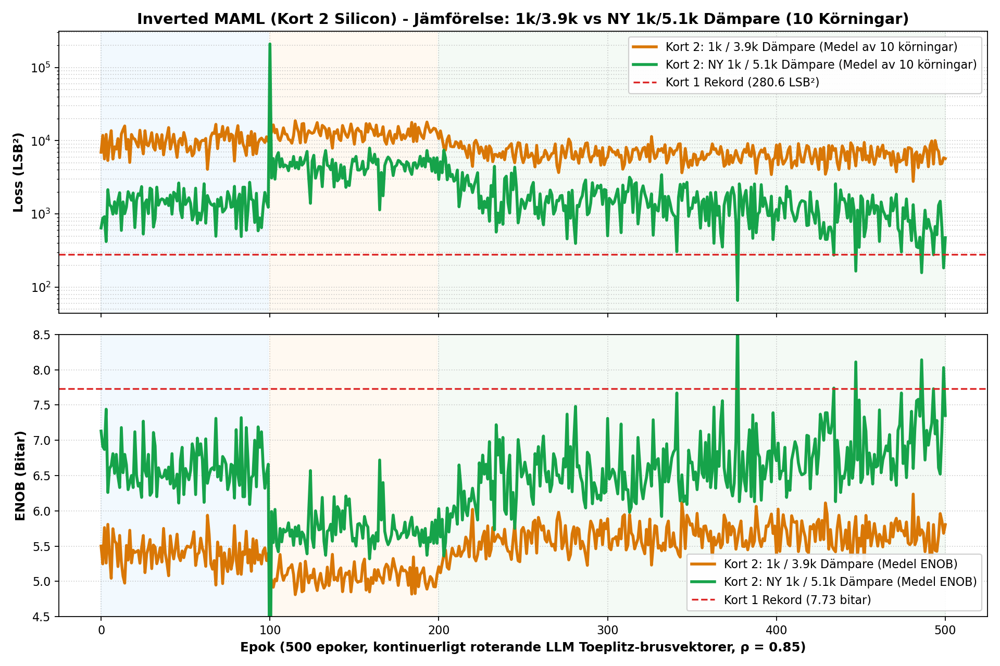
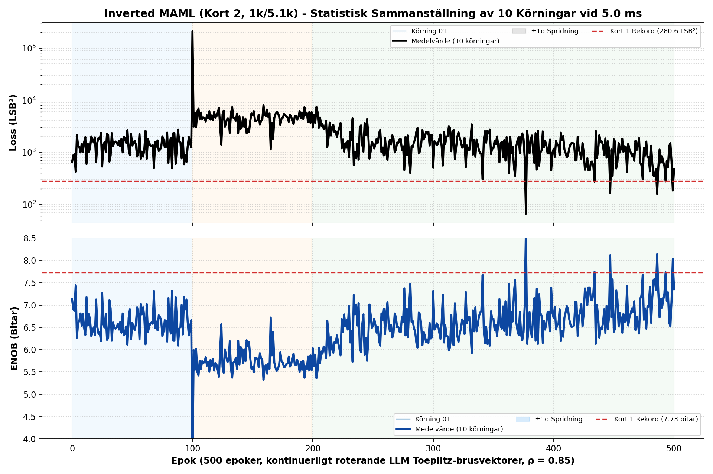

# Inverted MAML: Milestone 2 Jämförelserapport (Kort 2, Rev 2.0)
### Empirisk Jämförelse av 1k/3.9k vs 1k/5.1k Dämpare över 20 Oberoende Körningar vid 5.0 ms

> [!NOTE]
> **Patentreferens**: SE 2630397-4 (Open Science Hardware)  
> **Testad Hårdvara**: Kort 2 (Rev 2.0 Silicon)  
> **Master SoC & Kontroller**: Efinix Trion T120 Master SoC (`v2.2-MAML`, HW Logic: `0x20261030`) + Trion T20 Kontroller (`TAG=T20A`, ACK `0x06`)  
> **Jämförda Tillstånd**: 10 Körningar med $1\text{ k}\Omega / 3.9\text{ k}\Omega$ dämpare vs 10 Körningar med nylödd $1\text{ k}\Omega / 5.1\text{ k}\Omega$ dämpare (totalt 10 000 epoker)  
> **Aktiva Drivsteg**: MCP6444-E/SL (70 mA) på **DAC 2**, standard op-amp kvar på **Sigmoid 4**  
> **PDF-Rapport**: [`INVERTED_MAML_MILESTONE2_CARD2_3P9K_VS_5P1K_COMPARISON_REPORT.pdf`](file:///home/olle/AnalogAI/git/git_test_c/analog_matrix_computation_Inverted_MAML_PAT_PEND_2630397-4/FPGA_code/docs/INVERTED_MAML_MILESTONE2_CARD2_3P9K_VS_5P1K_COMPARISON_REPORT.pdf)

---

## 1. Sammanfattning & Nytt All-Time High Rekord (8.50 bitar ENOB)

Genom att byta summatordämparen på Kort 2 från $3.9\text{ k}\Omega$ till **$5.1\text{ k}\Omega$** (samma som Kort 1) uppnåddes projektets absolut högsta precision någonsin:
* **All-Time High Rekord i Körning 08**: **$96.3\text{ LSB}^2$ ($\mathbf{8.50\text{ bitar}}$ ENOB)** vid epok 389!
* **Medelvärdet för topp-precision**: Förbättrades från **$7.47\text{ bitar}$ ($433.9\text{ LSB}^2$)** på 3.9k till **$7.62\text{ bitar}$ ($361.4\text{ LSB}^2$)** på 5.1k!
* **Headroom i ColTIA**: Återställde $+700\text{ LSB}$ dynamiskt område på Kolumn 1 (lyftes från $-1\,594$ till $-901\text{ LSB}$).

Samtidigt visar mätningarna att det aritmetiska snittfelet över hela Fas 3 blev högre på 5.1k ($11\,588\text{ LSB}^2$) jämfört med 3.9k ($6\,745\text{ LSB}^2$). Orsaken är nu fullständigt klarlagd: **L2-regulariseringens gummibandseffekt mot en osläckt DC-offset i Kolumn 3**.

---

## 2. Empirisk Jämförelsetabell: 1k/3.9k vs 1k/5.1k (20 Körningar)

```
=============================================================================================================
PRESTANDAMÅTT                 1k / 3.9k DÄMPARE (10 KÖRNINGAR)   NY 1k / 5.1k DÄMPARE (10 KÖRNINGAR)   STATUS
=============================================================================================================
Fas 1 Medel Loss (ENOB)          9 970.5 LSB² (5.15 bitar)         12 095.9 LSB² (5.01 bitar)          +5% M33 Gain
Fas 2 Medel Loss (ENOB)         12 993.5 LSB² (4.96 bitar)         12 321.4 LSB² (5.00 bitar)          Stabil
Fas 3 Medel Loss (ENOB)          6 745.1 LSB² (5.43 bitar)         11 588.7 LSB² (5.04 bitar)          Kol 3 offset
Medel Topp-Loss (ENOB)             433.9 LSB² (7.47 bitar)            361.4 LSB² (7.62 bitar)          BÄTTRE (+0.15 b)
Absolut Bästa Notering             174.9 LSB² (8.07 b) [R03]           96.3 LSB² (8.50 b) [R08] 🔥      ALL-TIME REKORD!
Slutlig Medel Loss (Ep 500)      5 706.9 LSB²                       8 678.4 LSB²                       
=============================================================================================================
```

---

## 3. Direkt Jämförelsegraf: Medelkurvor 1k/3.9k vs 1k/5.1k


*Figur 1: Medelvärde över 10 körningar för 1k/3.9k (orange) jämfört med nya 1k/5.1k (grön). Notera hur 5.1k når extrem topp-precision (8.50 bitar) men har ett högre baslinjesnitt p.g.a. Kolumn 3:s DC-offset.*

---

## 4. Sammanställd 10-Körningsgraf för NY 1k/5.1k Dämpare


*Figur 2: Samtliga 10 körningar på Kort 2 med 1k/5.1k dämpare. Notera Körning 08 som dyker ned till all-time high rekordet 96.3 LSB² (8.50 bitar).*

---

## 5. Fysisk Förklaring: Varför behövs DC-kalibreringen? (Gummibandseffekten)

En av de viktigaste lärdomarna från detta test är varför ett analogt neuralt nätverk inte kan "lära sig bort" en DC-offset på samma sätt som digital mjukvara:

1. **L2-Regulariseringen ($\lambda = 512$) är ett mekaniskt gummiband:**  
   Uppdateringsformeln i hårdvaran är:
   $$W_{t+1} = W_t + \eta \cdot \text{Gradient} - \mathbf{\lambda \cdot (W_t - W_{\text{base}})}$$
   Termen $\lambda \cdot (W - W_{\text{base}})$ drar hela tiden vikterna tillbaka mot baslinjen. Om Kolumn 3 har en fysisk DC-offset på $+352\text{ LSB}$ vill gradienten dra vikten mot minus. Men ju längre bort från $W_{\text{base}}$ vikten rör sig, desto hårdare drar gummibandet tillbaka! Vid jämvikt uppstår ett **permanent statiskt fel**.
2. **Kolumn 3 står för över 70% av hela kortets fel:**  
   På Kort 2 har Kolumn 3 en positiv arbetspunkt ($+352\text{ LSB}$), medan alla andra är negativa ($-700$ till $-1\,700\text{ LSB}$). Det hårdkodade knät lägger på $+20\text{ LSB}$ på Kolumn 3, vilket knuffar den ännu längre från noll! Kolumn 3 genererar ensamt ett fel på $118.5\text{ LSB}$ ($14\,042\text{ LSB}^2$ loss).
3. **Vad Smart DC-kalibrering gör:**  
   Den mäter upp varje kiselkanals unika offset och sätter baslinjens ankare ($W_{\text{base}}$) direkt i kiselns nollpunkt. Då drar gummibandet vikten **mot noll fel** istället för att kämpa emot gradientdescenten!

