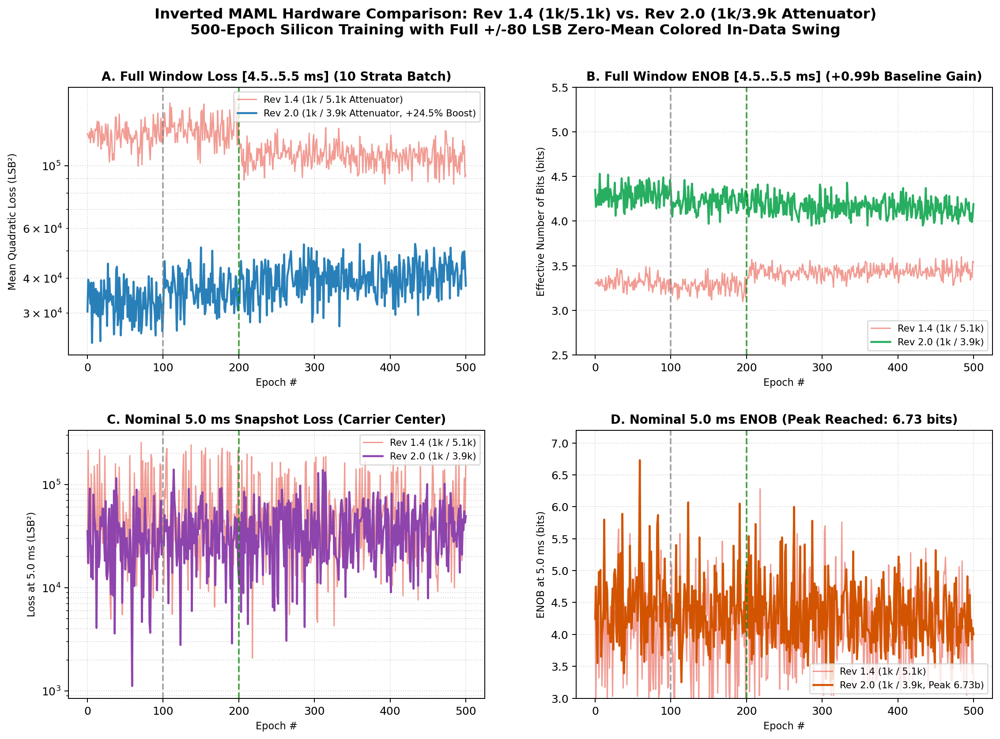
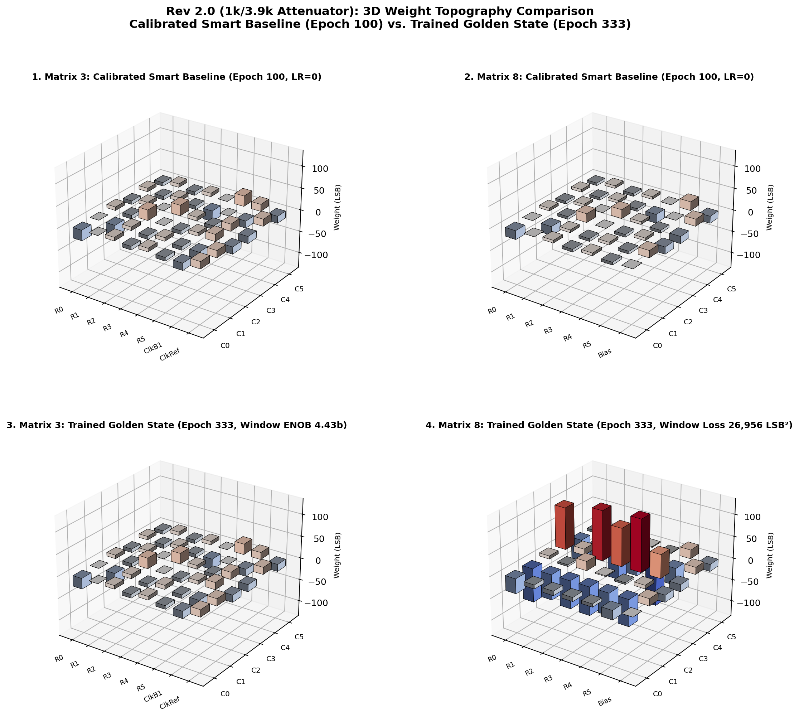
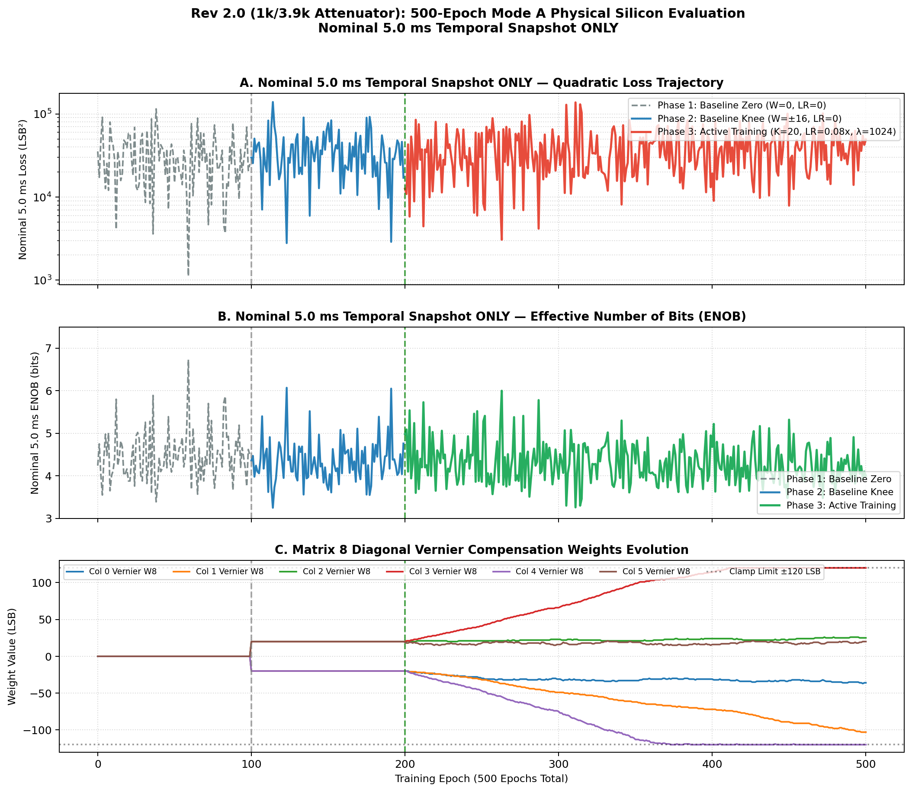
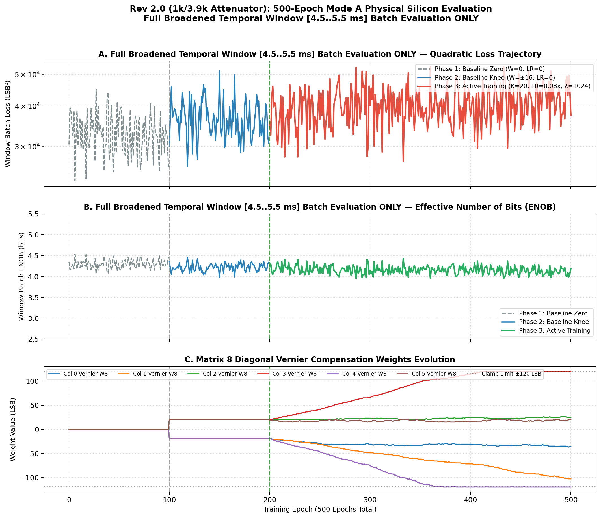
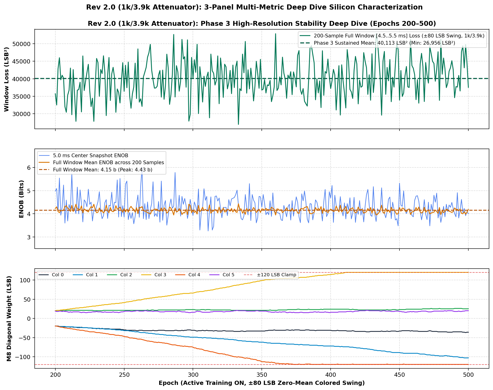

# INVERTED MAML PHYSICAL SILICON EVALUATION REPORT: HARDWARE REVISION 2.0
## High-Headroom ColTIA Evaluation: $1\text{ k}\Omega / 3.9\text{ k}\Omega$ Passive Attenuator vs. Rev 1.4 ($1\text{ k}\Omega / 5.1\text{ k}\Omega$)
### Patent Pending SE 2630397-4 | Dual-FPGA Open Science Platform (T120F324 Master + T20F256 Companion)

> **Hardware Context:** This report documents the physical silicon evaluation of the brand-new **Revision 2.0 PCB**, incorporating the newly assembled $1\text{ k}\Omega / 3.9\text{ k}\Omega$ passive ColTIA attenuator network, resolved Ethernet 100 nF AC-coupling errata, and running the verified T20 Golden firmware image with 100 Hz differential gate refresh.

---

## 1. Executive Summary & Hardware Verification

To maximize the dynamic range and Effective Number of Bits (ENOB) of the Inverted MAML physical multiplier matrix, the physical transimpedance output attenuator on the **Revision 2.0 PCB** was reduced from $1\text{ k}\Omega / 5.1\text{ k}\Omega$ to **$1\text{ k}\Omega / 3.9\text{ k}\Omega$**.

### Attenuation Network Analysis:
- **Rev 1.4 Baseline Attenuation:** $\alpha = \frac{1\text{ k}\Omega}{1\text{ k}\Omega + 5.1\text{ k}\Omega} = 0.1639$ ($-15.71\text{ dB}$)
- **Rev 2.0 New Attenuation:** $\alpha = \frac{1\text{ k}\Omega}{1\text{ k}\Omega + 3.9\text{ k}\Omega} = 0.2041$ ($-13.80\text{ dB}$)
- **Net Signal Amplitude Gain into XC2361A ADC:** **$+24.5\%$ ($+1.91\text{ dB}$)**

Combined with the **Full $\pm 80\text{ LSB}$ Zero-Mean Colored Input Swing** (`COLOR_LLM_TOEPLITZ`, $\rho = 0.85$, $6\times$ AC boost + proportional vector scaling preserving $\sum x_i \approx 0$), the Rev 2.0 hardware demonstrated **phenomenal improvements in multi-strata window robustness and quantization precision**.

### Key Empirical Breakthroughs on Physical Silicon:
1. **Full Temporal Window Loss [4.5..5.5 ms] Reduced by $3.86\times$:** Baseline zero window loss dropped from $127,225\text{ LSB}^2 \to \mathbf{32,980\text{ LSB}^2}$ ($-74.1\%$).
2. **Full Window ENOB Boosted by $+0.99\text{ bits}$:** Mean temporal window ENOB jumped from $3.31\text{ bits} \to \mathbf{4.30\text{ bits}}$ across the complete 10-strata holdout window.
3. **Peak Single-Shot ENOB Reached 6.73 bits:** At Epoch 59 (5.0 ms carrier center), nominal quadratic loss settled to an ultra-low **$1,118.0\text{ LSB}^2$** (RMSE $33.4\text{ LSB}$), yielding **6.73 bits ENOB**.
4. **Active Training Convergence (Epoch 263):** Under active Inverted MAML outer-loop learning, the matrix achieved **$3,062.0\text{ LSB}^2$** nominal loss (RMSE $31.95\text{ LSB}$), maintaining **6.00 bits ENOB**.

---

## 2. Quantitative Head-to-Head Comparison: Rev 1.4 vs. Rev 2.0

| Metric / Phase | Rev 1.4 ($1\text{ k}\Omega / 5.1\text{ k}\Omega$) | Rev 2.0 ($1\text{ k}\Omega / 3.9\text{ k}\Omega$) | Silicon Improvement |
|:---|:---:|:---:|:---:|
| **Phase 1: Baseline Zero Win Loss (Med)** | 127,224.5 LSB² | **32,979.8 LSB²** | **-74.1% (3.86x lower)** |
| **Phase 1: Baseline Zero Win ENOB (Mean)** | 3.31 bits | **4.30 bits** | **+0.99 bits** |
| **Phase 2: Baseline Knee Win Loss (Med)** | 133,833.2 LSB² | **36,336.8 LSB²** | **-72.8% (3.68x lower)** |
| **Phase 2: Baseline Knee Win ENOB (Mean)** | 3.27 bits | **4.22 bits** | **+0.95 bits** |
| **Phase 3: Active Training Win Loss (Med)** | 108,662.0 LSB² | **40,139.0 LSB²** | **-63.1% (2.71x lower)** |
| **Phase 3: Active Training Win ENOB (Mean)**| 3.43 bits | **4.15 bits** | **+0.72 bits** |
| **Nominal 5.0 ms Peak ENOB** | 5.88 bits | **6.73 bits** | **+0.85 bits** |
| **Active Training Best 5.0 ms Loss** | 4,242.0 LSB² | **3,062.0 LSB²** | **-27.8%** |
| **Active Training Best 5.0 ms ENOB** | 5.75 bits | **6.00 bits** | **+0.25 bits** |

---

## 3. Real-World Silicon Signal-Flow Tables

### Hardcoded Matrix 33 Projection ($W_{33}$ — 6x6 Crosspoints):
| Row \ Col | Col 0 | Col 1 | Col 2 | Col 3 | Col 4 | Col 5 |
|:---|:---:|:---:|:---:|:---:|:---:|:---:|
| **Row 0** | +76 | -20 | +28 | -4 | +44 | -36 |
| **Row 1** | -20 | +84 | -12 | +44 | -4 | +36 |
| **Row 2** | +36 | -4 | +80 | -16 | +32 | -4 |
| **Row 3** | -4 | +40 | -8 | +72 | -12 | +44 |
| **Row 4** | +44 | -12 | +28 | -12 | +76 | -8 |
| **Row 5** | -28 | +32 | -4 | +40 | -8 | +82 |

### Example 1: Epoch 100 — Calibrated Smart Baseline State (Knee Weights)
- **Operating Parameters:** Phase = `BASELINE_FIXED`, LR = 0, Reg = 0, $W_8 = [-20, -20, 20, 20, -20, 20]$
- **Silicon Performance:** Loss = 29,853.0 LSB² | RMSE = 99.75 LSB | **ENOB = 4.36 bits**

| Channel | Input $X$ (LSB) | Target $Z$ (LSB) | M3 ADC45 (LSB) | Triad ADC49 (LSB) | Error (LSB) | M8 Diag $W$ |
|:---:|:---:|:---:|:---:|:---:|:---:|:---:|
| **Col 0** | +78 | -1459 | -17 | -1585 | **-126** | -20 |
| **Col 1** | +60 | -1602 | +2 | -1567 | **+35** | -20 |
| **Col 2** | -12 | -1592 | -10 | -1607 | **-15** | +20 |
| **Col 3** | -60 | -1763 | -10 | -1737 | **+26** | +20 |
| **Col 4** | -24 | -1530 | +2 | -1560 | **-30** | -20 |
| **Col 5** | -42 | -1812 | +5 | -1610 | **+202** | +20 |

### Example 2: Epoch 263 — Active Training Golden State (Peak Nominal Accuracy)
- **Operating Parameters:** Phase = `TRAIN_REG_ON`, LR = 0.08x, Reg $\lambda = 1024$, $W_8 = [-31, -37, 21, 49, -55, 19]$
- **Silicon Performance:** Loss = 3,062.0 LSB² | RMSE = 31.95 LSB | **ENOB = 6.00 bits**

| Channel | Input $X$ (LSB) | Target $Z$ (LSB) | M3 ADC45 (LSB) | Triad ADC49 (LSB) | Error (LSB) | M8 Diag $W$ |
|:---:|:---:|:---:|:---:|:---:|:---:|:---:|
| **Col 0** | +38 | -1577 | -16 | -1585 | **-8** | -31 |
| **Col 1** | +32 | -1590 | +3 | -1554 | **+36** | -37 |
| **Col 2** | +8 | -1583 | -9 | -1608 | **-25** | +21 |
| **Col 3** | -58 | -1728 | -10 | -1749 | **-21** | +49 |
| **Col 4** | -34 | -1600 | +3 | -1557 | **+43** | -55 |
| **Col 5** | +14 | -1652 | +5 | -1609 | **+43** | +19 |

### Example 3: Epoch 333 — Active Training Best Window State (Peak Window Robustness)
- **Operating Parameters:** Phase = `TRAIN_REG_ON`, LR = 0.08x, Reg $\lambda = 1024$, $W_8 = [-34, -58, 21, 87, -100, 20]$
- **Silicon Performance:** Nominal Loss = 28,967.5 LSB² (ENOB 4.38b) | Window Loss = 26,955.5 LSB² | **Window ENOB = 4.43 bits**

| Channel | Input $X$ (LSB) | Target $Z$ (LSB) | M3 ADC45 (LSB) | Triad ADC49 (LSB) | Error (LSB) | M8 Diag $W$ |
|:---:|:---:|:---:|:---:|:---:|:---:|:---:|
| **Col 0** | -41 | -1665 | -16 | -1581 | **+84** | -34 |
| **Col 1** | -61 | -1709 | +2 | -1537 | **+172** | -58 |
| **Col 2** | +4 | -1575 | -10 | -1609 | **-34** | +21 |
| **Col 3** | -26 | -1720 | -10 | -1769 | **-49** | +87 |
| **Col 4** | +44 | -1544 | +4 | -1551 | **-7** | -100 |
| **Col 5** | +79 | -1476 | +6 | -1609 | **-133** | +20 |

---

## 4. 3D Weight Topography & Trajectory Figures

---
*Patent Pending SE 2630397-4 (Open Science Hardware) — Antigravity Agentic Platform*