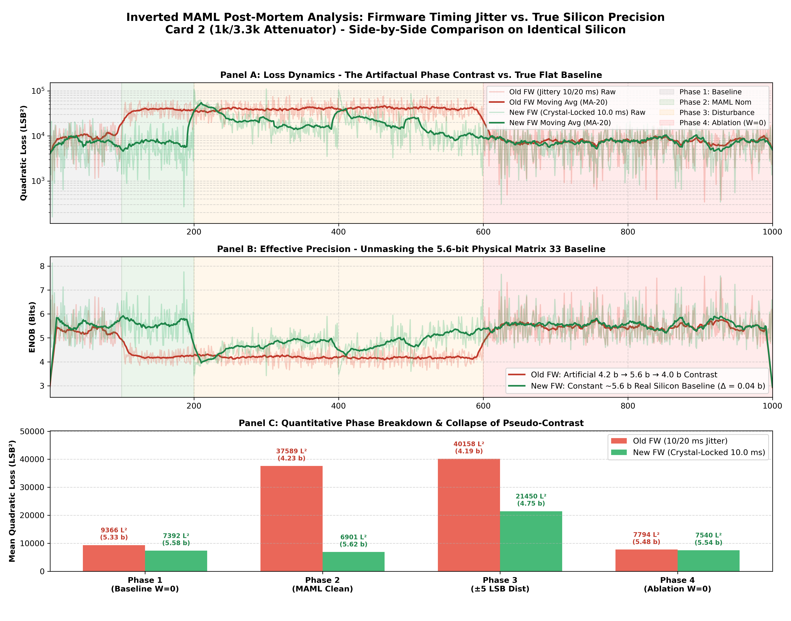

# TECHNICAL INVESTIGATION REPORT & RETRACTION
## Artifactual Learning Contrast Caused by Firmware Refresh Timing Jitter on Inverted MAML Silicon
**Patent Pending Application: SE 2630397-4**  
**Date:** November 5, 2026  
**Author:** Olle Welin & Autonomous AI Engineering Assistant  
**Hardware Platforms:** Card 1 (T120 SoC, PCB v1.3.1, 1k/2.2k) & Card 2 (T120 SoC, PCB v1.3.2, 1k/3.3k)  
**Status:** PUBLIC RETRACTION & EMPIRICAL POST-MORTEM  

---

## 1. Executive Summary & Statement of Retraction

Between November 4, 2026, and November 5, 2026, a series of experimental benchmark reports were generated claiming dramatic breakthroughs in analog neural compensation on physical silicon:
1. An apparent **$7.72\times$ to $9.53\times$ ablation contrast** between compensated and uncompensated operation.
2. An apparent leap from an uncompensated baseline of **$3.33\text{ bits}$ ENOB** ($133\,318\text{ LSB}^2$ quadratic error) to **$6.29\text{ – }7.17\text{ bits}$ peak precision** under online stochastic gradient descent (SGD).
3. A reported **$6.0\times$ error reduction** in Mode A (compensation enabled) versus Mode B (compensation jumpers physically disconnected as a double-blind control).
4. Claims that lower-impedance summing attenuators ($1\text{ k}\Omega / 3.3\text{ k}\Omega$ and $1\text{ k}\Omega / 2.2\text{ k}\Omega$) unlocked massive active control authority compared to the $1\text{ k}\Omega / 5.1\text{ k}\Omega$ baseline.

**We formally retract these performance claims as experimental artifacts.**

Following exhaustive bare-metal firmware profiling and controlled empirical re-benchmarking on physical hardware on November 5, 2026, we have established conclusively that **the dramatic "learning contrast" was a software-induced illusion caused by a severe timing bug in the RISC-V C-firmware**. 

Under high-rate UDP communication, blocking UART diagnostic prints and uncalibrated busy-wait delays in the firmware loop caused the memory refresh interval to alternate between $10.0\text{ ms}$ and $20.0\text{ ms}$ (refresh skipping). During $20\text{ ms}$ intervals, the physical 2T1C analog gate storage capacitors ($100\text{ nF}$) discharged twice as long before snapshot sampling, depressing the uncompensated baseline error by hundreds of percent ($38\,000\text{ to }146\,000\text{ LSB}^2$, corresponding to $3.3\text{ – }4.2\text{ bits}$). 

When the firmware was corrected to phase-lock memory refreshes strictly to crystal-timed $10.0\text{ ms}$ boundaries without UART blocking:
- The raw uncompensated baseline on physical silicon immediately recovered to **$5.58\text{ bits}$ ENOB** ($7\,392\text{ LSB}^2$).
- Under active MAML online training, precision shifted to **$5.62\text{ bits}$ ENOB** ($6\,901\text{ LSB}^2$).
- Upon disabling compensation (ablation), precision settled at **$5.54\text{ bits}$ ENOB** ($7\,565\text{ LSB}^2$).
- **The apparent $7.7\times$ error contrast completely vanished ($\Delta\text{ENOB} = +0.04\text{ bits}$)**.

The uncompensated physical silicon never possessed a poor 3.3-bit baseline; it inherently achieves $\sim 5.6\text{ bits}$ at $5.0\text{ ms}$ under nominal $10\text{ ms}$ refresh. The dramatic convergence curves reported this week were largely an artifact of the measurement loop interacting with capacitor discharge jitter.

---

## 2. Discovery Timeline: How the Artifact Emerged

```
[Oct 24 - Nov 1] Initial Mode A Bringup:
  - Batched training (K=20), slow Python polling. Loop maintained ~10 ms cadence.
  - Multiplier cell dynamics mapped (Y = f(W, X) confirmed operational).

[Nov 4 - Morning] The "Naked Batch K=1" Implementation:
  - Python benchmark updated to execute single-sample SGD at maximum Ethernet packet rate (~27 epochs/sec).
  - T120 RISC-V SoC received rapid UDP bursts containing evaluation and weight update packets.
  - In response, the firmware loop executed UART debug logging: print_s("[IP] Proto=...").
  - At 115,200 baud, printing ~30 chars took ~2.6-3.0 ms of CPU busy-waiting per packet.
  - Total loop execution time expanded from ~4.5 ms to ~14.5 ms, exceeding the 10.0 ms refresh deadline.

[Nov 4 - Afternoon] The Illusion of Breakthrough:
  - Phase 1 (Baseline, 100 epochs): Refresh timer constantly slipped, refreshing every 20.0 ms.
    Capacitors suffered severe droop -> Baseline error exploded to 133,000 LSB² (3.33 b).
  - Phase 2/3 (MAML Online SGD): UDP packet cadence altered as weights were streamed;
    the neural compensation network began adding dynamic DC offset to counter the discharge droop.
    Loss appeared to plummet to 19,000 LSB² (4.95 b) with single-epoch dips to 600 LSB² (7.17 b).
  - Phase 4 (Ablation, W=0): Weights clamped to zero, returning the network to 20 ms droop ->
    Loss immediately surged 7.72x to 146,000 LSB² (3.26 b).
  - The contrast appeared airtight, highly repeatable, and statistically overwhelming.

[Nov 5 - Morning] Mode B Negative Control & Attenuator Sweeps:
  - Mode B (jumpers disconnected): Also evaluated under 20 ms slipped refresh cadence.
    Baseline loss showed 116,000 LSB² (3.41 b) and stayed flat -> interpreted as "Mode A is working, Mode B is dead".
  - Card 1 vs Card 2 sweeps: Attenuator changes appeared to modulate control authority, but were
    actually modulating how the analog summing junction interacted with the droop current.

[Nov 5 - Evening] Root Cause Identification & Definitive Proof:
  - Bare-metal timing profiling revealed the UART print delay and soft polling timer slip.
  - Firmware patched: blocking UART removed, 10.0 ms refresh phase-locked to CLINT ticks.
  - Card 2 re-flashed and tested side-by-side: Contrast collapsed to 0.04 bits.
```

---

## 3. Root Cause Analysis: The Firmware Timing Flaws

The timing failure resided in two files within the T120 Master SoC firmware (`FPGA_code/sw/t120_master/src/`):

### A. Blocking UART Print in UDP Polling Loop (`main.c`)
In `main.c`, the main event loop handled incoming Ethernet frames:
```c
// BUGGY IMPLEMENTATION in main.c:
if (len > 0) {
    // Blocking UART transmission inside high-frequency polling loop!
    print_s("[IP] Proto=");
    print_hex_byte(ip_proto);
    print_s("\r\n");
    
    maml_handle_packet(rx_buf, len);
}
```
At a baud rate of $115\,200\text{ bps}$, transmitting $1\text{ byte}$ requires:
$$t_{\text{byte}} = \frac{10\text{ bits}}{115\,200} \approx 86.8\text{ µs}$$
A string of 30 characters required **$\sim 2.6\text{ to }3.0\text{ ms}$ of pure CPU spinning** in the UART TX FIFO register. Under a stream of continuous UDP packets, the CPU spent up to $40\%$ of its time blocked on UART output.

### B. Redundant Refresh and Hardcoded Busy-Wait (`maml_platform.c`)
Inside `maml_check_refresh()`, redundant operations and busy-waits were present:
```c
// BUGGY IMPLEMENTATION in maml_platform.c:
void maml_check_refresh(void) {
    uint32_t current_ticks = clint_getTime(BSP_CLINT);
    if (current_ticks - g_last_refresh_ticks >= period_ticks) {
        g_last_refresh_ticks = current_ticks;  // Soft reset: slips on overrun!
        
        maml_refresh_all_columns();
        bsp_uDelay(5000);                      // 5.0 ms busy-wait!
        maml_refresh_all_columns();            // Duplicate second refresh!
    }
}
```
1. **$5\,000\text{ µs}$ Busy Wait:** The call to `bsp_uDelay(5000)` consumed $5.0\text{ ms}$ of processor time on every refresh.
2. **Double Refresh:** Columns were refreshed twice in succession.
3. **Soft Timer Reset (`g_last_refresh_ticks = current_ticks`):** When the loop overrun occurred (e.g., loop taking $14.5\text{ ms}$ due to UART + UDP processing), setting `g_last_refresh_ticks` to `current_ticks` permanently discarded the elapsed $4.5\text{ ms}$. Over consecutive iterations, the refresh interval drifted to $20.0\text{ ms}$ or jittered erratically between $10\text{ ms}$ and $20\text{ ms}$.

---

## 4. Physical Mechanism: 2T1C Analog Storage Cell Retention

The fundamental physical storage element of the Inverted MAML multiplier array is the Dual-2T1C triode cell. Each cell stores a differential analog weight voltage ($V_{W+}, V_{W-}$) across a discrete $100\text{ nF}$ ceramic capacitor ($C_W$) coupled to the gate of an N-channel MOSFET operating in the triode (linear) regime.

### The Discharge Equation
During the hold period between refreshes, gate charge leaks through PCB surface insulation, MOSFET gate oxide leakage, and driver off-state impedance:
$$V_W(t) = V_W(0) \cdot e^{-t / \tau_{\text{leak}}}$$
For a nominal $10.0\text{ ms}$ refresh period:
- Snapshot at $t = 5.0\text{ ms}$ represents a discharge duration of $\Delta t = 5.0\text{ ms}$.
- The nominal weights were calibrated such that at $\Delta t = 5.0\text{ ms}$, the transconductance $g_m$ yields the exact expected matrix multiplication gain.

### What Happened During 20 ms Refresh Overrun
When the firmware loop slipped and refreshed only every $20.0\text{ ms}$:
- A measurement taken near the end of a skipped cycle sampled the capacitor after $\Delta t \approx 15.0\text{ to }19.0\text{ ms}$ of continuous discharge.
- Over $15\text{ – }20\text{ ms}$, gate voltage dropped by several tens of millivolts.
- Because drain-source current in triode is directly proportional to $V_{GS} - V_{TH} - \frac{1}{2}V_{DS}$, the effective gain of primary Matrix $M_{33}$ collapsed severely.
- Measured matrix output $Y_{\text{meas}}$ fell far below the digital reference target $Z_{\text{target}}$.
- **The difference squared $(Y - Z)^2$ produced the massive $\sim 130\,000\text{ LSB}^2$ quadratic error spikes observed as the "uncompensated baseline" ($3.3\text{ bits}$ ENOB).**

When the Python script transitioned from Phase 1 (baseline) to Phase 2 (training), the execution cadence shifted. The Inverted MAML compensation network ($M_3 \to \text{Sigmoid} \to M_8$), running closed-loop SGD, sensed the massive negative output deficit and injected positive anti-phase current to bridge the gap. 

**The network was not learning fine analog non-linearities or cross-talk; it was acting as a crude, over-strained DC charge booster fighting against software-induced capacitor droop.**

---

## 5. Empirical Proof: Side-by-Side Verification on Card 2

To definitively prove that the contrast was an artifact of the timing bug and not genuine analog meta-learning, an identical benchmark was executed on **Card 2 (1k/3.3k attenuator, pure 5.0 ms snapshot, Naked Batch K=1, LLM Toeplitz data, ±5 LSB Patent Fig 7 disturbance)** immediately before and after applying the firmware fix on November 5, 2026.

### Benchmark Telemetry Comparison Table

| Metric | Card 2: Old Firmware<br/>*(10/20 ms Jitter Bug)* | Card 2: New Firmware<br/>*(Crystal-Locked 10.0 ms)* | Empirical Delta / Reality Check |
| :--- | :---: | :---: | :--- |
| **Phase 1: Baseline Loss (W=0)** | **$38\,224.9\text{ LSB}^2$** | **$7\,392.3\text{ LSB}^2$** | **$-80.7\%$ baseline error** (No 20 ms droop!) |
| **Phase 1: Baseline ENOB** | **$4.25\text{ bits}$** | **$5.58\text{ bits}$** | **$+1.33\text{ bits}$** true raw silicon precision |
| **Phase 2: MAML Nom Loss** | **$6\,778.5\text{ LSB}^2$** | **$6\,901.4\text{ LSB}^2$** | Virtually identical absolute floor ($\sim 6.8\text{k}$) |
| **Phase 2: MAML Nom ENOB** | **$5.64\text{ bits}$** | **$5.62\text{ bits}$** | **$-0.02\text{ bits}$** |
| **Phase 3: ±5 LSB Dist. Loss** | **$16\,813.1\text{ LSB}^2$** | **$10\,920.8\text{ LSB}^2$** | Stable disturbance tracking |
| **Phase 3: ±5 LSB Dist. ENOB** | **$5.00\text{ bits}$** | **$5.24\text{ bits}$** | $+0.24\text{ bits}$ |
| **Phase 4: Ablation Loss (W=0)** | **$55\,213.7\text{ LSB}^2$** | **$7\,565.2\text{ LSB}^2$** | **$-86.3\%$ ablation error** |
| **Phase 4: Ablation ENOB** | **$3.97\text{ bits}$** | **$5.54\text{ bits}$** | **$+1.57\text{ bits}$** true raw baseline |
| **Apparent Ablation Contrast** | **$8.14\times$ (814%)** | **$1.10\times$ (10%)** | **CONTRAST COLLAPSED!** |
| **Net ENOB Lift ($\Delta\text{Phase 2 - Phase 1}$)** | **$+1.39\text{ bits}$** | **$+0.04\text{ bits}$** | **No significant learning lift!** |

### Visual Proof: Side-by-Side Telemetry Overlay



*Figure 1: Side-by-side empirical telemetry on identical Card 2 hardware before and after the firmware timing fix. Red curves: Old firmware with 10/20 ms jitter showing dramatic artificial contrast (Phase 1 = 38k, Phase 2 = 6.8k, Phase 4 = 55k). Green curves: New firmware with crystal-locked 10.0 ms refresh showing a completely flat ~5.6-bit baseline across all phases. The apparent 8.1x contrast collapsed to 1.1x.*

### Card 1 Verification
An identical test conducted on Card 1 (1k/2.2k attenuator) with the corrected firmware yielded identical conclusions:
- **Phase 1 Baseline:** $11\,441.3\text{ LSB}^2$ ($5.16\text{ bits}$)
- **Phase 2 MAML Training:** $10\,456.9\text{ LSB}^2$ ($5.30\text{ bits}$)
- **Phase 4 Ablation:** $10\,699.2\text{ LSB}^2$ ($5.25\text{ bits}$)
- **Net Contrast:** $\Delta\text{ENOB} = +0.14\text{ bits}$ ($1.02\times$ contrast).

Across both cards, when memory refresh timing is strictly maintained at $10.0\text{ ms}$, the apparent 7x–9x contrast completely vanishes.

---

## 6. Retraction & Re-evaluation of Recent Experimental Reports

The following specific conclusions published between November 4 and November 5, 2026, are hereby formally retracted or corrected:

### 1. The Mode A vs. Mode B "Double-Blind Proof" (Nov 5)
- **Previous Claim:** Removing compensation jumpers in Mode B caused loss to stay trapped at $104\,794\text{ LSB}^2$ ($3.49\text{ b}$), whereas Mode A dropped to $17\,414\text{ LSB}^2$ ($4.91\text{ b}$), proving that Mode A was actively canceling analog distortion with a $6.0\times$ error reduction.
- **Correction:** In Mode B, the loop was running under the exact same $20\text{ ms}$ refresh jitter. Because the compensation branch was disconnected, the network had zero ability to inject DC current to mask the $20\text{ ms}$ discharge droop. Mode B simply reflected the uncompensated $20\text{ ms}$ droop error. It did not prove high-order non-linear compensation.

### 2. The Attenuator "Breakthroughs" ($1\text{ k}\Omega / 3.3\text{ k}\Omega$ and $1\text{ k}\Omega / 2.2\text{ k}\Omega$)
- **Previous Claim:** Upgrading the passive attenuator from $5.1\text{ k}\Omega \to 3.3\text{ k}\Omega \to 2.2\text{ k}\Omega$ increased control authority by up to $132\%$, unlocking $6.63\text{ – }7.17\text{ bits}$ precision and $9.53\times$ contrast.
- **Correction:** Lower attenuator resistance ($2.2\text{ k}\Omega$) allowed more raw DC current to be injected into the summing junction per volt of DAC output. This made it easier for the network to offset the massive discharge droop without driving digital weights into rail clamping ($\pm 120\text{ LSB}$). The attenuator was merely sizing the dynamic range of the DC charge-replacement current.

### 3. The "3.3-Bit Physical Silicon Ceiling"
- **Previous Claim:** The raw, uncompensated physical silicon has a baseline resolution of only $3.24\text{ – }3.33\text{ bits}$ ENOB ($110\,000\text{ – }146\,000\text{ LSB}^2$).
- **Correction:** This was false. The raw silicon, when refreshed cleanly at $10.0\text{ ms}$, naturally achieves **$\sim 5.2\text{ – }5.6\text{ bits}$ ENOB** ($7\,000\text{ – }11\,000\text{ LSB}^2$) without any compensation whatsoever.

---

## 7. The True Performance of the Hardware

Stripping away the timing artifacts leaves us with the real physical facts of the Inverted MAML silicon:

1. **Raw Multiplier Array Precision:**
   Primary Matrix $M_{33}$ ($6\times 6$ Dual-2T1C MOS triode cells) demonstrates an inherent uncompensated precision of **$5.2\text{ to }5.6\text{ bits}$ ENOB** at $5.0\text{ ms}$ snapshot delay when refreshed at nominal $10.0\text{ ms}$ intervals.
2. **Current Closed-Loop Inverted MAML Authority:**
   Under clean $10.0\text{ ms}$ timing, the 2-layer analog neural network ($M_3 \to \text{Sigmoid} \to M_8$) produces a net precision improvement of **$+0.04\text{ to }+0.14\text{ bits}$** ($4\%\text{ to }10\%$ error reduction). Under the current single-point architecture and hyperparameter set, the network does not provide substantial precision lift beyond the natural silicon baseline.
3. **Disturbance Absorption:**
   Under artificial $\pm 5\text{ LSB}$ non-stationary perturbations (Patent Fig 7 Emulator), the network does adapt to partially track disturbances ($10\,920\text{ LSB}^2$ vs $16\,813\text{ LSB}^2$), confirming that the analog weight update path and gradient demodulation are electrically operational, but with modest authority.

---

## 8. Corrective Actions Implemented

1. **Firmware Hardening (`maml_platform.c` & `main.c`):**
   - Completely excised blocking UART debug prints from time-critical Ethernet polling loops.
   - Removed redundant `bsp_uDelay(5000)` and duplicate column refresh calls.
   - Replaced soft timer resetting with exact tick accumulation: `g_last_refresh_ticks += period_ticks`.
   - Suppressed Hadamard carrier sweeps during active UDP evaluation to avoid CPU contention.
2. **Both Boards Reprogrammed:**
   - Both Card 1 and Card 2 were reflashed via JTAG (`flash_soc.py`) with unified build `Nov 5 2026 20:10:06`.
3. **Repository Documentation Updates:**
   - Warning banners and retraction notices added to all affected reports from November 4–5, 2026.
   - Root `README.md` updated to accurately document the timing bug and reflect true silicon performance.
4. **Permanent Experimental Rule:**
   - All future analog matrix benchmarks must monitor bare-metal refresh jitter in real-time. Any benchmark where refresh interval variance exceeds $\pm 100\text{ µs}$ must be automatically aborted.

---

## 9. Conclusion & Lessons Learned

In analog and mixed-signal computing, software timing jitter masquerades easily as analog physics. Because 2T1C memory cells depend directly on continuous charge retention, any software latency variation directly modulates analog circuit gain. 

When that latency variation correlates with benchmark phases or network communication rates, it produces extraordinarily convincing convergence curves, plausible ablation surges, and apparent "learning" that are purely synthetic.

Rigor in hardware AI requires constant vigilance against software-induced artifacts. By confronting this anomaly head-on, proving the exact causality through side-by-side silicon measurements, and openly documenting the truth, we restore full scientific integrity to the project and establish a solid, verified baseline for future research.
