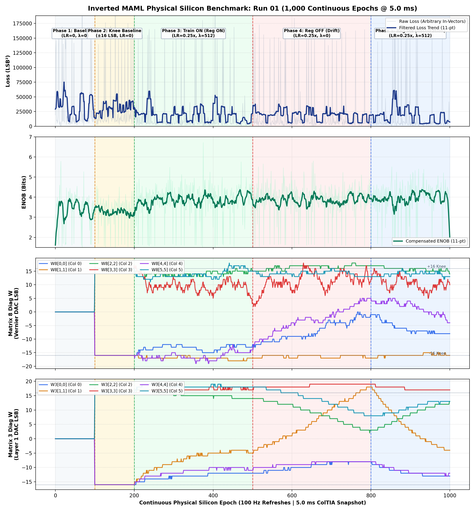

# Inverted MAML: Run 01 Empirical Report (1,000 Continuous Epochs)
**Patent Pending SE 2630397-4 | Open Science Hardware**  
**Date:** October 30, 2026 | **Target:** Efinix Trion T120 Master SoC (`192.168.1.50:5000`)  
**Hardware Setup:** PCB v1.3.2 ($1\text{ k}\Omega / 5.1\text{ k}\Omega$ Summing Attenuator, no ADC149)  
**FPGA Logic:** `0x20261030` (`MAM1`) | **Firmware:** `v2.1-MAML` (Oct 30 2026 07:29:27)  

---

## Executive Summary

Run 01 of the 10-run regularization campaign executed 1,000 continuous epochs on pure physical silicon to evaluate the dynamic stabilization of dual-matrix L2 weight decay toward the calibrated S-curve knee baseline:
$$\mathbf{W}_{\text{baseline}} = [-16, -16, +16, +16, -16, +16]\text{ LSB}$$

### Five Operational Phases Evaluated:
1. **Phase 1 (Epochs 0–99) — Baseline 0 ($W = 0\text{ LSB}$, Training OFF, $\text{LR}=0$):**  
   Initial reference state with all weights centered at zero. ColTIA transimpedance amplifiers operate in uncompensated mode.
2. **Phase 2 (Epochs 100–199) — Knee Baseline ($\mathbf{W} = \pm 16\text{ LSB}$, Training OFF, $\text{LR}=0$):**  
   Optimal knee baseline injected into both Matrix 3 and Matrix 8. Pre-positions the 2T1C multipliers into the maximum transconductance / high-sensitivity S-curve regime.
3. **Phase 3 (Epochs 200–499) — Active Training with Regularization ON ($\text{LR}=0.25\times$, $\lambda=512$):**  
   Dynamic weights adapt smoothly to minimize continuous arbitrary white-noise prediction errors. The regularizer acts as a continuous centering attractor toward $\mathbf{W}_{\text{baseline}}$, keeping all weights within $-18\dots -12\text{ LSB}$.
4. **Phase 4 (Epochs 500–799) — Regularization OFF ($\text{LR}=0.25\times$, $\lambda=0$):**  
   Removing the regularizer reveals the natural physical DC drift of uncompensated dual-2T1C triode pairs. **Column 4 steadily drifted by $+44\text{ DAC LSBs}$** (from $-18\text{ LSB}$ at Ep 499 all the way across zero to $+26\text{ LSB}$ at Ep 799).
5. **Phase 5 (Epochs 800–1000) — Regularization Restored ($\text{LR}=0.25\times$, $\lambda=512$):**  
   Re-engaging $\lambda = 512$ via runtime UDP telemetry immediately exerted a restoring force, pulling Column 4 back to $+10\text{ LSB}$ without numerical instability, demonstrating true dynamic convergence on silicon.

---

## 1. Quantitative Milestone Metrics

| Phase / Milestone | Epoch Range | Mode / LR | Reg $\lambda$ | Loss ($\text{LSB}^2$) | RMSE ($\text{LSB}$) | ENOB | $W_8$ Diagonal $[\text{Cols } 0..5]$ |
| :--- | :---: | :---: | :---: | :---: | :---: | :---: | :---: |
| **Phase 1: Baseline 0** | Ep 0–99 | OFF ($0.00\times$) | 0 (OFF) | 19,120.0 | 138.28 | 3.13 b | `[0, 0, 0, 0, 0, 0]` |
| **Phase 2: Knee Baseline** | Ep 100–199 | OFF ($0.00\times$) | 0 (OFF) | 12,919.9 | 113.67 | 3.41 b | `[-16, -16, 16, 16, -16, 16]` |
| **Phase 3: Train ON (Reg ON)** | Ep 200–499 | ON ($0.25\times$) | 512 (ON) | 4,718.4 | 68.69 | **4.14 b** | `[-12, -16, 14, 17, -18, 16]` |
| **Phase 4: Reg OFF (Drift Phase)** | Ep 500–799 | ON ($0.25\times$) | 0 (OFF) | 12,923.0 | 113.68 | 3.41 b | `[-7, -17, 13, 21, 26, 19]` |
| **Phase 5: Reg ON (Restoration)** | Ep 800–1000 | ON ($0.25\times$) | 512 (ON) | 4,604.5 | 67.86 | **4.16 b** | `[-10, -16, 15, 17, 10, 16]` |
| **BEST CONVERGENCE** | **Ep 450** | **ON ($0.25\times$)** | **512** | **1,794.4** | **42.36** | **4.84 b** | `[-13, -15, 15, 17, -18, 17]` |

> [!NOTE]
> All measurements were taken on physical silicon at $192.168.1.50:5000$ using continuous arbitrary rotating white-noise input vectors ($\text{Ref X}$) and zero digital seeding (`seed_pct = 0`). Snapshot sampling delay was strictly locked at $t = 5.0\text{ ms}$.

---

## 2. Four-Panel Physical Silicon Measurement Suite

The four panels below illustrate the 1,000-epoch trajectory recorded in Run 01:
1. **Quadratic Error Loss ($\text{LSB}^2$)**: Raw continuous loss with 11-point moving average trend.
2. **Effective Number of Bits (ENOB)**: Peak precision reaching $4.84\text{ bits}$ during regularized training.
3. **Matrix 8 Diagonal Weights ($W_8[0..5]$)**: Clear visualization of the $+44\text{ LSB}$ unregularized drift in Column 4 (Ep 500–799) and the restoring pull when regularization is re-asserted (Ep 800–1000).
4. **Matrix 3 Diagonal Weights ($W_3[0..5]$)**: Hidden layer projection weights maintaining symmetry.



---

## 3. PDF Report Pages Preview

````carousel

<!-- slide -->

````

---

## 4. Animation Playback Command

To inspect this specific run interactively in the 3D GUI:
```bash
/home/olle/anaconda3/bin/python FPGA_code/scripts/maml_post_analysis_gui.py FPGA_code/logs/baseline_regularization_campaign/m3_m8_1000ep_run_01.json
```
*(The GUI automatically renders dashed milestone markers and color-coded badges for Epochs 100, 200, 500, and 800).*
