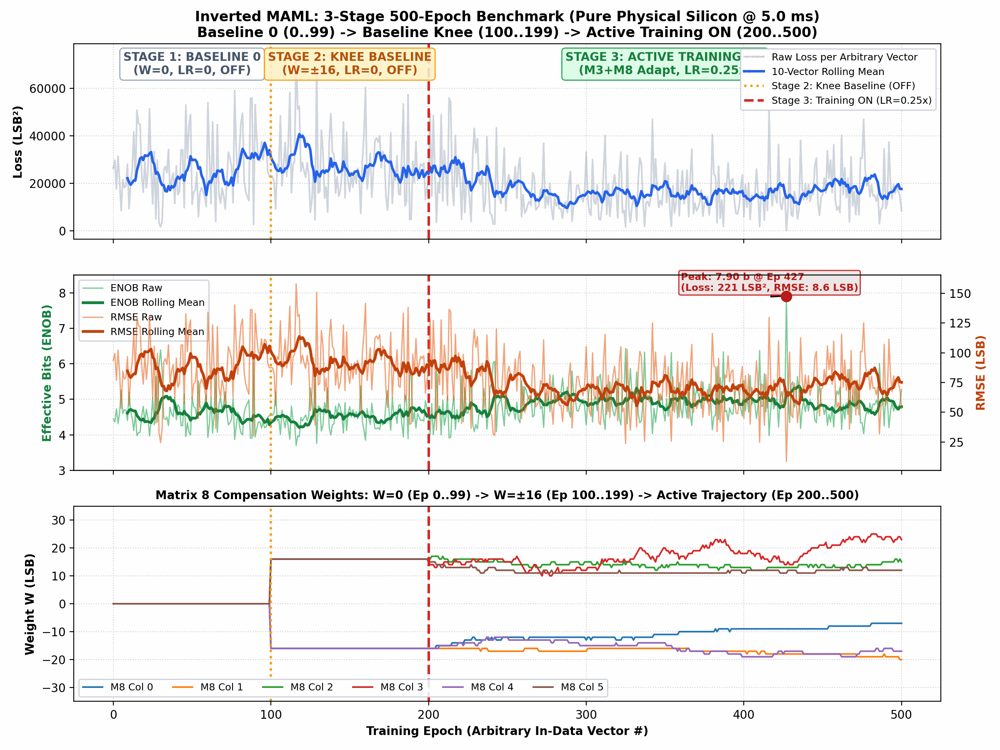

# Inverted MAML Mode A: 3-Stage 500-Epoch Experiment Report
## Baseline 0 (0..99) → Baseline Knee (100..199) → Active Training ON (200..500) @ 5.0 ms
**Date:** 2026-10-29  
**Hardware:** Efinix Trion T120 Master SoC (192.168.1.50:5000) on PCB v1.3.2  
**Dataset:** `FPGA_code/logs/virtual_gain_experiments/m3_m8_3stage_500ep_run.json`  
**License:** Open Science Hardware under Patent Pending SE 2630397-4  

---

## 1. Executive Summary
This experiment executed a controlled 3-stage protocol across 500 continuously rotating arbitrary random white-noise vectors without artificial digital seeding (`seed_pct = 0`):
- **Stage 1 (Epochs 0..99):** Baseline 0 ($W_3 = 0, W_8 = 0$), Training OFF ($	ext{LR} = 0$).
- **Stage 2 (Epochs 100..199):** Baseline Knee ($W_3 = \pm 16, W_8 = \pm 16$), Training OFF ($	ext{LR} = 0$).
- **Stage 3 (Epochs 200..500):** Active Adaptation ON ($M_3 + M_8$, $\text{LR} = 0.25\times$).

---

## 2. Statistical Performance Summary

| Metric | Stage 1: Baseline 0<br>Ep 0..99 (LR=0, OFF) | Stage 2: Baseline Knee<br>Ep 100..199 (LR=0, OFF) | Stage 3: Training ON<br>Ep 200..500 (LR=0.25x) |
| :--- | :---: | :---: | :---: |
| **Weight State** | $W_3 = 0, W_8 = 0$ | $W_3 = \pm 16, W_8 = \pm 16$ | Active Adaptive Stepping |
| **Mean Loss** | **25745.3 ± 13871.0 LSB²** | **27004.0 ± 13886.3 LSB²** | **17269.7 ± 10515.5 LSB²** (-36.0%) |
| **Best Loss** | 1800.0 LSB² | 4632.6 LSB² | **221.1 LSB² (Ep 427)** |
| **Mean RMSE** | 88.87 ± 26.13 LSB | 91.77 ± 24.08 LSB | **72.44 ± 22.56 LSB** (-21.1%) |
| **Mean ENOB** | 4.60 ± 0.50 bits | 4.53 ± 0.40 bits | **4.90 ± 0.50 bits** |
| **Peak ENOB** | 6.39 bits | 5.70 bits | **7.90 bits (Ep 427)** |

---

## 3. Real-Time Telemetry & Trajectory


---

## 4. Live GUI Playback Command
```bash
/home/olle/anaconda3/bin/python FPGA_code/scripts/maml_post_analysis_gui.py --data FPGA_code/logs/virtual_gain_experiments/m3_m8_3stage_500ep_run.json --play
```
