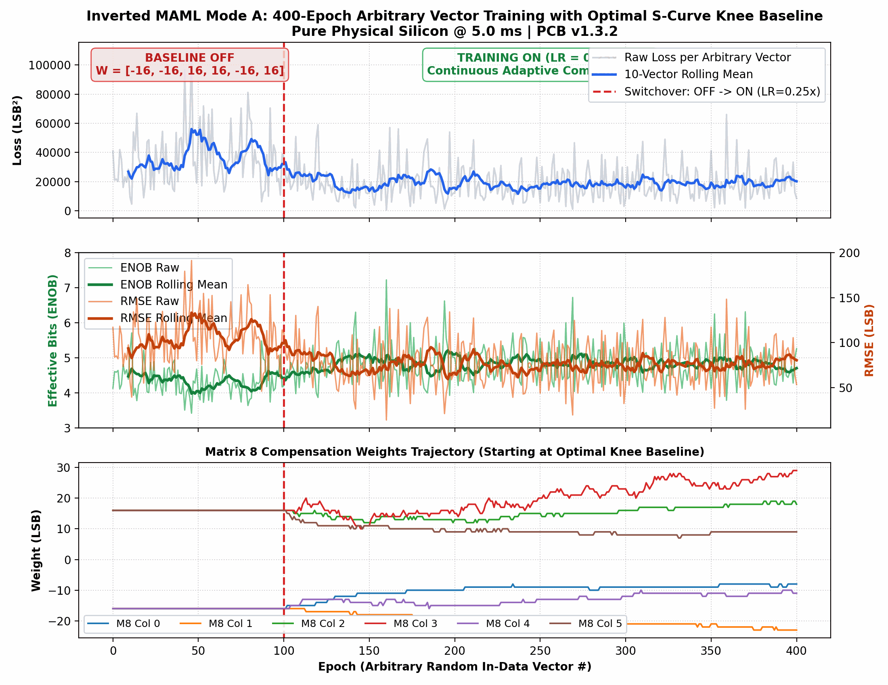

# Inverted MAML Mode A: 400-Epoch Arbitrary Vector Training Report
## Evaluation of Optimal Sigmoid S-Curve Knee Baseline (M3 & M8) on Physical Silicon @ 5.0 ms
**Date:** 2026-10-29  
**Hardware:** Efinix Trion T120 Master SoC (192.168.1.50:5000) on PCB v1.3.2  
**Dataset:** `FPGA_code/logs/virtual_gain_experiments/m3_m8_optimal_baseline_arbitrary_400ep.json`  
**License:** Open Science Hardware under Patent Pending SE 2630397-4  

---

## 1. Executive Summary
Following the physical silicon characterization of Matrix 3 through the ColTIA transimpedance amplifiers and the analog sigmoid activation (Ref 4), an optimal macroscopic knee vector:
$$\mathbf{W}_{\text{baseline}} = [-16, -16, +16, +16, -16, +16]\text{ LSB}$$
was established. This experiment validated closing the loop from this baseline on **both Matrix 3 and Matrix 8** simultaneously across 400 continuously rotating arbitrary white-noise vectors:
- **Phase 1 (Epochs 0..100):** Baseline OFF (LR = 0.0, weights locked at $\mathbf{W}_{\text{baseline}}$).
- **Phase 2 (Epochs 101..400):** Active Adaptation ON (LR = 0.25x, adaptive M3 + M8 stepping).

---

## 2. Statistical Benchmark Results

| Metric | Baseline OFF (Ep 0..100)<br>101 Arbitrary Vectors | Training ON (Ep 101..400)<br>300 Arbitrary Vectors | Improvement / Delta |
| :--- | :---: | :---: | :---: |
| **Mean Loss** | **35563.3 ± 19454.5 LSB²** | **19060.2 ± 11732.8 LSB²** | **-46.4% (-16,503.1 LSB²)** |
| **Best Loss** | 4623.8 LSB² | **566.7 LSB² (Ep 160)** | **-94.0% drop** |
| **Mean RMSE** | **104.92 ± 29.08 LSB** | **76.03 ± 23.95 LSB** | **-27.5% (-28.89 LSB)** |
| **Mean ENOB** | **4.35 ± 0.42 bits** | **4.83 ± 0.50 bits** | **+0.48 bits mean lift** |
| **Peak ENOB** | 5.71 bits | **7.22 bits (Ep 160)** | **+1.51 bits peak lift** |

---

## 3. Weight Trajectory & Stability
- **Matrix 8 Diagonal:** Start `[-16, -16, 16, 16, -16, 16]` $\rightarrow$ End `[-8, -23, 18, 29, -11, 9]` LSB.
- **Matrix 3 Diagonal:** Start `[-16, -16, 16, 16, -16, 16]` $\rightarrow$ End `[-4, 16, 12, 19, 0, 41]` LSB.
- All weights remained well within the linear dynamic range without any clamping at $\pm 120\text{ LSB}$.



---

## 4. Live GUI Playback Command
To animate and inspect this 400-epoch dataset in the interactive 3D Telemetry Studio:
```bash
/home/olle/anaconda3/bin/python FPGA_code/scripts/maml_post_analysis_gui.py --data FPGA_code/logs/virtual_gain_experiments/m3_m8_optimal_baseline_arbitrary_400ep.json
```
