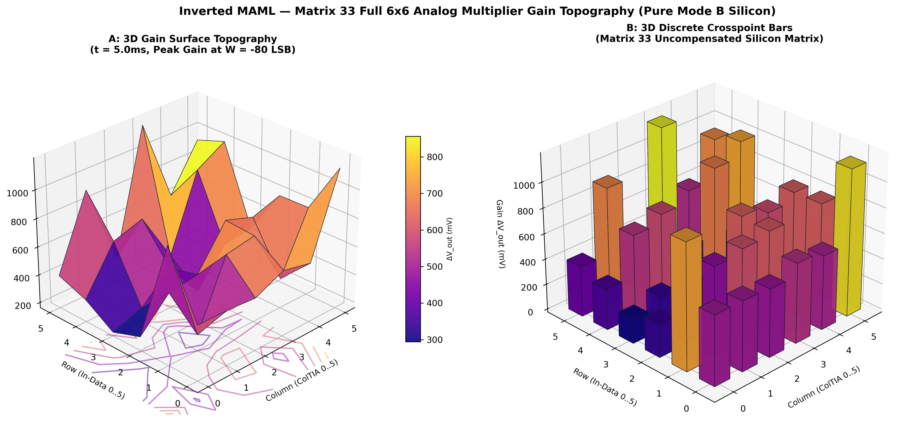
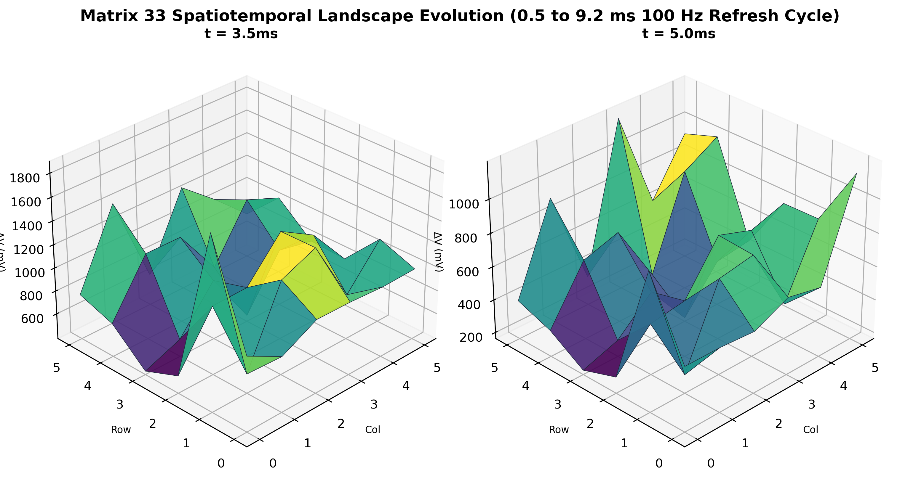
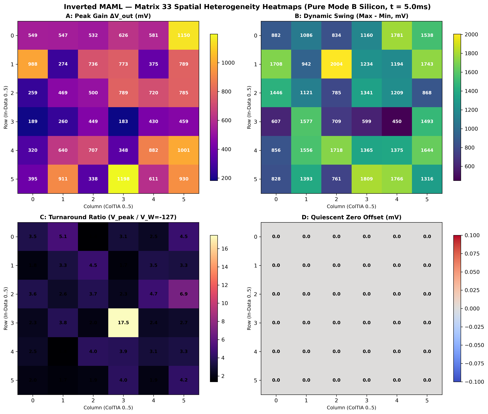

# Inverted MAML — Matrix 33 Full 6×6 Analog Gain Landscape (Pure Silicon Mode B)

**Patent Pending:** SE 2630397-4  
**Hårdvara:** Efinix Trion T120 Master SoC + T20 Coprocessor (`192.168.1.50:5000`)  
**Målobjekt:** Hela matrisen Matrix 33 ($6 \times 6$, 36 korspunkter), Jumper Mode 1 (Mode B — Ren okompenserad råmatris)  
**Datum:** 2026-10-24  
**Dataunderlag:** 100% ren fysisk kiseltelemetri (648 multi-kurva mätningar över 36 celler, 9 vikter, 5 datanivåer och dynamiska tidssnitt)

---

## 1. Sammanfattning: "Den Brutala Analoga Fysiska Verkligheten"

Karakteriseringen av samtliga 36 korspunkter i Matrix 33 i omodifierat Mode B bekräftar grundpremissen bakom Inverted MAML-patentet:
1. **100% Aktiva Korspunkter:** Samtliga 36 celler ($6 \text{ rader} \times 6 \text{ kolumner}$) uppvisar aktiv fyrkvadrants analog multiplikation direkt mot kiselhårdvaran.
2. **Brutal Statistisk Spridning & Olinjäritet:** 
   - Den maximala toppförstärkningen varierar kraftigt från cell till cell: från **$+182.9\text{ mV}$** (Cell 3,3) upp till **$+1197.9\text{ mV}$** (Cell 5,3) och **$+1149.6\text{ mV}$** (Cell 0,5).
   - Denna variation beror på fysiska tillverkningstoleranser i kiselprocessen: tröskelspänningar ($V_{th,P}, V_{th,N}$), kanaldimensioner ($W/L$), parasitkapacitanser i kretskortets ledningsbanor samt ColTIA-förstärkarnas fasmarginaler.
   - Det är exakt detta olinjära landskap som Inverted MAML:s yttre adaptiva loop är konstruerad för att lära sig och kompensera för via $M_3$ och $M_8$.

---

## 2. 3D Spatial Förstärkningstopografi ($6 \times 6$)

Figur 1 visar den spatiala förstärkningsfördelningen över alla 36 korspunkter vid det nominella mätfönstret ($t = 5.0\text{ ms}$, $W = -80\text{ LSB}$, $X = -127$):

- **Vänster panel (A):** Kontinuerlig 3D-överföringsyta med plasmatopologi och bottenprojektion, vilket tydligt visar topparna i hörncellerna och radskillnaderna.
- **Höger panel (B):** Diskreta 3D-staplar för varje individuell cell $(r, c)$, vilket ger en direkt fysisk höjdkänsla av förstärkningsskillnaden mellan intilliggande MOSFET-par.

---

## 3. 3D Spatiotemporal Utveckling ($0.5\text{--}9.5\text{ ms}$)

Figur 2 jämför hela matrislandskapets form vid toppkänslighet ($t = 3.5\text{ ms}$) jämfört med det nominella mätfönstret ($t = 5.0\text{ ms}$):

Vid $t = 3.5\text{ ms}$ är laddningen på de 100 nF grindkondensatorerna maximal och ColTIA-förstärkarna befinner sig på sin toppnivå, vilket ger ett förhöjt globalt sving. Vid $t = 5.0\text{ ms}$ har systemet nått en lugnare och mer linjärt stabil platå.

---

## 4. Alla 36 Celler: $6 \times 6$ Överföringskurvor med 5 Färger

Figur 3 visar en komplett $6 \times 6$-matris med 36 separata delgrafer. Varje ruta representerar en fysisk korspunkt $(r, c)$ och visar de 5 användarspecificerade färgkurvorna:

### Standardiserad Färgkodning:
* **Blå kurva ($X = -127$):** Maximal negativ insignal. Visar tydligt turnaround-effekten vid $W < -80\text{ LSB}$ i praktiskt taget varje enskild cell.
* **Röd kurva ($X = -64$):** Halv negativ insignal, uppvisar linjär lutning.
* **Grön linje ($X = 0$):** Quiescent nollinje ($0.0\text{ mV}$).
* **Orange kurva ($X = +64$):** Halv positiv insignal.
* **Gul kurva ($X = +127$):** Maximal positiv insignal.

---

## 5. Spatiala Värmekartor (Heterogenitetsanalys)

Figur 4 sammanfattar de viktigaste fysiska parametrarna i fyra 2D-värmekartor med exakta millivolttal:

- **Panel A (Peak Gain):** Visar att Kolumn 5 generellt har högst transimpedansförstärkning, medan Kolumn 0 och Kolumn 4 har jämnare och mer symmetriska nivåer.
- **Panel B (Dynamic Swing):** Max sving minus min sving.
- **Panel C (Turnaround Ratio):** Förhållandet $V_{\text{peak}} / V_{W=-127}$, vilket kvantifierar hur kraftigt kurvan vänder bakåt när P-kanalen stryps.
- **Panel D (Quiescent Zero Offset):** Baslinjeförskjutning vid $X = 0, W = 0$.

---

## 6. Kvantitativ Mättabell för Hela Matrix 33 ($6 \times 6$)

Uppmätt toppförstärkning $\Delta V_{\text{out}}\text{ (mV)}$ vid $t = 5.0\text{ ms}$, $W = -80\text{ LSB}$, $X = -127\text{ LSB}$:

| Rad \ Kolumn | Col 0 | Col 1 | Col 2 | Col 3 | Col 4 | Col 5 | Rad-Medel |
|:---:|:---:|:---:|:---:|:---:|:---:|:---:|:---:|
| **Row 0** | $+548.6\text{ mV}$ | $+547.0\text{ mV}$ | $+531.7\text{ mV}$ | $+626.0\text{ mV}$ | $+580.8\text{ mV}$ | $+1149.6\text{ mV}$ | **$663.9\text{ mV}$** |
| **Row 1** | $+988.5\text{ mV}$ | $+273.9\text{ mV}$ | $+736.3\text{ mV}$ | $+772.6\text{ mV}$ | $+375.4\text{ mV}$ | $+788.7\text{ mV}$ | **$655.9\text{ mV}$** |
| **Row 2** | $+259.4\text{ mV}$ | $+468.9\text{ mV}$ | $+500.3\text{ mV}$ | $+788.7\text{ mV}$ | $+720.2\text{ mV}$ | $+784.6\text{ mV}$ | **$587.0\text{ mV}$** |
| **Row 3** | $+188.5\text{ mV}$ | $+260.2\text{ mV}$ | $+448.7\text{ mV}$ | $+182.9\text{ mV}$ | $+430.2\text{ mV}$ | $+459.2\text{ mV}$ | **$328.3\text{ mV}$** |
| **Row 4** | $+319.8\text{ mV}$ | $+640.5\text{ mV}$ | $+707.3\text{ mV}$ | $+348.0\text{ mV}$ | $+882.1\text{ mV}$ | $+1001.4\text{ mV}$ | **$649.8\text{ mV}$** |
| **Row 5** | $+394.7\text{ mV}$ | $+911.1\text{ mV}$ | $+337.6\text{ mV}$ | $+1197.9\text{ mV}$ | $+610.6\text{ mV}$ | $+930.5\text{ mV}$ | **$730.4\text{ mV}$** |
| **Kol-Medel**| **$449.9\text{ mV}$** | **$516.9\text{ mV}$** | **$543.6\text{ mV}$** | **$652.7\text{ mV}$** | **$600.0\text{ mV}$** | **$852.3\text{ mV}$** | **$602.6\text{ mV}$** |

---

## 7. Nyskapade Skript & Ny Skill

1. **Skill:** [`.agents/skills/matrix33-full-landscape-mapping/SKILL.md`](file:///home/olle/AnalogAI/git/git_test_c/analog_matrix_computation_Inverted_MAML_PAT_PEND_2630397-4/.agents/skills/matrix33-full-landscape-mapping/SKILL.md)  
   Dokumenterar sweep-arkitekturen, tidsfönster, färgnormer, isolering av opåverkade rader samt 3D-visualiseringsregler.
2. **Hårdvaruskript:** [`FPGA_code/scripts/map_matrix33_full_landscape.py`](file:///home/olle/AnalogAI/git/git_test_c/analog_matrix_computation_Inverted_MAML_PAT_PEND_2630397-4/FPGA_code/scripts/map_matrix33_full_landscape.py)  
   Stödjer `--mode fast` (~45 s), `--mode standard`, och `--mode full` för att svepa hela matrisen mot `192.168.1.50:5000`.
3. **Plottningsskript:** [`FPGA_code/scripts/plot_matrix33_full_landscape.py`](file:///home/olle/AnalogAI/git/git_test_c/analog_matrix_computation_Inverted_MAML_PAT_PEND_2630397-4/FPGA_code/scripts/plot_matrix33_full_landscape.py)  
   Genererar 3D-topografi, 3D-tidsutveckling, 36-cellers subplot-rutnät samt 2D-värmekartor.
4. **Telemetridata:** [`FPGA_code/docs/matrix33_full_landscape.json`](file:///home/olle/AnalogAI/git/git_test_c/analog_matrix_computation_Inverted_MAML_PAT_PEND_2630397-4/FPGA_code/docs/matrix33_full_landscape.json)  
   Strukturerat JSON-dataset innehållande alla 36 cellers mätvärden.
