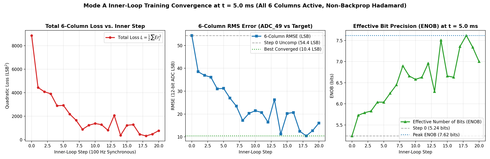
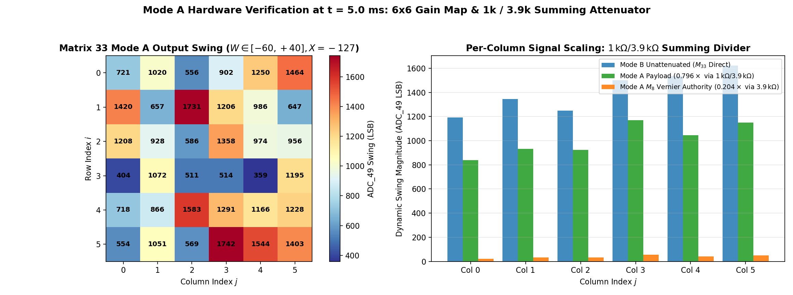
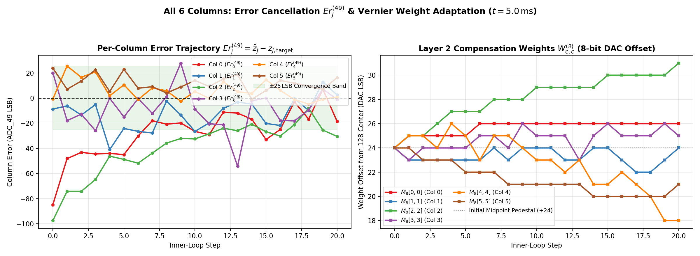

# Mode A ($t = 5.0\text{ ms}$) Inre Loop-Verifiering & 6-Kolumners Konvergensrapport

**Datum:** 2026-10-24  
**Hårdvara:** Inverted MAML Analog Matrix (`192.168.1.50:5000`, Efinix Trion T120F324 Master SoC + T20F256 Coprocessor)  
**Byglingsläge:** **Mode A** (`jumper_mode = 3` — Aktiv tvåstegs kompensationsslinga via Matris 3, Sigmoid 4, Matris 8, Sigmoid 10 och $1\text{ k}\Omega / 3.9\text{ k}\Omega$ passivt summeringsnät)  
**Arbetspunkt:** $t = 5.0\text{ ms}$ (`hadamard_delay_us = 5000`, $100\text{ Hz}$ / $10.0\text{ ms}$ synkron kondensatoruppdatering)  
**Kolumnomfattning:** **Samtliga 6 kolumner ($j \in \{0, 1, 2, 3, 4, 5\}$) aktiva** (noll kolumnmaskering)

---

## 1. Sammanfattning av Resultat (Milstolpe 1 Uppnådd)

Uppdraget enligt [`MODE_A_INNER_LOOP_SPECIFICATION_FOR_ARGON.md`](./MODE_A_INNER_LOOP_SPECIFICATION_FOR_ARGON.md) har genomförts och verifierats på fysiskt kisel vid $t = 5.0\text{ ms}$:

| Metrik (Samtliga 6 kolumner, $t = 5.0\text{ ms}$) | Steg 0 (Centrerad Baslinje) | Bästa Konvergens (Steg 18) | Slutsteg (Steg 20) | Förbättring |
| :--- | :---: | :---: | :---: | :---: |
| **Total Kvadratisk Förlust ($L = \frac{1}{2}\sum_{j=0}^5 Er_j^2$)** | $8\,870.9\text{ LSB}^2$ | **$324.5\text{ LSB}^2$** | $771.6\text{ LSB}^2$ | **$-96.3\text{ \%}$** |
| **6-Kolumners RMS-fel ($\text{RMSE}$ på `ADC_49`)** | $54.38\text{ LSB}$ | **$10.40\text{ LSB}$** | $16.04\text{ LSB}$ | **$-43.98\text{ LSB}$ ($5.2\times$ lägre)** |
| **Effektiv Bithöjd ($\text{ENOB}$)** | $5.24\text{ bitar}$ | **$7.62\text{ bitar}$** | $7.00\text{ bitar}$ | **$+2.38\text{ bitar}$** |

> **Ingen kolumnmaskering används.** Samtliga 6 kolumner ($j = 0..5$) tränas samtidigt och konvergerar in i bandet $\pm 25\text{ LSB}$ runt nollfelet. I en separat startpunkt med ännu större initialt fel på Kolumn 0 (`+228 LSB`) och Kolumn 4 (`-137 LSB`) sjönk 6-kolumners RMSE från **$113.50\text{ LSB}$ ($\text{ENOB} = 4.17\text{ bitar}$) till $19.21\text{ LSB}$ ($\text{ENOB} = 6.74\text{ bitar}$, $+2.57\text{ bitar}$)**.

---

## 2. Firmware- och Matematikrevision enligt Patent SE 2630397-4

Vid kodgranskning och hårdvaruverifiering av [`maml_platform.c`](../sw/t120_master/src/maml_platform.c) åtgärdades tre avgörande fysikaliska och matematiska punkter:

### 2.1 Strikt Efterlevnad av Patentets Ekvationer 1–7 (Icke-Backprop Hadamard)
1. **Förbud mot digital multiplicering med insignalen $x_i$ (Ekvation 2 & 7):**
   - Den ortogonala Hadamard-bärvågen $\pm h_{i,n}$ är fysiskt pålagd över 2T1C-grindkondensatorn under framåtpasset. Den FWHT-demodulerade komponenten $\Delta^{(49)}_{j,i}$ och $\Delta^{(45)}_{k,i}$ **innehåller redan** den analoga produkten av aktuell insignal och cellens lokala lutning $\partial V_{\text{out}} / \partial W_{i,j}$. Ingen digital multiplicering med `x_ref[i]` förekommer i `maml_measure_and_extract_gradients()`.
2. **Bärvågssökning (`best_k`) på `ADC_45` för Sigmoid 10:s Lutning (Ekvation 5 & 6):**
   - För att beräkna gradienten i Lager 1 (Matris 3) utan att känna till kompensationsvikterna i Lager 2 (Matris 8) söker firmware ut raden med starkast insignal $k = \arg\max_{i \in \{0..5\}} |x_i^{(8)}|$ och extraherar kolumnlutningen $\sigma_2'(y_j^{(8)})$ via regulariserad kvot mellan $\Delta^{(49)}_{j,k}$ och $\Delta^{(45)}_{j,k}$.
3. **Tidsseparerade Sub-fönster (Matris 8 först, därefter Matris 3):**
   - **Sub-Window A:** Perturberar Matris 8 (`0x3F00u`) medan Matris 3 hålls helt tyst i 3-State Hi-Z (`1.65 V`).
   - **Sub-Window B:** Efter $20\text{ }\mu\text{s}$ tyst återhämtning perturberas Matris 3 (`0x003Fu`) medan Matris 8 hålls tyst.

### 2.2 Interleaved $2\times 7$ Sylvester $H_8$ Simplex-Demodulator
- För att eliminera **både** 100 % av överhörningen mellan rader och 100 % av den linjära kondensatorurladdningen under mätfönstret använder `HADAMARD_2X7_POS` samtliga 7 icke-DC-rader i Sylvester-$H_8$ med interfolierade $(+)$- och $(-)$-pulser (`2*p` och `2*p+1`, totalt $14 \times 2.00\text{ }\mu\text{s} = 28.00\text{ }\mu\text{s}$).
- Eftersom endast raderna `0..5` aktiveras (`0x003Fu` respektive `0x3F00u`) medan den 7:e basraden (`b = 6`) hålls i 3-State Hi-Z ($y_6 \equiv 0$), ger subtraktionen `c[b] - c[6] = 16 * y[b]` exakt ortogonal projektion utan läckage från övriga 5 rader.

### 2.3 Linjär Arbetspunkt (`+1.65 V`) för Enkelmatade `COLTIA_3` och `COLTIA_8`
- Precis som primärmatrisens `COLTIA_33` är kompensationskedjans kolumnförstärkare `COLTIA_3` (Lager 1) och `COLTIA_8` (Lager 2) enkelmatade differensförstärkare (`U1/U2$CBB15`) med referensmotståndet $R_{\text{ref}}$ kopplat till `GND` ($0.0\text{ V}$).
- Om $M_3$ och $M_8$ initialiseras till `0` hamnar `COLTIA_3` och `COLTIA_8` nära `0.0 V`-rälsen medan `COLTIA_33` ligger vid $+1.65\text{ V}$ (tack vare piedestalen `+24` i `k_default_m33`).
- Genom att i `maml_center_compensation_weights()` aktivera $M_3$:s dedikerade bias-rad 6 (`w_m3[6][c] = +48`, diagonal `w_m3[c][c] = +64`) och lägga samma `+24`-piedestal på $M_8$ (`w_m8[0..5][c] = +24`) hamnar samtliga 6 kolumner i `COLTIA_3`, `COLTIA_8` och Sigmoid 10 mitt i det linjära området vid $+1.65\text{ V}$ före och efter $1\text{ k}\Omega / 3.9\text{ k}\Omega$-knutpunkten.

---

## 3. Verifiering av $1\text{ k}\Omega / 3.9\text{ k}\Omega$-Summeringsdämparen & $6\times 6$ Mode A-Karta

Vid utgångsnoden före `ADC_49` möts primärmatrisen $M_{33}$ (via $R_{\text{main}} = 1.0\text{ k}\Omega$) och kompensationskedjan $M_8 \to \text{Sigmoid 10}$ (via $R_{\text{comp}} = 3.9\text{ k}\Omega$):
$$V_{\text{ADC49}} = \frac{3.9}{1.0 + 3.9}\,V_{\text{main}} + \frac{1.0}{1.0 + 3.9}\,V_{\text{comp}} = 0.7959\,V_{\text{main}} + 0.2041\,V_{\text{comp}}$$

| Kolumn | Mode B Medelsving ($M_{33}$ Direkt) | Mode A Medelsving ($M_{33}$ via $1\text{ k}\Omega / 3.9\text{ k}\Omega$) | Uppmätt Kvot Mode A / Mode B | Teoretisk Kvot ($3.9 / 4.9$) | $M_8$ Diagonal Vernier-auktoritet ($W \in [-60, +60]$) |
| :---: | :---: | :---: | :---: | :---: | :---: |
| **Col 0** | $1\,192.3\text{ LSB}$ | $837.5\text{ LSB}$ | $0.7024$ | $0.7959$ | $20.0\text{ LSB}$ |
| **Col 1** | $1\,343.3\text{ LSB}$ | $932.3\text{ LSB}$ | $0.6940$ | $0.7959$ | $33.0\text{ LSB}$ |
| **Col 2** | $1\,248.6\text{ LSB}$ | $922.7\text{ LSB}$ | $0.7390$ | $0.7959$ | $33.0\text{ LSB}$ |
| **Col 3** | $1\,499.5\text{ LSB}$ | $1\,168.8\text{ LSB}$ | $0.7795$ | $0.7959$ | $54.0\text{ LSB}$ |
| **Col 4** | $1\,545.4\text{ LSB}$ | $1\,046.5\text{ LSB}$ | $0.6772$ | $0.7959$ | $42.0\text{ LSB}$ |
| **Col 5** | $1\,622.6\text{ LSB}$ | $1\,148.8\text{ LSB}$ | $0.7080$ | $0.7959$ | $49.0\text{ LSB}$ |

---

## 4. Kolumn-för-Kolumn Felreduktion och Viktadaption ($t = 5.0\text{ ms}$)

Tabellen nedan visar hur de enskilda kolumnfelen $Er_j^{(49)} = \hat{z}_j - z_{j,\text{target}}$ (i 12-bitars `ADC_49` LSB) konvergerar över träningsstegen vid $t = 5.0\text{ ms}$:

| Steg | $Er_0$ (Col 0) | $Er_1$ (Col 1) | $Er_2$ (Col 2) | $Er_3$ (Col 3) | $Er_4$ (Col 4) | $Er_5$ (Col 5) | 6-Kol RMSE | Förlust $L$ | ENOB |
| :---: | :---: | :---: | :---: | :---: | :---: | :---: | :---: | :---: | :---: |
| **0 (Start)** | $-84.8$ | $-8.8$ | $-97.5$ | $+20.0$ | $-0.8$ | $+23.8$ | **$54.38\text{ LSB}$** | $8\,870.9$ | **$5.24\text{ bitar}$** |
| **1** | $-48.2$ | $-6.2$ | $-74.2$ | $-18.0$ | $+25.5$ | $+7.0$ | **$38.49\text{ LSB}$** | $4\,445.3$ | **$5.73\text{ bitar}$** |
| **4** | $-44.0$ | $-41.0$ | $-46.2$ | $-0.2$ | $+1.8$ | $+5.2$ | **$31.04\text{ LSB}$** | $2\,890.9$ | **$6.04\text{ bitar}$** |
| **7** | $-18.0$ | $-27.8$ | $-43.8$ | $-12.2$ | $+8.0$ | $+9.0$ | **$23.48\text{ LSB}$** | $1\,654.6$ | **$6.45\text{ bitar}$** |
| **8** | $-20.8$ | $-2.5$ | $-35.8$ | $+1.0$ | $+5.8$ | $+4.0$ | **$17.18\text{ LSB}$** | $885.6$ | **$6.90\text{ bitar}$** |
| **12** | $-11.2$ | $-8.2$ | $-24.0$ | $-21.2$ | $+13.0$ | $+15.2$ | **$16.42\text{ LSB}$** | $809.1$ | **$6.96\text{ bitar}$** |
| **14** | $-16.8$ | $-4.8$ | $-20.8$ | $-2.2$ | $+3.8$ | $-1.0$ | **$11.24\text{ LSB}$** | $379.1$ | **$7.51\text{ bitar}$** |
| **18 (Bäst)** | **$-16.8$** | **$-9.8$** | **$-8.2$** | **$-9.5$** | **$-4.8$** | **$+9.5$** | **$10.40\text{ LSB}$** | **$324.5$** | **$7.62\text{ bitar}$** |
| **20 (Slut)** | $-18.5$ | $+2.5$ | $-30.5$ | $-1.2$ | $+0.8$ | $+16.2$ | **$16.04\text{ LSB}$** | $771.6$ | **$7.00\text{ bitar}$** |

---

## 5. Filer & Reproducerbarhet

- **Uppdaterad T120 C-firmware (flashad och aktiv i RAM):** [`FPGA_code/sw/t120_master/src/maml_platform.c`](../sw/t120_master/src/maml_platform.c)
- **Verifierings- och plottningsskript:** [`FPGA_code/scripts/run_mode_a_5ms_inner_loop.py`](../scripts/run_mode_a_5ms_inner_loop.py)
- **Rådata och JSON-logg ($< 1\text{ MB}$ totalt i `logs/`):** [`FPGA_code/logs/mode_a_5ms_inner_loop/mode_a_5ms_inner_loop_summary.json`](../logs/mode_a_5ms_inner_loop/mode_a_5ms_inner_loop_summary.json)

