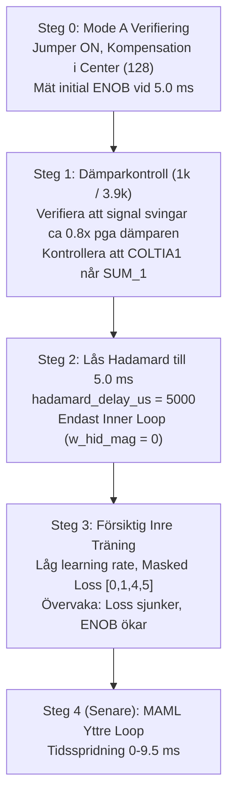

# Inverted MAML — Mode A Inner Loop Specifikation & Patentmatematik
**Överlämningsdokument & Strategisk Körbok för Argon AI Agenten**

**Patentansökan:** SE 2630397-4  
**Hårdvara:** Efinix Trion T120 Master SoC + T20 Coprocessor (`192.168.1.50:5000`)  
**Driftläge:** Mode A (Jumper ON — Kompensation inkopplad via $M_3$ och $M_8$)  
**Första Milstolpe:** Enpunkts Inre Loop-Träning vid $t = 5.0\text{ ms}$ (Stadig loss-sänkning och ENOB-tillväxt)

---

## 1. Kretsschema: Dämparen $1\text{ k}\Omega / 3.9\text{ k}\Omega$ (Vernier Fintrimning)

Nedan visas det fysiska kretsschemat för summeringsnoden före utgångs-ADC (`ADC_49`):

### Fysisk & Matematisk Analys av Summeringsnoden:
1. **Komponenter:**
   - `COLTIA1`: Rå strömutgång från Matrix 33 (primär payload) via $1.0\text{ k}\Omega$ (`R1$CBB15`).
   - `COMP_IN1`: Kompensationssignal från Matrix 8 (via Sigmoid 10) via $3.9\text{ k}\Omega$ (`R2$CBB15`).
   - Båda signalerna möts på pinne 3 (icke-inverterande ingång `+`) på op-amp `U3$CBB15.1` (`MCP6024T`), kopplad som en spänningsföljare (Pin 2 sluten till Pin 1).
2. **Superpositionsekvation:**
   Eftersom op-ampens CMOS-ingång har extremt hög impedans ($> 10^{12}\,\Omega$), bildar $R_1$ och $R_2$ en ren passiv spänningsdelare:
   $$V_{\text{SUM\_1}} = \left(\frac{3.9\,\text{k}\Omega}{1.0\,\text{k}\Omega + 3.9\,\text{k}\Omega}\right) V_{\text{COLTIA1}} + \left(\frac{1.0\,\text{k}\Omega}{1.0\,\text{k}\Omega + 3.9\,\text{k}\Omega}\right) V_{\text{COMP\_IN1}}$$
   $$V_{\text{SUM\_1}} \approx 0.796 \cdot V_{\text{COLTIA1}} + 0.204 \cdot V_{\text{COMP\_IN1}}$$
3. **Varför denna dämpare ger högre ENOB:**
   - **Vernier-fintrimning:** Kompensationssignalen dämpas med en faktor $\approx \frac{1}{4.9} \approx 0.204$ ($\approx -13.8\text{ dB}$).
   - I förhållande till huvudsignalen (`COLTIA1`) är kompensationens auktoritet $\frac{1.0}{3.9} \approx 0.256$ ($\approx \frac{1}{4}$ av full skala).
   - Detta innebär att ett helt $1\text{ LSB}$-steg på kompensations-DAC:en bara ger en **$\approx 0.2\text{ LSB}$ förändring** vid summeringsbufferten!
   - Detta ger den inre loopen en **sub-LSB finjusteringsförmåga** som gör att ENOB kan öka bortom DAC:ens vanliga 8-bitars upplösning.
   - Dessutom dämpas högfrekvent brus och DAC-rippel från kompensationsmatriserna med $\approx 14\text{ dB}$.

---

## 2. Patent SE 2630397-4 Matematik: INTE Klassisk Backpropagation!

> [!CAUTION]
> **MANDAT TILL ARGON AI AGENTEN:**
> Släng **INTE** på en extra insignalsmultiplikation ($x_i$) i kedjeregeln av gammal standardvana!
> I detta analoga hårdvarumedium sker Hadamard-perturbationen direkt på transistorgrinden ($V_{gs}$) medan insignalen $x_i$ ligger på kanalen ($V_{ds}$). Eftersom transistorn i sig är en fysikalisk multiplikator ($I_{ds} \propto g_m \cdot V_{gs} \cdot V_{ds}$), har **multiplikationen med $x_i$ REDAN SKETT i kiselhårdvaran** under den framåtriktade Hadamard-korrelationen.
> 
> Att multiplicera med $x_i$ en andra gång i digital mjukvara innebär att du kvadrerar insignalen ($x_i^2$), vänder gradientens tecken och spränger träningen!

### De Exakta Gradientekvationerna (Enligt Patentet):

#### 1. Utsignalsfel & Maskad Förlust (Ekvation 1)
$$Er_j^{(49)} = Z_{\text{target},j} - Z_{\text{out},j}^{(49)}$$

**MASKAD FÖRLUST (KRITISKT):**  
Eftersom Kolumn 2 och 3 är hårdmättade mot negativa rails ($-2048\text{ LSB}$), **MÅSTE DE EXKLUDERAS** från förlustberäkningen:
$$\mathcal{L} = \frac{1}{2} \sum_{j \in \{0, 1, 4, 5\}} \left( Er_j^{(49)} \right)^2$$

#### 2. Gradient för Layer 2 ($M_8$) — Direkt Hadamard-produkt (Ekvation 2)
Den demodulerade Hadamard-känsligheten mätt vid `ADC_49` är redan $\sigma_2'(y_j^{(8)}) \cdot x_i^{(8)}$. Gradienten är därför helt enkelt:
$$\boxed{\frac{\partial \mathcal{L}}{\partial W_{i,j}^{(8)}} = \left\langle \frac{\partial z_j^{(49)}}{\partial V_i^{\text{PTU}}} \right\rangle_{\text{Hadamard}} \cdot Er_j^{(49)}} \quad \text{(Ingen } x_i \text{-multiplikation!)}$$

#### 3. Bärvågssökning & Isolering av Sigmoid-lutning $\sigma_2'$ (Ekvation 5 & 6)
För att propagera känsligheten bakåt till Layer 1 ($M_3$) måste vi veta hur mycket kolumn $j$ stryps av den andra aktiveringsfunktionen ($\sigma_2'$). Eftersom $\sigma_2'$ är en kolumnegenskap:
1. **Hitta starkaste bärvågsrad $k$:**
   $$k = \arg\max_{i \in \{0..5\}} \left| x_i^{(8)} \right| \quad \text{(på ADC\_45)}$$
2. **Isolera lutningen via regulariserad division (Ekvation 6):**
   $$\sigma_2'\!\left(y_j^{(8)}\right) \approx \frac{x_k^{(8)}}{\left(x_k^{(8)}\right)^2 + \alpha} \cdot \left\langle \frac{\partial z_j^{(49)}}{\partial W_{k,j}^{(8)}} \right\rangle_{\text{Hadamard}}$$

#### 4. Känslighetskvitto till Layer 1 (Ekvation 4)
$$\partial x_i^{(8)} = \sum_{j \in \{0, 1, 4, 5\}} W_{i,j}^{(8)\text{digital}} \cdot \sigma_2'\!\left(y_j^{(8)}\right) \cdot Er_j^{(49)}$$

#### 5. Gradient för Layer 1 ($M_3$) — Direkt Hadamard-produkt (Ekvation 7)
Känsligheten mätt vid `ADC_45` under $M_3$-perturbationen innehåller redan insignalen $x_i^{(3)}$ och den första sigmoidens derivata $\sigma_1'$. Gradienten är därför:
$$\boxed{\frac{\partial \mathcal{L}}{\partial W_{i,j}^{(3)}} = \left\langle \frac{\partial z_j^{(45)}}{\partial V_i^{\text{PTU}}} \right\rangle_{\text{Hadamard}} \cdot \partial x_j^{(8)}} \quad \text{(Ingen primär } x_i \text{-multiplikation!)}$$

---

## 3. Strategisk Körplan för Argon: Steg för Steg

### Detaljerade Instruktioner per Steg:

### Steg 0: Mode A Verifiering & Centrerade Vikter
- Koppla in jumpern (Mode A).
- Sätt $M_3$ och $M_8$ i nolläge (`client.center_compensation_weights()`).
- Mät baslinjen vid $t = 5.0\text{ ms}$. Registrera initial ENOB och verifiera att utgången ligger inom $\pm 30\text{ LSB}$ på kolumn 0, 1, 4, 5.

### Steg 1: Verifiera 1k/3.9k Dämparen
- Gör en snabb mätning på en cell (t.ex. Cell 0,0) med $X = -127, W = -80$.
- I Mode B gav denna cell $\approx +512\text{ mV}$.
- I Mode A med dämparen bör utsignalen dämpas till ca $512 \cdot 0.796 \approx +407\text{ mV}$. Om du ser $\approx 400\text{ mV}$ fungerar dämparen exakt som konstruktionen avser!

### Steg 2 & 3: Försiktig Inre Loop vid $t = 5.0\text{ ms}$
- **Lås mättid:** Sätt `hadamard_delay_us = 5000` (5.0 ms).
- **Ingen MAML yttre loop direkt:** Sätt `w_hid_mag = 0` och `trim_hid_mag = 0`.
- **Låg inlärningstakt:** Börja med mycket försiktiga steg ($\alpha_{\text{inner}} \approx 0.005$).
- **Milstolpe 1:** Målet här är **INTE** perfekt 12-bitars precision direkt, utan att se att:
  1. Den maskade förlusten sjunker stadigt varv för varv utan oscillationer.
  2. ENOB rör sig uppåt (från t.ex. 3–4 bitar mot 6–8 bitar).
  3. Kompensationsvikterna i $M_3$ och $M_8$ rör sig mjukt och harmoniskt för att släcka ut Matrix 33:s fel.

---

## 4. Granskningschecklista för Argon AI Agenten

| Punkt | Krav | Rätt Åtgärd | Farlig Fälla att Undvika |
| :--- | :--- | :--- | :--- |
| **Mättidpunkt** | Låst till $5.0\text{ ms}$ | `hadamard_delay_us = 5000` | ❌ Sprida ut mätningen över hela cykeln i fas 1 |
| **Yttre loop (MAML)** | Avstängd i fas 1 | `w_hid_mag = 0, trim_hid_mag = 0` | ❌ Slå på basin-hopping och hidden offsets innan inre loopen konvergerar |
| **Maskade kolumner** | Kolumn 2 och 3 exkluderade | Träna enbart på $\{0, 1, 4, 5\}$ | ❌ Inkludera bottnade rails i loss-funktionen |
| **Layer 2 gradient** | Direkt felprodukt | `grad_M8 = hadamard_M8 * err_49` | ❌ Multiplicera med $x_i^{(8)}$ |
| **Layer 1 gradient** | Direkt bärvågsprodukt | `grad_M3 = hadamard_M3 * dx8` | ❌ Multiplicera med $x_i^{(3)}$ eller digital $\tanh'$ |
| **1k/3.9k Dämpare** | $\approx 20.4\%$ auktoritet | Utnyttja som Vernier-fintrimning | ❌ Förvänta sig att kompensationen kan överrösta fullskaliga railfel |
