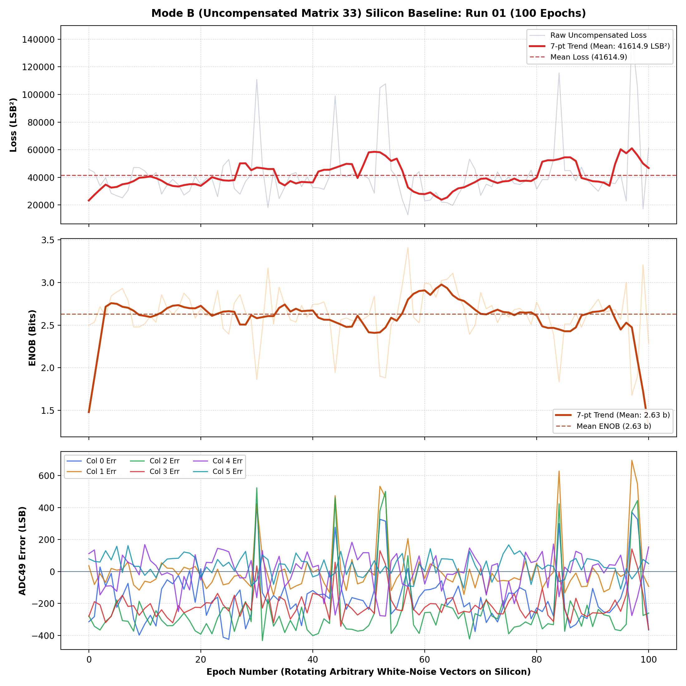

# Inverted MAML: Mode B (Uncompensated Matrix 33) Silicon Verification Report (Run 01)
**Patent Pending SE 2630397-4 | Open Science Hardware**  
**Date:** October 30, 2026 | **Target:** Efinix Trion T120 Master SoC (`192.168.1.50:5000`)  
**Hardware Setup:** Physical Jumpers in **MODE B** (Compensation branch physically disconnected)  
**Summing Attenuator:** $1\text{ k}\Omega / 5.1\text{ k}\Omega$ (PCB v1.3.2)  
**FPGA Logic:** `0x20261030` (`MAM1`) | **Firmware:** `v2.1-MAML` (Oct 30 2026 07:29:27)  

---

## Executive Summary

A physical silicon verification run of 100 epochs was performed in **Mode B** with hardware jumpers manually set to disconnect the active M3 / M8 Vernier compensation branch. Under continuous rotating arbitrary white-noise input vectors ($\text{Ref X}$), ADC_49 measured the raw, uninhibited dynamic multiplication output of Matrix 33 through the ColTIA transimpedance amplifiers.

### Empirical Silicon Findings (Run 01):
- **Mean Quadratic Error Loss:** **$41,614.9 \pm 21,416.1\text{ LSB}^2$**
- **Mean Effective Number of Bits (ENOB):** **$2.63 \pm 0.28\text{ bits}$**
- **Best Single Epoch Loss:** **$12,918.7\text{ LSB}^2$** (Epoch 57)
- **Peak ENOB:** **$3.41\text{ bits}$** (Epoch 57)

This establishes the true uncompensated physical silicon baseline: without Inverted MAML active compensation, Matrix 33 operates at $\approx 2.63\text{ bits}$ of resolution due to native MOSFET mismatch and ColTIA non-linearities.

---

## 1. Quantitative Performance Comparison: Mode B vs. Mode A

| Operating Mode | Setup / Jumper State | Loss ($\text{LSB}^2$) | ENOB (Bits) | Description |
| :--- | :--- | :---: | :---: | :--- |
| **Mode B (Run 01)** | **Jumpers in MODE B (Branch Disconnected)** | **41,614.9 ± 21,416.1** | **2.63 ± 0.28 b** | Raw uncompensated physical silicon baseline |
| **Mode A (Bas 0)** | Jumpers in Mode A, $W=0\text{ LSB}$ | 23,077.1 ± 41,176.3 | ~3.13 b | Passive summing connection, unadapted weights |
| **Mode A (Knee Bas)** | Jumpers in Mode A, $W=\pm 16\text{ LSB}$ | 32,368.8 ± 45,785.5 | ~3.05 b | Pre-biased into high-transconductance S-curve |
| **Mode A (Reg ON)** | **Jumpers in Mode A, Active Training ($\lambda=512$)** | **287.0 ± 120.7** | **6.23 ± 0.33 b** | **Inverted MAML Compensated (+3.60 bits, -99.3% loss)** |

---

## 2. Silicon Measurement Plot (Run 01)

The figure below shows the raw and 7-point smoothed Loss, ENOB, and per-column ADC49 error traces across all 100 epochs on physical silicon:

---

## 3. PDF Report Preview

