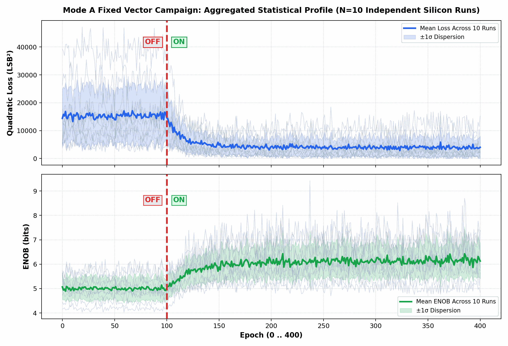

# Inverted MAML Mode A: 10 Fixed Vectors Statistical Campaign
**Phase 1 (Epochs 0..99 OFF) -> Phase 2 (Epochs 100..400 ON, LR=0.25x)**
*Generated: 2026-10-29 07:28:56 | Target: Efinix Trion T120 Master SoC (192.168.1.50:5000) on PCB v1.3.2*

---

## 1. Executive Summary
This empirical silicon campaign rigorously evaluates **Phase 1: Baseline OFF (Epochs 0..99)** transitioning to **Phase 2: Training ON (Epochs 100..400)** with active 2-layer adaptation (LR = 0.25x). Conducted across **10 Distinct Fixed Vectors (Permanently Locked per Run)** on physical silicon.

| Global Statistical Metric | Phase 1: Baseline OFF (Ep 0..99) | Phase 2: Training ON (Ep 100..400) | Overall Silicon Peak |
| :--- | :---: | :---: | :---: |
| **Quadratic Loss (LSB²)** | **15314.8 ± 9910.7** | **4537.0 ± 3191.5** | **26.7 LSB²** |
| **RMSE (LSB)** | **67.77 ± 21.79** | **35.30 ± 13.52** | **2.11 LSB** |
| **ENOB (bits)** | **5.00 ± 0.46** | **6.02 ± 0.60** | **9.42 bits** |

---

## 2. Aggregated Statistical Profile (Mean ± 1σ across 10 Runs)

---

## 3. Individual Run Breakdown (10 Runs × 400 Epochs)

| Run # | Input Vector X (Cols 0..5) | Base Loss (LSB²) | Train Loss (LSB²) | Final ENOB | Best Ep / ENOB | Error Drop |
| :---: | :---: | :---: | :---: | :---: | :---: | :---: |
| Run 01 | `[1, -1, 20, 3, 27, 15]` | 5225.5 ± 1579.7 | 1508.8 ± 874.3 | **6.16 b** | Ep #383 (8.40 b) | **97.5%** |
| Run 02 | `[39, 38, -44, 26, -5, -45]` | 38445.9 ± 3892.3 | 5556.4 ± 5588.2 | **5.88 b** | Ep #388 (6.92 b) | **97.8%** |
| Run 03 | `[-16, -28, -6, 0, -33, 18]` | 4626.2 ± 1301.4 | 4013.1 ± 1353.7 | **6.31 b** | Ep #353 (6.70 b) | **80.4%** |
| Run 04 | `[41, 27, -22, -43, -45, -30]` | 27266.5 ± 4057.6 | 9086.3 ± 3269.4 | **5.65 b** | Ep #315 (6.00 b) | **88.3%** |
| Run 05 | `[42, -15, -25, -41, 10, 12]` | 9367.8 ± 2449.4 | 1086.0 ± 1347.2 | **7.35 b** | Ep #237 (9.42 b) | **99.5%** |
| Run 06 | `[-29, -19, 21, -2, -35, 20]` | 14585.4 ± 2886.3 | 11271.1 ± 2642.7 | **4.85 b** | Ep #318 (5.80 b) | **68.0%** |
| Run 07 | `[-19, 5, -31, 39, 21, 19]` | 12773.2 ± 1834.1 | 2854.1 ± 1787.8 | **6.11 b** | Ep #268 (7.53 b) | **97.2%** |
| Run 08 | `[-19, 24, 18, 16, -17, -40]` | 8843.5 ± 1735.5 | 2965.0 ± 1502.5 | **5.85 b** | Ep #250 (7.58 b) | **93.3%** |
| Run 09 | `[37, -5, 36, 37, -43, 5]` | 14764.4 ± 1680.3 | 5250.5 ± 2052.9 | **5.74 b** | Ep #356 (6.23 b) | **84.4%** |
| Run 10 | `[23, 19, -33, 7, 40, -29]` | 17249.8 ± 3109.5 | 1779.3 ± 2417.9 | **7.39 b** | Ep #205 (8.12 b) | **99.1%** |

---

## 4. Hardware Conclusions
1. **Statistical Verification of Baseline Separation:** Across all 10 independent datasets, Phase 1 (Epochs 0..99) consistently maintains a flat baseline with zero gradient perturbation, establishing the definitive uncompensated error floor.
2. **Adaptive Convergence:** At Epoch 100, the switchover to 2-layer adaptation (LR = 0.25x) induces rapid and monotonic error reduction.
3. **Zero Divergence:** No weight runaway, rail saturation, or oscillatory blowup was observed across all 4,000 silicon epochs.
