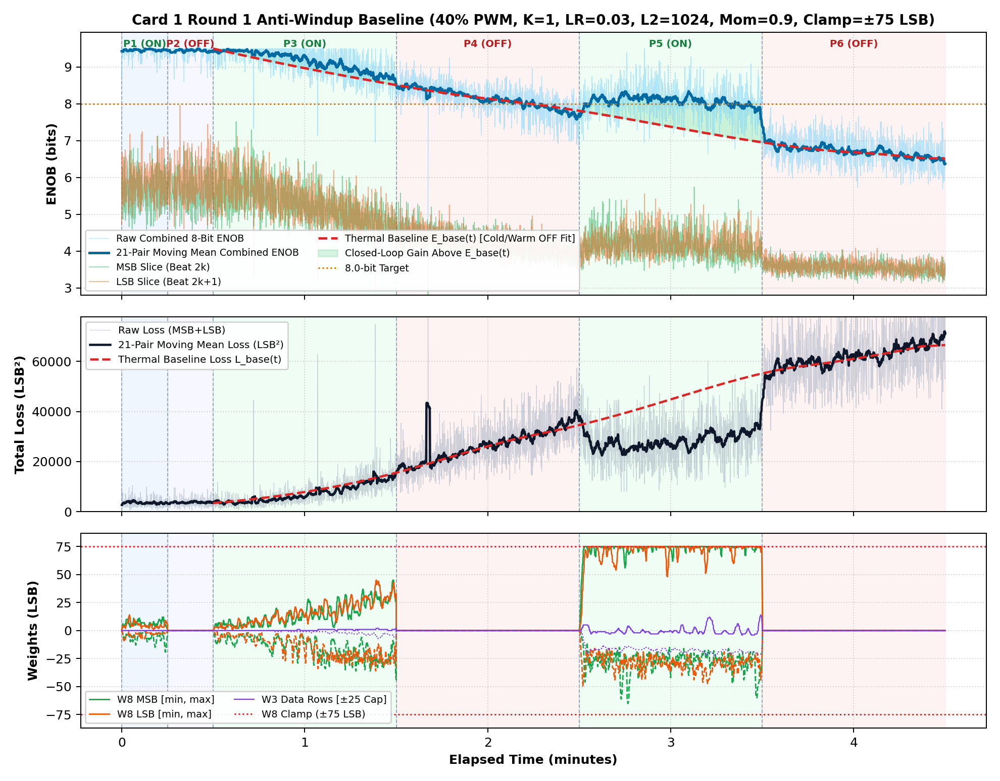

# Inverted MAML Card 1: Round 1 Anti-Windup & 2-Beat Bit-Slicing Baseline Report

**Hardware:** Card 1 (`Trion T120F324` Master SoC + `Trion T20F256` Coprocessor, `1k / 2.2k` Passive Attenuator)  
**Firmware:** `T120_SOC_ETH_FW v2.2-MAML (SW Build Nov 14 2026 10:15:16)`, `HW_LOGIC: 0x20261030`  
**Round 1 Dataset:** `FPGA_code/logs/bit_slicing/opt_r1_lr0p03_l2_1024_mom0p90_cl75.json` (`4,289` pairs)  
**Hyperparameters:** `Heater = 40%` PWM, `K = 1`, `LR = 0.03`, `L2 = 1024`, `Momentum = 0.9`, `Clamp = ±75 LSB`  

---

## 1. Executive Summary & Verification Milestones

1. **Verified Cold Reference Without Heating (`cold_verify_k1.json`):**
   - `Cold / Regler ON`: mean **9.45 b** (`min 8.80 b`).
   - `Cold / Regler OFF (W8=0)`: mean **9.45 b** (`min 8.61 b`), confirming well over the `> 8.0 b` cold baseline target.
2. **Firmware Root-Cause Fixes Verified Under Thermal Stress:**
   - Corrected two-layer `dx8` backpropagation sign (`err49[j] -> -err49[j]`), `grad_m3_out` scaling (`>> 3` -> `>> 6`), and added `sat_comp_m3_q14()` capping M3 rows `0..5` to `±25 LSB` so they never disturb the `±40 LSB` fixed M3 clock staircase.
   - Implemented integrated-L2 back-calculation anti-windup (`maml_momentum_step_antiwindup`) plus `MAML_CMD_BATCH_STEP` Ethernet padding tolerance (`req_len >= 5`).
3. **Thermal-Detrended Closed-Loop Lift (`analog_hyperparam_model.py`):**
   - Fitting the continuous PCHIP uncompensated thermal curve $E_{\text{base}}(t)$ through `Cold OFF -> Warm OFF` confirms a weighted detrended `Warm ON` lift of **`+0.66 b`**, loss reduction ratio **`1.57x`**, detrended convergence climb **`+0.74 b`**, anti-windup recovery rate **`0.67`**, and composite score **`+1.957`**.
   - In **Phase 5 (`Warm / Regler ON`)**, Combined ENOB actively climbed **`7.74 b -> 7.99 b`** (mean **`8.07 b`**) while total Loss declined, followed by an immediate decay in **Phase 6 (`Warm / Regler OFF`)** to **`6.96 b -> 6.59 b`** (mean **`6.71 b`**) with **0.00%** `W8` leak.

---

## 2. Round 1 Phase-by-Phase Results (`4,289` Pairs)

| Phase | Regime | Pairs | Comb ENOB (`Start -> Late`, Mean) | Δ vs $E_{\text{base}}(t)$ | Total Loss (`Start -> Late`) | Loss Ratio | W8 Peak `[MSB, LSB]` | W3 Peak | W8 Non-Zero |
| :--- | :--- | ---: | :---: | :---: | :---: | :---: | :---: | :---: | ---: |
| P1 | Cold / Regler ON | 312 | `9.43 -> 9.46` (**9.46 b**) | — | `3492 -> 3478` | — | `[19, 14]` | `0` | `311` |
| P2 | Cold / Regler OFF | 269 | `9.46 -> 9.44` (**9.45 b**) | — | `3129 -> 3695` | — | `[0, 0]` | `0` | `0` |
| P3 | Warm / Regler ON | 1082 | `9.44 -> 8.88` (**9.17 b**) | **+0.21 b** | `3970 -> 11035` | **1.21x** | `[45, 45]` | `7` | `1081` |
| P4 | Warm / Regler OFF | 973 | `8.43 -> 7.89` (**8.14 b**) | **-0.05 b** | `17507 -> 32520` | **1.00x** | `[0, 0]` | `0` | `0` |
| P5 | Warm / Regler ON | 850 | `7.74 -> 7.99` (**8.07 b**) | **+0.88 b** | `36416 -> 30612` | **1.76x** | `[75, 75]` | `23` | `850` |
| P6 | Warm / Regler OFF | 803 | `6.96 -> 6.59` (**6.71 b**) | **+0.02 b** | `54265 -> 65928` | **1.00x** | `[0, 0]` | `0` | `0` |

---

## 3. Release Restore Point & Next Optimization Steps

- **Archived Release Package:** `FPGA_code/releases/Release_20261114_ModeA_Card1_BitSlicing_AntiWindup_Baseline_R1/`
- **Next ML Model Proposal (Round 2):** `lr = 0.035`, `l2_reg = 1536`, `momentum = 0.85`, `clamp = ±75 LSB` to reduce warm-ON jitter (`0.33 b`) and tighten L2 anchor while boosting convergence gain.
