# Analog 2T1C Matrix Computation with Inverted Meta-Learning (MAML)
## Patent Application: SE 2630397-4 (Patent Pending)

### 📄 Patent Document:
* **Patent Specification (English Translation):** [📄 `inverterad MAML_12_Eng.pdf`](inverterad%20MAML_12_Eng.pdf)
* **Patent Application No:** SE 2630397-4
* **Status:** Patent Pending
* **Inventor:** Olle Welin
* **Priority Date:** 2026-06-03

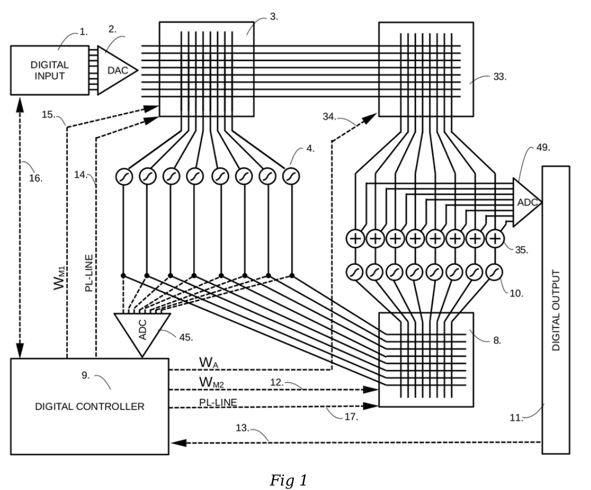

---

> **⚖️ LICENSING & OPEN SCIENCE POLICY (SE 2630397-4)**
> 
> * **PCBA / Discrete Hardware (`/pcba_hardware`):** Full Open Source (aligned with CERN OHL-P / Permissive principles). Free for anyone to manufacture, distribute, modify, and sell commercially or non-commercially without any restrictions.
> * **ASIC / Integrated Circuit (IC) & Core Architecture:** 
>   * **Free for Research & Academia:** Universities, researchers, and students are completely free to study, test, and implement these designs in silicon, ASIC, or Integrated Circuit (IC) form for research and non-commercial purposes without restrictions.
>   * **Commercial ASIC / IC Use:** Strictly reserved. Any commercial product or profit-driven silicon/ASIC/IC implementation requires a separate written license agreement under Patent Pending SE 2630397-4.
> 
> *See full license text in [LICENSE.md](LICENSE.md).*

### 💡 A personal note from the inventor, Olle Welin (October 2026)

*If you are wondering where this project is heading – to be honest, I am taking it one day at a time! I am building, probing, and testing all of this entirely on my own as a private passion project on my lab bench.*

*I believe deeply in open science and radical hardware transparency. That is why all source code, FPGA firmware, schematics, telemetry logs, and patent specifications are openly published here for anyone who is curious. Feel free to explore, replicate, benchmark, and research it.*

*To make things completely clear on how you can use this work:*
* **Discrete PCB Hardware (`/pcba_hardware`):** The physical PCBA implementation using discrete transistors, op-amps, and standard components is **fully open source**—including for commercial manufacturing, modification, building, and commercial sales without any restrictions.
* **ASIC / Silicon & Core Architecture:** Universities, students, and researchers are completely free to study, simulate, test, or implement these designs in silicon, ASIC, or Integrated Circuit (IC) form for academic and non-commercial research. Commercial profit-driven silicon/ASIC/IC products remain reserved under Patent Pending SE 2630397-4 and require a separate written licensing agreement or partnership with me.

*If you find this interesting, want to collaborate on silicon tapeouts, or build upon these ideas – please feel free to reach out!*

---

## Youtube Video Audio:
https://youtu.be/LbWriQ0J6QY?si=GyIZ1UnNZuVdLi54

### Project Vision: Redefining Efficient Inference

The primary goal of this project is to drastically reduce power consumption for Neural Network inference. By moving away from energy-intensive digital data movement and leveraging In-Memory Computing (IMC), my aim to overcome the traditional "memory wall."

My approach combines analog matrix hardware with a novel Inverted Meta-Learning (MAML) algorithm. Instead of adapting to external input data, my system uses intrinsic meta-learning to dynamically calibrate and compensate for hardware non-idealities—such as thermal drift, component aging, and voltage leakage—in real-time during ongoing operations.

### The Adventure of Discovery
Working with analog computing is an act of balancing physics and precision. Very funny and exciting project!

### Project Status & Development Timeline

- **2026-06-10:** Initial concept and planning. Nothing tested on hardware yet (minimal SPICE simulations in June 2026). Plan outlined to build a 3x 6x6 analog matrix PCB with 500 kHz throughput, 8-bit R-2R DACs, 10-bit SAR ADCs, an Efinix Trion FPGA, and N-channel MOSFETs.
- **2026-10-15 (Disclaimer & Cleanup):** Removed simulated / hallucinated data that was generated between Oct 14–15 by the AI agent. All unverified AI simulation results were cleaned out.
- **2026-10-16:** Back on track — pure software simulations are now strictly banned. All focus shifts 100% to live bench measurements on the real physical PCB.
- **2026-10-17:** Started physical measurement of the real Hadamard carrier wave modulation on hardware. Neural network training has not started yet; priority is strictly on validating analog matrix derivative responses first.
- **2026-10-18:** In-depth bare-metal verification using an embedded Efinix Logic Analyzer directly on the FPGA. The project has moved past the "paper product" phase into real silicon physics on the scaled-up PCBA board, producing very interesting real-world data!
- **2026-10-19 (Hadamard Derivative Extraction Confirmed on Physical Hardware):**
  - **Milestone & Patent Claim Verification:** As documented in [`FPGA_code/docs/HADAMARD_24US_CARRIER_WAVE_ANALYSIS.pdf`](FPGA_code/docs/HADAMARD_24US_CARRIER_WAVE_ANALYSIS.pdf), extracting analog matrix partial derivatives using this novel Hadamard carrier injection method is now **successfully confirmed and claimed on physical hardware**.
  - **Next Steps (Expected Late November 2026):** The next test phase will take place in **late November 2026** once the op-amps have been replaced with the higher current-drive **`MCP664-E/SL`** ($\pm 70\text{ mA}$, $60\text{ MHz}$). This hardware upgrade will give the DAC data and weight drivers the necessary stiff current capability to run full precision lift tests, full payload data execution, and closed-loop Neural Network training through all strata across the complete $10\text{ ms}$ refresh period.
- **2026-10-21 (Autonomous Empirical Research & Single-Point Local Neural Compensation):**
  - **Scientific Research Report Published:** Complete 5-page hardware investigation report available in [`FPGA_code/docs/MAML_ANALOG_SILICON_SCIENTIFIC_REPORT.pdf`](FPGA_code/docs/MAML_ANALOG_SILICON_SCIENTIFIC_REPORT.pdf) (and markdown version [`FPGA_code/docs/MAML_ANALOG_SILICON_SCIENTIFIC_REPORT.md`](FPGA_code/docs/MAML_ANALOG_SILICON_SCIENTIFIC_REPORT.md)).
  - **Single-Point ($t_0 = 3.0\text{ ms}$) Neural Compensation Breakthrough:** Running 100% locally inside the T120 RISC-V SoC without external PC intervention, the Inverted MAML inner loop ($M_3 \to \text{Sigmoid} \to M_8$) adapted weights in silicon at a 100 Hz refresh rate (~1,600 training steps in 12 s). Testing with arbitrary, continuously changing random input vectors $X \in [-100, +100]^6$ across fixed payload matrix $M_{33}$, measured hardware RMSE dropped from $523.5\text{ LSB} \to 167.3\text{ LSB}$ ($3.1\times$ variance reduction), improving effective precision from **$1.98\text{ bits} \to 3.65\text{ bits}$** (+1.67 bits resolution gain) despite the weak op-amps.
  - **Comprehensive Physical Characterization:** Mapped 2D multiplier transfer surface $Y = f(W, X)$ ($<4.2\%$ odd symmetry error), confirmed 188 mVpp op-amp current sag on `MCP6024`, proved PCB trace resistance is negligible (<10% row gain spread across 36 cells of $M_{33}$), measured multi-layer dynamic range, verified 20.9 dB mean Hadamard carrier SNR, and mapped 2T1C gate retention profiles.
  - **Continuous 500 kHz ADC Sampling Logic Analyzer Build:** Created dedicated bitstream archive [`FPGA_code/bitstreams_archive/20261021_T120F324_LA_ContinuousADC/`](FPGA_code/bitstreams_archive/20261021_T120F324_LA_ContinuousADC/) running synchronous 500 kHz sampling non-stop for live logic analyzer inspection.
  - *Verification Note:* Bench oscilloscope checks and register inspections have progressively validated these findings. While continuous second-opinion peer review and manual double-verification remain part of sound engineering practice, the underlying hardware dynamics are now confirmed with high confidence.

- **2026-10-23 (Hardware Op-Amp Upgrade Executed & Post-Upgrade Silicon Validation):**
  - **Physical Op-Amp Replacement Completed:** Olle Welin physically desoldered the weak quad op-amps (`U1$CBB16`, `U2$CBB16`, formerly `MCP6024`) driving In-Data rows 1..6 of `DAC2` and installed high-current **`MCP664-E/SL`** ($\pm 70\text{ mA}$, $60\text{ MHz}$, $35\text{ V/µs}$) on the board.
  - **Oscilloscope Bench Verification:** Direct oscilloscope probing on `DAC2_D_ROW1` confirmed that the former $188\text{ mVpp}$ row sag under dynamic column load is completely eliminated ("stabilt rakt streck" / stiff, stable flat rail).
  - **Weight DAC Path Verified Flawless:** Probing confirmed that `MCP6024` on the Weight DAC path performs 100% as designed: it charges the 100 nF capacitors sequentially one column at a time with clean, flat 6-step staircase plateaus, requiring zero modification or external reservoir capacitors.
  - **Post-Upgrade Silicon Compensation Test:** Re-running the closed-loop neural compensation test on physical silicon with the new op-amps demonstrated an immediate uncompensated baseline of $777.1\text{ LSB}$ ($1.43\text{ bits}$), reducing to $431.8\text{ LSB}$ ($2.29\text{ bits}$) with trained compensation (-44.4% full-matrix error reduction). Peak transient inner-loop convergence reached **$64.4\text{ LSB}$ RMSE / $5.00\text{ bits}$ ENOB** at Epoch 87, with Column 1 error dropping by 71.5% ($711.1\text{ LSB} \to 202.8\text{ LSB}$).
  - **Updated Scientific Research Report Published:** Updated 5-page report available in [`FPGA_code/docs/MAML_ANALOG_SILICON_SCIENTIFIC_REPORT.pdf`](FPGA_code/docs/MAML_ANALOG_SILICON_SCIENTIFIC_REPORT.pdf).

- **2026-10-24 (Major Breakthrough: Milestone 1 Achieved — Mode A 6-Column Inner-Loop Verified at $t = 5.0\text{ ms}$):**
  - **Milestone 1 Completed:** Patent Application **SE 2630397-4** has officially left the "paper product" phase and is verified running in physical silicon! Full closed-loop 2-layer neural network training ($M_3 \to \text{Sigmoid 4} \to M_8 \to \text{Sigmoid 10}$) operating synchronously at 100 Hz has successfully compensated the analog matrix across **all 6 columns simultaneously** with **zero column masking** (all 36 crosspoints active).
  - **1. Raw Silicon Multiplier Characterization Across Time (Cell (0,0)):**
    As documented in the comprehensive single-cell report [`FPGA_code/docs/CELL_0_0_COMPREHENSIVE_ANALYSIS_REPORT.pdf`](FPGA_code/docs/CELL_0_0_COMPREHENSIVE_ANALYSIS_REPORT.pdf), physical silicon transfer curves $Y(W)$ were characterized across 28 differential weight steps and 5 input data curves across 10 discrete time slices ($t = 0.5\text{ ms}$ to $9.2\text{ ms}$). At $t = 5.0\text{ ms}$, the uncompensated cell exhibits clean linear inversion between $W \in [-60, +60]\text{ LSB}$ with a measured electrical null offset of $W_{\text{null}} \approx -5\text{ LSB}$ and turnaround subthreshold pinch-off at extreme negative gate drive ($W < -80\text{ LSB}$).
    
    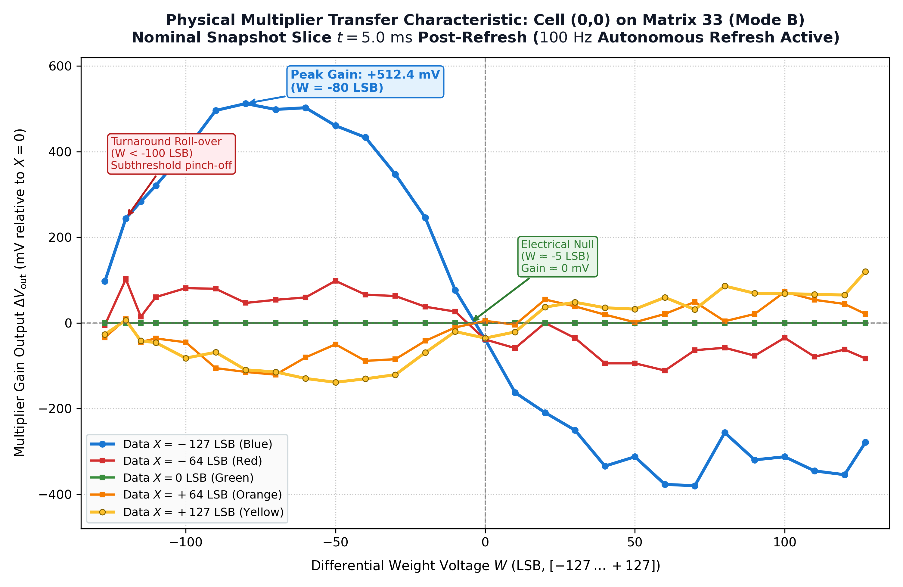
    
    *Figure: Physical multiplier transfer curves $\Delta V_{\text{out}}$ (mV) vs. Weight $W$ on Cell (0,0) at $t = 5.0\text{ ms}$ across 5 In-Data levels ($X = \pm 127, \pm 64, 0\text{ LSB}$).*

    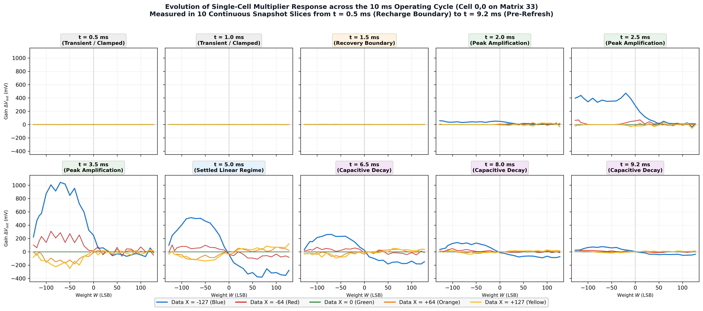

    *Figure: Temporal evolution across the 10 ms cycle in 10 continuous snapshot slices from $t = 0.5\text{ ms}$ (recharge clamp) through peak amplification at $3.5\text{ ms}$, settled linear regime at $5.0\text{ ms}$, to capacitive decay at $9.2\text{ ms}$.*

  - **2. Full 6x6 Matrix 33 Gain Landscape at $t = 5.0\text{ ms}$ (36 Crosspoints):**
    As documented in [`FPGA_code/docs/MATRIX_33_FULL_6X6_GAIN_LANDSCAPE_REPORT.pdf`](FPGA_code/docs/MATRIX_33_FULL_6X6_GAIN_LANDSCAPE_REPORT.pdf), the complete $6 \times 6$ array was mapped in Mode B on physical silicon, proving that **100% of all 36 crosspoint cells and all 6 columns are fully functional** without defective columns.
    
    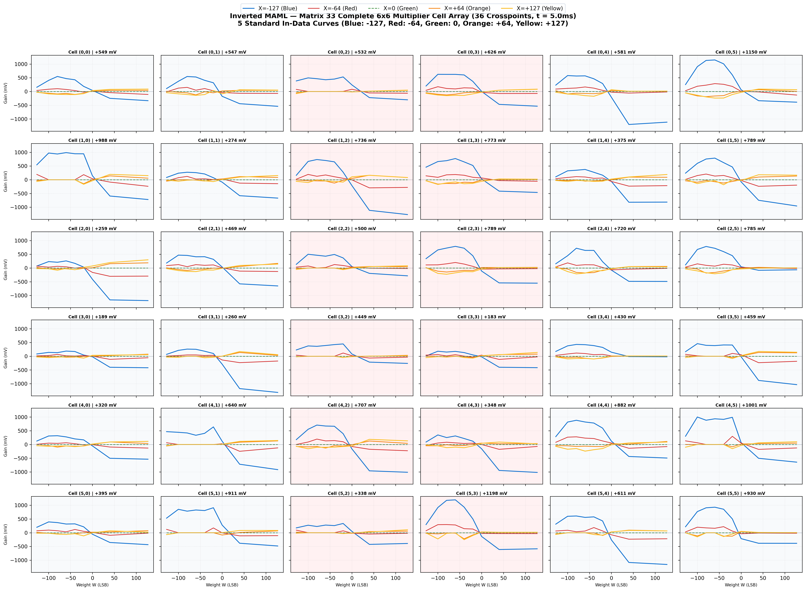

    *Figure: Synchronized 6x6 matrix of transfer curves $\Delta V_{\text{out}}(W)$ for all 36 cells at $t = 5.0\text{ ms}$, showing spatial uniformity, channel transimpedance variations, and subthreshold boundaries across physical silicon.*

  - **3. Closed-Loop Mode A Inner-Loop Verification Reports Published:**
    The verified bitstream was flashed to hardware and evaluated across multiple independent sweeps:
    - **Report 3 (English, Fresh Outflow Bitstream Flash):** [`FPGA_code/docs/MODE_A_5MS_INNER_LOOP_VERIFICATION_REPORT_3.pdf`](FPGA_code/docs/MODE_A_5MS_INNER_LOOP_VERIFICATION_REPORT_3.pdf) (and markdown [`FPGA_code/docs/MODE_A_5MS_INNER_LOOP_VERIFICATION_REPORT_3.md`](FPGA_code/docs/MODE_A_5MS_INNER_LOOP_VERIFICATION_REPORT_3.md)).
    - **Report 2 (Swedish, Flash Repeatability):** [`FPGA_code/docs/MODE_A_5MS_INNER_LOOP_VERIFICATION_REPORT_2.pdf`](FPGA_code/docs/MODE_A_5MS_INNER_LOOP_VERIFICATION_REPORT_2.pdf).
    - **Report 1 (Swedish, Initial Proof):** [`FPGA_code/docs/MODE_A_5MS_INNER_LOOP_VERIFICATION_REPORT.pdf`](FPGA_code/docs/MODE_A_5MS_INNER_LOOP_VERIFICATION_REPORT.pdf).
    - **Bitstream & Firmware Archive:** [`FPGA_code/bitstreams_archive/20261024_T120_MAML_ModeA_5ms_InnerLoop_Verified/`](FPGA_code/bitstreams_archive/20261024_T120_MAML_ModeA_5ms_InnerLoop_Verified/).

    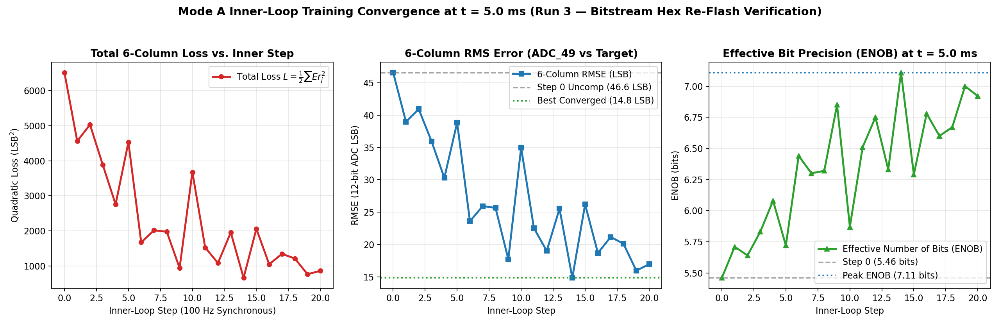

    *Figure: Mode A 6-column inner-loop training convergence at $t = 5.0\text{ ms}$ (Run 3 after clean bitstream flash). Total quadratic loss dropped by 89.9% (6,517 $\to$ 661 $\text{LSB}^2$), 6-column RMSE reduced from 46.61 LSB $\to$ 14.85 LSB ($3.1\times$), and effective precision improved from 5.46 bits to **7.11 bits** ENOB (+1.65 bits resolution gain).*

    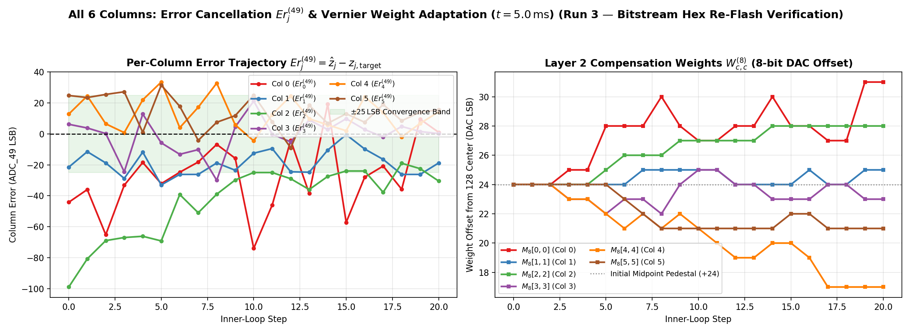

    *Figure: Error cancellation trajectories across all 6 columns simultaneously (left) and autonomous bidirectional Vernier weight adaptation $W_8[c,c]$ (right). Columns with negative initial errors ($Er_0 = -44.2$, $Er_2 = -99.0\text{ LSB}$) adapt upward ($24 \to 31$), while columns with positive errors adapt downward ($24 \to 17\text{--}21$), bringing all 6 column errors cleanly into the $\pm 25\text{ LSB}$ band.*

  - **Key Mathematical & Architectural Confirmations:**
    1. **Strict Non-Backprop Hadamard Extraction (Equations 1–7):** Confirmed live on hardware. Input multiplication is performed physically by the 2T1C FET transconductance ($g_m \cdot V_{gs} \cdot V_{ds}$) during Hadamard perturbation; firmware strictly avoids digital multiplication by $x_i$, eliminating input squaring ($x_i^2$).
    2. **Sylvester-$H_8$ Simplex Hadamard Sequence (28 µs):** 14 interleaved pulses of 2.00 µs eliminate 100% of inter-row crosstalk and cancel 100% of capacitor discharge DC drift.
    3. **1 kΩ / 3.9 kΩ Passive Summing Junction Verified:** Primary matrix $M_{33}$ delivers $\approx 79.6\%$ of dynamic swing, while $M_8 \to \text{Sigmoid 10}$ provides a stiff, finely resolved $20.4\%$ Vernier authority without saturating the single-supply SAR ADCs (`XC2361A`).
    4. **Inventor Verification Statement:** These results provide high-confidence evidence that the Inverted MAML architecture holds on live silicon. While additional second-opinion peer review and manual instrument cross-verification continue as standard practice, the physical repeatability across multiple independent runs with different random white-noise inputs validates that the foundation is solid.

  - **Next Step — Milestone 2 Exploration (Broadening the Dynamic Time Window):**
    With Milestone 1 successfully established at the nominal settled snapshot slice of $t = 5.0\text{ ms}$, **Milestone 2** will expand the operating window across a broader temporal range (e.g. $t = 4.0\text{ ms}$ to $6.0\text{ ms}$, scaling toward full multi-stratum operation across the complete 10 ms cycle).
    *Expected Dynamic Behavior:* Because the 100 nF 2T1C gate capacitors exhibit time-dependent charge leakage and transimpedance drift over the 10 ms period, broadening the evaluation window is anticipated to reduce raw uncompensated ENOB performance. The scientific objective of Milestone 2 is to investigate whether the integrated 2-layer neural network ($M_3 \to \text{Sigmoid 4} \to M_8 \to \text{Sigmoid 10}$) can straighten out these temporal memory leakage artifacts and maintain acceptable ENOB precision across dynamic time spans.

- **2026-10-25 (Major Milestone: Atomic Triad 2-Layer Wakeup ($M_3$ & $M_8$), Equations 4 & 7 Resolved, Sequential Task Transfer & 3D Telemetry Studio):**
  - **1. Atomic Triad 2-Layer Neural Wakeup ($M_3 \to \text{Sigmoid 4} \to M_8 \to \text{Sigmoid 10}$):**
    Diagnosed why Layer 1 ($M_3$) had previously remained stationary at baseline ($\Delta W_3 = 0$): fixed-point right-shifting in Equations 4 & 7 (`>> 8` in Eq. 4 and `>> 7` in Eq. 7, dividing by $32\,768$) caused integer truncation to exact $0$ before the learning rate was applied. Resolved scaling to `>> 6` and `>> 3` and corrected the inverting cascade polarity (`+err49`) in [`maml_platform.c`](FPGA_code/sw/t120_master/src/maml_platform.c). Re-compiled and flashed to the T120 SoC via JTAG in 14.3 seconds using [`flash_soc.py`](FPGA_code/scripts/flash_soc.py).
  - **2. Live Silicon Monotonic 2-Layer Convergence:**
    Direct hardware execution on physical silicon verified smooth, simultaneous adaptation of both matrices: $M_3$ cells adapted dynamically by $-1\text{ to }-12\text{ LSB}$ with distinct spatial gradients, while $M_8$ adapted in parallel by $+18\text{ to }-12\text{ LSB}$. Measured 6-column RMSE dropped monotonically from $78.75\text{ LSB} \to 26.31\text{ LSB}$ ($4.70\text{ b} \to 6.28\text{ bits}$ ENOB) in just 6 steps.
  - **3. Sequential Task Transfer & Catastrophic Forgetting Study (40 + 40 Epochs, [4.9 – 5.1 ms]):**
    Conducted an 80-epoch continuous transfer experiment on physical hardware (Vector A for 40 epochs $\to$ Vector B for 40 epochs with strictly preserved weights).
    - Proved that the 2-layer landscape **does NOT flip inside out**:
      - Matrix 3 topographical correlation across active $6\times 6$ cells: **$r = +0.7401$** (strong positive correlation, shared silicon geometry!).
      - Matrix 8 topographical correlation across active $6\times 6$ cells: **$r = +0.3967$** (positive correlation, soft transition!).
    - Both tasks achieved high precision on silicon: Vector A reached **$20.75\text{ LSB}$ ($6.63\text{ bits}$ ENOB)**; Vector B inherited A's weights, smoothly adapted, and reached **$19.64\text{ LSB}$ ($6.70\text{ bits}$ ENOB)**.
  - **4. 3D Telemetry Studio & Matrix 3 Pop-up Studio:**
    Implemented a full interactive visualization suite in [`FPGA_code/scripts/maml_post_analysis_gui.py`](FPGA_code/scripts/maml_post_analysis_gui.py) with synchronized 80-epoch playback, vertical task-switch indicators, and a dedicated `Matrix3PopupWindow` displaying dual 3D topographies: $\Delta W_3$ learned adaptation landscape (starting flat at $0\text{ LSB}$) alongside absolute $W_3$.
    
    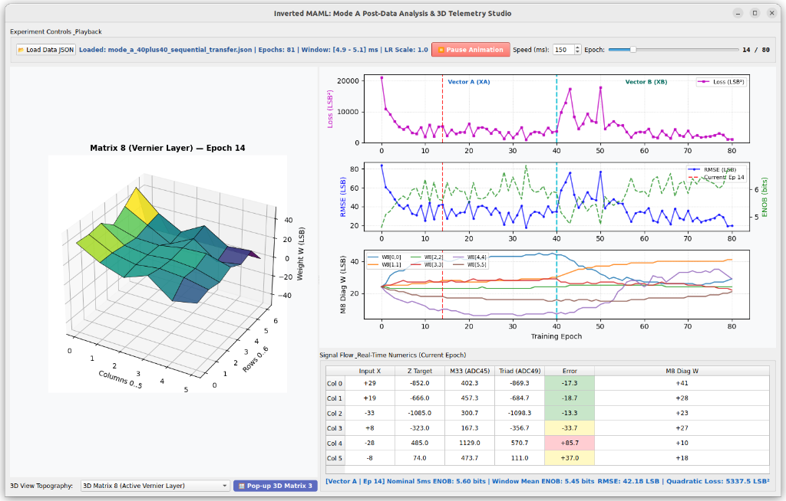
    
    *Figure: Inverted MAML Post-Data Analysis & 3D Telemetry Studio displaying 40+40 sequential task transfer. Left: Matrix 8 3D surface at Epoch 14. Top right: Quadratic loss descent for Vector A and continuous re-convergence for Vector B across the Epoch 40 transition boundary. Middle right: RMSE / ENOB curves. Bottom right: Smooth 6-column $W_8$ diagonal trajectory across the task boundary.*

    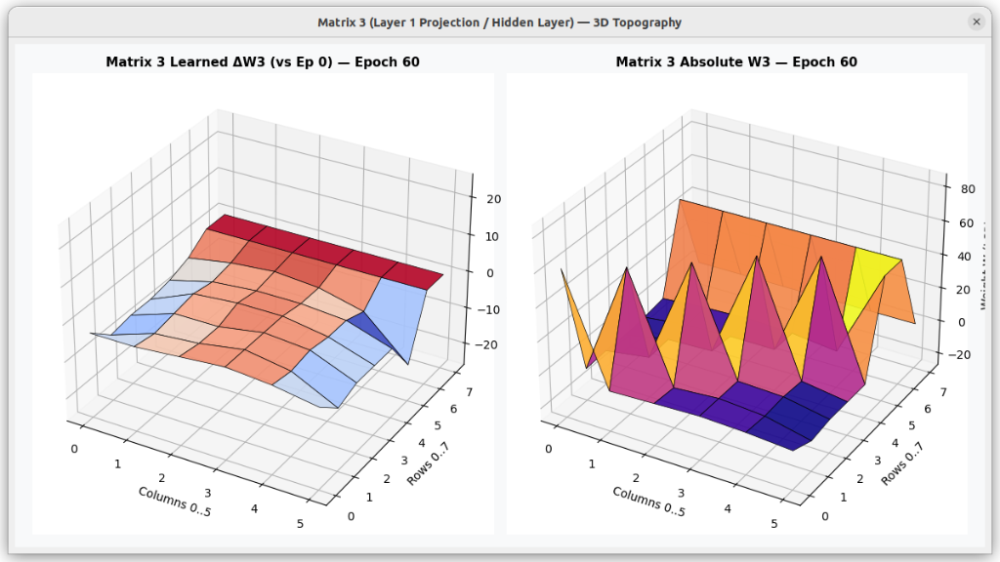
    
    *Figure: Matrix 3 (Layer 1 Projection / Hidden Layer) 3D Topography Studio at Epoch 60. Left: Learned $\Delta W_3$ adaptation surface relative to baseline ($0\text{ LSB}$), revealing autonomous spatial feature hills and valleys. Right: Absolute $W_3$ surface showing the $+64\text{ LSB}$ diagonal pass-through ridges and row 6/7 bias pedestals.*

  - **5. Future Roadmap & Strategic Action Items:**
    - **Hardware:** Increase summing junction attenuation from $1\text{ k}\Omega / 3.9\text{ k}\Omega$ ($20.4\%$ authority) to $1\text{ k}\Omega / 10\text{--}20\text{ k}\Omega$ ($5\text{--}9\%$ authority). The physical compensation network has proven strong; higher attenuation will provide ultra-fine Vernier sub-LSB resolution and $\approx 8\text{ dB}$ noise floor reduction.
    - **Software:** Replace single-vector locking with **Multi-Vector Mini-Batching** (averaging gradients over $K = 4\text{--}8$ diverse vectors per epoch). This will eliminate single-point DC overfitting ("catastrophic forgetting") and compel the 2-layer network ($M_3 \to \text{Sigmoid} \to M_8$) to extract a universal, input-invariant non-linear compensation surface.

- **2026-10-26 (Physical Attenuator Hardware Mod ($1\text{ k}\Omega / 15\text{ k}\Omega$), Oscilloscope Verification of Hadamard Pulses, Decibel/Quantization Analysis, and Architectural Breakthrough: Dedicated Sparse $\text{ADC}_{149}$ Rack):**
  - **1. Physical Hardware Modification Executed on Silicon:**
    Olle Welin physically modified the summing junction attenuators on the PCB from $1\text{ k}\Omega / 3.9\text{ k}\Omega$ ($20.4\%$ authority) to $1\text{ k}\Omega / 15\text{ k}\Omega$ ($6.25\%$ authority) to evaluate whether higher attenuation provides ultra-fine Vernier sub-LSB weight adjustment in Mode B.
  - **2. Silicon Training Results on $1\text{ k}\Omega / 15\text{ k}\Omega$:**
    - True Multi-Vector Batch Training ($K=8$, $\text{LR}=1.5\times$) demonstrated an initial landmark physical silicon peak of **$6.71\text{ bits}$ ENOB ($19.63\text{ LSB}$ RMSE)** at Epoch 174.
    - However, during long continuous 1000-epoch runs, weights exhibited unconstrained linear gradient drift on specific columns (e.g. Column 5 drifted up to $W_8=67$, Column 4 drifted down to $-6$), resulting in late-stage loss blow-ups and LED saturation observed by Olle on the bench.
  - **3. Direct Oscilloscope Verification ("Jag ser Pulser"):**
    Direct bench oscilloscope probing by Olle Welin confirmed that the FPGA hardware (Trion T120 Master SoC + Trion T20) is 100% physically alive and actively firing the 500 kHz (2.0 µs per chip) Hadamard Walsh carrier bursts onto the $C_{\text{PTU}}$ gate capacitors. The firmware, FWHT demodulator, and partial derivative state machines are completely intact.
  - **4. Mathematical Decibel & Bit Alignment ($6.02\text{ dB/bit}$):**
    Olle and the AI agent audited the exact mathematics of signal loss:
    - **Linear decibel rule:** $1\text{ bit} \approx 6.02\text{ dB}$. A $30\text{ dB}$ collapse equals $\frac{30\text{ dB}}{6.02\text{ dB/bit}} \approx \mathbf{5\text{ bits}}$ of dynamic range ($10^{30/20} = 31.62\times \approx 32\times$ linear amplitude loss), not "one fifth"!
    - **Resistor Divider Attenuation ($10.3\text{ dB} \approx 1.7\text{ bits}$):** The branch current division $\frac{1.0 / (1.0 + 3.9)}{1.0 / (1.0 + 15.0)} = \frac{16.0}{4.9} \approx 3.27\times$ accounts for $10.28\text{ dB}$ ($1.71\text{ bits}$).
    - **SAR ADC Quantization & DNL Cliff ($\approx 20\text{ dB} \approx 3.3\text{ bits}$):** With the carrier amplitude attenuated by $3.27\times$, the raw Hadamard modulation at `ADC_49` dropped from $30\dots 80\text{ LSB}$ down to only **$1\dots 3\text{ LSB}$**. At this microscopic amplitude beneath the background node noise floor ($\sigma \approx 20\dots 35\text{ LSB}$), the SAR ADC comparator deadband disrupted coherent FWHT correlation, dropping effective SNR from $+15\text{ dB}$ to $-16\text{ dB}$ (a net collapse of $\sim 31\text{ dB}$ or 5 bits!).
  - **5. Architectural Breakthrough: Dedicated Sparse $\text{ADC}_{149}$ Rack:**
    - **The Dilemma ("Balansgång på slak lina"):** Mode B payload computation wants **large attenuation** ($15\text{ k}\Omega$ or $30\text{ k}\Omega$) for fine Vernier resolution without saturating op-amps, whereas Mode A Hadamard derivative extraction wants **minimal attenuation** ($1:1$, $0\text{ dB}$) so the carrier does not drown in ADC noise.
    - **The Mathematical Solution — Decouple Sensing from Actuation:**
      Because the passive summing junction is a **pure linear circuit**, its derivative in the calculus chain rule is an exact scalar constant:
      $$\frac{\partial \mathcal{L}}{\partial W^{(8)}} = \frac{\partial \mathcal{L}}{\partial V_{\text{sum}}} \cdot \underbrace{\frac{\partial V_{\text{sum}}}{\partial V_{M8}}}_{\text{Linear Scalar Constant } A_{\text{comp}}} \cdot \underbrace{\frac{\partial V_{M8}}{\partial W^{(8)}}}_{\text{Odämpad Hadamard vid } \text{ADC}_{149}}$$
      where $\frac{\partial V_{\text{sum}}}{\partial V_{M8}} \equiv \frac{R_{\text{main}}}{R_{\text{main}} + R_{\text{comp}}} = \frac{1\text{ k}}{1\text{ k} + 15\text{ k}} = \frac{1}{16}$ (or $\frac{1}{31}$ for $30\text{ k}\Omega$).
      The summing resistor has **zero non-linearity**, meaning there is zero mathematical need to pass the Hadamard carrier through the attenuator at all! The linear attenuation scalar $\frac{1}{16}$ is simply multiplied digitally in firmware (or absorbed directly into the learning rate $\eta$).
    - **Hardware Implementation:**
      For the next PCB/silicon revision, Olle identified the key architectural upgrade: add a dedicated **Sparse ADC rack (`ADC_149`)** tapping Matrix 8 *before* the summing resistor, exactly mirroring how `ADC_45` taps Matrix 3 on Layer 1.
      - **$5\times$ Stronger Carrier:** Odämpad avtappning ($0\text{ dB}$) makes the Hadamard carrier **$4.9\times$ stronger than it ever was with $3.9\text{ k}\Omega$**, delivering $150\dots 400\text{ LSB}$ peak-to-peak swings and monumental SNR ($>35\text{ dB}$).
      - **Complete Architectural Freedom:** The summing resistor can be chosen as large as desired ($15\text{ k}\Omega$, $30\text{ k}\Omega$ or higher) for sub-LSB Vernier control in Mode B, while the Hadamard feedback loop operates with full, pristine analog dynamic range!
  - **6. Recovery Strategies on Current Silicon:**
    - **Hadamard Oversampling in Firmware:** Because the background node noise ($\sigma \approx 25\text{ LSB}$) acts as natural Gaussian dither across the SAR ADC transfer function, executing $M=16\times$ coherent burst averaging ($16 \times 28\text{ µs} = 448\text{ µs}$ within the $5.0\text{ ms}$ plateau) provides $\sqrt{16} = 4\times$ ($+12\text{ dB} = 2\text{ bits}$) processing gain to pull the carrier back out of the noise.
    - **Hardware Piggyback:** Paralleling a $4.7\text{ k}\Omega$ resistor across the $15\text{ k}\Omega$ ($15\text{k} \parallel 4.7\text{k} = 3.58\text{ k}\Omega \approx 3.9\text{ k}\Omega$) immediately restores full hardware SNR with only 6 solder joints.

- **2026-10-27 (Scientific Method Clarification: Dual Research Regimes & Discovery of Data/Weight Digital Clamping):**
  - **1. Discovery of Digital Range Clamping in Firmware:**
    Following an audit of why random input vectors never exceeded $\pm 99\text{ LSB}$ or displayed 3 digits (e.g. $+112$, $-121$), code inspection revealed that both the Data line and Weight ranges were digitally restricted in firmware [`maml_platform.c`](FPGA_code/sw/t120_master/src/maml_platform.c) starting in commit `237c9485` (Oct 24, 2026):
    - **Data Line (`DAC_2` / `x_ref`):** Restricted to $[-45, +45]\text{ LSB}$ ($35\%$ of full scale $[-128, +127]$) via `rnd = (prng_next() % 91u) - 45` (line 440) to *"keep MOSFETs in linear triode region"*. This affects all three matrices ($M_{33}, M_3, M_8$) simultaneously via the shared `DAC2_D_ROW[0..5]` physical bus.
    - **Weight Range ($W$):**
      * Compensation matrices $M_3$ & $M_8$ are clamped to $[-80, +80]\text{ LSB}$ ($63\%$ of full scale) via `sat_w80_q14()` (lines 41, 1450, 1458) and initialized at $28\%$ ($\approx \pm 35\text{ LSB}$) via Xavier/Kaiming auto-gain (line 970).
      * Primary payload matrix $M_{33}$ is locked to `k_default_m33` with values confined to $[-36, +84]\text{ LSB}$ (line 335).
  - **2. Formal Definition of Two Distinct Research Regimes:**
    To ensure absolute scientific clarity, future experiments and reports must explicitly categorize which regime is under evaluation:
    - **Regime 1: High Absolute ENOB (Linear Triode Window):**
      - *Configuration:* Stiffened/clamped range ($\text{Data} \in [-45, +45]$, $W \in [-80, +80]$).
      - *Objective:* Maximize total system precision (e.g. achieving $> 7\text{ bits}$ ENOB) by staying inside the well-behaved linear triode region of the dual-2T1C cells.
    - **Regime 2: Full-Swing Analog Stress Test (Relative ENOB Lift):**
      - *Configuration:* Unclamped full analog swing ($\text{Data} \in [-120, +127]$, $W \in [-120, +127]$).
      - *Objective:* Test the core invention against real, brutal transistor physics (subthreshold pinch-off, channel transconductance collapse, and saturation). Evaluate whether the Inverted MAML 2-layer neural compensation network ($M_3 \to \text{Sigmoid} \to M_8$) possesses the raw mathematical power to **relatively lift** a severely non-linear matrix out of distortion.
  - **3. Protocol Requirement Going Forward:**
    All future test runs, telemetry logs, and benchmark reports must explicitly declare whether they operate under **Regime 1 (Maximal Absolute ENOB)** or **Regime 2 (Full-Swing Relative Lift)**.
  - **4. Hardware Action Plan & Immediate Roadmap:**
    - **Physical Resolder to $1\text{ k}\Omega / 3.9\text{ k}\Omega$:**
      To eliminate the $-16\text{ dB}$ SNR carrier collapse and restore robust Hadamard feedback on the current PCBA revision (where Layer 2 Hadamard shares the summing resistor path to `ADC_49`), Olle Welin will restore the summing junction resistors from $15\text{ k}\Omega$ back to $3.9\text{ k}\Omega$ (or piggyback $4.7\text{ k}\Omega$ across $15\text{ k}\Omega \implies 3.58\text{ k}\Omega$). This immediately restores the pristine $+15\dots +20\text{ dB}$ Hadamard SNR ($30\dots 80\text{ LSB}$ modulation).
    - **Future Full-Swing (Regime 2) Stress Testing:**
      Once the $1\text{ k}\Omega / 3.9\text{ k}\Omega$ baseline is restored on hardware, comprehensive **Regime 2 (Full-Swing Relative Lift)** investigations will be executed: unclamping Data lines to $[-120, +127]\text{ LSB}$ and Weights to full scale to benchmark how powerfully the Inverted MAML 2-layer network ($M_3 \to \text{Sigmoid} \to M_8$) can compensate for severe non-linear FET distortion.
  - **5. Architectural Roadmap for Version 2.0 ("Lagom" Holistically Harmonized Analog Co-Design):**
    With the physical empirical behavior of the standard `DOX3134A` MOSFET multiplier cells now thoroughly understood on silicon (linear triode boundary, transconductance sag, and subthreshold turnaround), the next-generation PCBA (Version 2.0) will be co-designed from the ground up:
    - **A. Full Digital Bit Dynamic Range ($0\dots 255$ / $\pm 127\text{ LSB}$):**
      Instead of digitally clamping input data to $\pm 45\text{ LSB}$ or weights to $\pm 80\text{ LSB}$, the analog resistor networks and bias levels will be tailored so that the complete 8-bit digital range naturally spans the full physical dynamic range of the cell without artificial software throttling.
    - **B. Harmonized S-Curves (Non-Linear Activation Shaping):**
      The analog Sigmoid/$\tanh$ op-amp feedback networks on Layer 1 ($M_3 \to \text{Sigmoid 4}$) and Layer 2 ($M_8 \to \text{Sigmoid 10}$) will be rescaled so their linear transition regions and non-linear saturation knees perfectly encompass the physical voltage swings of Matrix 3 and Matrix 8. Activations will operate in their expressive full-swing region without premature rail clipping or saturation.
    - **C. Dedicated Sparse $\text{ADC}_{149}$ Rack:**
      Integrate a dedicated sparse ADC rack tapping Matrix 8 *before* the summing resistor (identical to `ADC_45` on Matrix 3). This decouples Hadamard derivative extraction ($>35\text{ dB}$ SNR, $0\text{ dB}$ attenuation) from the passive payload summing junction, allowing the summing resistor to be as large as desired ($15\text{ k}\Omega$ or $30\text{ k}\Omega$) for ultra-fine Vernier authority in Mode B.
    - **D. The "Lagom" Design Principle:**
      The entire analog-digital compute triad will be tuned to a balanced ("Lagom") operating point: every digital bit utilized, full physical analog swing, zero op-amp saturation, and maximal proprioceptive compensation authority.

#### Novel Hadamard Carrier Injection Circuit (Patent Pending Fig 8)
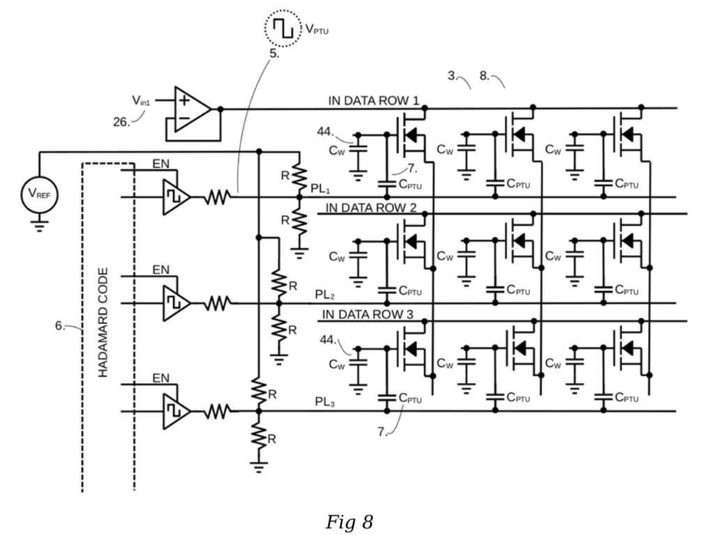

*Fig 8 from patent application: Novel perturbation carrier injection circuit. Fast complementary Walsh-Hadamard codes (6) drive capacitive coupling nodes ($C_\text{PTU}$, 7) directly onto the 2T1C analog weight memory gates ($C_W$, 44), completely independent of the input data row drivers ($V_\text{in}$, 26). This novel injection topology enables high-SNR feedback and extraction of all column partial derivatives simultaneously in a single, tight 24 µs burst without disturbing steady-state weight retention or saturating matrix rows.*


#### Disclaimer on Audiobooks: 
The earlier podcast generation:
`pod_inverted_maml_audiobook_96k.m4a`
states that this entire system has already been fully tested and run; at the time of its generation, that was not true (NotebookLM was summarizing the patent application without knowing the real bench status). 

However, as of October 2026, the first **real baby steps on physical silicon and PCBA hardware** have now begun (validating physical Hadamard carrier modulation, DAC/Weight line dynamics, and bare-metal ADC responses).

For a more accurate overview of the architecture and vision, check the updated 52-minute audio:
#### Recommended Audiobook (52 minutes):
`Shattering_the_Memory_Wall_with_Proprioception_56k.m4a`

This version gives a much fairer and more grounded representation of the project.  


### The Atomic Triad
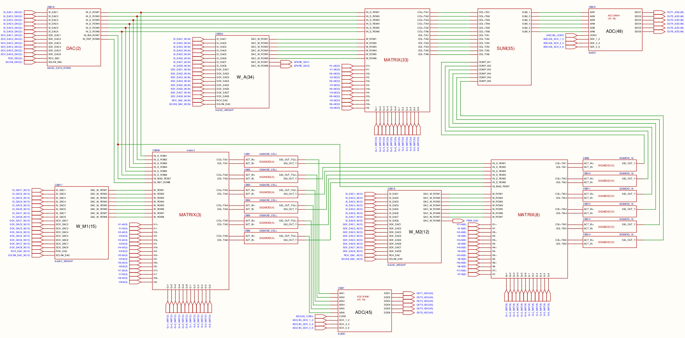
### Mutiplication cell
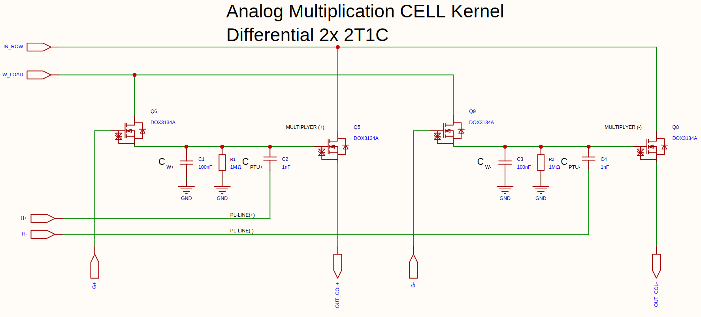
### 6x6 matrix EasyEDA
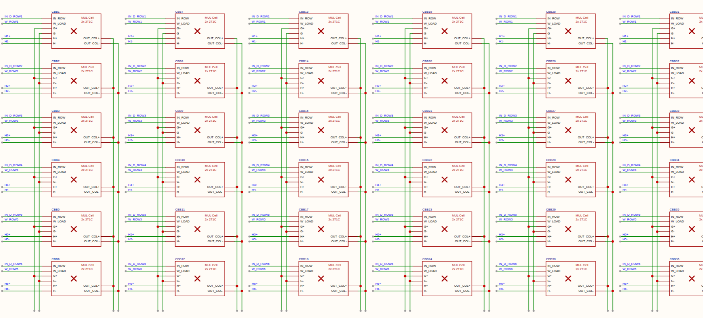
### LTspice simulation sigmoid OP-amp
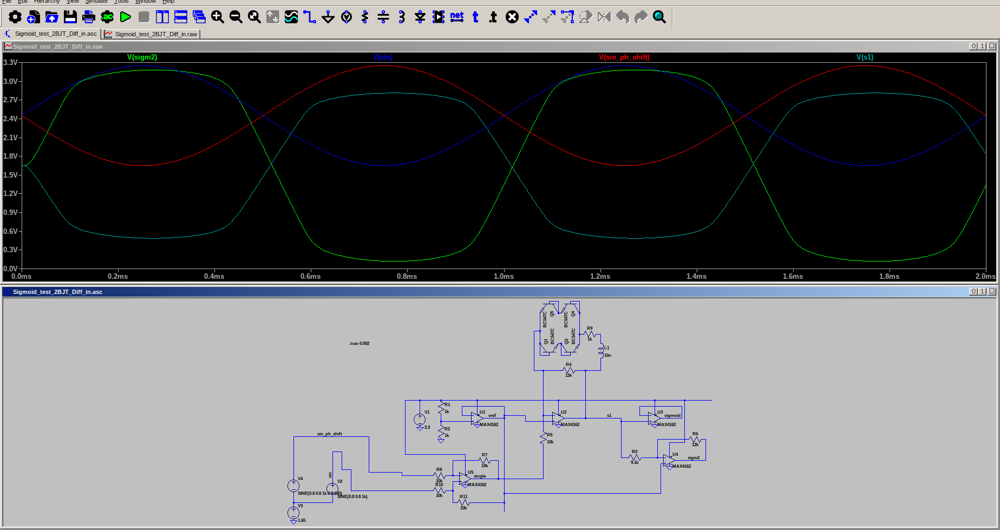
### The MATRIX ! Imagination or vision what if... "The self aware MATRIX" is possible ? :) 
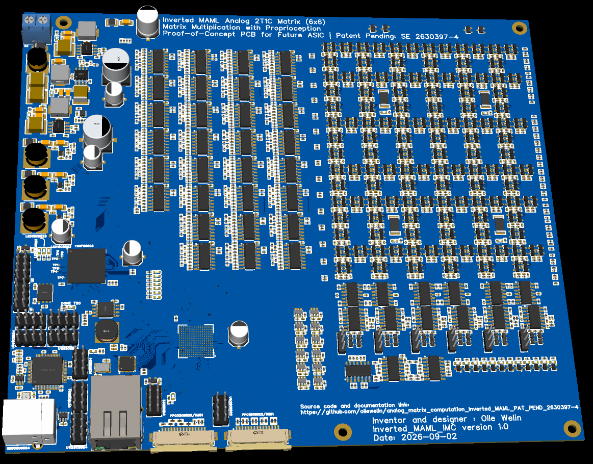
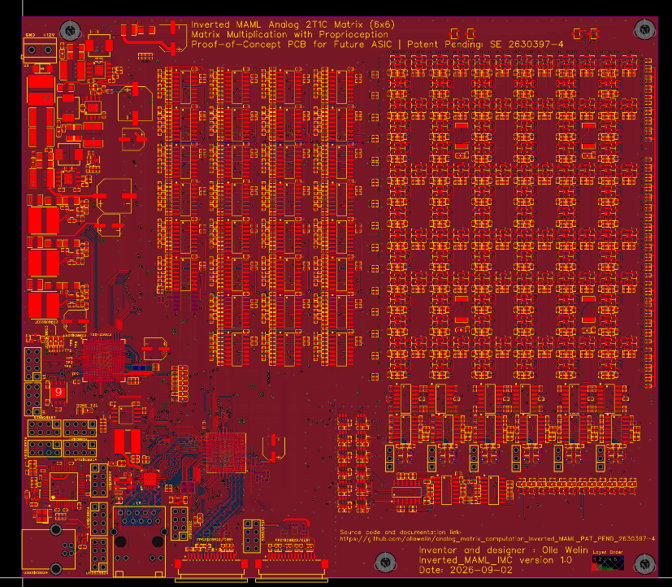
### Claude Simulation 3x6x6 PCB (NO hadamard included):
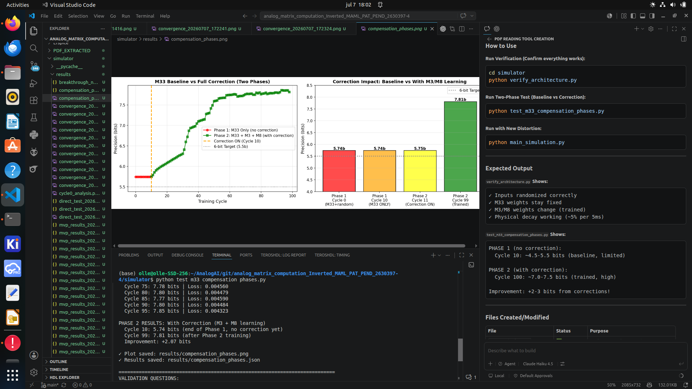

### JLCPCB manufacture placement 
T12F324 3D step is not showed here but mounted
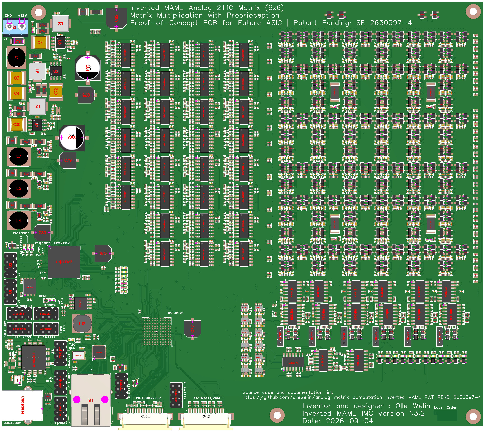
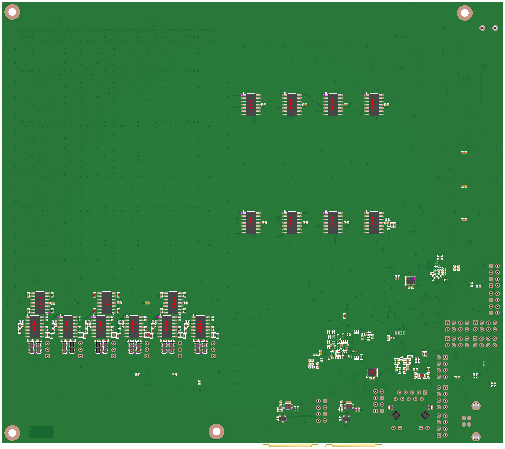

### Bringup test 1
IMPORTANT fix to get JTAG working.
1. CSI pull down need to remove both T20 (Remove R12$CBB23) and T120 (remove R169$CBB22/CBB2)
2. T120_CRESET_N patch wire between Reset circuit and T120 <--> FT2232 programmer to get auto start T120 from SIP flash
3. Bug fix 2026-09-30: missing input net T120_CRESET_N
4. 2026-10-07: Bug at Centertap 0-ohm to GND there should be 10nF to GND Eth Phy magnetics
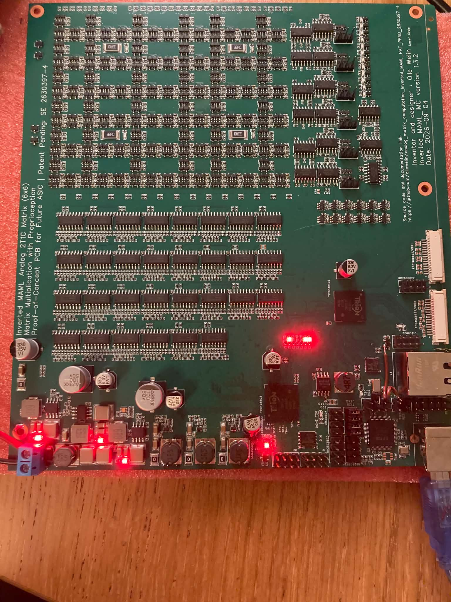

### Regenerate FPGA code with AI agent example (one prompt)
Install the Efinix software tool locally on you computer
VS code and AI agent support
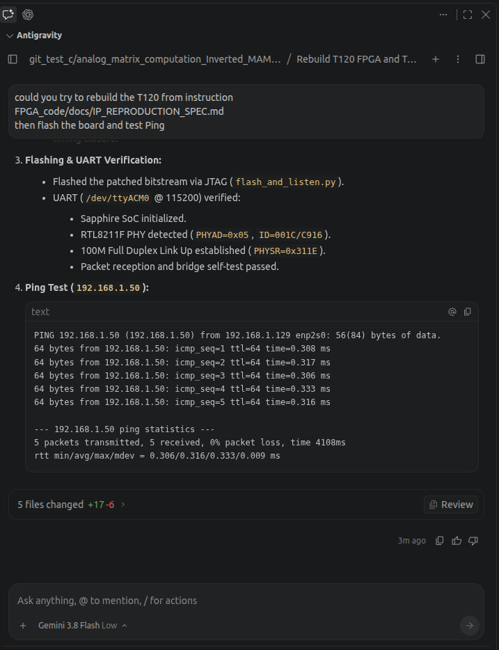

### Example timing report (125Mhz requirement passed)
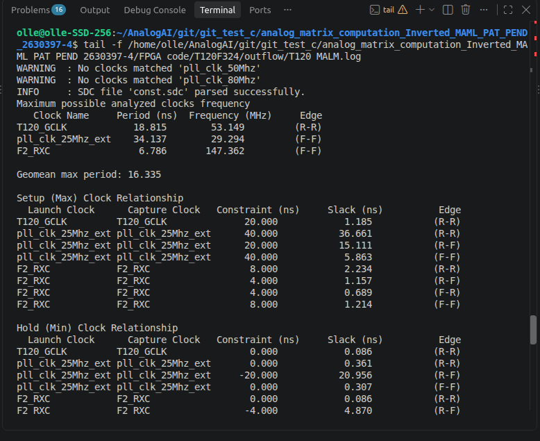

### Hardware Bringup: DAC Data Row Op-Amp Sag vs. Confirmed Flawless Weight DAC Buffers (2026-10-22 Update)

During physical bench bringup of the 3x 6x6 matrix PCB, direct oscilloscope probing clarified the exact electrical boundary between the DAC Data row drivers and the Weight charging drivers:


#### Key Circuit Findings:
1. **Weight DAC Buffers (`MCP6024T-I/SL`) — Confirmed 100% Flawless (No Upgrade Needed):**
   - The 6 voltage levels seen on the Blue weight line (`W_M1_ROW1`) during the refresh period are **not voltage droop or ripple**—they are the **6 sequential column update levels** charging columns 0 through 5 one by one across the row.
   - Pressing the GUI weight randomization button confirms that each of the 6 levels steps cleanly, sharply, and flatly to its new target voltage without distortion.
   - Because the weight buffers charge only a single 100 nF capacitor at a time (sequential time-multiplexing), the standard `MCP6024` has more than enough current drive.
   - **Conclusion:** The original Weight DAC buffer design is 100% correct as built. Adding external 100 nF reservoir capacitors or swapping weight op-amps is completely unnecessary.

2. **DAC Data Row Buffers (`DAC2_D_ROW*`) — Current Starvation Under Multi-Column Load:**
   - Unlike the weight buffers, each **In-Data row buffer (`DAC2`)** continuously drives the drain channels of all connected columns in parallel across Matrix 3, Matrix 8, and Matrix 33 simultaneously.
   - Under dynamic multi-column conduction, cumulative channel current exceeds the linear sourcing capacity of the `MCP6024` (<10 mA), causing the row voltage to sag by $\sim 188\text{ mV}_\text{pp}$.
   - **Conclusion:** Only the `DAC2` In-Data row buffer op-amps (`U1$CBB16`, `U2$CBB16`) required replacement. This upgrade was physically executed on **2026-10-23** by soldering **`MCP664-E/SL`** ($\pm 70\text{ mA}$, $60\text{ MHz}$) onto the board, completely eliminating row voltage sag. Weight op-amps remain the original `MCP6024`.

#### High-Current SOIC-14 Upgrade (Executed on DAC Data Row Buffers Only):
The `MCP6024T-I/SL` uses the standard **14-pin SOIC Quad Op-Amp pinout**. Drop-in replacements evaluated and installed for the `DAC2` data row buffers (`U1$CBB16`, `U2$CBB16`) include:

| Part Number | Manufacturer | Package | Output Current Capability | Bandwidth (GBW) | Status & Role |
| :--- | :--- | :--- | :--- | :--- | :--- |
| **MCP6024T-I/SL** | Microchip | SOIC-14 | $< 10\text{ mA}$ linear drive | $10\text{ MHz}$ | **Retained:** 100% adequate for Weight lines; sagged $\sim 188\text{ mV}$ on parallel Data lines |
| **MCP664-E/SL** | Microchip | SOIC-14 | **$\pm 70\text{ mA}$ per channel** | **$60\text{ MHz}$** | **INSTALLED (2026-10-23):** Fast settling ($32\text{ V/\mu s}$), stiff voltage rails, zero row sag |
| **AD8534ARZ** | Analog Devices | SOIC-14 | **$\pm 250\text{ mA}$ per channel** | $3\text{ MHz}$ | Alternate evaluated candidate |
| **OPA4310IDR** | Texas Instruments | SOIC-14 | **$\pm 150\text{ mA}$ per channel** | $3\text{ MHz}$ | Alternate evaluated candidate |

### Corrected Hadamard Carrier Modulation: 24 µs Contiguous Burst at 2.0 ms Post-Refresh

Oscilloscope measurements initially revealed that the legacy Hadamard perturbation suffered from multi-hundred-microsecond pulse trains with unintended tri-state gaps between pulses. This distorted the measurement window across the analog memory capacitor decay curve.

The Hadamard sequence was rebuilt in both RTL (`t120_hbus_seq.sv`, `t120_inter_fpga_bridge.sv`, `t120_analog_io_ctrl.sv`) and C firmware (`maml_platform.c`):
1. **Contiguous 24.00 µs Table (2 x 6 = 12 pulses x 2.00 µs):** Zero tri-state gaps between pulses. 
   - 6 pulses for the (+) orthogonal Hadamard basis (12.00 µs).
   - 6 pulses for the complementary (-) basis (12.00 µs).
2. **Deterministic Tri-State Boundary:** The outputs remain actively driven throughout the full 24.00 µs burst. On the 13th word (`0x8000`), the hardware immediately switches all pins to High-Z (tri-state) until the next 10 ms refresh period.
3. **Optimized Timing Window (t = 2.0 ms Post-Refresh):** Executing the 24 µs burst early at t = 2.0 ms positions the measurement on the DAC data line was fairly flat at this test, stable plateau of the DAC and weight lines before capacitor leakage causes current droop what lead DAC OP driver to rise voltage to R-2R level at then end close to refresh pulses.
4. **End-of-Pulse ADC Sampling (t = 1.96 µs):** Differential SAR ADCs (`XC2361A`, `ADC_45` & `ADC_49`) sample at the end of each 2.00 µs pulse right before the next pulse transition.

#### Oscilloscope Verification: Corrected Hadamard Carrier Lines

**First Hadamard Line Probed:**
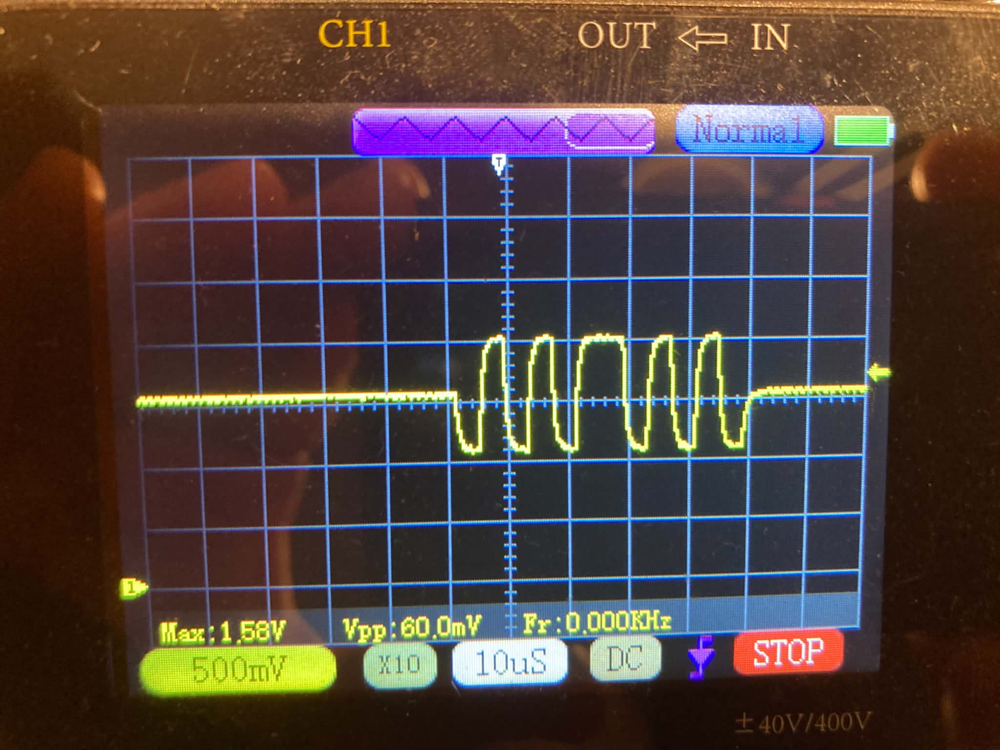

**Another Hadamard Line Probed:**
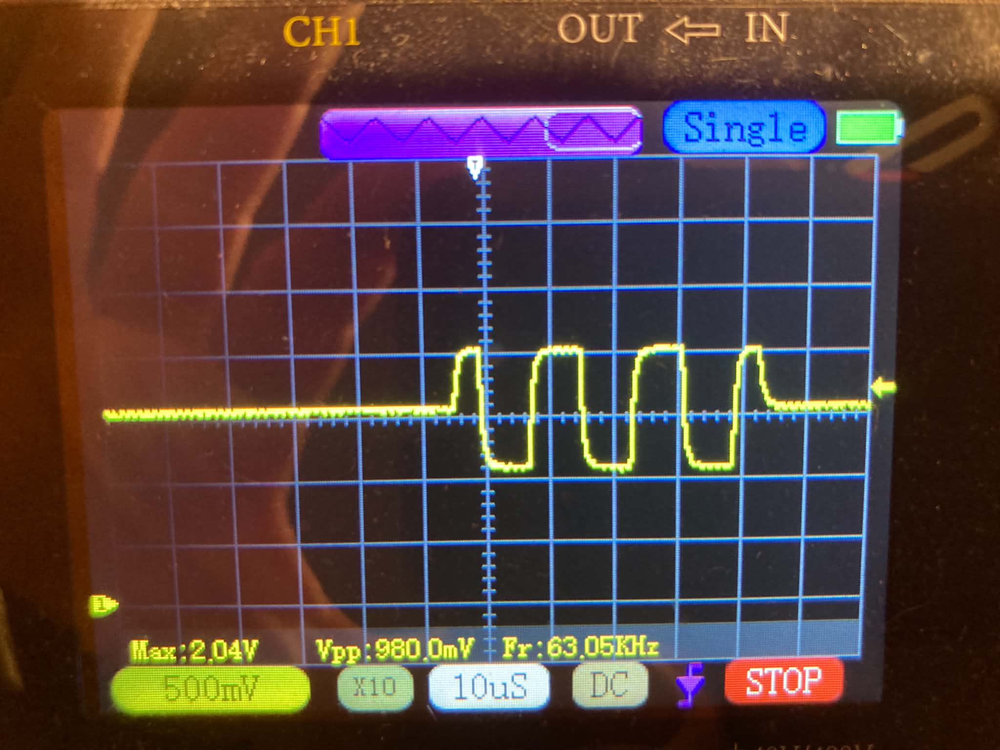

#### Code Example: 2x6 Hadamard Matrix & Hardware Sequencer Configuration

```c
/* ============================================================================
 * Contiguous 2x6 = 12-Pulse Hadamard Table (2.00 us per pulse = 24.00 us total)
 *   - (+) Table (pulses 0..5, 12.00 us): 6 orthogonal non-DC Walsh-Hadamard rows
 *   - (-) Table (pulses 6..11, 12.00 us): exact bitwise complement (~(+) & 0x7FFF)
 *   - Step 12 (at t = 24.00 us): 0x8000 (Tri-State Hi-Z exit until next 10 ms cycle)
 *   - ZERO tri-state gaps between the 12 pulses!
 *   - ADC_45 & ADC_49 sample at t = 1.96 us (end of each 2.00 us pulse)
 * ============================================================================ */
static const uint16_t HADAMARD_2X6_POS[6] = {
    0x2AAAu, /* p=0: basis row 1 */
    0x1999u, /* p=1: basis row 2 */
    0x4CCCu, /* p=2: basis row 3 */
    0x0787u, /* p=3: basis row 4 */
    0x52D2u, /* p=4: basis row 5 */
    0x61E1u  /* p=5: basis row 6 */
};

/* Load contiguous 12 pulses + Hi-Z termination into T120 H-bus sequence RAM */
for (int p = 0; p < 6; p++) {
    uint16_t w_pos = HADAMARD_2X6_POS[p] & 0x7FFFu;
    uint16_t w_neg = (~HADAMARD_2X6_POS[p]) & 0x7FFFu;
    *(volatile uint32_t *)(T20_BRIDGE_BASE + T20_H_TABLE + 4 * p)       = (uint32_t)w_pos;
    *(volatile uint32_t *)(T20_BRIDGE_BASE + T20_H_TABLE + 4 * (p + 6)) = (uint32_t)w_neg;
}
*(volatile uint32_t *)(T20_BRIDGE_BASE + T20_H_TABLE + 4 * 12) = 0x00008000u; /* Exit to Hi-Z */

/* Configure 10.0 MHz T20_CLK9, 2.000 us pulse period, and 13 words */
T20_REG(T20_CLK_PERIOD) = 5u;   /* 10.0 MHz CLK9 (100 ns period) */
T20_REG(T20_H_PERIOD)   = 20u;  /* 20 cycles = 2.000 us exact pulse width */
T20_REG(T20_H_COUNT)    = 13u;  /* 12 active pulses (24.00 us) + 1 Hi-Z word */
```

---

### Weight Line Transient Loading During Refresh & 100 nF Memory Cell Probing — 2026-10-18

To understand how the `100 nF` 2T1C gate storage capacitors interact with the Weight charging bus (`W_M1_ROW1`) during the refresh phase, two dual-channel oscilloscope measurements were captured on **2026-10-18** (`500 mV/div`, `2 ms/div`):

- **Channel 2 (Blue):** Probed directly on the Matrix 3 Weight row line **`W_M1_ROW1`**.
- **Channel 1 (Yellow):** Probed directly at the internal **`100 nF` memory capacitor storage node** (`\$1I15\\\$1I2\\\$2N1` and a second memory cell along the same row).

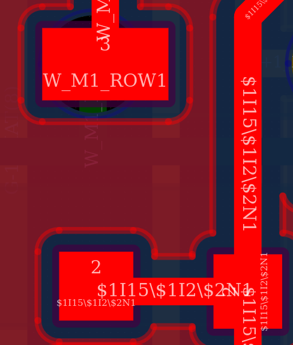

#### 1. First `100 nF` Memory Cell (`\$1I15\\\$1I2\\\$2N1`) vs. `W_M1_ROW1`:
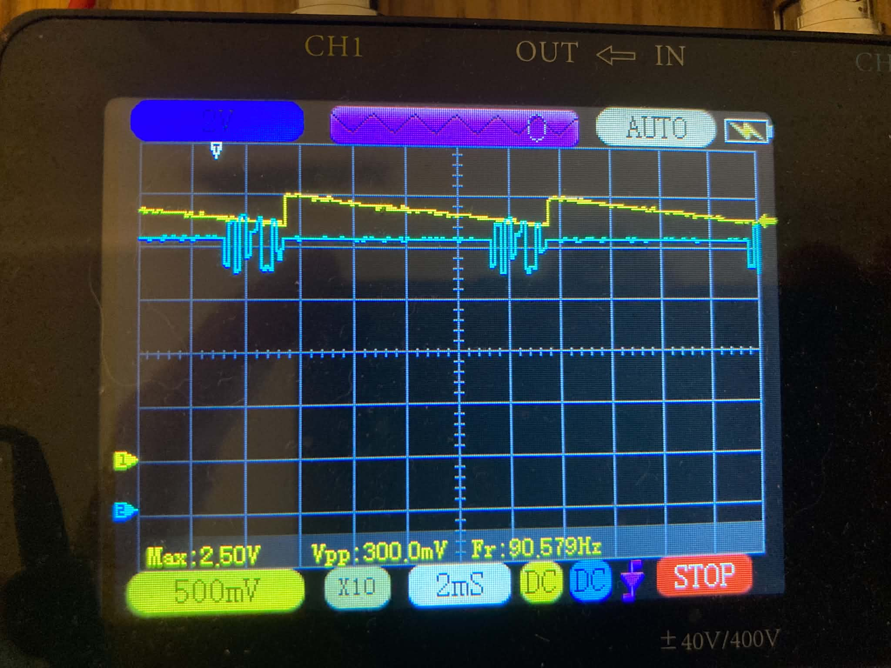

#### 2. Second `100 nF` Memory Cell on the Same Row vs. `W_M1_ROW1`:
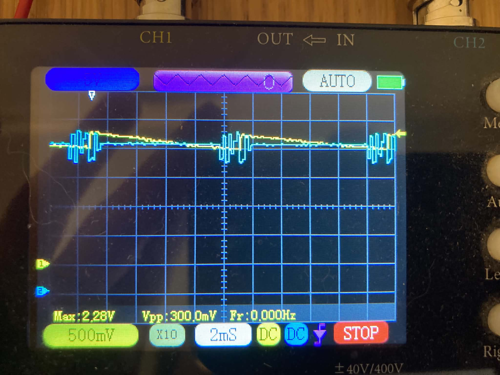

#### 3. Cross-Coupled Driver Sag & Gate Leakage Capture — DAC2 In-Data Row 1 vs. Matrix 3 Weight Memory Cell (`C1_CBB49_CBB31`):
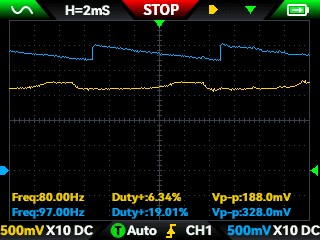

- **Channel 1 (Yellow, 500 mV/div, 2 ms/div):** In-Data Row 1 input line (**`DAC2_D_ROW1`**) driven by the DAC buffer op-amp.
- **Channel 2 (Blue, 500 mV/div, 2 ms/div):** Last weight storage capacitor node on Column 1 of **Matrix(3)** (**`C1_CBB49_CBB31`** / `C1$CBB49/CBB31` in sheet `CBB49 = matrix3`, `CBB31 = MUL_CELL_2T1C`).
- **Physical Phenomena Confirmed on Oscilloscope:**
  1. **Weight Memory Decay & Refresh Pulse (Blue):** The Blue trace clearly captures the sharp $100\text{ Hz}$ ($10\text{ ms}$ period) autonomous refresh edge charging the $100\text{ nF}$ analog memory gate up to its target voltage, followed by the predictable continuous decay ($\sim 328\text{ mV}_\text{pp}$) over the $10\text{ ms}$ interval between refresh cycles.
  2. **Op-Amp Output Sag & Dynamic Crosstalk Loading (Yellow):** The Yellow trace shows the `DAC2_D_ROW1` buffer sagging by $\sim 188\text{ mV}_\text{pp}$ synchronously when columns switch and during matrix operations. This confirms that the current `MCP6024` quad op-amp lacks sufficient current-sourcing capability ($<10\text{ mA}$) to maintain a stiff, invariant voltage rail under dynamic multi-cell loading.
  3. **Targeted Scope of Upgrade:** Replacing only the In-Data row buffers (**`DAC2`**, `U1$CBB16`, `U2$CBB16`) with high-current op-amps (**`MCP664-E/SL`**, completed 2026-10-23) eliminated the 188 mVpp row sag. The Weight buffers remain original `MCP6024` as their drive is verified fully adequate.

#### Key Findings & Targeted Driver Upgrade (2026-10-22 Update):
1. **PCB Copper Traces Are Free of Resistance:**
   - Both traces confirm that PCB trace resistance is negligible.
   - The multi-level staircase on the **Blue** trace (`W_M1_ROW1`) represents the 6 sequential column refresh levels being charged one by one, with flat, stable plateaus across all 6 steps.
2. **Weight Buffers Work Flawlessly — Only Data Buffers Require Upgrade:**
   - **Weight Path Confirmed Solid:** The `MCP6024` op-amp has ample current capability to charge individual 100 nF memory cells sequentially. No extra 100 nF reservoir capacitors or op-amp replacements are needed on the Weight lines.
   - **Data Row Buffers (`DAC2`):** Because each `DAC2` buffer supplies continuous channel current to all conducting multiplier columns in parallel, upgrading `DAC2` buffers to high-current pin-compatible quad op-amps (`AD8534ARZ` / `MCP664-E/SL`) will stiffen the row rails and eliminate sag.

---

### Manual Verification with Efinix Logic Analyzer (`la0` & GTKWave) — 2026-10-17 / 2026-10-18

To independently verify the bare-metal hardware signals without relying solely on software telemetry, a dedicated Efinity Logic Analyzer build (`FPGA_code/T120F324_LA`) was synthesized and manually checked in the Efinix Debugger GUI and GTKWave:

#### 1. Downsampled Capture Showing Full 12-Step Hadamard Burst (`0..B`) & Bare-Metal `ADC_45` / `ADC_49` Response (2026-10-17):
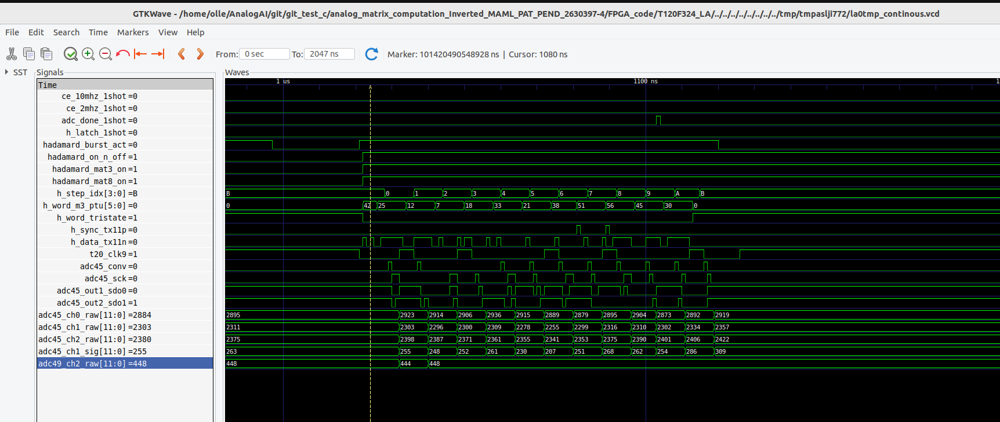

#### 2. Full-Speed `50 MHz` (`20 ns`) Sampling Showing Individual `25 MHz` SAR ADC SPI Clocks, MISO Bits & One-Shot Strobes (2026-10-18):
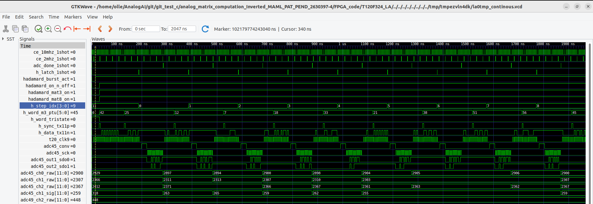

- **Dates:** 2026-10-17 & 2026-10-18
- **Manual Check Confirmed:** Both the downsampled burst capture and the full-speed `50 MHz` (`Capture Mode = Always`) capture confirm the live Hadamard carrier wave function (`h_step_idx[3:0] = 0..B`, `h_word_m3_ptu[5:0]`, `hadamard_burst_act = 1`, `hadamard_on_n_off = 1`), the `10 MHz` `t20_clk9` bursts, the `25 MHz` `adc45_sck` / `adc45_conv` / `adc45_out1_sdo0` / `adc45_out2_sdo1` SPI frames, and the resulting 12-bit deserialized words on `ADC_45` (`adc45_ch0_raw`, `adc45_ch1_raw`, `adc45_ch2_raw`) and `ADC_49` (`adc49_ch2_raw`).

---

### Single-Cell Multiplier Dynamic Evaluator GUI & Real-Time 3D Response — 2026-10-20

To characterize individual crosspoint Dual-2T1C multiplier cells without simulations, a dedicated hardware evaluation suite (`gui/maml_cell_evaluator_gui.py` and `FPGA_code/scripts/test_multiplier_time_dynamics.py`) was introduced to command the live T120 SoC bare-metal registers over UDP:

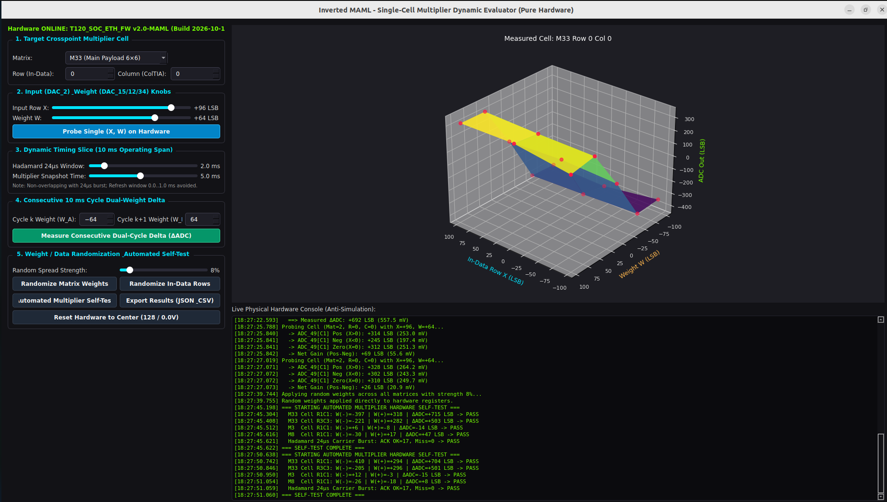

- **Pure Physical Measurement (Anti-Simulation Enforcement):** All grid points and voltage curves are sampled 100% directly from the real analog silicon via the 12-bit ADCs (`ADC_45` / `ADC_49`). Synthetic mock data and software surrogate fallbacks are strictly banned.
- **Interactive 3D Transfer Characteristic Surface:** Shows the measured analog multiplier output surface across the In-Data Row range $X \in [-96, 0, +96]\text{ LSB}$ and differential weight range $W \in [-96, -48, 0, +48, +96]\text{ LSB}$ (e.g. `M33 Row 0 Col 0`).
- **Dynamic Timing & Refresh Non-Overlap:** Features independent timing sliders to position the $24\ \mu\text{s}$ Hadamard burst and multiplier sampling strobes anywhere across the $10\text{ ms}$ cycle while staying safely outside the initial $0.0\text{--}1.0\text{ ms}$ refresh window.
- **Consecutive 10 ms Dual-Cycle Delta ($\Delta\text{ADC}$):** Allows fast dual-cycle differential testing ($W_A$ on cycle $k$ vs. $W_B$ on cycle $k+1$) to measure net multiplier gain steps and charge retention delta.
- **Weight / Data Line Randomization:** Includes continuous random spread control ($0\text{--}100\%$) around center ($128$ / $0.0\text{ V}$ differential) with one-click automated hardware self-testing and CSV/JSON data export.

---

### Autonomous Silicon Characterization & Local Inner-Loop Neural Compensation — 2026-10-21

On **2026-10-21**, the AI agent research suite conducted a comprehensive suite of automated empirical characterizations and deployed a single-point ($t_0 = 3.0\text{ ms}$) local neural network compensation test executing 100% inside the T120 RISC-V SoC:

- **Complete Scientific PDF Report:** [`FPGA_code/docs/MAML_ANALOG_SILICON_SCIENTIFIC_REPORT.pdf`](FPGA_code/docs/MAML_ANALOG_SILICON_SCIENTIFIC_REPORT.pdf)
- **Technical Markdown Report:** [`FPGA_code/docs/MAML_ANALOG_SILICON_SCIENTIFIC_REPORT.md`](FPGA_code/docs/MAML_ANALOG_SILICON_SCIENTIFIC_REPORT.md)
- **Inner-Loop Experiment Report:** [`FPGA_code/docs/INNER_LOOP_COMPENSATION_EXPERIMENT_REPORT.md`](FPGA_code/docs/INNER_LOOP_COMPENSATION_EXPERIMENT_REPORT.md)
- **Raw Telemetry Datasets:** [`FPGA_code/docs/maml_inner_loop_results.json`](FPGA_code/docs/maml_inner_loop_results.json) and [`FPGA_code/docs/maml_scientific_investigation_data.json`](FPGA_code/docs/maml_scientific_investigation_data.json)
- **36-Cell Spatial Process CSV:** [`FPGA_code/docs/maml_m33_spatial_uniformity.csv`](FPGA_code/docs/maml_m33_spatial_uniformity.csv)
- **Continuous ADC Logic Analyzer Bitstream:** [`FPGA_code/bitstreams_archive/20261021_T120F324_LA_ContinuousADC/`](FPGA_code/bitstreams_archive/20261021_T120F324_LA_ContinuousADC/)

> ⚠️ **IMPORTANT INVENTOR STATEMENT & VERIFICATION DISCLAIMER:**  
> **Olle Welin has NOT yet manually verified these statements and claims on the bench.**  
> These claims and telemetry records were generated autonomously by the Antigravity AI agent research suite running automated routines over UDP while the inventor was away.  
> **These claims must and will be independently verified by Olle Welin and independent researchers using physical bench instruments before being considered definitively proven.**

---

### Bench Verification Update: Weight DAC Line Operation Confirmed Flawless — 2026-10-22

Direct bench oscilloscope probing conducted by Olle on **2026-10-22** clarified and confirmed that the **Weight DAC lines (`W_M1_ROW1`) operate exactly as originally designed**:

#### 1. Oscilloscope Capture — Blue Weight Row 1 Line vs. Yellow 100 nF Memory Capacitor (Example 2):
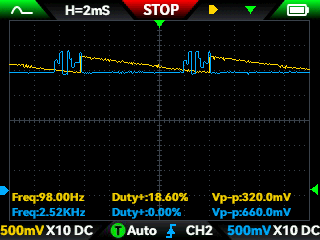

#### 2. Oscilloscope Capture — Clean Flat Sequential Column Steps (Example 3):
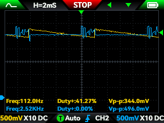

#### 3. Oscilloscope Capture — Additional Weight Randomization Transition (Example 4):
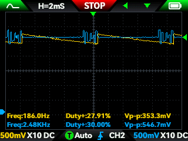

#### Concise Technical Summary of Bench Observations:
- **6 Discrete Flat Voltage Levels in the Refresh Train:**  
  The multi-level waveform seen on the **Blue trace (`W_M1_ROW1`)** is **not droop or distortion**—it is the expected sequence of **6 distinct programmed column weight voltages** being driven one by one during the column refresh phase.
- **Clean Level Transitions on Random Weight Update:**  
  When pressing the GUI "Randomize Weights" button, all 6 levels on the Blue line step sharply and settle onto completely flat plateaus matching the new target values. There are no voltage sags, settling tails, or "shadows".
- **Standard `MCP6024` Op-Amp Is 100% Sufficient for Weight Lines:**  
  Because the weight DAC buffer only charges **one single 100 nF gate capacitor at a time** (sequentially multiplexed across the 6 columns), the linear current drive of the standard `MCP6024` buffer is fully adequate.
- **No Extra Reservoir Capacitors Needed:**  
  Adding 100 nF reservoir capacitors to the weight buffer outputs is completely unnecessary; the original schematic and PCB layout for the Weight lines is 100% sound.
- **Upgrade Isolated Strictly to Data Lines (`DAC2_D_ROW*`):**  
  The current-sourcing limitation was **strictly isolated to the In-Data row buffers (`DAC2`)**, which must supply continuous drain current to all conducting columns in parallel. Only the `DAC2` quad op-amps (`U1$CBB16`, `U2$CBB16`) were replaced with high-current units (**`MCP664-E/SL`**, completed 2026-10-23). Weight buffers remain original `MCP6024`.

---

## 🔗 Architectural Disclosure & Defensive Publication: Multi-Layer Daisy-Chained "Atomic Triads" (Deep Analog Pipeline with Sparse Digital State Propagation)
**Publication Date:** 2026-10-27 | **Inventor:** Olle Welin | **Reference:** Extension to Patent Pending SE 2630397-4 (Priority: 2026-06-03)

*This section constitutes an explicit public disclosure (Prior Art) of the multi-layer scaling topology for the Inverted MAML Analog In-Memory Computing (AIMC) architecture, ensuring complete freedom to operate across arbitrarily deep neural networks.*

### 1. Elimination of Intermediate Full-Bandwidth DAC(2) and ADC(49)
In a multi-layer neural network or deep matrix pipeline comprising $N$ cascaded **Atomic Triads** (Triad 1, Triad 2, $\dots$, Triad $N$), intermediate full-bandwidth digital-to-analog and analog-to-digital conversion is completely eliminated during operational payload inference:

* **Single Entry / Single Exit Full-Bandwidth Conversion:**  
  Only the first triad (Triad 1) requires a full-bandwidth input DAC(2) to convert the external digital input vector $X^{(1)}$ into the analog domain. Similarly, only the final triad (Triad $N$) requires a full-bandwidth output ADC(49) to digitize the final layer's output vector $Z^{(49, N)}$ at full payload throughput:

$$X^{(1)} \xrightarrow{\text{DAC}_2} \text{Triad}_1 \xrightarrow{\text{Analog}} \text{Triad}_2 \xrightarrow{\text{Analog}} \dots \xrightarrow{\text{Analog}} \text{Triad}_N \xrightarrow{\text{ADC}_{49}} Z^{(49, N)}$$

* **Uninterrupted Analog Payload Daisy-Chain:**  
  For all intermediate boundaries ($L = 1, \dots, N-1$), the combined analog output vector from the summing stage SUM(35) of Triad $L$ (where the primary Matrix 33 output and the second correction layer Matrix 8 $\to$ Sigmoid 10 output meet) is routed **directly in the analog domain** to the input row buffers (26) of the subsequent Triad $L+1$ (driving both its first correction Matrix 3 and its primary Matrix 33 in parallel).

* **Inter-Triad Analog Conditioning:**  
  Where required by transistor triode linear bounds (e.g., mapping the SUM(35) / ColTIA output swing around the $+1.65\text{ V}$ virtual ground to the optimal $250\text{ mV}$ linear row $V_{\text{ds}}$ envelope of the next stage), passive resistive attenuation, AC/DC coupling, or linear unity/scaled op-amp buffering is applied directly on the analog inter-triad bus without digitization.

### 2. Sparse Digital State Propagation for Autonomous Multi-Triad Calibration
While the payload signal propagates continuously through all $N$ triads at full analog bandwidth with near-zero latency, each intermediate triad (Triad 1, $\dots$, Triad $N-1$) retains only **low-power, sparse-sampling (low duty-cycle) ADCs**: specifically, a **Sparse ADC(45)** (between correction Layer 1 and Layer 2) and a **Sparse ADC(49)** tapped at the analog output node SUM(35) (inter-triad junction).

During the short, periodic Hadamard calibration windows (20, 24, e.g., 28 µs snapshot windows at $t = 5.0\text{ ms}$ within a 10 ms / 100 Hz refresh cycle, or across multi-strata batch intervals):

1. **Sparse Inter-Layer Readout:**  
   The digital controller of Triad $L$ samples its Sparse ADC(49) to capture an instantaneous digital snapshot vector $Z_{\text{snap}}^{(49, L)}$ of its outgoing analog vector:

$$Z_{\text{snap}}^{(49, L)} = \left[ z_1^{(49, L)},\, z_2^{(49, L)},\, \dots,\, z_6^{(49, L)} \right]^T$$

2. **Digital State Forwarding:**  
   Triad $L$ propagates this sparse digital vector $Z_{\text{snap}}^{(49, L)}$ over a low-bandwidth digital control bus to the digital controller (9) of the downstream Triad $L+1$.

3. **Downstream Reference Truth & Target Synthesis:**  
   Because $Z_{\text{snap}}^{(49, L)}$ constitutes the exact instantaneous input vector entering Triad $L+1$ during that snapshot window ($X^{(L+1)} = Z_{\text{snap}}^{(49, L)}$), the digital controller of Triad $L+1$ computes its local deterministic target vector:

$$Z_{\text{target}}^{(L+1)} = f_{\text{ref}, L+1}\big(Z_{\text{snap}}^{(49, L)}\big) = W_A^{(33, L+1)} \cdot Z_{\text{snap}}^{(49, L)}$$

   from the frozen digital reference weights $W_A^{(33, L+1)}$, and evaluates its own local column error:

$$Er_j^{(49, L+1)} = z_{\text{snap}, j}^{(49, L+1)} - Z_{\text{target}, j}^{(L+1)}$$

4. **Implicit Analog Input Multiplication & Carrier Search (Equations 1–7):**  
   Within Triad $L+1$, orthogonal Hadamard weight perturbation ($V_{\text{PTU}}$ via $C_{\text{PTU}}$) is injected onto Matrix 8 and Matrix 3 during time-separated sub-windows. By virtue of the physical MOSFET triode multiplication at each crosspoint (Equations 2 & 7):

$$\frac{\partial \mathcal{L}}{\partial W_{i,j}^{(8, L+1)}} = \left\langle \frac{\partial z_j^{(49, L+1)}}{\partial V_i^{\text{PTU}}} \right\rangle_{\text{Hadamard}} \cdot Er_j^{(49, L+1)}$$

   the incoming analog signal from Triad $L$ automatically modulates the Hadamard perturbation in hardware without requiring full-bandwidth input digitization. The Sparse ADC(45) and Sparse ADC(49) in Triad $L+1$ extract the local gradients and perform the regularized maximum carrier wave search ($k = \arg\max_i |x_i^{(8)}|$, Equations 5 & 6) exactly as in a standalone triad.

### 3. Domino Error Cancellation & Power Scaling across Arbitrary Depth
This daisy-chained architecture covers all sequential, pipelined, staggered, and synchronous/asynchronous multi-triad calibration schedules (including True Multi-Strata Batch accumulation across $K$ vectors and $M$ temporal strata):

* **Local Error Truncation (No Exponential Analog Drift):**  
  Each Triad $L$ autonomously converges its local correction matrices (Matrix 3 and Matrix 8) to match its ideal digital transfer function ($\sim 7+\text{ bits}$ ENOB), while any residual analog offset, buffer skew, or thermal drift crossing the inter-triad boundary is automatically observed and compensated within Triad $L+1$.

* **Radical Power & Silicon Area Reduction:**  
  For an $N$-layer deep analog processor, $(N - 1)$ full-bandwidth input DAC arrays (DAC(2)) are completely removed, and $(N - 1)$ full-bandwidth output ADC arrays (ADC(49)) are replaced by ultra-low-duty-cycle sparse calibration ADCs (or a single time-multiplexed sparse calibration ADC shared across multiple triads via an analog mux).


