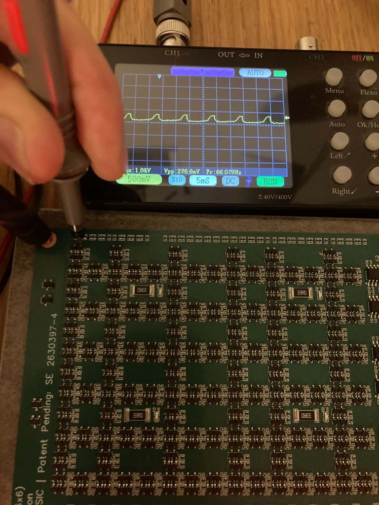

# Analog Matrix Multiplication with Proprioception
### Patent pending: document inverterad MAML_12_Eng.pdf translated
`inverterad MAML_12_Eng.pdf`


#### PATENT APP NO: SE 2630397-4
#### STATUS: PATENT PENDING
#### INVENTOR: OLLE WELIN
#### PRIORITY DATE: 2026-06-03
## Analog 2T1C Matrix with Inverted Meta-Learning (MAML)

## Youtube Video Audio:
https://youtu.be/LbWriQ0J6QY?si=GyIZ1UnNZuVdLi54

### Project Vision: Redefining Efficient Inference

The primary goal of this project is to drastically reduce power consumption for Neural Network inference. By moving away from energy-intensive digital data movement and leveraging In-Memory Computing (IMC), my aim to overcome the traditional "memory wall."

My approach combines analog matrix hardware with a novel Inverted Meta-Learning (MAML) algorithm. Instead of adapting to external input data, my system uses intrinsic meta-learning to dynamically calibrate and compensate for hardware non-idealities—such as thermal drift, component aging, and voltage leakage—in real-time during ongoing operations.

### The Adventure of Discovery
Working with analog computing is an act of balancing physics and precision. Very funny and exciting project!

### Status and Disclaimer
2026-06-10: Nothing is yet tested (little simulated 2026-06). This is currently only a plan to build a test board with a 3x 6x6 matrix PCB at 500 kHz throughput, 8-bit R-2R DACs, 10-bit SAR ADCs, a Trion FPGA, and N-channel transistors.
# Disclamer 2026-10-15 All measurement so far is made by AI agent and I have not get time to verify anything more then basics

## DAC data line seems not good with my oscilloscope
## I do NOT trust AI measurement data result. 2026-10-15  
## Stay tuned if you are curious 

#### Disclaimer: 
The 
`pod_inverted_maml_audiobook_96k.m4a`
states that this has already been tested and run; this is not true. NotebookLM is simply trying to summarize the patent document without knowing the current status.

Updated audiobook the:
#### Resonable good audiobook 52 minutes:
`Shattering_the_Memory_Wall_with_Proprioception_56k.m4a`

Is better and reflect this project more fair I think.  


### The Atomic Triad

### Mutiplication cell

### 6x6 matrix EasyEDA

### LTspice simulation sigmoid OP-amp

### The MATRIX ! Imagination or vision what if... "The self aware MATRIX" is possible ? :) 


### Claude Simulation 3x6x6 PCB (NO hadamard included):


### JLCPCB manufacture placement 
T12F324 3D step is not showed here but mounted


### Bringup test 1
IMPORTANT fix to get JTAG working.
1. CSI pull down need to remove both T20 (Remove R12$CBB23) and T120 (remove R169$CBB22/CBB2)
2. T120_CRESET_N patch wire between Reset circuit and T120 <--> FT2232 programmer to get auto start T120 from SIP flash
3. Bug fix 2026-09-30: missing input net T120_CRESET_N
4. 2026-10-07: Bug at Centertap 0-ohm to GND there should be 10nF to GND Eth Phy magnetics


### Regenerate FPGA code with AI agent example (one prompt)
Install the Efinix software tool locally on you computer
VS code and AI agent support


### Example timing report (125Mhz requirement passed)


### Hardware Bringup & Oscilloscope Discovery: DAC Data & Weight Op-Amp Current Drive Limitation

During physical bench bringup of the 3x 6x6 matrix PCB, direct oscilloscope probing on the **DAC Data row lines and Weight charging lines** (behind the `MCP6024T-I/SL` buffer op-amps) revealed that the **output current capability of the DAC Data and Weight buffer op-amps is too low** (whereas the column TIA stages are not the primary bottleneck):



#### Oscilloscope Observations:
- **R-2R DAC output before buffer:** Clean, stable DC output directly at the R-2R ladder.
- **DAC Data line & Weight line after op-amp buffer:** Periodic $\sim 250\text{--}276.6\text{ mV}_\text{pp}$ voltage swing repeating at $100\text{ Hz}$ ($10\text{ ms}$ period, $1.84\text{ V}$ peak).
- **Behavior as memory leaks out:** When the $100\text{ nF}$ 2T1C weight capacitors are charged, the matrix draws heavy current from the **DAC Data line** op-amp (which has to supply all active `DOX3134A` multiplier channels across the row in parallel across the 3 matrices) and the **Weight line** op-amp (which has to charge the $100\text{ nF}$ capacitors). Because the `MCP6024T-I/SL` cannot source enough current, its output voltage drops by $\sim 250\text{ mV}$. As the memory capacitors leak out over the $10\text{ ms}$ decay cycle, the load current drops and the op-amp output voltage rises back up by $250\text{ mV}$ to reach the R-2R DAC target level.

#### Physics Root Cause:
1. **Insufficient Output Current Drive on DAC Data & Weight Op-Amps (`MCP6024T-I/SL`):**
   - **DAC Data Row Buffers (`DAC(2)`):** A single DAC Data row buffer drives the drain paths of all connected matrix columns simultaneously (up to $3 \times 6 = 18$ cells across Matrix 3, Matrix 8, and Matrix 33). At high weight voltages, the combined channel current exceeds the linear sourcing capability of the `MCP6024`, causing a $250\text{ mV}$ sag until the gate capacitors discharge.
   - **Weight Charging Buffers (`W_M1(15)`, `W_M2(12)`, `W_A(34)`):** Charging the large $100\text{ nF}$ gate storage capacitors within the short refresh window demands high peak charging current ($I = C \cdot dV/dt$), which hits the current limit of the `MCP6024` buffer.
   - **Column TIAs:** Each column TIA only sinks the current of a single column into virtual ground ($1.65\text{ V}$), so the TIA is not the problem—the bottleneck is strictly on the **DAC Data and Weight buffer op-amps**.

#### Pin-Compatible High-Current SOIC-14 Upgrade Options (for DAC Data & Weight Buffers):
The `MCP6024T-I/SL` uses the industry-standard **14-pin SOIC Quad Op-Amp pinout** (Pin 4 = $V_{DD}$ `+3.3V`, Pin 11 = $V_{SS}$ `GND`, Outputs on Pins 1, 7, 8, 14). Direct drop-in, pin-compatible replacements with much higher output current capability at $3.3\text{ V}$ for the DAC Data and Weight buffers include:

| Part Number | Manufacturer | Package | Output Current Capability | Bandwidth (GBW) | Supply Range | Key Advantage |
| :--- | :--- | :--- | :--- | :--- | :--- | :--- |
| **MCP6024T-I/SL** *(Current)* | Microchip | SOIC-14 | Weak linear drive ($< 10\text{ mA}$ before drop) | $10\text{ MHz}$ | $2.5\text{V} - 5.5\text{V}$ | Drops $\sim 250\text{ mV}$ on DAC Data & Weight lines |
| **AD8534ARZ** | Analog Devices | SOIC-14 | **$\pm 250\text{ mA}$ per channel** | $3\text{ MHz}$ | $2.7\text{V} - 6.0\text{V}$ | Massive current drive, Rail-to-Rail I/O, built for heavy capacitive/resistive loads |
| **OPA4310IDR** | Texas Instruments | SOIC-14 | **$\pm 150\text{ mA}$ per channel** | $3\text{ MHz}$ | $1.5\text{V} - 5.5\text{V}$ | Very strong $3.3\text{ V}$ linear drive, Rail-to-Rail I/O, thermal protection |
| **OPA4354AIDR** | Texas Instruments | SOIC-14 | **$\pm 100\text{ mA}$ per channel** | $100\text{ MHz}$ | $2.5\text{V} - 5.5\text{V}$ | High current + high speed ($150\text{ V/\mu s}$), fast capacitor charging |
| **TS924IDT** | STMicroelectronics | SOIC-14 | **$\pm 80\text{ mA}$ per channel** | $4\text{ MHz}$ | $2.7\text{V} - 12\text{V}$ | Proven high-current Rail-to-Rail driver (drives down to $32\ \Omega$ loads without droop) |

### Corrected Hadamard Carrier Modulation: 24 µs Contiguous Burst at 2.0 ms Post-Refresh

Oscilloscope measurements initially revealed that the legacy Hadamard perturbation suffered from multi-hundred-microsecond pulse trains with unintended tri-state gaps between pulses. This distorted the measurement window across the analog memory capacitor decay curve.

The Hadamard sequence was rebuilt in both RTL (`t120_hbus_seq.sv`, `t120_inter_fpga_bridge.sv`, `t120_analog_io_ctrl.sv`) and C firmware (`maml_platform.c`):
1. **Contiguous 24.00 µs Table (2 x 6 = 12 pulses x 2.00 µs):** Zero tri-state gaps between pulses. 
   - 6 pulses for the (+) orthogonal Hadamard basis (12.00 µs).
   - 6 pulses for the complementary (-) basis (12.00 µs).
2. **Deterministic Tri-State Boundary:** The outputs remain actively driven throughout the full 24.00 µs burst. On the 13th word (`0x8000`), the hardware immediately switches all pins to High-Z (tri-state) until the next 10 ms refresh period.
3. **Optimized Timing Window (t = 2.0 ms Post-Refresh):** Executing the 24 µs burst early at t = 2.0 ms positions the measurement on the flat, stable plateau of the DAC and weight lines before capacitor leakage causes droop.
4. **End-of-Pulse ADC Sampling (t = 1.96 µs):** Differential SAR ADCs (`XC2361A`, `ADC_45` & `ADC_49`) sample at the end of each 2.00 µs pulse right before the next pulse transition.

#### Oscilloscope Verification: Corrected Hadamard Carrier Lines

**First Hadamard Line Probed:**


**Another Hadamard Line Probed:**


#### Code Example: 2x6 Hadamard Matrix & Hardware Sequencer Configuration

```c
/* ============================================================================
 * Contiguous 2x6 = 12-Pulse Hadamard Table (2.00 us per pulse = 24.00 us total)
 *   - (+) Table (pulses 0..5, 12.00 us): 6 orthogonal non-DC Walsh-Hadamard rows
 *   - (-) Table (pulses 6..11, 12.00 us): exact bitwise complement (~(+) & 0x7FFF)
 *   - Step 12 (at t = 24.00 us): 0x8000 (Tri-State Hi-Z exit until next 10 ms cycle)
 *   - ZERO tri-state gaps between the 12 pulses!
 *   - ADC_45 & ADC_49 sample at t = 1.96 us (end of each 2.00 us pulse)
 * ============================================================================ */
static const uint16_t HADAMARD_2X6_POS[6] = {
    0x2AAAu, /* p=0: basis row 1 */
    0x1999u, /* p=1: basis row 2 */
    0x4CCCu, /* p=2: basis row 3 */
    0x0787u, /* p=3: basis row 4 */
    0x52D2u, /* p=4: basis row 5 */
    0x61E1u  /* p=5: basis row 6 */
};

/* Load contiguous 12 pulses + Hi-Z termination into T120 H-bus sequence RAM */
for (int p = 0; p < 6; p++) {
    uint16_t w_pos = HADAMARD_2X6_POS[p] & 0x7FFFu;
    uint16_t w_neg = (~HADAMARD_2X6_POS[p]) & 0x7FFFu;
    *(volatile uint32_t *)(T20_BRIDGE_BASE + T20_H_TABLE + 4 * p)       = (uint32_t)w_pos;
    *(volatile uint32_t *)(T20_BRIDGE_BASE + T20_H_TABLE + 4 * (p + 6)) = (uint32_t)w_neg;
}
*(volatile uint32_t *)(T20_BRIDGE_BASE + T20_H_TABLE + 4 * 12) = 0x00008000u; /* Exit to Hi-Z */

/* Configure 10.0 MHz T20_CLK9, 2.000 us pulse period, and 13 words */
T20_REG(T20_CLK_PERIOD) = 5u;   /* 10.0 MHz CLK9 (100 ns period) */
T20_REG(T20_H_PERIOD)   = 20u;  /* 20 cycles = 2.000 us exact pulse width */
T20_REG(T20_H_COUNT)    = 13u;  /* 12 active pulses (24.00 us) + 1 Hi-Z word */
```
